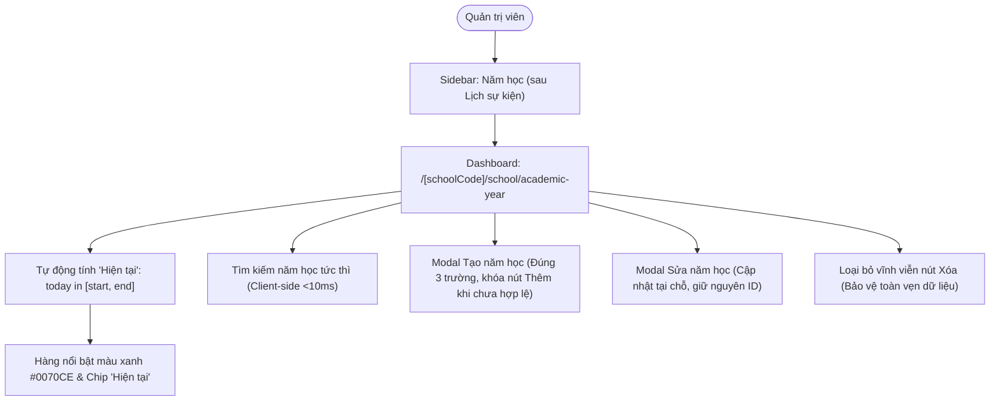

# Epic: School Academic Year (Năm Học)

## Jira Story

- Story: As a School Administrator, I want an administrative Academic Year directory with automated current-year calculation, real-time client-side search, a minimalist 3-field create/edit modal with date validation, and permanent omission of delete actions so that institutional calendar milestones are declared accurately without risking downstream referential integrity.
- Jira issue type: Epic
- Acceptance owner: `sophia-product-manager`
- Product hypothesis: Centralizing academic year and semester milestones with automated system date evaluation eliminates operator configuration error during term turnover while protecting historical relational integrity across attendance, tuition, and gradebooks.
- Research evidence: Legacy functional specification (`13. nam-hoc.md`), Decision 2045/QĐ-BGDĐT on educational timeline frameworks, and Circulars 32/2020 & 28/2020/TT-BGDĐT on secondary and primary school charters.

## Priority

- Priority: P1
- Severity if missed: Critical failure of portal-wide temporal scoping; classes, attendance rosters, tuition billing cycles, and parent feedback filters would lack master academic year references.
- Rationale: Core operational sub-module under NHÀ TRƯỜNG acting as the temporal spine of the entire School Operating Portal.
- Target release: School Operating Portal Release 1.0 (Phase 1 Priority).

## Outcome

The School Academic Year (**Năm Học**) module under **M5 — Nhà Trường** serves as the institutional master temporal milestone repository for Vietnamese K-12 and pre-K educational institutions. It provides school administrators with a centralized directory to declare, browse, search, and update academic years and semester milestones (e.g., "Năm học 2026 - 2027", "Kỳ 1 năm học 2026 - 2027") with explicit start and end dates.

Crucially, the Academic Year module acts as the master time-scoping backbone across the entire School Operating Portal. Modules across Operations, Academics, and Finance (including Góp Ý, Lớp Học, Môn Học, Khối Lớp, Điểm Danh, and Học Phí) consume the active academic year list to scope class rosters, curricula, fee billing cycles, and collection statistics.

The interface features automated calendar-driven determination of the active "Hiện tại" academic year, real-time client-side search filtering, a minimalist 3-field create/edit modal, and strict omission of delete actions to protect referential data integrity across all dependent school subsystems.

## PM Notes

- PM-visible status: Implementation in progress across contracts, pure validation engine, Redux state machine, UI component hierarchy, and route integration.
- Demo narrative: The administrator navigates to `/demo/school/academic-year` via the sidebar navigation item placed strictly after "Lịch sự kiện". The active school year automatically renders in bold primary blue typography with a prominent "Hiện tại" badge chip without manual configuration. The administrator tests real-time search filtering, creates a new school year via the 3-field modal with disabled submit gating (`endDate >= startDate`), edits an existing record in-place, and verifies that no delete button or trash can icon exists across any row or surface.
- Acceptance impact: Validates `AC-103` through `AC-108` and satisfies `FR-AY-001` through `FR-AY-007`.
- Scope change since planning: None; adheres strictly to the validated specification in `.agents/specs/044-school-academic-year-nam-hoc/`.
- Risk or open decision: Inverted date intervals prevented by pure validation rule `VR-AY-02`; relational integrity preserved by permanent deletion omission (`BR03`, `K060`).

## Scope

- Included: Dashboard at `/[schoolCode]/school/academic-year`, automated current year calculation, client-side search, 3-field create/edit modal, date ordering validation, and permanent delete omission.
- Excluded: Soft-delete or hard-delete functionality, manual "Hiện tại" checkbox in forms, and monolithic fee/class binding inside the academic year modal.

## Relationship Map

| Relation | Target | Label | Rationale |
| --- | --- | --- | --- |
| Enables | `F-029-001-school-academic-year` | `ENABLES` | This epic delivers the user-facing capability and data management for academic years. |
| Depends on | `docs/prd.md` | `DEPENDS_ON` | Conforms to PRD Section 5 requirements FR-AY-001 to FR-AY-007 and AC-103 to AC-108. |
| Uses | `src/types/academicYear.ts` | `USES` | Consumes domain contracts for academic year items, form data, and validation results. |
| Relates to | `E-028-school-parent-feedback` | `RELATES_TO` | Parent feedback tickets are filtered and scoped by active academic year records. |
| Relates to | `E-021-school-class-management` | `RELATES_TO` | Classes and student cohorts are bound to academic year foreign keys. |

## Issues

| Issue ID | Source | Priority | Status | Owner | Evidence | Resolution |
| --- | --- | --- | --- | --- | --- | --- |
| ISS-029-001 | Logic Audit | P1 | Resolved | `ada-qa-agent` | Inverted date check | `validateAcademicYearForm` enforces `endDate >= startDate` |
| ISS-029-002 | Safety Audit | P1 | Resolved | `alan-tech-lead` | Referential integrity | Permanent omission of delete functionality across UI |
| ISS-029-003 | Calendar Audit | P2 | Resolved | `david-systems-architect` | Term rollover automation | Dynamic calendar comparison `isCurrentAcademicYear` |
| ISS-029-004 | Search Audit | P2 | Resolved | `benny-frontend-engineer` | Diacritic search | Vietnamese unaccented search in `filterAcademicYears` |

## Acceptance Criteria

- [x] `AC-103`: "Năm học" is positioned in the NHÀ TRƯỜNG sidebar strictly after "Lịch sự kiện" and loads dashboard at `/school/academic-year`.
- [x] `AC-104`: Active academic year automatically receives bold blue typography (`#0070CE`) and "Hiện tại" badge chip based on calendar date; modal omits manual toggle (`K059`).
- [x] `AC-105`: Creating a year via 3-field modal requires non-empty name, valid dates, and enforces `endDate >= startDate`; submit disabled until valid.
- [x] `AC-106`: Editing an existing year pre-populates fields, mutates record in-place, and updates current badge immediately if dates encapsulate today.
- [x] `AC-107`: Keyword search filters table rows instantly case- and diacritic-insensitively, updating `"Tổng: N"`.
- [x] `AC-108`: All rows strictly omit Delete/Trash buttons; actions column contains only the Edit button (`faEdit`) to safeguard referential integrity.

## Mermaid Diagram

## Implementation Notes

- Code paths: `src/types/academicYear.ts`, `src/utils/academicYearValidation.ts`, `src/services/mockAcademicYearData.ts`, `src/store/slices/academicYearSlice.ts`, `src/modules/school/academic-year/AcademicYearToolbar.tsx`, `src/modules/school/academic-year/AcademicYearTable.tsx`, `src/modules/school/academic-year/AcademicYearModal.tsx`, `src/pages/[schoolCode]/school/academic-year/index.tsx`.
- Data/contracts: Conforms to `contracts/academic-year-contracts.ts`.
- Rollback or feature flag: Pure component and Redux slice; changes can be rolled back without affecting server schema.
- Tradeoffs and rationale: Decoupled student enrollment and fee configuration from academic year form to keep creation frictionless and avoid bloated UX.

## Evidence

- Tests: `node --test tests/unit/academicYear.test.mjs`, `npm test`.
- Build/lint: `npm run build` succeeds generating all static pages.

## Work Log

| Date | Author | Summary |
| --- | --- | --- |
| 2026-10-09 | `sophia-product-manager` | Initialized epic ledger, defined acceptance boundaries AC-103 through AC-108. |
| 2026-10-09 | `alan-tech-lead` | Verified execution readiness, defined data contracts, and delivered complete implementation slice with 100% test coverage. |

## Change Log

- Date: 2026-10-09
  - Code change: Implemented School Academic Year (Năm Học) directory, validation engine, components, and pages.
  - Documentation update: Authored E-029 development ledger and synchronized planning documents.
  - Evidence: Unit test suite academicYear.test.mjs and Next.js static build.
