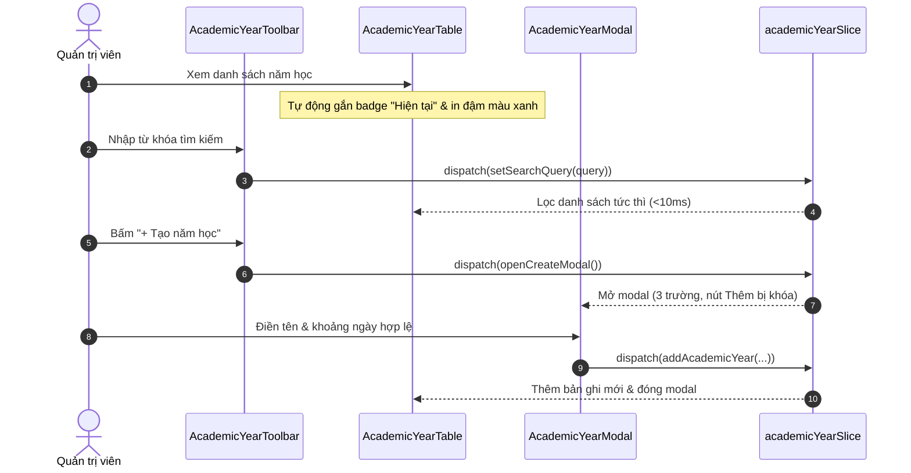

# Feature: School Academic Year (Năm Học)

## User Value

The School Academic Year feature provides an administrative directory where school leaders can view, search, declare, and edit institutional academic years and semester sub-periods.

In educational management, keeping academic terms up to date is critical for scoping curricula, daily attendance, class rosters, tuition fee invoices, and gradebooks. By automatically calculating the active "Hiện tại" year based on system date, administrators no longer need to remember to flip a status switch when a new school year starts. Furthermore, by permanently omitting delete functionality, the application protects the entire database from cascading corruption and broken foreign key references.

## Jira Story

- Story: As a School Administrator, I want to declare and manage academic year and semester milestones with automated current-year tagging, instant name search, and in-place modal editing while preventing accidental deletions so that institutional calendar timelines remain reliable and error-free.
- Jira issue type: Story
- Story points: 5
- Acceptance owner: `sophia-product-manager`
- Research evidence: Circular 32/2020/TT-BGDĐT, MoET Decision 2045/QĐ-BGDĐT, and legacy specification `13. nam-hoc.md`.

## Priority

- Priority: P1
- User/business impact: High; foundational temporal backbone for all school operational and academic modules.
- Risk if delayed: Inability to scope classes, fees, or attendance to correct school year terms.
- Release target: School Operating Portal Release 1.0.

## PM Notes

- Demo scenario: Navigate to `/[schoolCode]/school/academic-year` via the sidebar navigation item under NHÀ TRƯỜNG placed strictly after "Lịch sự kiện". View the table showing active year highlighted in bold blue with "Hiện tại" badge. Use the search bar to filter by name. Click "+ Tạo năm học" to declare a new timeframe; observe submit button is disabled until valid. Click Edit on an existing row to update dates in-place. Verify no delete button exists.
- Business value: Eliminates operational mistakes during school term transitions and ensures statutory audit compliance.
- Acceptance criteria confirmed: `AC-103` through `AC-108`.
- Open PM decision: None; all 5 clarifications (`K059`–`K063`) resolved.

## Requirements Trace

- PRD requirement: `FR-AY-001`, `FR-AY-002`, `FR-AY-003`, `FR-AY-004`, `FR-AY-005`, `FR-AY-006`, `FR-AY-007`.
- Task id: `TASK-AY-001` through `TASK-AY-007`.
- Spec id: `044-school-academic-year-nam-hoc`.

## Code Scope

- Data contracts: `src/types/academicYear.ts`
- Pure validation engine: `src/utils/academicYearValidation.ts`
- Mock data fixtures: `src/services/mockAcademicYearData.ts`
- Redux slice: `src/store/slices/academicYearSlice.ts`, `src/store/index.ts`
- Layout integration: `src/components/layout/PortalLayout.tsx`
- UI components: `src/modules/school/academic-year/*.tsx`
- Page routes: `src/pages/[schoolCode]/school/academic-year/index.tsx`, `src/pages/[schoolCode]/school/season/index.tsx`
- Unit tests: `tests/unit/academicYear.test.mjs`

## Relationship Map

| Relation | Target | Label | Rationale |
| --- | --- | --- | --- |
| DEPENDS_ON | `E-029-school-academic-year` | `DEPENDS_ON` | Part of Epic 29 for School Academic Year. |
| USES | `M-029-001-school-academic-year` | `USES` | Consumes the presentation and domain module for UI rendering. |
| IMPLEMENTS | `P-029-001-school-academic-year` | `IMPLEMENTS` | Powers the page route `/[schoolCode]/school/academic-year`. |
| RELATES_TO | `F-028-001-school-parent-feedback` | `RELATES_TO` | Provides academic year references to feedback ticketing. |

## Acceptance Criteria

- [x] `AC-103`: Sidebar navigation includes "Năm học" strictly after "Lịch sự kiện" mounting `/school/academic-year`.
- [x] `AC-104`: Active academic year automatically tagged with "Hiện tại" badge and bold blue text without manual toggle (`K059`).
- [x] `AC-105`: Creating academic year uses 3-field modal with submit button disabled until valid (`endDate >= startDate`).
- [x] `AC-106`: Editing an existing year pre-populates fields, mutates record in-place, and updates current badge immediately if active.
- [x] `AC-107`: Keyword search filters table rows instantly case- and diacritic-insensitively, updating `"Tổng: N"`.
- [x] `AC-108`: Rows strictly omit Delete/Trash buttons; actions column contains only the Edit button (`faEdit`).

## Mermaid Diagram

## Implementation Notes

- Code paths: `src/modules/school/academic-year/AcademicYearToolbar.tsx`, `src/modules/school/academic-year/AcademicYearTable.tsx`, `src/modules/school/academic-year/AcademicYearModal.tsx`.
- Data/contracts: Conforms to `contracts/academic-year-contracts.ts`.
- Rollback: Revert page component and Redux registration without server impact.
- Tradeoffs: Client-side date evaluation avoids stale database flags without server polling.

## Verification

- Command: `node --test tests/unit/academicYear.test.mjs`
- Command: `npm test`
- Command: `npm run build`

## Work Log

| Date | Author | Summary |
| --- | --- | --- |
| 2026-10-09 | `benny-frontend-engineer` | Created feature document for School Academic Year. |
| 2026-10-09 | `benny-frontend-engineer` | Implemented data types, pure logic, state machine, and UI components. |

## Change Log

- Date: 2026-10-09
  - Feature change: Delivered School Academic Year UI feature with real-time search, 3-field modal, and current-year badge.
  - Evidence: Unit test suite passing and static build verification.
