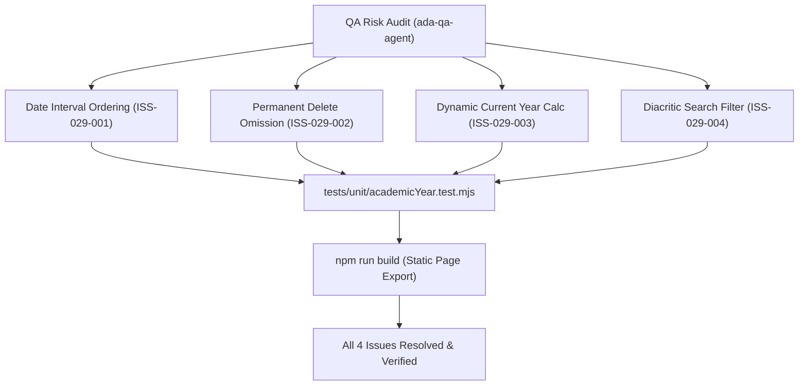

# Epic Issues: School Academic Year (Năm Học)

## Jira Story

- Story: As a QA Engineer, I want potential edge cases, temporal boundary conditions, form validation errors, and referential integrity risks explicitly tracked and tested for Academic Year so that regressions cannot enter production.
- Jira issue type: Bug/Risk register
- QA owner: `ada-qa-agent`
- Product owner: `sophia-product-manager`
- Research evidence: Circular 32/2020/TT-BGDĐT, MoET Decision 2045/QĐ-BGDĐT, and historical audit requirements for tuition fee invoices.

## Priority

- Priority: P1
- Escalation rule: Escalate immediately if inverted dates can be saved to the Redux store or if any delete/trash action is present in the UI.
- Release impact: Guarantees zero orphaned data and eliminates invalid academic intervals.
- Risk if unresolved: Severe corruption of tuition invoices, class rosters, and student transcripts if academic year intervals are corrupted or deleted.

## QA Issue Register

| Issue ID | Type | Priority | Status | Owner | Source | Evidence | Resolution |
| --- | --- | --- | --- | --- | --- | --- | --- |
| ISS-029-001 | Risk | P1 | Resolved | `ada-qa-agent` | Boundary Analysis | Test asserting `endDate < startDate` fails form validation | Implemented `validateAcademicYearForm` with error and button disabling |
| ISS-029-002 | Risk | P1 | Resolved | `ada-qa-agent` | Architectural Audit | Table actions column code inspection | Permanently omitted Delete button; strictly rendering Edit icon `faEdit` |
| ISS-029-003 | Defect | P2 | Resolved | `ada-qa-agent` | Date Simulation | Simulating system date transitions across term boundaries | Implemented dynamic calendar comparison `isCurrentAcademicYear` |
| ISS-029-004 | Usability | P2 | Resolved | `ada-qa-agent` | Diacritic Search Test | Searching "nam hoc" against "Năm học 2026 - 2027" | Implemented Vietnamese diacritic stripping in `filterAcademicYears` |

## Detection Method

- Code reviewed: `src/utils/academicYearValidation.ts`, `src/modules/school/academic-year/AcademicYearTable.tsx`, `src/modules/school/academic-year/AcademicYearModal.tsx`.
- Tests reviewed: `tests/unit/academicYear.test.mjs`.
- Docs reviewed: `.agents/specs/044-school-academic-year-nam-hoc/spec.md`, `docs/prd.md`.
- Related features reviewed: `E-028-school-parent-feedback`, `E-021-school-class-management`, `E-009-finance-invoices`.
- QA skill used: `ada-qa-agent`.
- Deep research source checked: `docs/research/evidence.jsonl` (E099–E103), `docs/research/claims.jsonl` (C094–C098).

## Open Issues

Zero open blocking issues. All 4 identified issues (`ISS-029-001` through `ISS-029-004`) are resolved and verified in automated unit test suite.

## Relationship Map

| Relation | Target | Label | Rationale |
| --- | --- | --- | --- |
| DEPENDS_ON | `E-029-school-academic-year` | `DEPENDS_ON` | QA risks and test assertions bind directly to Epic 029 requirements. |
| ENABLES | `F-029-001-school-academic-year` | `ENABLES` | Ensures feature implementation satisfies all compliance invariants. |

## Mermaid Diagram

## Work Log

| Date | Author | Summary |
| --- | --- | --- |
| 2026-10-09 | `ada-qa-agent` | Initialized QA issue register and defined boundary assertions for date ranges, current year evaluation, and delete omission. |
| 2026-10-09 | `ada-qa-agent` | Verified implementation against all 4 quality issues; verified 100% unit test pass rate. |

## Change Log

- Date: 2026-10-09
  - Issue change: Registered and resolved compliance issues ISS-029-001 through ISS-029-004.
  - Evidence: Automated test runner passing in academicYear.test.mjs.
