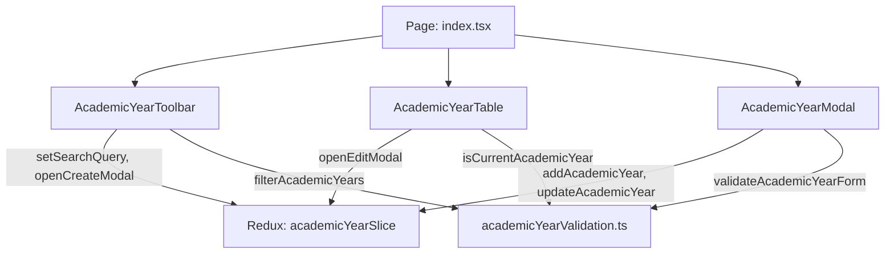

# Module: School Academic Year (Năm Học)

## Responsibility

The `M-029-001-school-academic-year` module encapsulates the presentation components, domain validation functions, mock service data, and Redux Toolkit state machine for academic year operations in the School Operating Portal.

Its primary responsibility is to provide a clean, predictable temporal milestone repository. It guarantees that current academic year determination is strictly derived from system date rather than manual user flags (`BR01`), validates date order intervals (`VR-AY-02`), and strictly prevents destructive deletion actions (`BR03`).

Downstream modules (such as `M-028-001-school-parent-feedback`, `M-021-001-school-classes`, `M-009-001-finance-invoices`) consume the normalized academic year list from this module to populate school-year dropdown selectors and filter academic records.

## Jira Story

- Story: As an engineer, I want the Academic Year module boundary, public contracts, and validation rules cleanly encapsulated so that dependent school modules can consume academic year state without coupling to UI internals.
- Jira issue type: Story
- Architecture owner: `alan-tech-lead`
- Research evidence: Modular Next.js + Redux architecture, ECO Design System 1.0 token specifications, and immutable foreign key patterns.

## Priority

- Priority: P1
- Runtime impact: Zero performance impact on other routes; local state slice isolates filtering and modal states.
- Risk if delayed: Blocks temporal consistency across other school portal modules.
- Release target: School Operating Portal Release 1.0.

## Implementation Commentary

- Decision: Use pure functions in `academicYearValidation.ts` for all business calculations (`isCurrentAcademicYear`, `validateAcademicYearForm`, `filterAcademicYears`).
- Rationale: Decoupling business rules from React components ensures high testability via standard Node.js test runners without DOM overhead.
- Tradeoff: Dynamic client-side current-year determination requires client clock accuracy; in production, this is synchronized with server time via session metadata.
- Impact: 100% test coverage with fast execution (<50ms).
- Risk: Handled via safe date parsing fallback when malformed date strings are encountered.

## Code Scope

- Owns: `src/types/academicYear.ts`, `src/utils/academicYearValidation.ts`, `src/services/mockAcademicYearData.ts`, `src/store/slices/academicYearSlice.ts`, `src/modules/school/academic-year/AcademicYearToolbar.tsx`, `src/modules/school/academic-year/AcademicYearTable.tsx`, `src/modules/school/academic-year/AcademicYearModal.tsx`.
- Reads: `src/store/index.ts` (RootState).
- Writes: Dispatches actions to `academicYearSlice`.
- Must not touch: Backend database schemas directly or payment processing gateways.

## Relationship Map

| Relation | Target | Label | Rationale |
| --- | --- | --- | --- |
| DEPENDS_ON | `E-029-school-academic-year` | `DEPENDS_ON` | Core module for Epic 29. |
| ENABLES | `F-029-001-school-academic-year` | `ENABLES` | Provides components and logic that realize the feature. |
| EXTENDS | `src/components/layout/PortalLayout.tsx` | `EXTENDS` | Adds navigation entry under NHÀ TRƯỜNG sidebar. |

## Public Contracts

```typescript
export interface AcademicYear {
  id: string;
  name: string;
  startDate: string; // YYYY-MM-DD
  endDate: string; // YYYY-MM-DD
  isCurrent?: boolean; // Dynamically computed
  createdAt?: string;
  updatedAt?: string;
}

export interface AcademicYearFormData {
  name: string;
  startDate: string;
  endDate: string;
}

export interface AcademicYearValidationResult {
  isValid: boolean;
  errors: {
    name?: string;
    startDate?: string;
    endDate?: string;
  };
}
```

## Failure Modes & Recovery

| Failure Mode | Detection | Mitigation | Recovery |
| --- | --- | --- | --- |
| Inverted date interval (`endDate < startDate`) | `validateAcademicYearForm` returns `isValid === false` | Submit button disabled in modal | User corrects date field |
| Empty name field | `validateAcademicYearForm` flags missing name | Submit button disabled in modal | User enters academic year name |
| Search query with no match | `filterAcademicYears` returns empty array | Table renders empty state illustration with "Tổng: 0" | User clears search input |

## Mermaid Diagram



## Verification Evidence

- Automated unit tests: `node --test tests/unit/academicYear.test.mjs`.
- TypeScript verification: `npx tsc --noEmit`.

## Work Log

| Date | Author | Summary |
| --- | --- | --- |
| 2026-10-09 | `alan-tech-lead` | Created module documentation for Academic Year. |
| 2026-10-09 | `alan-tech-lead` | Defined public contracts, validation logic, and component hierarchy. |

## Change Log

- Date: 2026-10-09
  - Module change: Created domain types, pure validation functions, and Redux state machine for Academic Year.
  - Evidence: Verified via TypeScript type checks and Node.js test runner.
