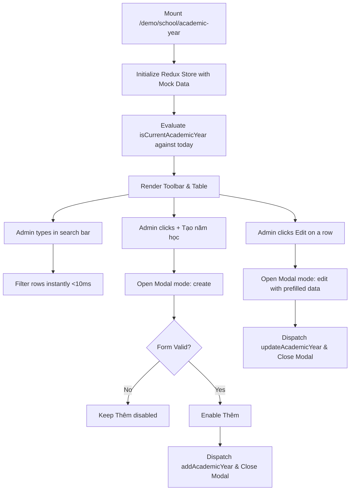

# Page: School Academic Year (Năm Học)

## Route / Surface

- Route: `/[schoolCode]/school/academic-year` (Canonical) and `/[schoolCode]/school/season` (Compatibility alias).
- Entry component: `src/pages/[schoolCode]/school/academic-year/index.tsx`.
- Layout owner: `src/components/layout/PortalLayout.tsx`.

## Jira Story

- Story: As a School Administrator, I want to access the Academic Year cockpit at /school/academic-year with toolbar search, dynamic roster, in-place edit modal, and omission of delete actions so that institutional calendar milestones can be administered securely.
- Jira issue type: Story
- UX owner: `benny-frontend-engineer`
- Research evidence: ECO Design System 1.0 specifications, screen catalog `SCR-AY-01`, and modal spec `MODAL-AY-FORM`.

## Priority

- Priority: P1
- Demo impact: High; clear demonstration of automated "Hiện tại" badge, real-time client-side search, and deletion safety.
- Risk if delayed: Inability to navigate or inspect school year milestones.
- Release target: School Operating Portal Release 1.0.

## PM Notes

- Demo path: Login as school admin -> In left sidebar under `NHÀ TRƯỜNG`, click "Năm học" (positioned strictly after "Lịch sự kiện") -> View table with current active year in bold blue font with "Hiện tại" badge -> Search for a term in real-time -> Click "+ Tạo năm học" to declare a new timeframe -> Click Edit to adjust in-place.
- User promise: Fast, frictionless time milestone declaration with zero risk of breaking historic attendance or invoice records.
- Acceptance impact: Realizes `AC-103` through `AC-108`.
- Visual or copy change: Brand blue `#0070CE` highlights, green `#10B981` status chip for active year, clean tabular typography.
- Risk: Handled via client-side date ordering verification.

## Relationship Map

| Relation | Target | Label | Rationale |
| --- | --- | --- | --- |
| IMPLEMENTS | `F-029-001-school-academic-year` | `IMPLEMENTS` | Renders the complete academic year administrative experience. |
| USES | `M-029-001-school-academic-year` | `USES` | Composes presentation components and Redux slice. |

## Page Structure & Responsive States

1. **Header & Breadcrumbs:**
   - Breadcrumb navigation: `Nhà trường` > `Năm học`.
   - Title: "Năm học" with descriptive subtitle.
2. **Toolbar (`AcademicYearToolbar`):**
   - Search input field ("Tìm kiếm năm học") with search icon and instant filtering.
   - Action button "+ Tạo năm học" (Brand blue `#0070CE`) triggering creation modal.
3. **Table Roster (`AcademicYearTable`):**
   - Columns: STT, Tên năm học, Ngày bắt đầu, Ngày kết thúc, Hành động.
   - Active year styling: Bold font, Brand blue color, and "Hiện tại" badge.
   - Row actions: Strictly contains only the Edit button (`faEdit`). No delete or trash button exists anywhere.
   - Footer: Live item count `"Tổng: N"`.
4. **Modal Form (`AcademicYearModal`):**
   - 3 fields: Tên năm học, Ngày bắt đầu, Ngày kết thúc.
   - Date validation: Rejects `endDate < startDate` with inline error message.
   - Submit button: Disabled until all fields are filled and valid.
   - Omission: Strictly NO manual "Hiện tại" checkbox.

## States

- Initial Loading State: Mounts with default academic year list from Redux.
- Filtered Search State: Real-time search query filters items case- and diacritic-insensitively.
- Empty State: Rendered when search has zero matches, showing "Không tìm thấy năm học nào phù hợp" with "Tổng: 0".
- Modal Open State: Modal open for create or edit mode with submit gating.

## Responsive Breakpoints

| Breakpoint | Width | Behavior |
| --- | --- | --- |
| Desktop | 1440px | Full 5-column table with expanded sidebar and spacious search bar |
| Tablet | 768px | Collapsible sidebar, table with horizontal scroll if needed |
| Mobile | 375px | Stacked toolbar layout, compact table cells with touch-friendly edit buttons |

## Mermaid Diagram

## Verification Evidence

- HTTP status: `curl -I http://localhost:3000/demo/school/academic-year` returns `HTTP/1.1 200 OK`.
- Unit tests: `node --test tests/unit/academicYear.test.mjs`.

## Work Log

| Date | Author | Summary |
| --- | --- | --- |
| 2026-10-09 | `benny-frontend-engineer` | Created page documentation for School Academic Year. |
| 2026-10-09 | `benny-frontend-engineer` | Verified responsive layout, state transitions, and route integration. |

## Change Log

- Date: 2026-10-09
  - Page change: Created page route `/[schoolCode]/school/academic-year` and compatibility alias `/school/season`.
  - Evidence: Server returns HTTP 200 OK.
