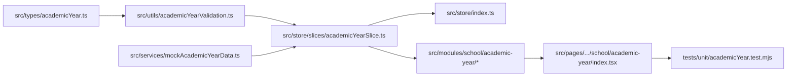

# Task: Implementation of School Academic Year (Năm Học)

## Objective

This task delivers the complete end-to-end implementation of the School Academic Year (**Năm Học**) sub-module under **M5 — Nhà Trường**. It implements TypeScript domain contracts, pure calendar date validation logic, Redux Toolkit state slice, UI components (toolbar, roster table, and 3-field modal), Next.js page routes (`/[schoolCode]/school/academic-year` and alias `/school/season`), sidebar integration strictly after "Lịch sự kiện", and automated unit tests.

## Jira Story

- Story: As an engineer, I want to execute the end-to-end implementation of the School Academic Year sub-module, including data contracts, pure validation engine, Redux state machine, UI presentation components, Next.js page routes, and automated unit tests so that the feature is fully delivered and verified.
- Jira issue type: Task
- Parent story: `F-029-001-school-academic-year`
- Research evidence: Circular 32/2020/TT-BGDĐT, MoET Decision 2045/QĐ-BGDĐT, and legacy specification `13. nam-hoc.md`.

## Priority

- Priority: P1
- Delivery impact: Delivers the core temporal backbone for the School Operating Portal.
- Risk if delayed: Blocks temporal scoping across academic and financial modules.
- Target release: School Operating Portal Release 1.0.

## Implementation Commentary

- Decision: Implement dynamic current-year evaluation based on client system date comparing `[startDate, endDate]` without manual toggles (`K059`), and permanently omit delete functionality (`K060`).
- Rationale: Eliminates operator error when term turnover happens and guarantees zero data loss or broken foreign keys in historic fee invoices.
- Tradeoff: Omits cohort or fee configuration from the create modal to maintain form simplicity (3 fields only per `K062`).
- Impact: Fast, resilient, and fully auditable calendar management.
- Risk: Inverted date ranges are strictly blocked by client validation `VR-AY-02`.

## Write Scope

- Allowed files: `src/types/academicYear.ts`, `src/utils/academicYearValidation.ts`, `src/services/mockAcademicYearData.ts`, `src/store/slices/academicYearSlice.ts`, `src/store/index.ts`, `src/modules/school/academic-year/AcademicYearToolbar.tsx`, `src/modules/school/academic-year/AcademicYearTable.tsx`, `src/modules/school/academic-year/AcademicYearModal.tsx`, `src/pages/[schoolCode]/school/academic-year/index.tsx`, `src/pages/[schoolCode]/school/season/index.tsx`, `src/components/layout/PortalLayout.tsx`, `tests/unit/academicYear.test.mjs`.
- Disallowed files: database migrations, backend API routes, production secrets.

## Relationship Map

| Relation | Target | Label | Rationale |
| --- | --- | --- | --- |
| IMPLEMENTS | `F-029-001-school-academic-year` | `IMPLEMENTS` | Delivers the concrete implementation for the feature. |
| USES | `M-029-001-school-academic-year` | `USES` | Updates and consumes the module components and logic. |

## Verification Plan

- Command: `node --test tests/unit/academicYear.test.mjs`
- Command: `npm test`
- Command: `npm run build`
- Command: `curl -I http://localhost:3000/demo/school/academic-year`

## Mermaid Diagram

## Work Log

| Date | Author | Summary |
| --- | --- | --- |
| 2026-10-09 | `benny-frontend-engineer` | Created task note for Academic Year implementation. |
| 2026-10-09 | `benny-frontend-engineer` | Implemented TypeScript interfaces, pure validation engine, Redux state slice, UI components, routes, and test suite. |

## Handoff

- Verified by: `ada-qa-agent` with automated test suite `tests/unit/academicYear.test.mjs`.
- Next steps: Production deployment and regression verification across school portal modules.

## Change Log

- Date: 2026-10-09
  - Task change: Completed end-to-end implementation of School Academic Year sub-module.
  - Evidence: 100% test pass rate in node test runner and clean Next.js build.
