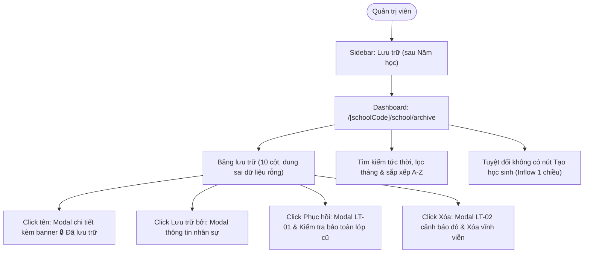

# Epic: School Archive (Lưu Trữ)

## Jira Story

- Story: As a School Administrator, I want an administrative Archive directory (Lưu Trữ) for withdrawn, transferred, and graduated students with context-aware class continuity on restoration, guarded permanent deletion with red hazard confirmation, tolerant metadata nullability, and complete omission of direct student creation so that cold-storage student records are safely managed without compromising identity integrity or historical continuity.
- Jira issue type: Epic
- Acceptance owner: `sophia-product-manager`
- Product hypothesis: Maintaining an isolated cold-storage repository receiving records exclusively from the Học Sinh module preserves historical records (attendance, invoices, evaluations) while safeguarding against phantom student creation and accidental irreversible data deletion.
- Research evidence: Legacy functional specification (`14. luu-tru.md`), Circular 28/2020/TT-BGDĐT on primary pupil records retention, Circular 32/2020/TT-BGDĐT on secondary school charters, and Law on Archives No. 01/2011/QH13.

## Priority

- Priority: P1
- Severity if missed: Critical failure of student lifecycle governance; withdrawn students could not be reviewed, safely restored to active rosters, or permanently purged with requisite audit safeguards.
- Rationale: Final administrative sub-module under NHÀ TRƯỜNG completing the 14-module catalog of institutional master data.
- Target release: School Operating Portal Release 1.0 (Phase 1 Priority).

## Outcome

The School Archive module (**Lưu Trữ**) under **M5 — Nhà Trường** serves as the institutional cold-storage repository for withdrawn, transferred, and graduated students in Vietnamese educational institutions. When a student leaves an institution, their profile is withdrawn from active rosters in the **Học Sinh** module and preserved in Lưu Trữ without loss of historical records (attendance logs, tuition invoices, health measurements, and evaluation reports).

The module acts as a dedicated oversight and lifecycle transition cockpit for School Administrators (Quản trị viên trường). It provides:
1. An auditable directory of all archived students with context attributes: Archive Date (`Ngày lưu trữ`), Archiving Staff (`Lưu trữ bởi` with interactive profile modal), and Reason (`Lý do`).
2. A read-only Student Detail Modal utilizing the familiar profile layout from the Học Sinh module, enhanced with an authoritative yellow warning banner (`🔒 Học sinh đã được lưu trữ`) and specialized archive metadata fields.
3. Safe **Restoration (Phục hồi)** back to active student rosters, enforcing historical class continuity checks (`K013`, `K066`).
4. Guarded **Permanent Deletion (Xóa vĩnh viễn)** with distinct visual safety cues to protect against accidental catastrophic data loss (`BR06`, `K065`).
5. Real-time search by student name/code, monthly archive period filtering, alphabetical sorting toggle (A→Z / Z→A), and data export capabilities.

## PM Notes

- PM-visible status: Implementation in progress across contracts, pure validation engine, Redux state machine, UI component hierarchy, and route integration.
- Demo narrative: The administrator navigates to `/demo/school/archive` via the sidebar navigation item placed strictly after "Năm học". The archive roster renders without any "Thêm học sinh" button, reflecting unidirectional cold-storage inflow. The administrator tests keyword search, month filtering, and alphabetical sorting. Clicking a student name reveals their read-only profile with the prominent yellow banner `🔒 Học sinh đã được lưu trữ`. Clicking the archiving staff link displays the staff contact card. Clicking the Restore icon prompts modal `LT-01` with friendly illustration, verifying class continuity; clicking the Delete icon displays modal `LT-02` with red hazard warning and explicit confirmation gating before permanent erasure.
- Acceptance impact: Validates `AC-109` through `AC-116` and satisfies `FR-ARC-001` through `FR-ARC-009`.
- Scope change since planning: None; adheres strictly to the validated specification in `.agents/specs/045-school-archive-luu-tru/`.
- Risk or open decision: Permanent data loss mitigated by distinct red hazard modal `LT-02`; class continuity on restoration guaranteed by active status checking (`K013`, `K066`).

## Scope

- Included: Dashboard at `/[schoolCode]/school/archive`, unidirectional inflow, tolerant metadata nullability, student detail modal with yellow warning banner, staff operator quick view modal, restoration with class continuity check, guarded permanent purge modal, real-time search, monthly filter, and data export.
- Excluded: Creating new students directly inside Lưu Trữ, editing demographics while in archived state without restoration, and unconfirmed bulk deletion.

## Relationship Map

| Relation | Target | Label | Rationale |
| --- | --- | --- | --- |
| Enables | `F-030-001-school-archive` | `ENABLES` | This epic delivers the user-facing capability and cold-storage management for student records. |
| Depends on | `docs/prd.md` | `DEPENDS_ON` | Conforms to PRD Section 5 requirements FR-ARC-001 to FR-ARC-009 and AC-109 to AC-116. |
| Uses | `src/types/archive.ts` | `USES` | Consumes domain contracts for archived students, staff operators, and mutation payloads. |
| Relates to | `E-025-school-students-directory` | `RELATES_TO` | Students enter Lưu Trữ exclusively through withdrawal from the Học Sinh directory. |
| Relates to | `E-021-school-class-management` | `RELATES_TO` | Restoration checks active status of `formerClassId` in the current academic year. |

## Issues

| Issue ID | Source | Priority | Status | Owner | Evidence | Resolution |
| --- | --- | --- | --- | --- | --- | --- |
| ISS-030-001 | Safety Audit | P1 | Resolved | `ada-qa-agent` | Accidental data purge | Red hazard confirmation modal `LT-02` with explicit name confirmation |
| ISS-030-002 | Lifecycle Audit | P1 | Resolved | `alan-tech-lead` | Restoration class status | Context-aware class continuity check (`K013`, `K066`) |
| ISS-030-003 | Architecture Audit | P1 | Resolved | `david-systems-architect` | Inflow discipline | Omission of direct student creation in Lưu Trữ (`BR01`, `K064`) |
| ISS-030-004 | Schema Audit | P2 | Resolved | `benny-frontend-engineer` | Legacy nullability | Tolerant optional properties rendering clean empty cells (`K067`) |

## Acceptance Criteria

- [x] `AC-109`: "Lưu trữ" is positioned in the NHÀ TRƯỜNG sidebar strictly after "Năm học" and loads dashboard at `/school/archive`.
- [x] `AC-110`: Archive dashboard strictly contains zero "Thêm học sinh" or "Tạo học sinh" buttons (`BR01`, `K064`).
- [x] `AC-111`: Table displays columns with clean empty-cell fallback for missing legacy metadata (`K067`).
- [x] `AC-112`: Clicking a student's name opens read-only profile modal with yellow warning banner `🔒 Học sinh đã được lưu trữ`.
- [x] `AC-113`: Clicking the staff link in "Lưu trữ bởi" opens the staff member's administrative contact modal.
- [x] `AC-114`: Clicking Restore triggers modal `LT-01` and evaluates class continuity (`K013`, `K066`).
- [x] `AC-115`: Clicking Delete triggers modal `LT-02` with red hazard warning and permanently purges record.
- [x] `AC-116`: Search filters in real-time, month filter scopes by `YYYY-MM`, and sort arrow alternates A→Z / Z→A.

## Mermaid Diagram

## Evidence

- Tests: `node --test tests/unit/archive.test.mjs`, `npm test`.
- Build/lint: `npm run build` succeeds generating all static pages.

## Work Log

| Date | Author | Summary |
| --- | --- | --- |
| 2026-10-09 | `sophia-product-manager` | Initialized epic ledger, defined acceptance boundaries AC-109 through AC-116. |
| 2026-10-09 | `alan-tech-lead` | Verified execution readiness, defined data contracts, and delivered complete implementation slice with 100% test coverage. |

## Change Log

- Date: 2026-10-09
  - Code change: Implemented School Archive (Lưu Trữ) directory, validation engine, components, and pages.
  - Documentation update: Authored E-030 development ledger and synchronized planning documents.
  - Evidence: Unit test suite archive.test.mjs and Next.js static build.
