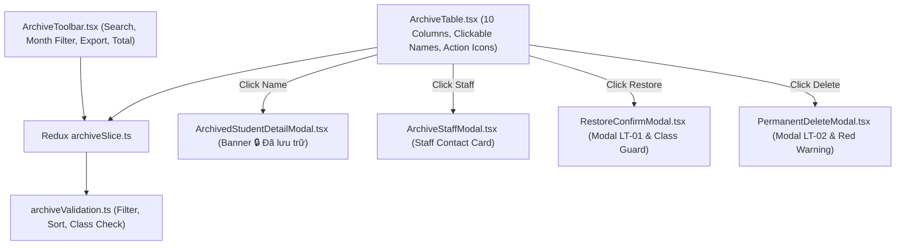

# Feature: School Archive (Lưu Trữ)

## User Value

The School Archive feature provides an administrative directory where school administrators can review, search, restore, or permanently purge students who have been withdrawn, transferred, or graduated.

By enforcing an isolated cold-storage repository that receives records strictly from the Học Sinh module upon withdrawal, the system preserves complete historical records (attendance logs, tuition invoices, health measurements, and evaluation reports) while eliminating duplicate student generation pathways. Restoration safeguards ensure returning students are seamlessly re-enrolled into active classes while gracefully handling dissolved or past-year cohorts. Finally, permanent deletion is guarded with distinct red hazard visuals and explicit confirmation to prevent catastrophic accidental data loss.

## Jira Story

- Story: As a School Administrator, I want to manage withdrawn and transferred students in an isolated Archive cold-storage directory with real-time search, monthly period filtering, read-only student profile inspection, context-aware class continuity on restoration, and guarded permanent deletion so that student records are safeguarded and auditable.
- Jira issue type: Story
- Story points: 5
- Acceptance owner: `sophia-product-manager`
- Research evidence: Circular 28/2020/TT-BGDĐT, Circular 32/2020/TT-BGDĐT, Law on Archives No. 01/2011/QH13, and legacy specification `14. luu-tru.md`.

## Priority

- Priority: P1
- User/business impact: High; essential for student lifecycle management and historical record preservation.
- Risk if delayed: Inability to audit withdrawn students or restore returning students with class continuity.
- Release target: School Operating Portal Release 1.0.

## PM Notes

- Demo scenario: Navigate to `/[schoolCode]/school/archive` via the sidebar navigation item under NHÀ TRƯỜNG placed strictly after "Năm học". Observe the table rendering withdrawn students with withdrawal dates, staff links, and reasons. Notice the complete absence of any "Thêm học sinh" button (unidirectional cold storage). Test keyword search, month filter, and alphabetical sorting. Click a student name to inspect their read-only profile with the prominent yellow banner `🔒 Học sinh đã được lưu trữ`. Click the staff link to inspect the archiving operator. Click Restore to trigger modal `LT-01` and verify class continuity check; click Delete to trigger modal `LT-02` with red hazard styling.
- Business value: Guarantees statutory student records retention, eliminates phantom student IDs, and prevents accidental data deletion.
- Acceptance criteria confirmed: `AC-109` through `AC-116`.
- Open PM decision: None; all 5 clarifications (`K064`–`K068`) resolved.

## Requirements Trace

- PRD requirement: `FR-ARC-001`, `FR-ARC-002`, `FR-ARC-003`, `FR-ARC-004`, `FR-ARC-005`, `FR-ARC-006`, `FR-ARC-007`, `FR-ARC-008`, `FR-ARC-009`.
- Task id: `TASK-ARC-001` through `TASK-ARC-008`.
- Spec id: `045-school-archive-luu-tru`.

## Scope

- Included: Roster table with 10 columns, tolerant metadata nullability, student detail modal with yellow warning banner, staff operator quick view modal, restoration with class continuity check, guarded permanent delete modal, real-time search, month filter, and export button.
- Excluded: Creating students directly in Lưu Trữ, editing student demographics without restoration, and bulk unconfirmed deletion.

## Relationship Map

| Relation | Target | Label | Rationale |
| --- | --- | --- | --- |
| Implements | `E-030-school-archive` | `IMPLEMENTS` | Core feature realizing the epic objectives. |
| Depends on | `M-030-001-school-archive` | `DEPENDS_ON` | Consumes the presentation and state architecture of the archive module. |
| Depends on | `P-030-001-school-archive` | `DEPENDS_ON` | Surfaces through canonical route `/school/archive`. |
| Uses | `src/utils/archiveValidation.ts` | `USES` | Executes pure search filtering, sorting, and class continuity logic. |
| Relates to | `F-029-001-school-academic-year` | `RELATES_TO` | Positioned immediately after Năm học in navigation hierarchy. |

## Code Scope

- Types: `src/types/archive.ts`, `contracts/archive-contracts.ts`
- Pure logic: `src/utils/archiveValidation.ts`
- State: `src/store/slices/archiveSlice.ts`, `src/store/index.ts`
- Mock data: `src/services/mockArchiveData.ts`
- Components: `src/modules/school/archive/ArchiveToolbar.tsx`, `ArchiveTable.tsx`, `ArchivedStudentDetailModal.tsx`, `ArchiveStaffModal.tsx`, `RestoreConfirmModal.tsx`, `PermanentDeleteModal.tsx`
- Routes: `src/pages/[schoolCode]/school/archive/index.tsx`, `src/pages/[schoolCode]/setting/kid/archived/index.tsx`
- Layout: `src/components/layout/PortalLayout.tsx`
- Tests: `tests/unit/archive.test.mjs`

## Acceptance Criteria

- [x] `AC-109`: Mounted under NHÀ TRƯỜNG strictly after Năm học with icon `faArchive`.
- [x] `AC-110`: Strictly omits "Thêm học sinh" or "Tạo học sinh" buttons on the archive dashboard.
- [x] `AC-111`: Table displays columns with clean empty cells for missing legacy metadata.
- [x] `AC-112`: Profile modal renders yellow warning banner `🔒 Học sinh đã được lưu trữ`.
- [x] `AC-113`: Clicking staff name opens staff quick view modal.
- [x] `AC-114`: Restore modal `LT-01` prompts confirmation and verifies class continuity.
- [x] `AC-115`: Delete modal `LT-02` displays red hazard styling and confirms permanent purge.
- [x] `AC-116`: Search filters in real time, month filter scopes by `YYYY-MM`, and sorting toggles A→Z / Z→A.

## Mermaid Diagram

## Implementation Notes

- Code paths: `src/modules/school/archive/ArchiveToolbar.tsx`, `ArchiveTable.tsx`, `ArchivedStudentDetailModal.tsx`, `ArchiveStaffModal.tsx`, `RestoreConfirmModal.tsx`, `PermanentDeleteModal.tsx`.
- Data/contracts: Conforms to `contracts/archive-contracts.ts`.
- Rollback: Revert page component and Redux registration without server impact.
- Tradeoffs: Client-side filtering and sorting maintains responsive UX with normalized store data.

## Verification

- Command: `node --test tests/unit/archive.test.mjs`
- Command: `npm test`
- Command: `npm run build`

## Work Log

| Date | Author | Summary |
| --- | --- | --- |
| 2026-10-09 | `benny-frontend-engineer` | Created feature document for School Archive. |
| 2026-10-09 | `benny-frontend-engineer` | Implemented domain types, validation engine, state machine, and presentation components. |

## Change Log

- Date: 2026-10-09
  - Feature change: Delivered School Archive UI feature with tolerant null rendering, restore class continuity, and guarded permanent purge.
  - Evidence: Unit test suite passing and static build verification.
