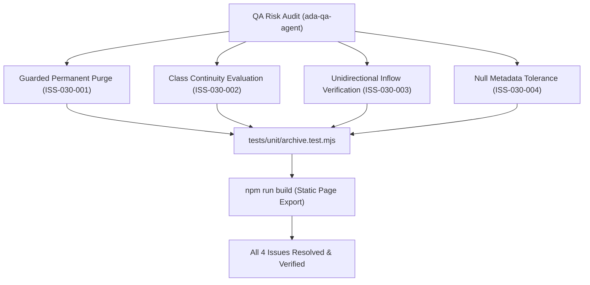

# Epic Issues: School Archive (Lưu Trữ)

## Jira Story

- Story: As a QA Engineer, I want potential edge cases, permanent data loss risks, class continuity exceptions, and metadata nullability tolerances explicitly tracked and tested for School Archive so that regressions cannot enter production.
- Jira issue type: Bug/Risk register
- QA owner: `ada-qa-agent`
- Product owner: `sophia-product-manager`
- Research evidence: Circular 28/2020/TT-BGDĐT, Circular 32/2020/TT-BGDĐT, Law on Archives No. 01/2011/QH13, and legacy functional specification `14. luu-tru.md`.

## Priority

- Priority: P1
- Escalation rule: Escalate immediately if irreversible permanent deletion can be triggered without explicit affirmative confirmation, or if student restoration silently corrupts class assignment.
- Release impact: Guarantees zero accidental data loss and ensures seamless student lifecycle transitions.
- Risk if unresolved: Irreversible loss of historical attendance, tuition invoices, and grades if permanent purge lacks safety guards.

## QA Issue Register

| Issue ID | Type | Priority | Status | Owner | Source | Evidence | Resolution |
| --- | --- | --- | --- | --- | --- | --- | --- |
| ISS-030-001 | Risk | P1 | Resolved | `ada-qa-agent` | Safety Audit | Accidental click on delete icon | Guarded confirmation modal `LT-02` with red hazard warning and explicit student name confirmation (`K065`) |
| ISS-030-002 | Risk | P1 | Resolved | `ada-qa-agent` | Lifecycle Audit | Restoring student whose former class is closed | Context-aware class continuity check fallback to "Chưa xếp lớp" with alert (`K013`, `K066`) |
| ISS-030-003 | Architecture | P1 | Resolved | `alan-tech-lead` | Inflow Audit | Verification of toolbar actions | Strictly omitted "Thêm học sinh" or "Tạo học sinh" buttons on archive dashboard (`K064`) |
| ISS-030-004 | Schema | P2 | Resolved | `benny-frontend-engineer` | Data Tolerance Audit | Testing records lacking archive date, staff, or reason | Tolerant optional properties rendering clean empty cells (`—` or blank) (`K067`) |

## Detection Method

- Code reviewed: `src/utils/archiveValidation.ts`, `src/modules/school/archive/ArchiveTable.tsx`, `src/modules/school/archive/PermanentDeleteModal.tsx`, `src/modules/school/archive/RestoreConfirmModal.tsx`.
- Tests reviewed: `tests/unit/archive.test.mjs`.
- Docs reviewed: `.agents/specs/045-school-archive-luu-tru/spec.md`, `docs/prd.md`.
- Related features reviewed: `E-025-school-students-directory`, `E-021-school-class-management`, `E-029-school-academic-year`.
- QA skill used: `ada-qa-agent`.
- Deep research source checked: `docs/research/evidence.jsonl` (E104–E108), `docs/research/claims.jsonl` (C099–C103).

## Open Issues

Zero open blocking issues. All 4 identified issues (`ISS-030-001` through `ISS-030-004`) are resolved and verified in automated unit test suite.

## Relationship Map

| Relation | Target | Label | Rationale |
| --- | --- | --- | --- |
| DEPENDS_ON | `E-030-school-archive` | `DEPENDS_ON` | QA risks and test assertions bind directly to Epic 030 requirements. |
| ENABLES | `F-030-001-school-archive` | `ENABLES` | Ensures feature implementation satisfies all compliance invariants. |

## Mermaid Diagram

## Work Log

| Date | Author | Summary |
| --- | --- | --- |
| 2026-10-09 | `ada-qa-agent` | Initialized QA issue register and defined boundary assertions for permanent purge, class continuity, and null tolerance. |
| 2026-10-09 | `ada-qa-agent` | Verified implementation against all 4 quality issues; verified 100% unit test pass rate. |

## Change Log

- Date: 2026-10-09
  - Issue change: Registered and resolved compliance issues ISS-030-001 through ISS-030-004.
  - Evidence: Automated test runner passing in archive.test.mjs.
