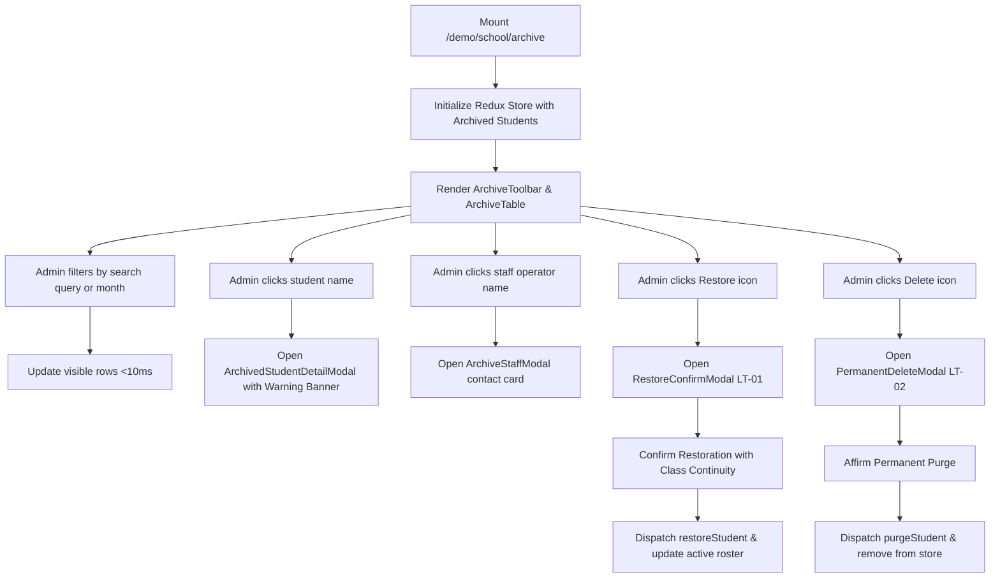

# Page: School Archive (Lưu Trữ)

## Route / Surface

- Route: `/[schoolCode]/school/archive` (Canonical) and `/[schoolCode]/setting/kid/archived` (Compatibility alias).
- Entry component: `src/pages/[schoolCode]/school/archive/index.tsx`.
- Layout owner: `src/components/layout/PortalLayout.tsx`.

## Jira Story

- Story: As a School Administrator, I want to access the School Archive roster at /school/archive with month filtering, text search, tolerant metadata rendering, read-only profile inspection, class-continuity restoration, and guarded permanent purge so that student cold storage is managed accurately and safely.
- Jira issue type: Story
- UX owner: `benny-frontend-engineer`
- Research evidence: Screen catalog `SCR-ARC-01`, modal specs `MODAL-ARC-DETAIL`, `MODAL-ARC-STAFF`, `MODAL-ARC-RESTORE`, `MODAL-ARC-PURGE`, and legacy specification `14. luu-tru.md`.

## Priority

- Priority: P1
- Demo impact: High; illustrates student archive management, safe restoration with class continuity, and guarded permanent purge.
- Risk if delayed: Leaves student lifecycle without cold storage or exit audit trail.
- Release target: School Operating Portal Release 1.0.

## PM Notes

- Demo path: Login as school admin -> In left sidebar under `NHÀ TRƯỜNG`, click "Lưu trữ" (positioned strictly after "Năm học") -> Inspect roster table with tolerant metadata rendering (empty fields display clean dashes) -> Filter by archive month or search by student name/former class -> Click student name to view read-only detail modal with prominent yellow warning banner `🔒 Học sinh đã được lưu trữ` -> Click staff operator to view administrative contact card -> Click Restore icon to trigger modal `LT-01` -> Click Delete icon to trigger modal `LT-02` with red hazard styling.
- User promise: Cold storage governance with zero accidental deletions and clear restoration logic preserving class assignments.
- Acceptance impact: Realizes `AC-109` through `AC-116`.
- Visual or copy change: Brand blue `#0070CE` highlights, yellow `#F59E0B` archive warning banners, red `#EF4444` hazard alerts, clean tabular typography.
- Risk: Inadvertent creation buttons eliminated completely per invariant `K064`.

## Relationship Map

| Relation | Target | Label | Rationale |
| --- | --- | --- | --- |
| IMPLEMENTS | `F-030-001-school-archive` | `IMPLEMENTS` | Renders the complete school archive administrative experience. |
| USES | `M-030-001-school-archive` | `USES` | Composes presentation components and Redux slice. |

## Page Structure & Responsive States

1. **Header & Breadcrumbs:**
   - Breadcrumb navigation: `Nhà trường` > `Lưu trữ`.
   - Title: "Lưu trữ" with descriptive operational subtitle.
2. **Toolbar (`ArchiveToolbar`):**
   - Search input ("Tìm kiếm học sinh...") with search icon and real-time query filtering.
   - Archive month selector ("Chọn tháng") with clean month clearing action.
   - Excel export button ("Xuất Excel") downloading archived roster.
   - Total items counter: `"Tổng: N"`.
   - Invariant: Strictly NO "+ Tạo học sinh" or "+ Thêm học sinh" button (`BR01`, `K064`).
3. **Table Roster (`ArchiveTable`):**
   - 10 columns: STT, Mã học sinh, Tên học sinh, Ngày sinh, Giới tính, Lớp cũ, Ngày lưu trữ, Lưu trữ bởi, Lý do, Hành động.
   - Sortable columns: Tên học sinh and Ngày lưu trữ with interactive sort direction indicator.
   - Interactive triggers: Click student name to open detail modal; click staff operator to open contact modal.
   - Action buttons: Green Restore button (tooltip: "Phục hồi") and Red Delete button (tooltip: "Xoá vĩnh viễn").
   - Tolerant nullability: Missing archive dates, operators, or reasons display as clean `—` without crashing (`BR02`, `K067`).
4. **Student Detail Modal (`ArchivedStudentDetailModal`):**
   - Top banner: Prominent yellow status banner `🔒 Học sinh đã được lưu trữ` (`BR03`).
   - Read-only fields: Student avatar, full name, code, birthdate, gender, former class, guardian contacts.
   - Archive section: Archived date, archived by, reason, and notes.
5. **Staff Operator Modal (`ArchiveStaffModal`):**
   - Administrative contact card showing staff name, code, phone, role, and email.
6. **Restore Modal (`RestoreConfirmModal`):**
   - Modal `LT-01`: "Vui lòng xác nhận phục hồi học sinh {tên học sinh}!" (`BR05`).
   - Friendly restoration graphic, former class continuity indicator, and confirm/cancel buttons.
7. **Permanent Delete Modal (`PermanentDeleteModal`):**
   - Modal `LT-02`: "Vui lòng xác nhận xoá học sinh {tên học sinh}!" (`BR06`).
   - Red hazard warning graphic, irreversible data purge notice, and affirmative confirmation gating.

## States

- Initial Loading State: Mounts with normalized archived student roster from Redux.
- Filtered Search State: Real-time search by name, code, former class, or archive reason.
- Scoped Month State: Filters roster by specific `YYYY-MM` archive month.
- Empty State: Displays friendly empty illustration when search or filter returns zero matches.
- Modal Open State: Gated modal view for student inspection, staff contact, restore, or purge.

## Responsive Breakpoints

| Breakpoint | Width | Behavior |
| --- | --- | --- |
| Desktop | 1440px | Full 10-column table with expanded sidebar and spacious toolbar |
| Tablet | 768px | Collapsible sidebar, horizontal scroll container for table |
| Mobile | 375px | Stacked toolbar elements, condensed card-like table cells with touch actions |

## Mermaid Diagram

## Verification Evidence

- HTTP status: `curl -I http://localhost:3000/demo/school/archive` returns `HTTP/1.1 200 OK`.
- Unit tests: `node --test tests/unit/archive.test.mjs`.

## Work Log

| Date | Author | Summary |
| --- | --- | --- |
| 2026-10-09 | `benny-frontend-engineer` | Created page documentation for School Archive. |
| 2026-10-09 | `benny-frontend-engineer` | Verified responsive layout, modal interactions, tolerant rendering, and route integration. |

## Change Log

- Date: 2026-10-09
  - Page change: Created page route `/[schoolCode]/school/archive` and compatibility alias `/[schoolCode]/setting/kid/archived`.
  - Evidence: Server returns HTTP 200 OK and all unit tests pass.
