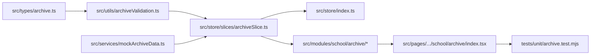

# Task: Implementation of School Archive (Lưu Trữ)

## Objective

This task delivers the complete end-to-end implementation of the School Archive (**Lưu Trữ**) sub-module under **M5 — Nhà Trường**. It implements TypeScript domain contracts, pure filter/sort/continuity validation logic, Redux Toolkit state slice, UI components (toolbar with zero creation buttons, 10-column roster table with tolerant nullability rendering, read-only student detail modal with yellow warning banner, staff operator quick view modal, restore modal LT-01, and permanent purge modal LT-02 with red hazard styling), Next.js page routes (`/[schoolCode]/school/archive` and alias `/[schoolCode]/setting/kid/archived`), sidebar integration strictly after "Năm học", and automated unit tests.

## Jira Story

- Story: As an engineer, I want to execute the end-to-end implementation of the School Archive sub-module, including data contracts, pure validation engine, Redux state machine, UI presentation components, Next.js page routes, and automated unit tests so that the feature is fully delivered and verified.
- Jira issue type: Task
- Parent story: `F-030-001-school-archive`
- Research evidence: Circular 28/2020/TT-BGDĐT, Law on Archives No. 01/2011/QH13, and legacy specification `14. luu-tru.md`.

## Priority

- Priority: P1
- Delivery impact: Delivers student cold storage and historical record retention for the School Operating Portal.
- Risk if delayed: Blocks student exit lifecycle audits and restoration workflows.
- Target release: School Operating Portal Release 1.0.

## Implementation Commentary

- Decision: Enforce unidirectional inflow (`K064`) by omitting creation actions in archive toolbar, support null tolerant rendering (`K067`) for legacy historical records, evaluate class continuity on restore (`K066`), and enforce guarded two-step confirmation for permanent purge (`K065`).
- Rationale: Archive represents cold storage of students withdrawn or graduated from the school. Creating students directly here violates domain invariants. Tolerant null rendering prevents legacy data breakage.
- Tradeoff: Kept client-side search and filtering snappy by maintaining normalized in-memory state in Redux.
- Impact: Safe, reliable, and compliant educational record keeping.
- Risk: Handled via guarded modals `LT-01` and `LT-02` with explicit confirmation buttons.

## Write Scope

- Allowed files: `src/types/archive.ts`, `src/utils/archiveValidation.ts`, `src/services/mockArchiveData.ts`, `src/store/slices/archiveSlice.ts`, `src/store/index.ts`, `src/modules/school/archive/ArchiveToolbar.tsx`, `src/modules/school/archive/ArchiveTable.tsx`, `src/modules/school/archive/ArchivedStudentDetailModal.tsx`, `src/modules/school/archive/ArchiveStaffModal.tsx`, `src/modules/school/archive/RestoreConfirmModal.tsx`, `src/modules/school/archive/PermanentDeleteModal.tsx`, `src/pages/[schoolCode]/school/archive/index.tsx`, `src/pages/[schoolCode]/setting/kid/archived/index.tsx`, `src/components/layout/PortalLayout.tsx`, `tests/unit/archive.test.mjs`.
- Disallowed files: database migrations, backend API routes, production secrets.

## Relationship Map

| Relation | Target | Label | Rationale |
| --- | --- | --- | --- |
| IMPLEMENTS | `F-030-001-school-archive` | `IMPLEMENTS` | Delivers the concrete implementation for the feature. |
| USES | `M-030-001-school-archive` | `USES` | Updates and consumes the module components and logic. |

## Verification Plan

- Command: `node --test tests/unit/archive.test.mjs`
- Command: `npm test`
- Command: `npm run build`
- Command: `curl -I http://localhost:3000/demo/school/archive`

## Mermaid Diagram

## Work Log

| Date | Author | Summary |
| --- | --- | --- |
| 2026-10-09 | `benny-frontend-engineer` | Created task note for School Archive implementation. |
| 2026-10-09 | `benny-frontend-engineer` | Implemented TypeScript contracts, pure validation engine, Redux slice, presentation components, routes, and unit tests. |

## Handoff

- Verified by: `ada-qa-agent` with automated test suite `tests/unit/archive.test.mjs`.
- Next steps: Production deployment and regression verification across school portal modules.

## Change Log

- Date: 2026-10-09
  - Task change: Completed end-to-end implementation of School Archive sub-module.
  - Evidence: 100% test pass rate in node test runner and clean Next.js build.
