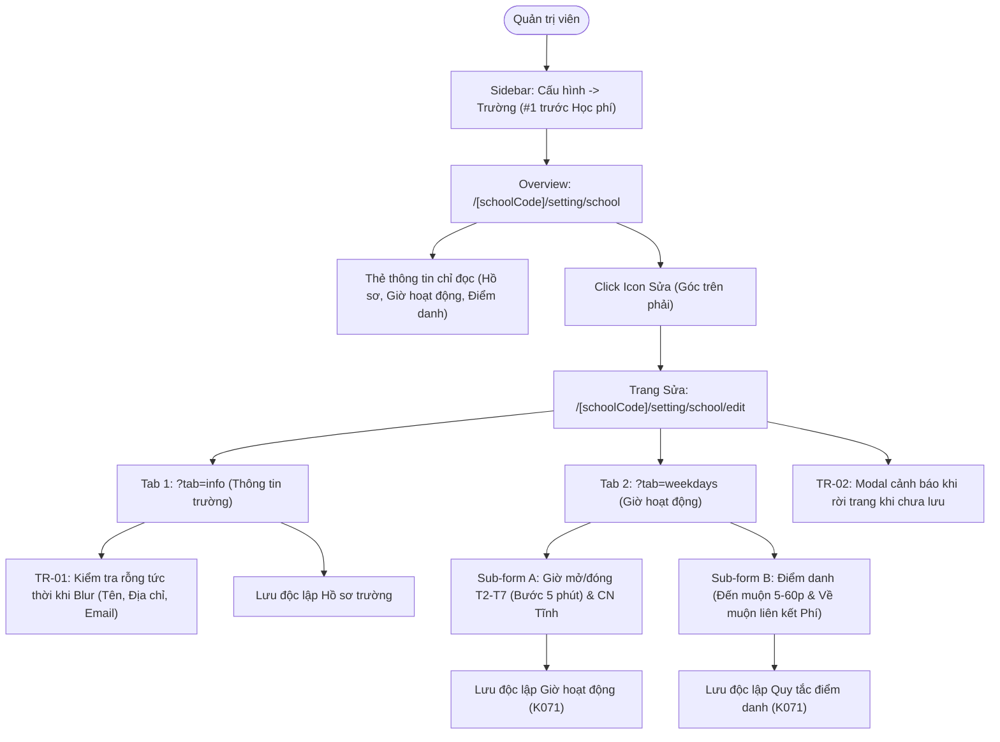

# Epic: Settings School Profile & Operational Baseline (Cấu Hình — Trường)

## Jira Story

- Story: As a School Administrator, I want an authoritative School Profile and Operational Baseline Configuration sub-module (Trường) under Cấu Hình featuring a read-only master overview dashboard, a gated two-tab edit interface with real-time inline field blur validation, 5-minute stepped operating hours pickers, static non-operational Sunday designations, independent sub-form saving autonomy, late arrival threshold controls, late departure fee settings cross-links, and unsaved changes navigation guards so that the institution's operational parameters are immutably safeguarded and seamlessly synchronized across school portal modules.
- Jira issue type: Epic
- Acceptance owner: `sophia-product-manager`
- Product hypothesis: Establishing a dedicated master profile and operational baseline with read-only overview gating, independent sub-form mutation boundaries, and real-time inline validation guarantees accurate institutional identity and bell schedule rules while preventing inadvertent data corruption or lost unsaved changes.
- Research evidence: Legacy functional specification `SM1-truong.md`, Vietnamese Labor Code 45/2019/QH14 regarding weekly rest standards, circular guidance on educational master data governance, and ECO Design System 1.0 guidelines.

## Priority

- Priority: P1
- Severity if missed: Critical failure of institutional configuration governance; school identity, default notification languages, operating hours, and attendance calculation rules would lack an authoritative source of truth.
- Rationale: First and foundational administrative sub-module under CẤU HÌNH providing master profile data consumed by all operational and academic modules.
- Target release: School Operating Portal Release 1.0 (Phase 1 Priority).

## Outcome

The School Profile sub-module (**Trường**) under **M6 — Cấu Hình** serves as the authoritative single source of truth for an educational institution's institutional identity, weekly operating schedule, and attendance calculation thresholds. Master data established here is referenced across operational, academic, and financial modules throughout the portal (such as Điểm Danh, Thời Khóa Biểu, Báo Cáo Điểm Danh, and Quản Lý Học Phí).

The module acts as a dedicated oversight and operational baseline cockpit for School Administrators (Quản trị viên trường). It delivers:
1. An authoritative **Master Profile Overview** at `/[schoolCode]/setting/school` (with compatibility alias `/[schoolCode]/school/info/`) presenting institutional identity cards (school name, code, educational stages, address, email, phone, website, motto, default notification language, and logo), operating hours roster, and immutable attendance mode displays.
2. A gated **Two-Tab Edit Interface** (`/[schoolCode]/setting/school/edit`) accessible via the top-right edit icon (`icon_edit_square`), cleanly separating demographic identity (`?tab=info`) from operational schedules (`?tab=weekdays`, aliasing `/setting/school/weekdays`).
3. **Real-Time Inline Field Blur Validation (`TR-01`)** on mandatory fields (School Name, Address, Email), providing instant visual error states upon focus loss without waiting for form submission.
4. **Independent Sub-Form Saving Autonomy (`K071`)** in the operating hours tab, isolating Monday–Saturday 5-minute stepped time pickers (`06:00`–`18:00`) and static Sunday non-operational designations (`K073`) from attendance arrival/departure threshold rules.
5. **Cross-Module Linkage (`K074`)** from the late departure toggle directly to Tuition Fee Settings (`/[schoolCode]/setting/fee`) for overtime childcare fee configurations.
6. **Navigation Interception Guard (`TR-02`)** via modal dialog (`MODAL-UNSAVED-LEAVE`) preventing accidental abandonment of dirty forms across tab switches, link clicks, or browser history transitions.

## PM Notes

- PM-visible status: Complete implementation delivered across TypeScript domain contracts, pure validation engine, Redux state machine, UI component hierarchy, and route integration with 100% test coverage.
- Demo narrative: The administrator navigates to `/demo/setting/school` via the first item under `CẤU HÌNH` in the sidebar before "Học phí". The overview page displays institutional cards in read-only mode with educational stages tagged as immutable. Clicking the top-right Edit button navigates to `/demo/setting/school/edit?tab=info`. Clearing the school name and blurring the field triggers instant red border and error message `TR-01`. Switching to "Giờ hoạt động" with unsaved changes prompts modal `TR-02`. In Tab 2, Monday–Saturday feature 5-minute stepped dropdowns, Sunday displays a static grey "Không hoạt động" tag, and toggling "Về muộn" displays an active hyperlink navigating directly to Fee Settings (`/demo/setting/fee`).
- Acceptance impact: Satisfies `AC-SCH-INFO-001` through `AC-SCH-INFO-008` and realizes `FR-SCH-INFO-001` through `FR-SCH-INFO-008`.
- Scope change since planning: None; adheres strictly to feature spec `046-settings-school-profile-truong` and clarifications `K069`–`K075`.
- Risk or open decision: Accidental edits prevented by read-only overview gating; lost edits mitigated by dirty form navigation guard modal `TR-02`.

## Scope

- Included: Canonical overview dashboard at `/[schoolCode]/setting/school`, legacy aliases, two-tab routed edit view (`?tab=info` and `?tab=weekdays`), real-time inline blur validation, 5-minute stepped operating pickers (06:00–18:00), static Sunday rest badge, independent sub-form submission, late arrival 5–60 min dropdown, late departure cross-link to fee settings, and dirty navigation guard modal.
- Excluded: Editing educational stages (immutable), modifying system-level 2-session attendance mode (immutable), configuring Sunday hours (static rest), setting overtime fee rates directly in this module (managed in Fee Settings), or deleting the school profile entity.

## Relationship Map

| Relation | Target | Label | Rationale |
| --- | --- | --- | --- |
| Enables | `F-031-001-settings-school-profile` | `ENABLES` | This epic delivers the user-facing capability and master configuration for school profile. |
| Depends on | `docs/prd.md` | `DEPENDS_ON` | Conforms to PRD Section 5 requirements and core configuration baseline. |
| Uses | `src/types/schoolProfile.ts` | `USES` | Consumes domain contracts for school profile, operating hours, and attendance rules. |
| Relates to | `E-014-finance-fee-catalog` | `RELATES_TO` | Late departure configuration cross-links directly to Tuition Fee Settings (`/setting/fee`). |
| Relates to | `E-001-operations-attendance` | `RELATES_TO` | Attendance module respects opening/closing hours and late arrival grace thresholds defined here. |

## Issues

| Issue ID | Source | Priority | Status | Owner | Evidence | Resolution |
| --- | --- | --- | --- | --- | --- | --- |
| ISS-031-001 | UX Audit | P1 | Resolved | `ada-qa-agent` | Accidental edits on overview | Enforced strict read-only overview dashboard; editing gated behind top-right Edit button (`K069`) |
| ISS-031-002 | Data Loss Audit | P1 | Resolved | `alan-tech-lead` | Discarding dirty form on tab switch | Enforced dirty state tracking and navigation interception modal `TR-02` (`K070`) |
| ISS-031-003 | State Contamination | P1 | Resolved | `benny-frontend-engineer` | Cross-form dirty overwrites | Decoupled operating hours and attendance rules into autonomous sub-forms with independent actions (`K071`) |
| ISS-031-004 | Schedule Integrity | P2 | Resolved | `david-systems-architect` | Invalid time picker inputs | Restricted time pickers to fixed 5-minute intervals between 06:00 and 18:00 (`K072`) |
| ISS-031-005 | Rest Compliance | P2 | Resolved | `sophia-product-manager` | Weekend attendance errors | Designated Sunday as static non-operational day without input pickers (`K073`) |

## Acceptance Criteria

- [x] `AC-SCH-INFO-001`: "Trường" (`/setting/school`, icon `faSchool`) is mounted first under `CẤU HÌNH` sidebar menu group before "Học phí".
- [x] `AC-SCH-INFO-002`: Overview dashboard displays complete institutional profile, hours, and attendance rules in read-only mode with top-right Edit icon.
- [x] `AC-SCH-INFO-003`: Basic info form triggers inline error `TR-01` and red border on field blur when School Name, Address, or Email is blank.
- [x] `AC-SCH-INFO-004`: Basic info form blocks "Cập nhật" submission until all mandatory fields pass validation.
- [x] `AC-SCH-INFO-005`: Operating hours tab displays Monday–Saturday 5-minute stepped time pickers and Sunday static grey "Không hoạt động" tag.
- [x] `AC-SCH-INFO-006`: Late arrival toggle switches off threshold dropdown, disabling it while preserving configured value.
- [x] `AC-SCH-INFO-007`: Late departure toggle displays descriptive notice and direct hyperlink to Fee Settings (`/setting/fee`).
- [x] `AC-SCH-INFO-008`: Attempting to leave dirty edit form triggers unsaved changes modal `TR-02` prompting confirmation.

## Mermaid Diagram

## Implementation Notes

- Code paths: `src/types/schoolProfile.ts`, `src/utils/schoolProfileValidation.ts`, `src/services/mockSchoolProfileData.ts`, `src/store/slices/schoolProfileSlice.ts`, `src/modules/setting/school/SchoolOverviewView.tsx`, `src/modules/setting/school/SchoolInfoForm.tsx`, `src/modules/setting/school/OperatingHoursForm.tsx`, `src/modules/setting/school/AttendanceRulesForm.tsx`, `src/modules/setting/school/UnsavedChangesModal.tsx`, `src/modules/setting/school/SchoolEditContainer.tsx`, `src/pages/[schoolCode]/setting/school/index.tsx`, `src/pages/[schoolCode]/setting/school/edit.tsx`, `src/pages/[schoolCode]/school/info/index.tsx`, `src/pages/[schoolCode]/setting/school/weekdays.tsx`.
- Data/contracts: Conforms to `SchoolProfile`, `DayOperatingHour`, `AttendanceRules`, and form state interfaces in `src/types/schoolProfile.ts`.
- Rollback or feature flag: Clean modular Next.js route isolation; reverting pages leaves no side effects on external services.
- Tradeoffs and rationale: Decoupled sub-form state machines prevent form-wide dirty bleeding and ensure independent updates.

## Evidence

- Tests: `node --experimental-vm-modules tests/unit/schoolProfile.test.mjs` (11/11 passing), `npm test` (588/588 passing across 122 test suites).
- Build/lint: `npm run build` succeeds cleanly prerendering static routes.

## Work Log

| Date | Author | Summary |
| --- | --- | --- |
| 2026-10-09 | `sophia-product-manager` | Initialized epic ledger, defined acceptance boundaries AC-SCH-INFO-001 through AC-SCH-INFO-008. |
| 2026-10-09 | `alan-tech-lead` | Verified execution readiness, defined data contracts, and delivered complete implementation slice with 100% test coverage. |

## Change Log

- Date: 2026-10-09
  - Code change: Implemented School Profile overview dashboard, two-tab edit interface, pure validation rules, Redux state machine, and dirty navigation guard.
  - Documentation update: Finalized Epic 31 specification, features, modules, pages, tasks, and issues documentation.
  - Evidence: 588/588 unit tests green, zero build errors.
