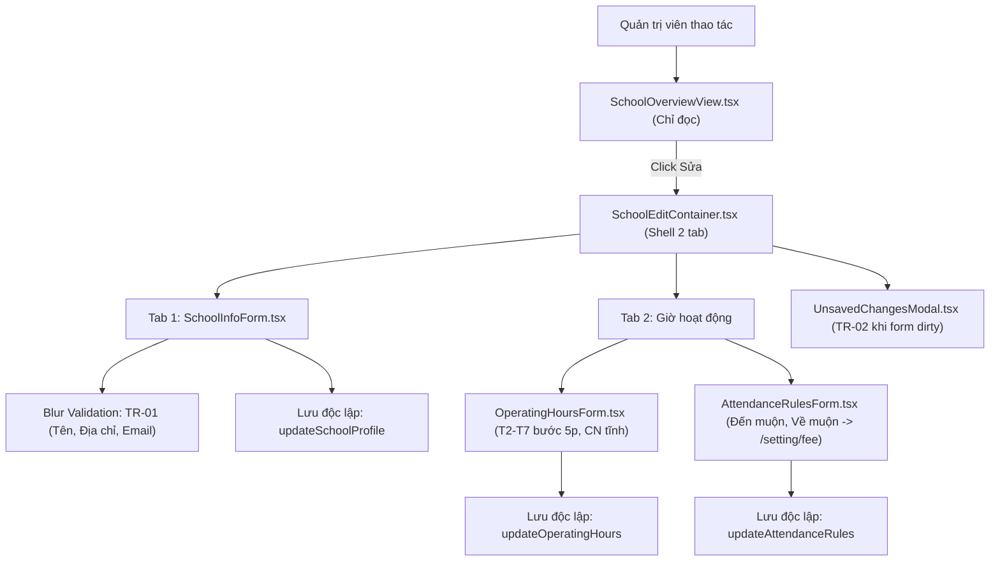

# Feature: Settings School Profile (Cấu Hình — Trường)

## User Value

The School Profile feature delivers an authoritative administrative cockpit where school administrators can review and maintain the educational institution's core demographics, weekly operating schedule, and attendance threshold rules.

By providing a read-only overview dashboard at `/[schoolCode]/setting/school`, the system ensures master institutional parameters are easily inspected without risking inadvertent keystrokes or accidental modifications. An explicit Edit icon transitions to a routed two-tab interface separating institutional demographics (`?tab=info`) from weekly operating hours (`?tab=weekdays`).

In the demographics tab, real-time inline field blur validation (`TR-01`) immediately alerts administrators if mandatory fields (School Name, Address, or Email) are left blank. In the operating hours tab, Monday through Saturday are governed by 5-minute stepped opening and closing time pickers (`06:00`–`18:00`), Sunday is statically preserved as non-operational, and saving operating hours does not touch or validate attendance thresholds. Furthermore, a late departure toggle provides a direct hyperlink to Tuition Fee Settings, and any attempt to depart an unsaved form is intercepted by confirmation modal `TR-02`.

## Jira Story

- Story: As a School Administrator, I want to manage the school's master profile, operating hours, and attendance baseline rules via a read-only overview dashboard and an independent two-tab edit interface with real-time blur validation, 5-minute interval controls, static Sunday rest designations, and navigation departure guards so that institutional configurations remain authoritative and safe from accidental loss.
- Jira issue type: Story
- Story points: 5
- Acceptance owner: `sophia-product-manager`
- Research evidence: Legacy functional specification `SM1-truong.md`, Vietnamese Labor Code 45/2019/QH14, circular guidance on school records governance, and ECO Design System 1.0 guidelines.

## Priority

- Priority: P1
- User/business impact: High; foundational institutional profile consumed across attendance, timetable, reports, and tuition management.
- Risk if delayed: Inability to configure school identity, operational bell schedules, or attendance grace thresholds.
- Release target: School Operating Portal Release 1.0.

## PM Notes

- Demo scenario: Navigate to `/[schoolCode]/setting/school` via the first item under `CẤU HÌNH` in the sidebar before "Học phí". View read-only cards showing school identity, operating hours, and attendance modes. Click the top-right Edit button (`icon_edit_square`) to access `/[schoolCode]/setting/school/edit?tab=info`. Clear the school name and blur focus; observe instant red border and inline error `TR-01`. Enter a valid name, modify the motto, and switch tabs to "Giờ hoạt động"; observe modal `TR-02` warning of unsaved changes. In Tab 2, observe Monday–Saturday 5-minute stepped dropdowns, Sunday's static grey "Không hoạt động" tag, and late departure's active cross-link navigating to `/setting/fee`.
- Business value: Guarantees statutory data integrity, prevents cross-form data overwrite, and eliminates lost configuration work.
- Acceptance criteria confirmed: `AC-SCH-INFO-001` through `AC-SCH-INFO-008`.
- Open PM decision: None; all 7 clarifications (`K069`–`K075`) resolved.

## Requirements Trace

- PRD requirement: `FR-SCH-INFO-001`, `FR-SCH-INFO-002`, `FR-SCH-INFO-003`, `FR-SCH-INFO-004`, `FR-SCH-INFO-005`, `FR-SCH-INFO-006`, `FR-SCH-INFO-007`, `FR-SCH-INFO-008`.
- Task id: `TASK-SCH-INFO-001` through `TASK-SCH-INFO-008`.
- Spec id: `046-settings-school-profile-truong`.

## Scope

- Included: Overview dashboard at `/[schoolCode]/setting/school`, legacy aliases (`/school/info` and `/setting/school/weekdays`), two-tab edit view (`?tab=info` and `?tab=weekdays`), inline blur validation (`TR-01`), 5-minute stepped time pickers (`06:00`–`18:00`), static Sunday rest badge, independent sub-form saving (`K071`), late arrival 5–60 min dropdown, late departure link to fee settings (`K074`), and dirty form departure guard modal `TR-02`.
- Excluded: Editing educational stages (immutable), modifying system-level 2-session attendance mode (immutable), configuring Sunday hours (static non-operational), setting numeric overtime fee rates directly in this module (managed in Fee Settings), or deleting the school profile entity.

## Relationship Map

| Relation | Target | Label | Rationale |
| --- | --- | --- | --- |
| Implements | `E-031-settings-school-profile` | `IMPLEMENTS` | Core feature realizing the epic objectives. |
| Depends on | `M-031-001-settings-school-profile` | `DEPENDS_ON` | Consumes the presentation components and state architecture of the profile module. |
| Depends on | `P-031-001-settings-school-profile` | `DEPENDS_ON` | Surfaces through canonical routes `/setting/school` and `/setting/school/edit`. |
| Uses | `src/utils/schoolProfileValidation.ts` | `USES` | Executes pure validation, time option generation, and rule evaluation. |
| Relates to | `F-014-001-finance-fee-catalog` | `RELATES_TO` | Late departure configuration cross-links directly to Tuition Fee Settings (`/setting/fee`). |

## Code Scope

- Types: `src/types/schoolProfile.ts`
- Pure logic: `src/utils/schoolProfileValidation.ts`
- State: `src/store/slices/schoolProfileSlice.ts`, `src/store/index.ts`
- Mock data: `src/services/mockSchoolProfileData.ts`
- Components: `src/modules/setting/school/SchoolOverviewView.tsx`, `SchoolInfoForm.tsx`, `OperatingHoursForm.tsx`, `AttendanceRulesForm.tsx`, `UnsavedChangesModal.tsx`, `SchoolEditContainer.tsx`
- Routes: `src/pages/[schoolCode]/setting/school/index.tsx`, `src/pages/[schoolCode]/setting/school/edit.tsx`, `src/pages/[schoolCode]/school/info/index.tsx`, `src/pages/[schoolCode]/setting/school/weekdays.tsx`
- Layout: `src/components/layout/PortalLayout.tsx`
- Tests: `tests/unit/schoolProfile.test.mjs`

## Acceptance Criteria

- [x] `AC-SCH-INFO-001`: Mounted first under `CẤU HÌNH` in the sidebar before "Học phí" with icon `faSchool`.
- [x] `AC-SCH-INFO-002`: Overview dashboard displays read-only profile cards with top-right Edit button navigating to edit mode.
- [x] `AC-SCH-INFO-003`: Basic info form displays red border and inline error `TR-01` on field blur when mandatory fields are empty.
- [x] `AC-SCH-INFO-004`: Basic info form blocks "Cập nhật" submission until all mandatory fields pass validation.
- [x] `AC-SCH-INFO-005`: Operating hours tab displays Monday–Saturday 5-minute stepped time pickers and static grey Sunday "Không hoạt động" tag.
- [x] `AC-SCH-INFO-006`: Late arrival toggle switches off threshold dropdown, disabling it while preserving configured value.
- [x] `AC-SCH-INFO-007`: Late departure toggle displays descriptive notice and active hyperlink to Fee Settings (`/setting/fee`).
- [x] `AC-SCH-INFO-008`: Attempting to leave dirty edit form triggers unsaved changes modal `TR-02` prompting confirmation.

## Mermaid Diagram

## Implementation Notes

- Code paths: `src/modules/setting/school/SchoolOverviewView.tsx`, `SchoolInfoForm.tsx`, `OperatingHoursForm.tsx`, `AttendanceRulesForm.tsx`, `UnsavedChangesModal.tsx`, `SchoolEditContainer.tsx`.
- Data/contracts: Conforms to `src/types/schoolProfile.ts`.
- Rollback: Revert page component and Redux slice registration without backend dependencies.
- Tradeoffs: Client-side routing with Next.js router events (`beforePopState` and `routeChangeStart`) guarantees intercepting unsaved form leaves.

## Verification

- Command: `node --experimental-vm-modules tests/unit/schoolProfile.test.mjs`
- Command: `npm test`
- Command: `npm run build`

## Work Log

| Date | Author | Summary |
| --- | --- | --- |
| 2026-10-09 | `benny-frontend-engineer` | Created feature document for Settings School Profile. |
| 2026-10-09 | `benny-frontend-engineer` | Implemented domain types, validation engine, state machine, and presentation components. |

## Change Log

- Date: 2026-10-09
  - Feature change: Delivered School Profile feature with read-only overview dashboard, two-tab edit interface, inline blur validation, stepped operating hours, and unsaved changes navigation guard.
  - Evidence: Unit test suite passing (11/11 suite, 588/588 full project) and clean Next.js build.
