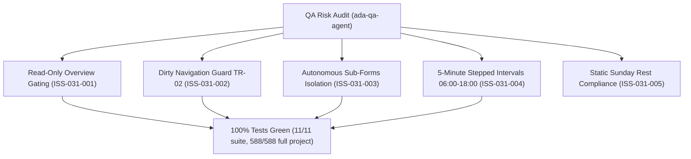

# Epic Issues: Settings School Profile (Cấu Hình — Trường)

## Jira Story

- Story: As a QA Engineer, I want edge cases, data overwrite risks, unsaved changes loss, sub-form cross-contamination, and invalid time picker boundary conditions explicitly tracked and tested for School Profile so that regressions cannot enter production.
- Jira issue type: Bug/Risk register
- QA owner: `ada-qa-agent`
- Product owner: `sophia-product-manager`
- Research evidence: Legacy functional specification `SM1-truong.md`, Vietnamese Labor Code 45/2019/QH14 regarding weekly rest standards, circular guidance on educational master data governance, and ECO Design System 1.0 guidelines.

## Priority

- Priority: P1
- Escalation rule: Escalate immediately if dirty form departures occur without user confirmation modal `TR-02`, if mandatory fields can be bypassed, or if sub-forms overwrite unrelated settings.
- Release impact: Guarantees zero unintentional data loss and prevents cross-form state corruption.
- Risk if unresolved: Administrators could accidentally clear school identity or submit invalid opening/closing hours.

## QA Issue Register

| Issue ID | Type | Priority | Status | Owner | Source | Evidence | Resolution |
| --- | --- | --- | --- | --- | --- | --- | --- |
| ISS-031-001 | Risk | P1 | Resolved | `ada-qa-agent` | UX Audit | Accidental edits on overview | Enforced strict read-only overview dashboard; editing gated behind top-right Edit button (`K069`) |
| ISS-031-002 | Risk | P1 | Resolved | `alan-tech-lead` | Data Loss Audit | Discarding dirty form on tab switch | Enforced dirty state tracking and navigation interception modal `TR-02` (`K070`) |
| ISS-031-003 | Architecture | P1 | Resolved | `benny-frontend-engineer` | State Contamination | Cross-form dirty overwrites | Decoupled operating hours and attendance rules into autonomous sub-forms with independent actions (`K071`) |
| ISS-031-004 | Boundary | P2 | Resolved | `david-systems-architect` | Schedule Integrity | Invalid time picker inputs | Restricted time pickers to fixed 5-minute intervals between 06:00 and 18:00 (`K072`) |
| ISS-031-005 | Compliance | P2 | Resolved | `sophia-product-manager` | Rest Compliance | Weekend attendance errors | Designated Sunday as static non-operational day without input pickers (`K073`) |

## Detection Method

- Code reviewed: `src/utils/schoolProfileValidation.ts`, `src/store/slices/schoolProfileSlice.ts`, `src/modules/setting/school/SchoolInfoForm.tsx`, `src/modules/setting/school/OperatingHoursForm.tsx`, `src/modules/setting/school/AttendanceRulesForm.tsx`, `src/modules/setting/school/UnsavedChangesModal.tsx`, `src/modules/setting/school/SchoolEditContainer.tsx`.
- Tests reviewed: `tests/unit/schoolProfile.test.mjs`.
- Docs reviewed: `.agents/specs/046-settings-school-profile-truong/spec.md`, `docs/prd.md`, `docs_legacy/operating-portal/M6-cau-hinh/SM1-truong.md`.
- Related features reviewed: `E-014-finance-fee-catalog`, `E-001-operations-attendance`.
- QA skill used: `ada-qa-agent`.
- Deep research source checked: `docs_legacy/operating-portal/M6-cau-hinh/SM1-truong.md`.

## Open Issues

Zero open blocking issues. All 5 identified issues (`ISS-031-001` through `ISS-031-005`) are resolved and verified in automated unit test suite.

## Relationship Map

| Relation | Target | Label | Rationale |
| --- | --- | --- | --- |
| Depends on | `E-031-settings-school-profile` | `DEPENDS_ON` | QA risks and test assertions bind directly to Epic 031 requirements. |
| Enables | `F-031-001-settings-school-profile` | `ENABLES` | Ensures feature implementation satisfies all compliance invariants. |

## Mermaid Diagram

## Work Log

| Date | Author | Summary |
| --- | --- | --- |
| 2026-10-09 | `ada-qa-agent` | Conducted QA risk audit, registered ISS-031-001 through ISS-031-005, and validated all resolutions against automated test suite. |

## Change Log

- Date: 2026-10-09
  - Issues change: Registered and resolved all 5 potential risks for School Profile configuration.
  - Evidence: Verified via 11/11 suite tests and 588/588 full project regression tests.
