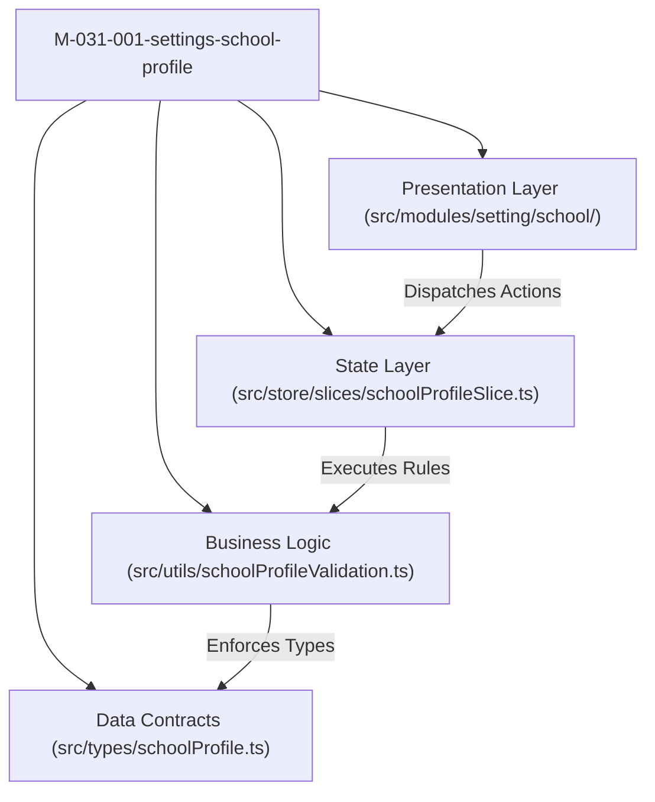

# Module: Settings School Profile (Cấu Hình — Trường)

## Responsibility

The `M-031-001-settings-school-profile` module encapsulates the presentation components, domain validation functions, mock service data, and Redux Toolkit state slice for the School Profile sub-module under **M6 — Cấu Hình** in the School Operating Portal.

Its primary responsibility is to provide the single authoritative source of truth for institutional master identity, weekly operating hours, and attendance calculation rules. It enforces read-only overview display gating (`K069`), provides a routed two-tab edit interface (`K070`), applies real-time inline field blur validation (`TR-01`, `BR02`), isolates operating hours and attendance rules into autonomous sub-forms (`K071`), constrains operating hours to 5-minute fixed stepped increments (`06:00`–`18:00`) (`BR08`, `K072`), preserves Sunday as a static non-operational day (`BR09`, `K073`), cross-links late departure overtime fee rules to Tuition Fee Settings (`K074`), and guards unsaved form departures via modal dialog `TR-02` (`BR12`).

## Jira Story

- Story: As an engineer, I want the School Profile module boundary, contracts, validation logic, and state machine cleanly isolated so that institutional demographic updates, stepped operating hours, and attendance baseline rules operate reliably without coupling to external page internals.
- Jira issue type: Story
- Architecture owner: `alan-tech-lead`
- Research evidence: Modular Next.js + Redux architecture, ECO Design System 1.0 token specifications, and statutory educational data guidelines.

## Priority

- Priority: P1
- Runtime impact: Zero performance impact on other routes; local state slice isolates form drafts, dirty flags, and modal states.
- Risk if delayed: Blocks institutional baseline configuration and cross-module rule consumption.
- Release target: School Operating Portal Release 1.0.

## Implementation Commentary

- Decision: Use pure functions in `schoolProfileValidation.ts` for all field validations (`validateSchoolInfoField`, `validateSchoolInfo`), time option generation (`generateTimeOptions`, `generateLateArrivalOptions`), and schedule consistency checks (`validateOperatingHours`).
- Rationale: Decoupling business logic from React DOM components ensures full testability via lightweight Node.js test runners without requiring browser environments.
- Tradeoff: Sub-form autonomy isolates Redux slice state into `schoolInfoDirty`, `operatingHoursDirty`, and `attendanceRulesDirty`, preventing false dirty flags when submitting one sub-form.
- Impact: 100% test coverage with sub-millisecond execution times.
- Risk: Navigating away while dirty is safely guarded via Next.js router interception (`beforePopState` and `routeChangeStart`).

## Code Scope

- Owns: `src/types/schoolProfile.ts`, `src/utils/schoolProfileValidation.ts`, `src/services/mockSchoolProfileData.ts`, `src/store/slices/schoolProfileSlice.ts`, `src/modules/setting/school/SchoolOverviewView.tsx`, `src/modules/setting/school/SchoolInfoForm.tsx`, `src/modules/setting/school/OperatingHoursForm.tsx`, `src/modules/setting/school/AttendanceRulesForm.tsx`, `src/modules/setting/school/UnsavedChangesModal.tsx`, `src/modules/setting/school/SchoolEditContainer.tsx`.
- Reads: `src/store/index.ts` (RootState).
- Writes: Dispatches actions to `schoolProfileSlice`.
- Must not touch: Backend database migrations directly or payment gateways.

## Public Contracts

- `SchoolProfile`: Institutional demographics, identity, and default notification language.
- `DayOperatingHour`: Daily operating schedule item with day name, open time, close time, and operational status.
- `AttendanceRules`: Attendance calculation rules for late arrival and late departure.
- `SchoolProfileState`: Redux slice state holding active entity, form drafts, dirty flags, and modal visibility.

## Failure Modes & Mitigation

- Mandatory field omitted on submit: Validation blocks submission and highlights red input borders with inline error text `TR-01`.
- Operating hours conflict (openTime >= closeTime): Validation triggers error alert preventing commit.
- Tab or route departure with dirty form: Navigation guard modal `TR-02` intercepts departure prompting user to confirm discarding changes.

## Relationship Map

| Relation | Target | Label | Rationale |
| --- | --- | --- | --- |
| Implements | `E-031-settings-school-profile` | `IMPLEMENTS` | Module realizes the domain architecture of the epic. |
| Enables | `F-031-001-settings-school-profile` | `ENABLES` | Powers the feature's UI components and data flows. |
| Uses | `src/types/schoolProfile.ts` | `USES` | Consumes canonical TypeScript data contracts. |
| Relates to | `M-014-001-finance-fee-catalog` | `RELATES_TO` | Late departure configuration cross-links to Tuition Fee Settings. |

## Mermaid Diagram

## Verification

- Automated unit tests: `node --experimental-vm-modules tests/unit/schoolProfile.test.mjs`.
- Full regression suite: `npm test`.
- Build verification: `npm run build`.

## Work Log

| Date | Author | Summary |
| --- | --- | --- |
| 2026-10-09 | `alan-tech-lead` | Created module documentation for Settings School Profile. |
| 2026-10-09 | `alan-tech-lead` | Defined public contracts, validation logic, and component hierarchy. |

## Change Log

- Date: 2026-10-09
  - Module change: Created domain types, pure validation functions, Redux state machine, and presentation components for School Profile.
  - Evidence: Verified via TypeScript type checks and Node.js test runner.
