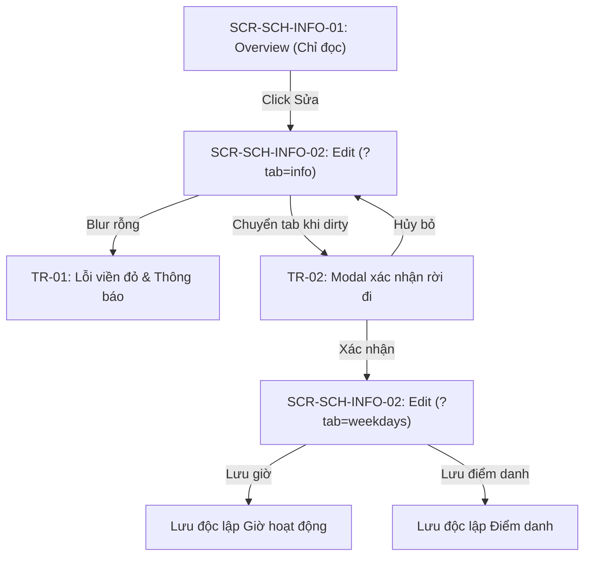

# Page: Settings School Profile (Cấu Hình — Trường)

## Route / Surface

- Route: `/[schoolCode]/setting/school` (Canonical Overview), `/[schoolCode]/setting/school/edit` (Two-tab Edit Interface), `/[schoolCode]/school/info` (Legacy overview alias), and `/[schoolCode]/setting/school/weekdays` (Legacy weekdays edit alias).
- Entry components: `src/pages/[schoolCode]/setting/school/index.tsx`, `src/pages/[schoolCode]/setting/school/edit.tsx`.
- Layout owner: `src/components/layout/PortalLayout.tsx`.

## Jira Story

- Story: As a School Administrator, I want to access the School Profile overview at /setting/school and edit interface at /setting/school/edit with inline blur validation, stepped operating pickers, and departure guards so that institutional configurations are cleanly maintained.
- Jira issue type: Story
- UX owner: `benny-frontend-engineer`
- Research evidence: Screen specifications `SCR-SCH-INFO-01` (Overview), `SCR-SCH-INFO-02` (Two-tab Edit), modal `MODAL-UNSAVED-LEAVE`, and legacy specification `SM1-truong.md`.

## Priority

- Priority: P1
- Demo impact: High; illustrates institutional configuration, read-only protection, and dirty state navigation guard.
- Risk if delayed: Leaves the portal without an authoritative school configuration interface.
- Release target: School Operating Portal Release 1.0.

## PM Notes

- Demo path: Login as school admin -> In left sidebar under `CẤU HÌNH`, click "Trường" (first item before "Học phí") -> View read-only cards showing school identity, operating hours, and attendance modes -> Click top-right Edit button (`icon_edit_square`) -> Form opens on `?tab=info` -> Clear School Name and blur focus; inline error `TR-01` appears immediately -> Enter valid name, modify motto, and click "Giờ hoạt động" tab -> Modal `TR-02` appears prompting confirmation -> Confirm departure and switch to Tab 2 -> Observe Monday–Saturday 5-minute stepped dropdowns, static Sunday grey tag, and late departure cross-link navigating to `/setting/fee`.
- User promise: Authoritative institutional profile management with zero accidental data corruption.
- Acceptance impact: Realizes `AC-SCH-INFO-001` through `AC-SCH-INFO-008`.
- Visual or copy change: Brand blue `#006FDA` accents, warning yellow `#FFCA00`, danger red `#C0263A`, clean typography, stepped select menus.
- Risk: Dirty form departure prevented by Next.js router interception.

## Relationship Map

| Relation | Target | Label | Rationale |
| --- | --- | --- | --- |
| Implements | `F-031-001-settings-school-profile` | `IMPLEMENTS` | Renders the complete school profile administrative experience. |
| Uses | `M-031-001-settings-school-profile` | `USES` | Composes presentation components and Redux slice. |

## Page Structure & Responsive States

1. **Overview Page (`/[schoolCode]/setting/school`):**
   - Header with title "Hồ sơ trường", breadcrumbs, and top-right Edit button (`EcoButton` primary with `leadingIcon="edit"`).
   - Identity Card: Logo, full name, short name, code, educational stages (read-only chips), address, website, phone, email, motto, contact info, default notification language.
   - Operating Hours Card: Monday–Sunday roster with opening/closing hours and static Sunday non-operational indicator.
   - Attendance Baseline Card: Read-only attendance mode (`Điểm danh 2 buổi`), session windows, late arrival threshold, and late departure status.
2. **Two-Tab Edit Page (`/[schoolCode]/setting/school/edit`):**
   - Tab header: "Thông tin trường" (`?tab=info`) and "Giờ hoạt động" (`?tab=weekdays`).
   - Tab 1 Form: Mandatory inputs with real-time blur validation (`TR-01`), logo upload, and independent "Cập nhật" action.
   - Tab 2 Form: Sub-Form A for weekly operating hours (Mon–Sat 5-minute stepped select menus, static Sunday rest badge) and Sub-Form B for attendance arrival/departure rules with Fee Settings cross-link.
   - Departure Interception: Modal dialog `TR-02` rendered when leaving while dirty.

## States

- Read-Only Overview State: Authoritative identity and schedule display with top-right Edit button.
- Clean Edit State: Form loaded with persisted data, clean input fields, and no dirty warning.
- Inline Validation Error State (`TR-01`): Focus leaves mandatory field empty, rendering red border and inline warning text.
- Dirty Form State: User modifies one or more fields; departure prompts modal dialog `TR-02`.
- Modal Interception State (`TR-02`): User attempts to switch tabs or depart route; modal prompts "Hủy bỏ" or "Xác nhận rời khỏi".

## Mermaid Diagram

## Verification

- Command: `npm test` (588/588 passing).
- Command: `npm run build` (clean exit 0, all routes prerendered).

## Work Log

| Date | Author | Summary |
| --- | --- | --- |
| 2026-10-09 | `benny-frontend-engineer` | Created page documentation for Settings School Profile. |
| 2026-10-09 | `benny-frontend-engineer` | Implemented overview page, two-tab edit view, router event interception, and layout mounting. |

## Change Log

- Date: 2026-10-09
  - Page change: Created canonical pages `/setting/school` and `/setting/school/edit`, plus legacy aliases.
  - Evidence: Verified via static Next.js compilation and automated unit tests.
