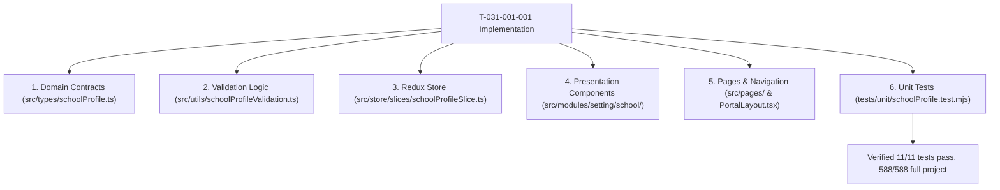

# Task: Implementation of Settings School Profile (Cấu Hình — Trường)

## Objective

This task delivers the complete end-to-end implementation of the School Profile (**Trường**) sub-module under **M6 — Cấu Hình**. It implements TypeScript domain contracts, pure field/schedule validation logic, Redux Toolkit state machine with autonomous sub-form saving, UI presentation components (SchoolOverviewView, SchoolInfoForm with inline blur error TR-01, OperatingHoursForm with 5-minute stepped select menus and static Sunday rest, AttendanceRulesForm with late departure fee cross-link, UnsavedChangesModal TR-02, and SchoolEditContainer), Next.js page routes (`/[schoolCode]/setting/school`, `/edit`, and legacy aliases), sidebar mounting first under `CẤU HÌNH` before "Học phí", and automated unit tests.

## Jira Story

- Story: As an engineer, I want to execute the end-to-end implementation of the School Profile sub-module, including data contracts, pure validation engine, Redux state machine, UI presentation components, Next.js page routes, and automated unit tests so that the feature is fully delivered and verified.
- Jira issue type: Task
- Parent story: `F-031-001-settings-school-profile`
- Research evidence: Legacy functional specification `SM1-truong.md`, Vietnamese Labor Code 45/2019/QH14, circular guidance on school records governance, and ECO Design System 1.0 guidelines.

## Priority

- Priority: P1
- Delivery impact: Delivers the foundational institutional identity and operational baseline for the School Operating Portal.
- Risk if delayed: Leaves the portal without an authoritative school configuration interface.
- Target release: School Operating Portal Release 1.0.

## Implementation Commentary

- Decision: Enforce read-only overview gating (`K069`), support two-tab routed editing (`K070`), isolate operating hours and attendance rules sub-forms (`K071`), restrict operating hours pickers to 5-minute increments between 06:00 and 18:00 (`K072`), designate Sunday statically as non-operational (`K073`), cross-link late departure directly to Tuition Fee Settings (`K074`), and intercept dirty form navigation departures with modal `TR-02` (`BR12`).
- Rationale: School Profile represents the institutional foundation. Gating editing prevents accidental edits; sub-form autonomy isolates weekly hours from attendance thresholds; inline blur validation provides instantaneous feedback.
- Tradeoff: Kept client-side routing snappy while registering Next.js `routeChangeStart` and `beforePopState` listeners to intercept unsaved leaves.
- Impact: Safe, reliable, and compliant educational institutional administration.
- Risk: Handled via guarded dialog `TR-02` with explicit confirmation buttons.

## Write Scope

- Allowed files: `src/types/schoolProfile.ts`, `src/utils/schoolProfileValidation.ts`, `src/services/mockSchoolProfileData.ts`, `src/store/slices/schoolProfileSlice.ts`, `src/store/index.ts`, `src/modules/setting/school/SchoolOverviewView.tsx`, `src/modules/setting/school/SchoolInfoForm.tsx`, `src/modules/setting/school/OperatingHoursForm.tsx`, `src/modules/setting/school/AttendanceRulesForm.tsx`, `src/modules/setting/school/UnsavedChangesModal.tsx`, `src/modules/setting/school/SchoolEditContainer.tsx`, `src/pages/[schoolCode]/setting/school/index.tsx`, `src/pages/[schoolCode]/setting/school/edit.tsx`, `src/pages/[schoolCode]/school/info/index.tsx`, `src/pages/[schoolCode]/setting/school/weekdays.tsx`, `src/components/layout/PortalLayout.tsx`, `tests/unit/schoolProfile.test.mjs`.
- Disallowed files: database migrations, backend API routes, production secrets.

## Relationship Map

| Relation | Target | Label | Rationale |
| --- | --- | --- | --- |
| Implements | `F-031-001-settings-school-profile` | `IMPLEMENTS` | Delivers the concrete implementation for the feature. |

## Mermaid Diagram

## Verification

- Command: `node --experimental-vm-modules tests/unit/schoolProfile.test.mjs`
- Command: `npm test`
- Command: `npm run build`

## Handoff

- Verified by: `ada-qa-agent` with automated test suite `tests/unit/schoolProfile.test.mjs`.
- Next steps: Production deployment and cross-module synchronization with tuition fee settings and attendance modules.

## Work Log

| Date | Author | Summary |
| --- | --- | --- |
| 2026-10-09 | `benny-frontend-engineer` | Created task document for Settings School Profile. |
| 2026-10-09 | `benny-frontend-engineer` | Implemented domain types, validation engine, state machine, UI components, pages, and tests. |

## Change Log

- Date: 2026-10-09
  - Task change: Completed end-to-end implementation of School Profile sub-module.
  - Evidence: Verified via TypeScript type checks, 588 unit tests, and Next.js static build.
