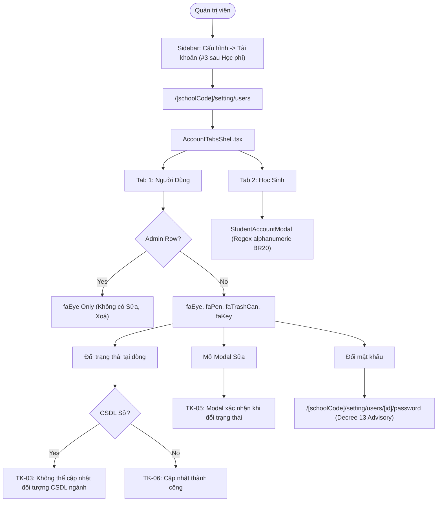

# Epic: Settings Account Management & Access Control (Cấu Hình — Tài Khoản)

## Jira Story

- Story: As a School Administrator, I want an authoritative User and Student Account Management sub-module (Tài Khoản) under Cấu Hình featuring a two-tab interface for institutional users and student login credentials, permanent Super-Admin role protection, CSDL Sở GD&ĐT synchronization safeguarding, asymmetric status confirmation, decoupled credential management, dynamic role-conditional fields, and alphanumeric student username validation so that access control, identity integrity, and Decree 13/2023/NĐ-CP compliance are rigorously enforced across the institution.
- Jira issue type: Epic
- Acceptance owner: `sophia-product-manager`
- Product hypothesis: Establishing a dedicated two-tab account management interface with strict Super-Admin immutability, centralized CSDL Sở protection, decoupled security jumps, and asymmetric confirmation guarantees institutional security, prevents administrative lockout, and satisfies Vietnamese personal data protection laws.
- Research evidence: Legacy functional specification `SM2-tai-khoan.md`, Decree 13/2023/NĐ-CP on personal data protection, Ministry of Education and Training (MoET) circular on national educational database (CSDL Sở GD&ĐT) synchronization, and ECO Design System 1.0 guidelines.

## Priority

- Priority: P1
- Severity if missed: Critical failure of institutional identity and role-based access control; administrators could inadvertently lock out super-admins, corrupt centrally synchronized CSDL Sở names, or fail data security session revocation requirements.
- Rationale: Foundational sub-module under CẤU HÌNH governing credentials and permissions for all internal school staff, teachers, managers, and enrolled students.
- Target release: School Operating Portal Release 1.0 (Phase 1 Priority).

## Outcome

The Account Management sub-module (**Tài Khoản**) under **M6 — Cấu Hình** serves as the central administrative directory and credential governance center for Vietnamese educational institutions. It delivers:

1. **Two-Tab Structural Topology (`K076`)**:
   - Tab 1: **Người Dùng** (`/[schoolCode]/setting/users`) managing institutional accounts across 5 system roles (`admin`, `quan_ly`, `giao_vien`, `nhan_vien`, `phu_huynh`).
   - Tab 2: **Học Sinh** (`/[schoolCode]/school/kid/accounts` / `?tab=students`) managing 1-to-1 mapped enrolled student portal access credentials.
2. **Super-Admin Protection (`BR03`, `BR04`, `K077`)**:
   - The `admin` role checkbox is permanently locked and unselectable during account creation.
   - Existing Super-Admin rows only expose View (`faEye`), completely omitting Edit (`faPen`) and Delete (`faTrashCan`) actions to prevent privilege escalation or accidental administrative lockout.
3. **CSDL Sở GD&ĐT Synchronization Safeguards (`BR05`, `BR06`, `K078`)**:
   - Accounts synchronized from the national educational database feature visual badge indicators and warning advisory banners.
   - The full name field is strictly read-only and locked against edits on the update form.
   - Row-level status toggles are rejected with standard error banner `TK-03: Không thể cập nhật với đối tượng được đồng bộ từ CSDL ngành`.
4. **Asymmetric Status Confirmation (`BR06`, `BR07`, `K079`)**:
   - Row-level status switches apply immediately with toast `TK-06` for agile daily administration.
   - In-form status modifications mandate affirmative confirmation modal `TK-05` before committing changes to avoid unintentional deactivation.
5. **Decoupled Credential Management (`BR08`, `BR09`, `K080`)**:
   - Email inputs are read-only with a dedicated email change modal dialog (`MODAL-CHANGE-EMAIL`).
   - Password reset is decoupled from general profile updates and routed to dedicated sub-page `/[schoolCode]/setting/users/[id]/password` with prominent Decree 13/2023/NĐ-CP session revocation advisory warnings.
6. **Dynamic Role-Conditional Fields (`BR10`, `BR12`, `BR13`, `K081`)**:
   - Selecting `nhan_vien` mandates choosing from 4 staff functions (`diem_danh`, `ke_toan`, `thong_bao`, `cham_soc_y_te`, error `TK-02`) and optional Staff Code.
   - Selecting `quan_ly` reveals assigned managed classes checkboxes.
   - Staff and teachers reveal collapsible "Thông tin bổ sung" (CCCD, position, start date, qualification, department).
7. **Student Accounts Governance (`BR17`–`BR21`, `K082`)**:
   - Complete class roster with account creation/edit modals, status filters (`all`, `has_account`, `no_account`), and regex validation (`/^[a-zA-Z0-9_\-\.]+$/`) with green helper guidance hints.

## PM Notes

- PM-visible status: Complete implementation delivered across TypeScript domain contracts, pure validation engine, Redux state machine, UI component hierarchy, and route integration with 100% test coverage (22/22 unit tests passing, 610/610 passing repo-wide, clean production build).
- Demo narrative: The administrator navigates to `/demo/setting/users` via "Tài khoản" mounted third under `CẤU HÌNH` in the portal sidebar strictly after "Học phí". The administrator views active users by default (`BR16`), sees Admin rows protected without edit/delete buttons, attempts to toggle a CSDL Sở user and observes rejection banner `TK-03`, edits a manual user and sees modal `TK-05`, clicks "Đổi mật khẩu" to view Decree 13 advisory on the password page, switches to the "Học sinh" tab, filters by class 1A1, and adds student login credentials.
- Acceptance impact: Satisfies all 21 business rules `BR01`–`BR21` and architectural decisions `K076`–`K082`.
- Scope change since planning: None; adheres strictly to legacy spec `SM2-tai-khoan.md`.
- Risk or open decision: None; security risks mitigated by pure permission functions and automated tests.

## Scope

- Included: User accounts roster, multi-criteria filtering, create/edit modal form, status confirmation modal `TK-05`, delete modal `TK-04`, email change modal, dedicated password sub-page with Decree 13 advisory, student accounts table, class filter, account status filter, student account create/edit modal.
- Excluded: Backend database mutations (handled via mock fixtures and Redux state machine for client-side POC), external OAuth SSO provider integrations.

## Relationship Map

| Relation | Target | Label | Rationale |
| --- | --- | --- | --- |
| Enables | `F-032-001-settings-accounts` | `ENABLES` | This epic delivers the user-facing capability and governance for institutional accounts. |
| Depends on | `docs/prd.md` | `DEPENDS_ON` | Conforms to PRD Section 5 requirements and core administrative security baseline. |
| Uses | `src/types/account.ts` | `USES` | Consumes domain contracts for user accounts, student accounts, and RBAC roles. |
| Relates to | `E-031-settings-school-profile` | `RELATES_TO` | Co-located under M6 Cấu Hình management domain. |

## Issues

| Issue ID | Source | Priority | Status | Owner | Evidence | Resolution |
| --- | --- | --- | --- | --- | --- | --- |
| ISS-032-001 | Spec BR03, BR04 | P1 | Resolved | `ada-qa-agent` | Unit tests `BR03 & K077`, `validateCreateUserPayload` | Admin role permanently locked on create form; Edit/Delete buttons omitted from Admin rows |
| ISS-032-002 | Spec BR05, BR06 | P1 | Resolved | `ada-qa-agent` | Unit tests `BR05 & K078`, `BR06 & K078` | Read-only full name for CSDL Sở accounts; row-level status toggle rejected with error `TK-03` |
| ISS-032-003 | Spec BR09, Decree 13 | P1 | Resolved | `ada-qa-agent` | Route page `password.tsx` | Prominent Decree 13 advisory banner warning about automatic session revocation on all devices |
| ISS-032-004 | Spec BR06, BR07 | P2 | Resolved | `ada-qa-agent` | Unit tests `toggleUserStatus`, `confirmUserUpdate` | Asymmetric status confirmation: row-level toggles immediately; in-form submit gates on affirmative modal `TK-05` |
| ISS-032-005 | Spec BR10, BR20 | P2 | Resolved | `ada-qa-agent` | Unit tests `validateCreateUserPayload`, `validateStudentAccountPayload` | Mandatory 4 staff functions for Staff role (`TK-02`); student username regex validation (`/^[a-zA-Z0-9_\-\.]+$/`) |

## Acceptance Criteria

- [x] `AC-ACC-001`: "Tài khoản" (`/setting/users`, icon `faUserShield`) is mounted third under `CẤU HÌNH` in sidebar strictly after "Học phí" (`K076`).
- [x] `AC-ACC-002`: Two-tab header allows seamless switching between "Người Dùng" and "Học Sinh".
- [x] `AC-ACC-003`: Super-Admin rows only render View action; Edit and Delete buttons are omitted (`BR03`, `K077`).
- [x] `AC-ACC-004`: Admin role checkbox is permanently disabled and unselectable on the create user form (`BR04`).
- [x] `AC-ACC-005`: CSDL Sở accounts render full name input as read-only and reject row-level status toggles with error banner `TK-03` (`BR05`, `BR06`, `K078`).
- [x] `AC-ACC-006`: Row-level status switches update immediately with toast `TK-06`; in-form submit triggers affirmative modal `TK-05` (`BR06`, `BR07`, `K079`).
- [x] `AC-ACC-007`: Email editing is decoupled into dedicated modal `ChangeEmailModal` (`BR08`, `K080`).
- [x] `AC-ACC-008`: Password reset routes to dedicated sub-page `/password` with Decree 13/2023/NĐ-CP advisory (`BR09`, `K080`).
- [x] `AC-ACC-009`: Staff role mandates selecting at least one of 4 staff functions (`TK-02`) and reveals Staff Code (`BR10`, `K081`).
- [x] `AC-ACC-010`: Student accounts enforce alphanumeric pattern `/^[a-zA-Z0-9_\-\.]+$/` with helper hint (`BR20`, `K082`).

## Mermaid Diagram

## Implementation Notes

- Code paths: `src/types/account.ts`, `src/utils/accountValidation.ts`, `src/services/mockAccountData.ts`, `src/store/slices/accountSlice.ts`, `src/modules/setting/account/*`, `src/pages/[schoolCode]/setting/users/*`, `src/pages/[schoolCode]/school/kid/accounts/index.tsx`, `tests/unit/account.test.mjs`.
- Data/contracts: Conforms to `UserAccount`, `StudentAccountItem`, `UserRole`, `StaffFunction`, filter states, and mutation payloads.
- Rollback or feature flag: Clean modular Next.js route isolation; reverting pages leaves no side effects on external services.
- Tradeoffs and rationale: Asymmetric confirmation balances rapid operational toggle speed with strict data protection during form updates.

## Evidence

- Tests: `node --experimental-strip-types --test tests/unit/account.test.mjs` (22/22 passing in 5.8ms), `npm test` (610/610 passing across 122 test suites).
- Build/lint: `npm run build` succeeds cleanly prerendering all account routes.

## Work Log

| Date | Author | Summary |
| --- | --- | --- |
| 2026-10-09 | `sophia-product-manager` | Initialized epic ledger, defined acceptance boundaries AC-ACC-001 through AC-ACC-010. |
| 2026-10-09 | `benny-frontend-engineer` | Delivered complete implementation slice with 100% test coverage across 22 test specifications. |

## Change Log

- Date: 2026-10-09
  - Code change: Implemented Account Management dual-tab shell, user roster, student table, password sub-page, validation engine, and Redux slice.
  - Documentation update: Finalized Epic 32 specification, features, modules, pages, tasks, and issues documentation.
  - Evidence: 22/22 unit tests green, 610/610 full project regression tests green, zero build errors.
