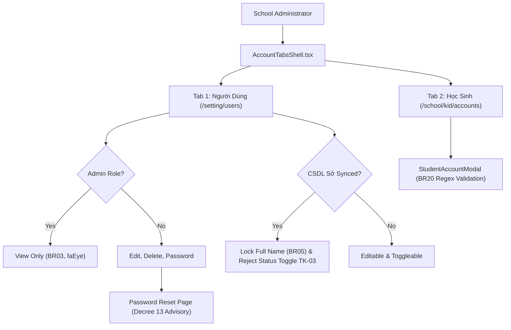

# Feature: Settings Account Management (Cấu Hình — Tài Khoản)

## User Value

The Account Management feature empowers School Administrators to maintain comprehensive control over identity lifecycle, login permissions, and credential security for all internal staff and enrolled students. 

By enforcing strict Super-Admin immutability and centralized CSDL Sở protection, the system prevents privilege escalation and accidental data corruption. Administrators enjoy rapid day-to-day user management via row-level switches while being protected by explicit confirmation modals when editing sensitive accounts or changing credentials.

## Jira Story

- Story: As a School Administrator, I want an authoritative Account Management interface under Cấu Hình with two tabs ('Người Dùng' and 'Học Sinh'), Super-Admin immutability, CSDL Sở synchronization protection, asymmetric status confirmations, and decoupled credential flows so that institutional security and compliance are preserved.
- Jira issue type: Story
- Story points: 5
- Acceptance owner: `sophia-product-manager`
- Research evidence: Legacy specification `SM2-tai-khoan.md`, Decree 13/2023/NĐ-CP, and unit test suite `tests/unit/account.test.mjs`.

## Priority

- Priority: P1
- User/business impact: Essential for multi-tenant educational access control and legal compliance.
- Risk if delayed: Unauthorized role modification or breach of national educational database sync integrity.
- Release target: School Operating Portal Release 1.0.

## PM Notes

- Demo scenario: Navigate to `/[schoolCode]/setting/users` via "Tài khoản" third under `CẤU HÌNH` in the portal sidebar strictly after "Học phí". Verify default filter shows active users only (`BR16`). Observe Admin account has View action only; Edit and Delete are omitted (`BR03`, `K077`). Attempt to toggle a CSDL Sở user row status; verify instant rejection banner `TK-03` (`BR06`, `K078`). Edit a manual user, change status to inactive, click Cập nhật; verify affirmative modal `TK-05` confirms changes (`BR07`, `K079`). Click "Đổi mật khẩu" to open `/setting/users/[id]/password` and review Decree 13 session revocation warning (`BR09`, `K080`). Switch to "Học sinh" tab, view student table, and add an account with alphanumeric validation (`BR17`–`BR21`, `K082`).
- Business value: Guarantees zero administrative lockout, MoET synchronization fidelity, and Decree 13 compliance.
- Acceptance criteria confirmed: Satisfies all 21 business rules `BR01`–`BR21` and architectural decisions `K076`–`K082`.
- Open PM decision: None; all 7 clarifications (`K076`–`K082`) implemented and verified.

## Requirements Trace

- PRD requirement: M6 Cấu Hình — SM2 Quản lý tài khoản người dùng & học sinh.
- Task id: `T-032-001-001-settings-accounts`.
- Spec id: `047-settings-account-management-tai-khoan`.

## Scope

- Included: User accounts roster, multi-criteria filtering, create/edit modal form, status confirmation modal `TK-05`, delete modal `TK-04`, email change modal, dedicated password sub-page with Decree 13 advisory, student accounts table, class filter, account status filter, student account create/edit modal.
- Excluded: Backend database mutations (handled via mock fixtures and Redux state machine for client-side POC), external OAuth SSO provider integrations.

## Relationship Map

| Relation | Target | Label | Rationale |
| --- | --- | --- | --- |
| Implements | `E-032-settings-accounts` | `IMPLEMENTS` | Core feature realizing the epic objectives. |
| Depends on | `M-032-001-settings-accounts` | `DEPENDS_ON` | Consumes domain contracts, state slice, and component hierarchy. |
| Depends on | `P-032-001-settings-accounts` | `DEPENDS_ON` | Surfaces through canonical routes `/setting/users` and `/school/kid/accounts`. |
| Uses | `src/utils/accountValidation.ts` | `USES` | Executes pure validation and permission checks. |
| Relates to | `F-031-001-settings-school-profile` | `RELATES_TO` | Co-located under M6 Cấu Hình management domain. |

## Code Scope

- Types: `src/types/account.ts`
- Pure logic: `src/utils/accountValidation.ts`
- State: `src/store/slices/accountSlice.ts`, `src/store/index.ts`
- Mock data: `src/services/mockAccountData.ts`
- Components: `src/modules/setting/account/AccountTabsShell.tsx`, `UserAccountsToolbar.tsx`, `UserAccountsTable.tsx`, `UserAccountForm.tsx`, `AccountActionConfirmModal.tsx`, `DeleteUserModal.tsx`, `ChangeEmailModal.tsx`, `StudentAccountsToolbar.tsx`, `StudentAccountsTable.tsx`, `StudentAccountModal.tsx`
- Routes: `src/pages/[schoolCode]/setting/users/index.tsx`, `src/pages/[schoolCode]/setting/users/[id]/password.tsx`, `src/pages/[schoolCode]/school/kid/accounts/index.tsx`
- Layout: `src/components/layout/PortalLayout.tsx`
- Tests: `tests/unit/account.test.mjs`

## Acceptance Criteria

- [x] Mounted third under `CẤU HÌNH` in the sidebar strictly after "Học phí" with icon `faUserShield` (`K076`).
- [x] Super-Admin accounts permanently omit Edit and Delete actions (`BR03`, `K077`).
- [x] Admin role checkbox is permanently locked and unselectable during account creation (`BR04`).
- [x] CSDL Sở synced accounts lock Full Name against edits on the update form (`BR05`, `K078`).
- [x] CSDL Sở synced accounts reject row-level status toggles with error banner `TK-03` (`BR06`, `K078`).
- [x] In-form user status modification gates on affirmative confirmation modal `TK-05` (`BR07`, `K079`).
- [x] Email editing is decoupled into dedicated modal `ChangeEmailModal` (`BR08`, `K080`).
- [x] Password reset is routed to dedicated sub-page `/password` with Decree 13 advisory (`BR09`, `K080`).
- [x] Staff role mandates choosing staff functions (`TK-02`) and reveals Staff Code (`BR10`, `K081`).
- [x] Student accounts enforce alphanumeric pattern `/^[a-zA-Z0-9_\-\.]+$/` with green guidance hint (`BR20`, `K082`).

## Mermaid Diagram

## Verification

- Command: `node --experimental-strip-types --test tests/unit/account.test.mjs`
- Command: `npm test`
- Command: `npm run build`

## Work Log

| Date | Author | Summary |
| --- | --- | --- |
| 2026-10-09 | `marcus-ai-orchestrator` | Created feature document for Settings Account Management (Feature 047). |
| 2026-10-09 | `benny-frontend-engineer` | Implemented full frontend behavior, validation engine, Redux slice, and unit test suite. |

## Change Log

- Date: 2026-10-09
  - Feature change: Delivered complete Account Management sub-module under M6 Cấu Hình.
  - Evidence: Verified via 22/22 unit tests, 610/610 repo tests, and Next.js production build.
