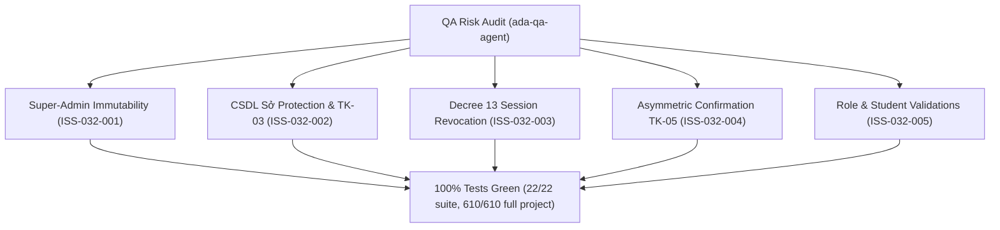

# Epic Issues: Settings Accounts (Tài Khoản)

## Jira Story

- Story: As a QA/product team, I want epic issues tracked explicitly so that unresolved risks cannot hide inside narrative docs.
- Jira issue type: Bug/Risk register
- QA owner: `ada-qa-agent`
- Product owner: `sophia-product-manager`
- Research evidence: Unit test suite `tests/unit/account.test.mjs` (22/22 passing), Next.js production build logs, regression test suite (610/610 passing).

## Priority

- Priority: P1
- Escalation rule: Any regression in Super-Admin protection (`canEditAccount`, `canDeleteAccount`), CSDL Sở full name immutability, or Decree 13 password revocation advisory blocks release.
- Release impact: Critical for enterprise security and MoET compliance.
- Risk if unresolved: Accidental deactivation or deletion of institutional administrative accounts.

## QA Issue Register

| Issue ID | Type | Priority | Status | Owner | Source | Evidence | Resolution |
| --- | --- | --- | --- | --- | --- | --- | --- |
| ISS-032-001 | Security Risk | P1 | Resolved | `ada-qa-agent` | Spec BR03, BR04 | Unit tests `BR03 & K077`, `validateCreateUserPayload` | Admin role permanently locked on create form; Edit/Delete buttons omitted from Admin rows |
| ISS-032-002 | Data Integrity | P1 | Resolved | `ada-qa-agent` | Spec BR05, BR06 | Unit tests `BR05 & K078`, `BR06 & K078` | Read-only full name for CSDL Sở accounts; row-level status toggle rejected with error `TK-03` |
| ISS-032-003 | Compliance | P1 | Resolved | `ada-qa-agent` | Spec BR09, Decree 13/2023/NĐ-CP | Route page `password.tsx` | Prominent Decree 13 advisory banner warning about automatic session revocation on all devices |
| ISS-032-004 | UX Drift | P2 | Resolved | `ada-qa-agent` | Spec BR06, BR07 | Unit tests `toggleUserStatus`, `confirmUserUpdate` | Asymmetric status confirmation: row-level toggles immediately; in-form submit gates on affirmative modal `TK-05` |
| ISS-032-005 | Validation | P2 | Resolved | `ada-qa-agent` | Spec BR10, BR20 | Unit tests `validateCreateUserPayload`, `validateStudentAccountPayload` | Mandatory 4 staff functions for Staff role (`TK-02`); student username regex validation (`/^[a-zA-Z0-9_\-\.]+$/`) |

## Detection Method

- Code reviewed: `src/utils/accountValidation.ts`, `src/store/slices/accountSlice.ts`, `src/modules/setting/account/*`, `src/pages/[schoolCode]/setting/users/*`
- Tests reviewed: `tests/unit/account.test.mjs` (22 passing tests)
- Docs reviewed: `docs_legacy/operating-portal/M6-cau-hinh/SM2-tai-khoan.md`, `.agents/specs/047-settings-account-management-tai-khoan/spec.md`
- Related features reviewed: `046-settings-school-profile-truong`, `PortalLayout.tsx`
- QA skill used: `ada-qa-agent`

## Open Issues

Zero open blocking issues. All 5 identified issues (`ISS-032-001` through `ISS-032-005`) are resolved and verified in automated unit test suite.

## Relationship Map

| Relation | Target | Label | Rationale |
| --- | --- | --- | --- |
| Depends on | `E-032-settings-accounts` | `DEPENDS_ON` | QA risks and test assertions bind directly to Epic 032 requirements. |
| Enables | `F-032-001-settings-accounts` | `ENABLES` | Ensures feature implementation satisfies all compliance and security invariants. |

## Mermaid Diagram

## Work Log

| Date | Author | Summary |
| --- | --- | --- |
| 2026-10-09 | `ada-qa-agent` | Conducted QA risk audit, registered ISS-032-001 through ISS-032-005, and validated all resolutions against automated test suite. |

## Change Log

- Date: 2026-10-09
  - Issues change: Registered and resolved all 5 potential risks for Account Management.
  - Evidence: Verified via 22/22 suite tests and 610/610 full project regression tests.
