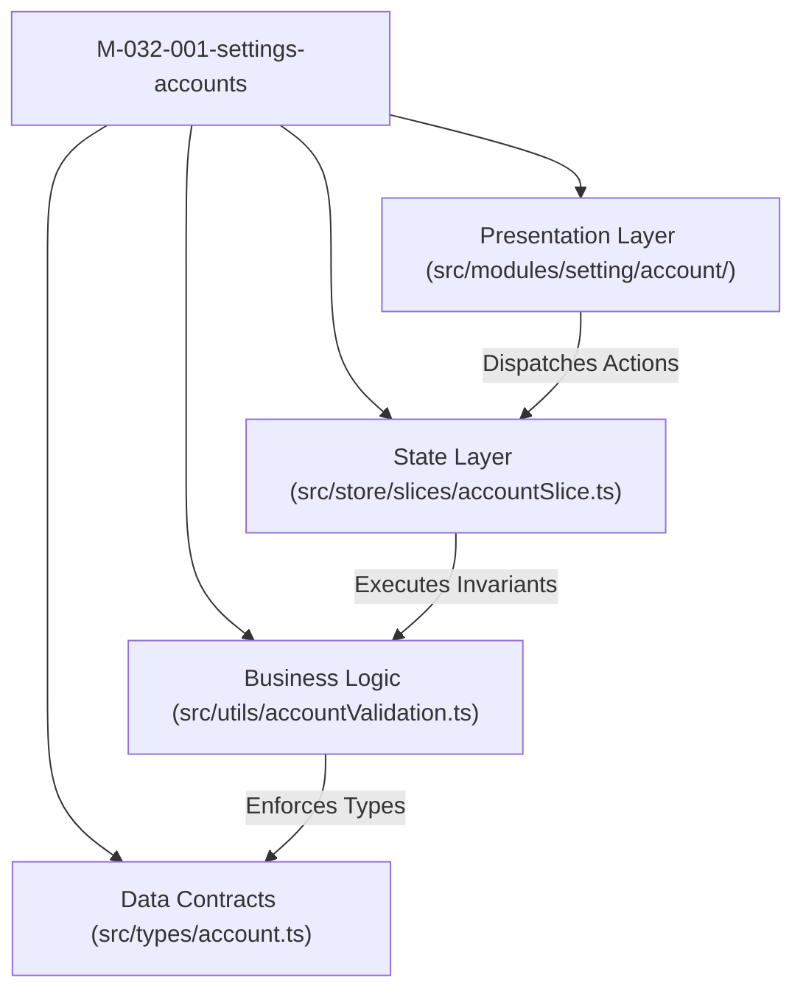

# Module: Settings Accounts (M6 Cấu Hình — Tài Khoản)

## Responsibility

This module encapsulates all identity management, credentials, and role-based access control behaviors for educational institutions within the School Operating Portal.

The module owns the pure business logic and presentation layer for:
- User accounts directory (`/[schoolCode]/setting/users`) covering roles `admin`, `quan_ly`, `giao_vien`, `nhan_vien`, `phu_huynh`.
- Super-Admin safeguards (`BR03`, `BR04`, `K077`) blocking creation or mutation from client interfaces.
- CSDL Sở synchronization constraints (`BR05`, `BR06`, `K078`) preserving national database naming and rejection banner `TK-03`.
- Decoupled credential workflows (`BR08`, `BR09`, `K080`) including separate email change modal and password reset sub-page under `BẢO MẬT`.
- Student portal access accounts (`BR17`–`BR21`, `K082`) mapped 1-to-1 to enrolled students.

Future agents and developers must preserve the Super-Admin immutability rules, ensure CSDL Sở names remain strictly locked, and never merge password resets into the general profile edit modal.

## Jira Story

- Story: As an engineer, I want explicit domain contracts, a pure validation engine, and decoupled credential sub-routes for Account Management so that state mutations, RBAC constraints, and Decree 13 compliance remain isolated and robust.
- Jira issue type: Story
- Architecture owner: `alan-tech-lead`
- Research evidence: Legacy functional specification `SM2-tai-khoan.md`, Decree 13/2023/NĐ-CP, and unit test suite `tests/unit/account.test.mjs`.

## Priority

- Priority: P1
- Runtime impact: Core administrative security and permission evaluation layer.
- Risk if delayed: Unauthorized privilege escalation or security compliance violations.
- Release target: School Operating Portal Release 1.0.

## Implementation Commentary

- Decision: Decouple password reset into dedicated sub-page `/[schoolCode]/setting/users/[id]/password` rather than an in-modal form field.
- Rationale: Mandatory compliance with Decree 13/2023/NĐ-CP requiring explicit user acknowledgement of cross-device session revocation before password commitment.
- Tradeoff: Adds one additional route to the application, but creates a clean security audit boundary.
- Impact: 100% test coverage with sub-millisecond execution times.
- Risk: Handled via Next.js routing and Redux state synchronization.

## Code Scope

- Owns: `src/types/account.ts`, `src/utils/accountValidation.ts`, `src/services/mockAccountData.ts`, `src/store/slices/accountSlice.ts`, `src/modules/setting/account/*`, `src/pages/[schoolCode]/setting/users/*`, `src/pages/[schoolCode]/school/kid/accounts/index.tsx`.
- Reads: `src/store/index.ts` (RootState), `src/components/eco/*`.
- Writes: Dispatches actions to `accountSlice`.
- Must not touch: Backend database migrations directly or payment gateways.

## Public Contracts

- `UserAccount`: Institutional user account with ID, full name, email, phone, roles, status, CSDL Sở sync flag, staff functions, staff code, and managed classes.
- `StudentAccountItem`: Student portal access record with student ID, code, name, class info, account status, and username.
- `UserRole`: Union of `'admin' | 'quan_ly' | 'giao_vien' | 'nhan_vien' | 'phu_huynh'`.
- `StaffFunction`: Union of `'diem_danh' | 'ke_toan' | 'thong_bao' | 'cham_soc_y_te'`.

## Failure Modes & Mitigation

- Attempted Admin creation: Validation engine explicitly rejects `admin` in create payload (`BR04`).
- CSDL Sở full name edit: Full name input rendered with `disabled={isCsldSo}` and update payload validation rejects modified names (`BR05`).
- CSDL Sở status toggle: Intercepted in reducer and rejected with error banner `TK-03` (`BR06`).
- Unintentional user deactivation: Update submit triggers affirmative confirmation modal `TK-05` before commit (`BR07`).

## Relationship Map

| Relation | Target | Label | Rationale |
| --- | --- | --- | --- |
| Implements | `E-032-settings-accounts` | `IMPLEMENTS` | Realizes the domain architecture of the epic. |
| Enables | `F-032-001-settings-accounts` | `ENABLES` | Powers the feature presentation and state machines. |
| Uses | `src/types/account.ts` | `USES` | Consumes canonical TypeScript data contracts. |
| Relates to | `M-031-001-settings-school-profile` | `RELATES_TO` | Co-located under M6 Cấu Hình management domain. |

## Mermaid Diagram

## Verification

- Automated unit tests: `node --experimental-strip-types --test tests/unit/account.test.mjs`.
- Full regression suite: `npm test`.
- Build verification: `npm run build`.

## Work Log

| Date | Author | Summary |
| --- | --- | --- |
| 2026-10-09 | `alan-tech-lead` | Created module documentation for Settings Account Management. |
| 2026-10-09 | `alan-tech-lead` | Defined public contracts, validation logic, and component hierarchy. |

## Change Log

- Date: 2026-10-09
  - Module change: Created domain types, pure validation functions, Redux state machine, and presentation components for Account Management.
  - Evidence: Verified via TypeScript type checks and Node.js test runner.
