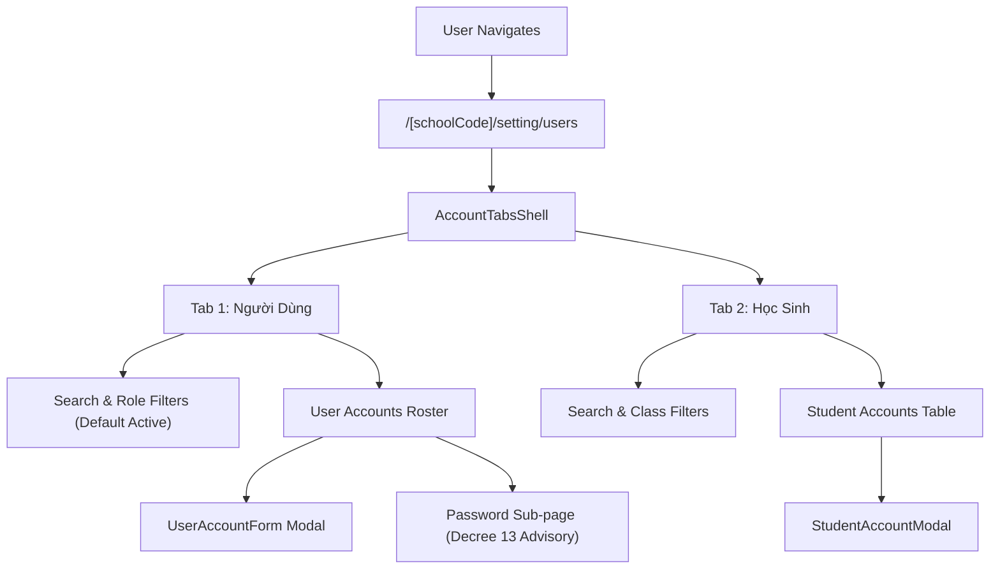

# Page: Settings Accounts (Tài Khoản)

## Route / Surface

- Primary Route: `/[schoolCode]/setting/users` (Tab 1: Người Dùng)
- Alias / Tab 2 Route: `/[schoolCode]/school/kid/accounts` (Tab 2: Học Sinh)
- Password Sub-page: `/[schoolCode]/setting/users/[id]/password` (BẢO MẬT)
- Layout: `PortalLayout`

## Jira Story

- Story: As a user, I want responsive and accessible account management pages with two tab routes ('Người Dùng' and 'Học Sinh'), dedicated password sub-page, and intuitive modal dialogs so that administrative tasks are fast and error-free.
- Jira issue type: Story
- UX owner: `benny-frontend-engineer`
- Research evidence: ECO Design System 1.0 guidelines, Next.js Pages router, FontAwesome SVG icons.

## Priority

- Priority: P1
- Demo impact: High visual fidelity, instant search, responsive table with STT, status pills, and accessible modal dialogs.
- Release target: School Operating Portal Release 1.0.

## PM Notes

- Demo path: Navigate to `/[schoolCode]/setting/users`. Switch between tabs "Người Dùng" and "Học Sinh". Filter users by role "Giáo viên", search by name. Click "+ Thêm người dùng" to test form validation. Click Edit on a teacher to inspect the edit modal. Click "Đổi mật khẩu" to navigate to `/[schoolCode]/setting/users/[id]/password` and review the Decree 13 personal data protection advisory. Switch to "Học sinh" tab and filter by class.
- User promise: Fast, consistent administrative workflows with clear security feedback and no dead ends.
- Acceptance impact: Satisfies all 21 business rules `BR01`–`BR21` and architectural decisions `K076`–`K082`.
- Visual or copy change: Brand blue `#006FDA` accents, purple for Management, amber for Staff, emerald for Parents, red for Admin, accessible contrast tokens.
- Risk: Super-Admin lockout prevented by permanent button omission on Admin rows.

## Relationship Map

| Relation | Target | Label | Rationale |
| --- | --- | --- | --- |
| Implements | `F-032-001-settings-accounts` | `IMPLEMENTS` | Renders the complete account management administrative experience. |
| Uses | `M-032-001-settings-accounts` | `USES` | Composes presentation components and Redux slice. |

## Page Structure & Responsive States

1. **Tab Bar Header (`AccountTabsShell.tsx`):**
   - Tab 1: "Người Dùng" (`faUsers`) -> `/setting/users`
   - Tab 2: "Học Sinh" (`faGraduationCap`) -> `/school/kid/accounts`
2. **Global Error Banner:**
   - Appears above table upon rejected status toggle on CSDL Sở accounts (`TK-03`).
3. **User Accounts Roster (`UserAccountsTable.tsx`):**
   - Columns: STT, Họ và tên (with CSDL Sở badge), Email / Tên đăng nhập, Số điện thoại, Vai trò (color-coded pills), Trạng thái (EcoSwitch), Thao tác (faEye, faPen, faTrashCan, faKey).
4. **Student Accounts Roster (`StudentAccountsTable.tsx`):**
   - Columns: STT, Mã học sinh, Họ và tên, Lớp, Tài khoản, Tên đăng nhập, Trạng thái, Lần đăng nhập cuối, Thao tác (`+` create vs pencil edit).
5. **Password Sub-page (`setting/users/[id]/password.tsx`):**
   - Dedicated card layout under `BẢO MẬT` with Decree 13/2023/NĐ-CP advisory banner.

## States

- Default Active Filter State: Users table loads with `statusFilter: 'active'` showing only active accounts by default (`BR16`).
- Admin Protected State: Super-Admin rows render View action only; Edit and Delete buttons are omitted (`BR03`, `K077`).
- CSDL Sở Protected State: CSDL Sở accounts show sync badge; attempting row-level status toggle triggers rejection banner `TK-03` (`BR06`).
- In-Form Confirmation Modal State: Submitting user form with status modification triggers affirmative confirmation modal `TK-05` (`BR07`).
- Student Creation Modal State: Student account dialog enforces alphanumeric pattern with green helper hint (`BR20`).

## Mermaid Diagram

## Verification

- Command: `node --experimental-strip-types --test tests/unit/account.test.mjs`
- Command: `npm test`
- Command: `npm run build`

## Work Log

| Date | Author | Summary |
| --- | --- | --- |
| 2026-10-09 | `benny-frontend-engineer` | Created page documentation for Settings Account Management. |
| 2026-10-09 | `benny-frontend-engineer` | Implemented primary users route, student credentials alias, and dedicated password sub-page. |

## Change Log

- Date: 2026-10-09
  - Page change: Created canonical pages `/setting/users`, `/setting/users/[id]/password`, and `/school/kid/accounts`.
  - Evidence: Verified via static Next.js compilation and automated unit tests.
