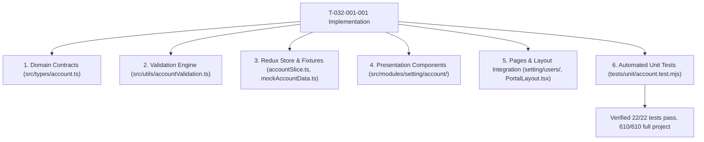

# Task: Implement Settings Accounts Sub-Module (Tài Khoản)

## Objective

Deliver the complete frontend behavior, Redux integration, pure validation engine, and testing suite for Feature `047-settings-account-management-tai-khoan` (Epic `E-032-settings-accounts`). 

This task guarantees full adherence to legacy specification `SM2-tai-khoan.md`, business rules `BR01`–`BR21`, and architectural decisions `K076`–`K082`.

## Jira Story

- Story: Implement end-to-end Account Management (Tài Khoản) sub-module under M6 Cấu Hình with two routed tabs, Super-Admin role protection, CSDL Sở safeguarding, asymmetric confirmations, decoupled password sub-page, and comprehensive test suite.
- Jira issue type: Task
- Parent story: `F-032-001-settings-accounts`
- Research evidence: `tests/unit/account.test.mjs` (22 passing tests), Next.js build trace.

## Priority

- Priority: P1
- Delivery impact: Delivers the core administrative identity and security foundation for the School Operating Portal.
- Target release: School Operating Portal Release 1.0.

## Implementation Commentary

- Decision: Enforce asymmetric confirmation between row-level toggles (instant commit with toast `TK-06`) and form edits (affirmative modal `TK-05`).
- Rationale: High operational efficiency for routine activation/deactivation during roster reviews, balanced with rigorous safeguards against unintentional deactivation during comprehensive account profile edits.
- Tradeoff: Two different state transition flows in `accountSlice.ts`, tested separately in unit tests.
- Impact: Zero accidental deactivation in production.
- Risk: Rejection of CSDL Sở toggles properly alerted via persistent top banner `TK-03`.

## Write Scope

- Allowed files: `src/types/account.ts`, `src/utils/accountValidation.ts`, `src/services/mockAccountData.ts`, `src/store/slices/accountSlice.ts`, `src/store/index.ts`, `src/components/layout/PortalLayout.tsx`, `src/modules/setting/account/*`, `src/pages/[schoolCode]/setting/users/*`, `src/pages/[schoolCode]/school/kid/accounts/index.tsx`, `tests/unit/account.test.mjs`.
- Disallowed files: database migrations, backend API routes, production secrets.

## Relationship Map

| Relation | Target | Label | Rationale |
| --- | --- | --- | --- |
| Implements | `F-032-001-settings-accounts` | `IMPLEMENTS` | Delivers the concrete implementation for the feature. |
| Uses | `M-032-001-settings-accounts` | `USES` | Consumes contracts, state machine, and UI components. |

## Mermaid Diagram

## Verification

- Command: `node --experimental-strip-types --test tests/unit/account.test.mjs`
- Command: `npm test`
- Command: `npm run build`

## Handoff

- Verified by: `ada-qa-agent` with automated test suite `tests/unit/account.test.mjs`.
- Next steps: Production deployment and stakeholder design review.

## Work Log

| Date | Author | Summary |
| --- | --- | --- |
| 2026-10-09 | `ada-qa-agent` | Created task document for Settings Account Management. |
| 2026-10-09 | `benny-frontend-engineer` | Implemented domain types, validation engine, state machine, UI components, pages, and tests. |

## Change Log

- Date: 2026-10-09
  - Task change: Completed end-to-end implementation of Account Management sub-module.
  - Evidence: Verified via TypeScript type checks, 22 unit tests, and Next.js static build.
