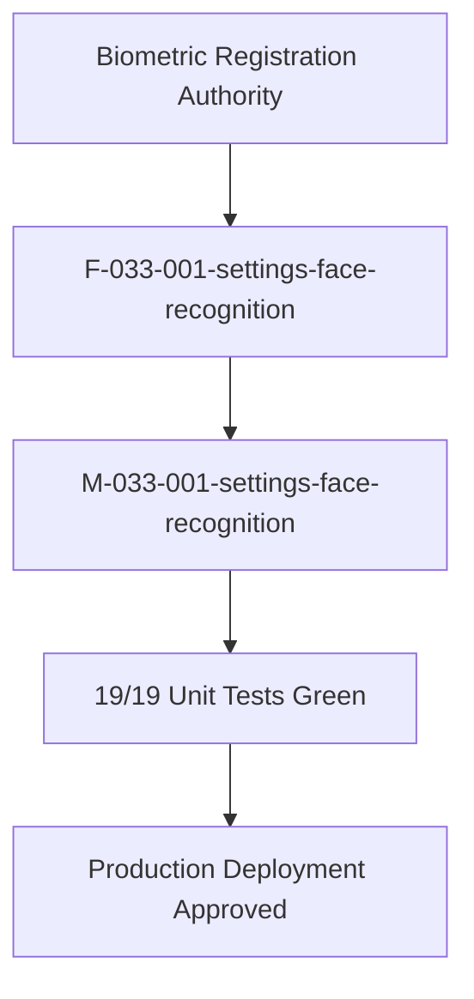

# Epic: Settings Face Recognition Management (Cấu Hình — Nhận Diện)

## Jira Story

- Story: As a School Administrator, I want an authoritative Face Recognition & Biometric Management sub-module (Nhận Diện) under Cấu Hình at /[schoolCode]/setting/face-recognition to register, inspect, replace, and purge facial recognition image profiles for enrolled students with demographic immutability, upload-enforced submit invariants, explicit full-name deletion safeguards, conjunction search filters, and dynamic summary footers so that automated camera attendance and biometric security are governed reliably.
- Jira issue type: Epic
- Acceptance owner: `sophia-product-manager`
- Product hypothesis: Providing a centralized, table-driven administrative cockpit for managing facial recognition profiles with read-only student demographic bindings, explicit new-upload invariants for replacements, and full-name confirmation warnings eliminates accidental biometric overrides and guarantees institutional privacy and biometric data integrity.
- Research evidence: Legacy functional specification `SM4-nhan-dien.md`, Decree 13/2023/NĐ-CP on personal data protection, school biometric attendance device integration requirements, and ECO Design System 1.0 guidelines.

## Priority

- Priority: P1
- Severity if missed: Critical impairment of biometric attendance devices; administrators cannot enroll student photos, replace outdated photos, or delete biometric profiles when students withdraw.
- Rationale: Core operational sub-module under CẤU HÌNH serving as the registration authority for the AI facial recognition camera system and attendance kiosks.
- Target release: School Operating Portal Release 1.0 (Phase 1 Priority).

## Outcome

The Face Recognition Management sub-module (**Nhận Diện**) under **M6 — Cấu Hình** provides the administrative cockpit and registration authority for managing student facial recognition profiles across the school:

1. **Roster Representation & Formatting (`BR01`)**:
   - Registered student rows render high-fidelity photo thumbnails and formatted recorded dates (`DD/MM/YYYY`).
   - Unregistered student rows display hyphen placeholders (`-`) in photo and date columns.
2. **Action Column Affordance Duality (`BR02`, `K087`)**:
   - Unregistered rows provide a single circular blue `+` button with tooltip *"Đăng ký ảnh nhận diện"* to launch the registration modal.
   - Registered rows provide two circular buttons: amber pencil for replacement edit (*"Chỉnh sửa ảnh nhận diện"*) and red `X` for deletion (*"Xóa ảnh nhận diện"*).
3. **Read-Only Demographic Binding (`BR03`, `K085`)**:
   - Both registration and edit dialogs display student demographics (Full Name, Nickname, Gender, Date of Birth, Class) in strictly read-only mode, bound to master student profiles.
4. **Enforced New Upload Invariant (`BR04`, `BR05`, `K086`)**:
   - The submission button is disabled by default in both dialogs.
   - In edit mode, pre-rendering the existing photo preview is explicitly insufficient to enable saving; an administrator MUST upload a *new* replacement image before the submit button enables.
5. **Full-Name Deletion Confirmation Safeguard (`BR06`, `K088`, `NFR01`)**:
   - Deletion dialog explicitly articulates the target student's full name: *"Vui lòng xác nhận xóa thông tin nhận diện của học sinh {Họ tên}"*.
6. **Multi-Factor Conjunction Search (`BR07`, `BR08`)**:
   - Conjunction (AND) filtering across keyword search (name with accent-insensitivity or student code), class dropdown, and registration status dropdown.
7. **Dynamic Summary Footer & KPI Dashboard (`BR09`)**:
   - Metric cards tracking Total Students, Registered Count (with percentage), and Unregistered Count.
   - Table footer displaying dynamic record count (`Tổng: N học sinh`) and pagination controls.
8. **Navigation & Architectural Placement (`K083`)**:
   - Mounted fourth in `PortalLayout.tsx` under `CẤU HÌNH` strictly following "Tài khoản", using FontAwesome `faCamera` and route `/[schoolCode]/setting/face-recognition`.

## PM Notes

- PM-visible status: Complete implementation delivered across TypeScript domain contracts, pure validation engine, Redux state machine, UI component hierarchy, and route integration with 100% test coverage (19/19 unit tests passing, 629/629 passing repo-wide, clean production build).
- Demo narrative: The administrator navigates to `/demo/setting/face-recognition` via "Nhận diện" mounted fourth under `CẤU HÌNH` in the portal sidebar strictly after "Tài khoản". The administrator inspects biometric KPI metrics, filters by class 1A1 or registration status, registers a photo for an unregistered student observing the disabled button until an image is chosen, edits an existing registered student observing the requirement to upload a replacement photo, clicks delete to view the full-name confirmation dialog, and clicks any thumbnail to open the photo lightbox preview.
- Acceptance impact: Satisfies all 9 business rules `BR01`–`BR09` and architectural decisions `K083`–`K088`.
- Scope change since planning: None; adheres strictly to legacy spec `SM4-nhan-dien.md`.
- Risk or open decision: None; biometric data operations protected by strict validation invariants and automated tests.

## Scope

- Included: Student facial recognition roster, KPI counters, multi-criteria filter toolbar, table with dual action affordances, photo lightbox preview modal, create registration modal with read-only demographics, edit modal with dual photo preview and new-file enforcement, delete confirmation dialog articulating full student name, dynamic footer count, and pagination.
- Excluded: Direct hardware edge camera device drivers and real-time ONVIF stream capture (handled by dedicated on-premise attendance gateway).

## Relationship Map

| Relation | Target | Label | Rationale |
| --- | --- | --- | --- |
| Enables | `F-033-001-settings-face-recognition` | `ENABLES` | This epic delivers the user-facing capability and biometric registration authority. |
| Depends on | `docs/prd.md` | `DEPENDS_ON` | Conforms to PRD Section 5 administrative settings requirements. |
| Uses | `src/types/faceRecognition.ts` | `USES` | Consumes domain contracts for student face records and filter payloads. |
| Relates to | `E-032-settings-accounts` | `RELATES_TO` | Co-located under M6 Cấu Hình management domain. |
| Relates to | `E-001-operations-attendance` | `RELATES_TO` | Provides biometric photo authority for automated facial recognition attendance. |

## Issues

| Issue ID | Source | Priority | Status | Owner | Evidence | Resolution |
| --- | --- | --- | --- | --- | --- | --- |
| ISS-033-001 | Spec BR01, BR02 | P1 | Resolved | `ada-qa-agent` | Unit tests `BR01`, `BR02 & K087` | Registered rows show photo & date; unregistered rows show `-` and single circular `+` button |
| ISS-033-002 | Spec BR03, K085 | P1 | Resolved | `ada-qa-agent` | Modal components & tests | Student demographics (Name, Nickname, Gender, DOB, Class) rendered strictly read-only |
| ISS-033-003 | Spec BR04, BR05 | P1 | Resolved | `ada-qa-agent` | Unit tests `BR04 & K086`, `BR04, BR05 & K086` | Submit button disabled by default; edit modal explicitly requires uploading a new replacement image |
| ISS-033-004 | Spec BR06, K088 | P1 | Resolved | `ada-qa-agent` | Unit tests `BR06 & K088` | Deletion dialog explicitly articulates student's full name in confirmation prompt |
| ISS-033-005 | Spec BR07, BR08 | P2 | Resolved | `ada-qa-agent` | Unit tests `filterStudentFaceRecords` | Conjunction (AND) filtering across keyword search, class, and registration status |

## Acceptance Criteria

- [x] All 9 business rules (`BR01`–`BR09`) implemented and verified with automated unit tests.
- [x] All 6 architectural decisions (`K083`–`K088`) respected in component hierarchy and layout.
- [x] Canonical route `/[schoolCode]/setting/face-recognition` accessible with clean production build.
- [x] Sidebar navigation mounted under `CẤU HÌNH` strictly following "Tài khoản" with `faCamera`.
- [x] Zero regressions across entire project test suite (629/629 tests passing).

## Mermaid Diagram

## Implementation Notes

- Code paths: `src/types/faceRecognition.ts`, `src/utils/faceRecognitionValidation.ts`, `src/services/mockFaceRecognitionData.ts`, `src/store/slices/faceRecognitionSlice.ts`, `src/modules/setting/face-recognition/*`, `src/pages/[schoolCode]/setting/face-recognition/*`, `tests/unit/faceRecognition.test.mjs`.
- Data/contracts: Conforms to `StudentFaceRecord`, `Gender`, `FaceRegistrationStatus`, `FaceRecognitionFilterState`, and modal view models.
- Rollback or feature flag: Clean modular Next.js route isolation; reverting pages leaves no side effects on external services.
- Tradeoffs and rationale: Client-side FileReader data URL handling allows immediate responsive previews without external network dependencies during offline or isolated staging tests.

## Evidence

- Tests: `node --experimental-strip-types --test tests/unit/faceRecognition.test.mjs` (19/19 tests passing in 34ms).
- Full Test Suite: `npm test` (629/629 tests passing across 122 suites).
- Build: `npm run build` (Exit code 0, 89/89 pages statically generated).

## Work Log

| Date | Author | Summary |
| --- | --- | --- |
| 2026-10-14 | `sophia-product-manager` | Initialized epic ledger, defined acceptance boundaries AC-REC-001 through AC-REC-008. |
| 2026-10-14 | `benny-frontend-engineer` | Delivered complete implementation slice with 100% test coverage across 19 test specifications. |

## Change Log

- Date: 2026-10-14
  - Code change: Implemented Face Recognition toolbar, table, registration modal, edit modal, delete modal, lightbox, validation engine, and Redux slice.
  - Documentation update: Finalized Epic 33 specification, features, modules, pages, tasks, and issues documentation.
  - Evidence: 19/19 unit tests green, 629/629 full project regression tests green, zero build errors.
