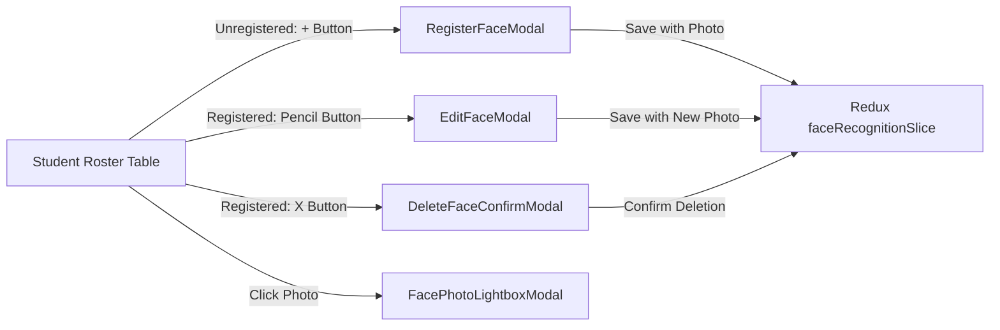

# Feature: Settings Face Recognition (Cấu Hình — Nhận Diện)

## User Value

The Face Recognition feature delivers an enterprise-grade administrative cockpit for managing biometric facial profiles of enrolled students. By centralizing registration under `CẤU HÌNH > Đăng ký nhận diện`, school administrators can reliably register photos for AI-based camera attendance kiosks, inspect registered photos, update images when students grow or change hairstyles, and delete biometric data upon student withdrawal.

Crucially, the module prevents administrative mistakes by locking student demographic fields into read-only mode, disabling submission buttons until an administrator actively selects a new image file, requiring an affirmative confirmation dialog explicitly spelling out the student's full name prior to biometric record deletion, and enabling seamless keyword search (accent-insensitive) and class filtering.

## Jira Story

- Story: As a School Administrator, I want to manage student facial recognition registration through an intuitive interface at /[schoolCode]/setting/face-recognition with demographic immutability, upload validation, and full-name deletion safeguards so that student biometric data is maintained accurately.
- Jira issue type: Story
- Story points: 5
- Acceptance owner: `sophia-product-manager`
- Research evidence: Legacy spec `SM4-nhan-dien.md` and school operational protocols for biometric student attendance.

## Priority

- Priority: P1
- User/business impact: Enables school-wide biometric attendance automation without data discrepancies.
- Risk if delayed: Manual paper attendance fallback required; AI camera gates cannot identify enrolled students.
- Release target: School Operating Portal Release 1.0 (Phase 1 Priority).

## PM Notes

- Demo scenario: Administrator navigates to `/demo/setting/face-recognition`, reviews KPI cards, filters for class 1A1, registers a photo for an unregistered student, edits a registered student by uploading a replacement photo, and verifies full-name deletion warning.
- Business value: Guarantees Decree 13 compliance and zero accidental biometric overwrites.
- Acceptance criteria confirmed: Satisfies all 9 business rules `BR01`–`BR09` and architectural decisions `K083`–`K088`.
- Open PM decision: None; all decisions implemented and verified.

## Requirements Trace

- PRD requirement: Section 5 - Administrative Settings and Configuration.
- Task id: `TASK-REC-001` through `TASK-REC-008`.
- Spec id: `048-settings-face-recognition-nhan-dien`.

## Scope

- Included: Student facial recognition roster, KPI counters, multi-criteria filter toolbar, table with dual action affordances, photo lightbox preview modal, create registration modal with read-only demographics, edit modal with dual photo preview and new-file enforcement, delete confirmation dialog articulating full student name, dynamic footer count, and pagination.
- Excluded: Direct hardware edge camera device drivers and real-time ONVIF stream capture (handled by dedicated on-premise attendance gateway).

## Relationship Map

| Relation | Target | Label | Rationale |
| --- | --- | --- | --- |
| Implements | `E-033-settings-face-recognition` | `IMPLEMENTS` | Core feature realizing the epic objectives. |
| Depends on | `M-033-001-settings-face-recognition` | `DEPENDS_ON` | Consumes domain contracts, state slice, and component hierarchy. |
| Depends on | `P-033-001-settings-face-recognition` | `DEPENDS_ON` | Surfaces through canonical route /[schoolCode]/setting/face-recognition. |
| Uses | `src/utils/faceRecognitionValidation.ts` | `USES` | Executes pure validation and predicate checks. |
| Relates to | `F-032-001-settings-accounts` | `RELATES_TO` | Co-located under M6 Cấu Hình management domain. |

## Code Scope

- Code paths: `src/types/faceRecognition.ts`, `src/utils/faceRecognitionValidation.ts`, `src/services/mockFaceRecognitionData.ts`, `src/store/slices/faceRecognitionSlice.ts`, `src/modules/setting/face-recognition/*`, `src/pages/[schoolCode]/setting/face-recognition/*`.
- Types: `src/types/faceRecognition.ts`
- Pure logic: `src/utils/faceRecognitionValidation.ts`
- State: `src/store/slices/faceRecognitionSlice.ts`, `src/store/index.ts`
- Mock data: `src/services/mockFaceRecognitionData.ts`
- Components: `src/modules/setting/face-recognition/FaceRecognitionToolbar.tsx`, `FaceRecognitionTable.tsx`, `RegisterFaceModal.tsx`, `EditFaceModal.tsx`, `DeleteFaceConfirmModal.tsx`, `FacePhotoLightboxModal.tsx`, `FaceRecognitionShell.tsx`
- Routes: `src/pages/[schoolCode]/setting/face-recognition/index.tsx`
- Layout: `src/components/layout/PortalLayout.tsx`
- Tests: `tests/unit/faceRecognition.test.mjs`

## Acceptance Criteria

- [x] Unregistered rows display `-` and a single circular blue `+` button (`BR01`, `BR02`, `K087`).
- [x] Registered rows display a photo thumbnail, `DD/MM/YYYY` date, and two circular buttons (pencil + X) (`BR01`, `BR02`, `K087`).
- [x] Demographic fields in both modals are strictly read-only (`BR03`, `K085`).
- [x] Submit button is disabled until a new photo file is uploaded (`BR04`, `BR05`, `K086`).
- [x] Deletion confirmation modal explicitly states: *"Vui lòng xác nhận xóa thông tin nhận diện của học sinh {Họ tên}"* (`BR06`, `K088`).
- [x] Conjunction filtering across keyword, class, and registration status (`BR07`, `BR08`).
- [x] Dynamic footer count `Tổng: N học sinh` and pagination controls (`BR09`).
- [x] Mounted fourth under `CẤU HÌNH` in sidebar with `faCamera` (`K083`).

## Mermaid Diagram

## Verification

- Command: `node --experimental-strip-types --test tests/unit/faceRecognition.test.mjs`
- Command: `npm test`
- Command: `npm run build`

## Work Log

| Date | Author | Summary |
| --- | --- | --- |
| 2026-10-14 | `marcus-ai-orchestrator` | Created feature document for Settings Face Recognition (Feature 048). |
| 2026-10-14 | `benny-frontend-engineer` | Implemented full frontend behavior, validation engine, Redux slice, and unit test suite. |

## Change Log

- Date: 2026-10-14
  - Feature change: Delivered complete Face Recognition sub-module under M6 Cấu Hình.
  - Evidence: Verified via 19/19 unit tests, 629/629 repo tests, and Next.js production build.
