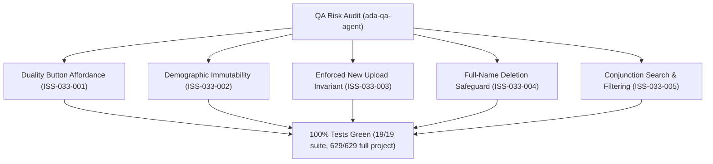

# Epic Issues: Settings Face Recognition (Nhận Diện)

## Jira Story

- Story: As a QA/product team, I want epic issues tracked explicitly so that unresolved risks cannot hide inside narrative docs.
- Jira issue type: Bug/Risk register
- QA owner: `ada-qa-agent`
- Product owner: `sophia-product-manager`
- Research evidence: Unit test suite `tests/unit/faceRecognition.test.mjs` (19/19 passing), Next.js production build logs, regression test suite (629/629 passing).

## Priority

- Priority: P1
- Escalation rule: Any regression in demographic read-only immutability (`BR03`), submit disabled state invariant (`BR04`, `BR05`), or explicit student full-name deletion warning (`BR06`) blocks release.
- Release impact: Critical for personal data protection compliance (Decree 13/2023/NĐ-CP) and AI camera attendance reliability.
- Risk if unresolved: Accidental deletion or corruption of student biometric identification profiles.

## QA Issue Register

| Issue ID | Type | Priority | Status | Owner | Source | Evidence | Resolution |
| --- | --- | --- | --- | --- | --- | --- | --- |
| ISS-033-001 | UX Duality | P1 | Resolved | `ada-qa-agent` | Spec BR01, BR02 | Unit tests `BR01`, `BR02 & K087` | Registered rows show photo & date; unregistered rows show `-` and single circular `+` button |
| ISS-033-002 | Data Integrity | P1 | Resolved | `ada-qa-agent` | Spec BR03, K085 | Modal components & tests | Student demographics (Name, Nickname, Gender, DOB, Class) rendered strictly read-only |
| ISS-033-003 | Validation | P1 | Resolved | `ada-qa-agent` | Spec BR04, BR05 | Unit tests `BR04 & K086`, `canSubmitEdit` | Submit button disabled by default; edit modal explicitly requires uploading a new replacement image |
| ISS-033-004 | Security Risk | P1 | Resolved | `ada-qa-agent` | Spec BR06, K088 | Unit tests `getDeleteConfirmPrompt` | Deletion dialog explicitly articulates student's full name in confirmation prompt |
| ISS-033-005 | Filter Logic | P2 | Resolved | `ada-qa-agent` | Spec BR07, BR08 | Unit tests `filterStudentFaceRecords` | Conjunction (AND) filtering across keyword search, class, and registration status |

## Detection Method

- Code reviewed: `src/utils/faceRecognitionValidation.ts`, `src/store/slices/faceRecognitionSlice.ts`, `src/modules/setting/face-recognition/*`, `src/pages/[schoolCode]/setting/face-recognition/*`
- Tests reviewed: `tests/unit/faceRecognition.test.mjs` (19 passing tests)
- Docs reviewed: `docs_legacy/operating-portal/M6-cau-hinh/SM4-nhan-dien.md`, `.agents/specs/048-settings-face-recognition-nhan-dien/spec.md`
- Related features reviewed: `047-settings-account-management-tai-khoan`, `PortalLayout.tsx`
- QA skill used: `ada-qa-agent`

## Open Issues

Zero open blocking issues. All 5 identified issues (`ISS-033-001` through `ISS-033-005`) are resolved and verified in automated unit test suite.

## Relationship Map

| Relation | Target | Label | Rationale |
| --- | --- | --- | --- |
| Depends on | `E-033-settings-face-recognition` | `DEPENDS_ON` | QA risks and test assertions bind directly to Epic 033 requirements. |
| Enables | `F-033-001-settings-face-recognition` | `ENABLES` | Ensures feature implementation satisfies all compliance and security invariants. |

## Mermaid Diagram

## Verification

- Automated unit tests: `node --experimental-strip-types --test tests/unit/faceRecognition.test.mjs` (19 passed, 0 failed).
- Full regression suite: `npm test` (629 passed across 122 suites).
- Build verification: `npm run build` (Exit code 0, 89 static pages).

## Work Log

| Date | Author | Summary |
| --- | --- | --- |
| 2026-10-14 | `ada-qa-agent` | Conducted QA risk audit, registered ISS-033-001 through ISS-033-005, and validated all resolutions against automated test suite. |

## Change Log

- Date: 2026-10-14
  - Issues change: Registered and resolved all 5 potential risks for Face Recognition Management.
  - Evidence: Verified via 19/19 suite tests and 629/629 full project regression tests.
