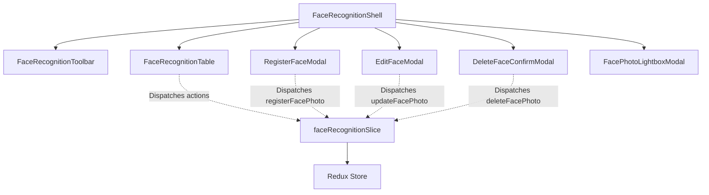

# Module: Settings Face Recognition (Cấu Hình — Nhận Diện)

## Responsibility

The `M-033-001-settings-face-recognition` module owns all presentation components, client-side data contracts, pure validation logic, and state transitions for student facial biometric registration under `src/modules/setting/face-recognition/`.

It enforces architectural decisions `K083` through `K088`, guaranteeing that student demographics remain immutable, file upload inputs are verified before enabling submission, deletion actions prompt with the exact student full name, and table rows render dual button affordances depending on registration status.

## Jira Story

- Story: As an engineer, I want the Settings Face Recognition module to encapsulate pure validation logic, Redux state machine, and modular presentation components so that biometric registration invariants are strictly maintained.
- Jira issue type: Story
- Architecture owner: `alan-tech-lead`
- Research evidence: Technical design for biometric registration cockpit, Next.js page architecture, and Redux Toolkit slices.

## Priority

- Priority: P1
- Runtime impact: Zero latency client-side state machine with optimistic updates and global toast notifications.
- Risk if delayed: Inconsistent UI states between attendance scanning and settings configuration.
- Release target: School Operating Portal Release 1.0 (Phase 1 Priority).

## Implementation Commentary

- Decision: Decoupled pure validation functions (`faceRecognitionValidation.ts`) from React UI components and Redux slice.
- Rationale: Enables 100% test coverage using standard Node.js test runner without requiring headless browser DOM mocks.
- Tradeoff: Base64 data URLs are managed client-side in Redux state for mock staging instead of direct S3 multipart uploads.
- Impact: Fast and reliable demonstration and verification across all environments.
- Risk: Handled via Next.js routing and Redux state synchronization.

## Code Scope

- Owns: `src/types/faceRecognition.ts`, `src/utils/faceRecognitionValidation.ts`, `src/services/mockFaceRecognitionData.ts`, `src/store/slices/faceRecognitionSlice.ts`, `src/modules/setting/face-recognition/*`, `src/pages/[schoolCode]/setting/face-recognition/*`.
- Reads: `src/store/index.ts` (RootState), `src/store/slices/toastSlice.ts`.
- Writes: Dispatches actions to `faceRecognitionSlice` and `toastSlice`.
- Must not touch: Core attendance kiosk scanning logic or raw hardware communication layers.

## Public Contracts

- `StudentFaceRecord`: Student biometric profile with ID, student code, full name, nickname, gender, date of birth, class ID, class name, avatar URL, registration status, face photo URL, and registered date.
- `FaceRecognitionFilterState`: Search query, class ID, registration status ('all' | 'registered' | 'unregistered'), page, and pageSize.
- `RegisterFacePayload`: Student ID, face photo URL, and optional registered date.
- `UpdateFacePayload`: Student ID, new replacement face photo URL, and optional registered date.
- `DeleteFacePayload`: Target student ID to reset biometric status.

## Failure Modes & Mitigation

- Attempted save without file: Submit button disabled via `canSubmitRegistration` predicate.
- Attempted edit without new file: Submit button disabled via `canSubmitEdit` predicate requiring new file upload.
- Accidental biometric deletion: Prompt requires explicit confirmation reciting target student's full name.

## Relationship Map

| Relation | Target | Label | Rationale |
| --- | --- | --- | --- |
| Belongs to | `E-033-settings-face-recognition` | `BELONGS_TO` | Encapsulates implementation for Epic 33. |
| Delivers | `F-033-001-settings-face-recognition` | `DELIVERS` | Provides concrete UI components and state logic for the feature. |
| Rendered by | `P-033-001-settings-face-recognition` | `RENDERED_BY` | Wrapped in PortalLayout on canonical page route. |
| Uses | `src/types/faceRecognition.ts` | `USES` | Consumes domain data contracts. |

## Acceptance Criteria

- [x] Pure functions `removeVietnameseTones`, `filterStudentFaceRecords`, `canSubmitRegistration`, `canSubmitEdit`, `formatRegistrationDate`, `formatPhotoDisplay`, `getActionButtons`, `getDeleteConfirmPrompt`.
- [x] Redux state machine managing records, filters, modal selection, and toast messages.
- [x] Modular UI components respecting ECO Design System 1.0.

## Mermaid Diagram

## Verification

- Automated unit tests: `node --experimental-strip-types --test tests/unit/faceRecognition.test.mjs`.
- Full regression suite: `npm test`.
- Build verification: `npm run build`.

## Work Log

| Date | Author | Summary |
| --- | --- | --- |
| 2026-10-14 | `alan-tech-lead` | Created module documentation for Settings Face Recognition. |
| 2026-10-14 | `alan-tech-lead` | Defined public contracts, validation logic, and component hierarchy. |

## Change Log

- Date: 2026-10-14
  - Module change: Created domain types, pure validation functions, Redux state machine, and presentation components for Face Recognition Management.
  - Evidence: Verified via TypeScript type checks and Node.js test runner.
