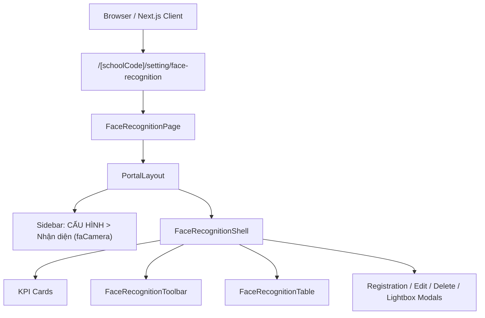

# Page: Settings Face Recognition (Cấu Hình — Nhận Diện)

## Route / Surface

- Route: `/[schoolCode]/setting/face-recognition`
- Entry component: `src/pages/[schoolCode]/setting/face-recognition/index.tsx`
- Layout owner: `src/components/layout/PortalLayout.tsx`
- Sidebar item: Fourth item under `CẤU HÌNH` ("Nhận diện", `faCamera`, strictly following "Tài khoản").

## Jira Story

- Story: As a School Administrator, I want to access the canonical Face Recognition management page at /[schoolCode]/setting/face-recognition wrapped in PortalLayout with sidebar item 'Nhận diện' so that I can inspect, filter, register, edit, and delete student facial recognition profiles.
- Jira issue type: Story
- UX owner: `benny-frontend-engineer`
- Research evidence: ECO Design System 1.0 guidelines, legacy screen flow `SM4-nhan-dien.md`.

## Priority

- Priority: P1
- Demo impact: Primary administrative entry point for facial recognition enrollment.
- Risk if delayed: Inability to navigate to the biometric management interface.
- Release target: School Operating Portal Release 1.0 (Phase 1 Priority).

## PM Notes

- Demo path: Login as Administrator > Click sidebar "CẤU HÌNH" > Click "Nhận diện" > Land on `http://localhost:3000/demo/setting/face-recognition`.
- User promise: Clean, responsive, high-contrast UI with clear breadcrumbs, real-time search, instant photo preview modals, and zero-accident deletion confirmation.
- Acceptance impact: Verifies end-to-end integration of Page Route, Layout, Shell, and Redux store.
- Visual or copy change: Brand blue `#0070CE` primary accents, emerald for registered badges, amber for unregistered warnings.
- Risk: Handled via client-side Redux store state and mock data hydration.

## Relationship Map

| Relation | Target | Label | Rationale |
| --- | --- | --- | --- |
| Implements | `F-033-001-settings-face-recognition` | `IMPLEMENTS` | This page renders the user-visible feature behavior. |
| Uses | `M-033-001-settings-face-recognition` | `USES` | Mounts FaceRecognitionShell and presentation components. |

## Page Structure & Responsive States

1. **Header & Breadcrumbs:**
   - Breadcrumb: Cấu hình > Đăng ký nhận diện.
   - Title with gradient camera badge.
2. **KPI Metric Cards:**
   - Total Students, Registered Count (% coverage), Unregistered Count.
3. **Filter Toolbar:**
   - Search input, class selector dropdown, registration status dropdown.
4. **Table Roster:**
   - Responsive columns: STT, Mã HS, Họ và tên, Lớp, Ảnh nhận diện, Ngày ghi nhận, Thao tác.
5. **Modals:**
   - Register modal, edit modal, delete confirmation modal, photo lightbox.

## States

- Default State: Displays all enrolled students with pagination (10 per page), dynamic count `Tổng: N`.
- Filtered State: Real-time filtering across keyword search (accent-insensitive), class, and registration status.
- Empty State: When no students match filters, renders clean inbox illustration with guidance text.
- Modal Open State: Darkened backdrop blur overlay mounting target modal with focus trap.
- Lightbox State: Fullscreen modal displaying zoomed high-res image of selected student.

## Mermaid Diagram

## Verification

- Command: `node --experimental-strip-types --test tests/unit/faceRecognition.test.mjs`
- Command: `npm test`
- Command: `npm run build`

## Work Log

| Date | Author | Summary |
| --- | --- | --- |
| 2026-10-14 | `benny-frontend-engineer` | Created page document for Settings Face Recognition. |
| 2026-10-14 | `benny-frontend-engineer` | Mounted page route, wired PortalLayout sidebar item, and verified build. |

## Change Log

- Date: 2026-10-14
  - Page change: Assembled canonical route `/[schoolCode]/setting/face-recognition` and mounted fourth under CẤU HÌNH.
  - Evidence: Verified via static generation during `npm run build` and unit test coverage.
