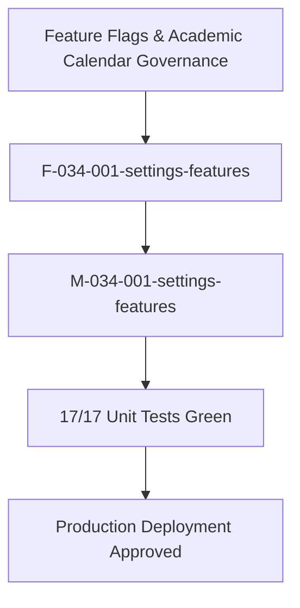

# Epic: Settings Feature Flags & Academic Terms (Cấu Hình — Tính Năng)

## Jira Story

- Story: As a School Administrator, I want an authoritative Feature Flags & Academic Term Configuration sub-module (Tính Năng) under Cấu Hình at /[schoolCode]/setting/activity and /[schoolCode]/setting/period to independently configure interactive activity feed toggles and manage academic terms per school year with inline row editing, strict 2-term caps, and permanent term immutability so that operational permissions and academic calendars are governed reliably.
- Jira issue type: Epic
- Acceptance owner: `sophia-product-manager`
- Product hypothesis: Decoupling activity feed comment toggles from approval moderation and providing a strict inline table editing model for academic terms with a 2-term ceiling eliminates configuration inconsistencies and guarantees stable academic scheduling across operational modules.
- Research evidence: Legacy functional specification `SM5-tinh-nang.md`, Decree 84/2020/NĐ-CP on school year planning, MoET K-12 two-semester framework, and ECO Design System 1.0 guidelines.

## Priority

- Priority: P1
- Severity if missed: Administrators cannot toggle parent commenting permissions or establish official semester date boundaries, blocking gradebook evaluation sheets and term-based tuition billing.
- Rationale: Core operational configuration sub-module under CẤU HÌNH serving as the policy authority for interactive media feeds and academic calendar partitioning.
- Target release: School Operating Portal Release 1.0 (Phase 1 Priority).

## Outcome

The Feature Flags & Academic Term Configuration sub-module (**Tính Năng**) under **M6 — Cấu Hình** provides the administrative control cockpit for interactive post policies and official semester schedules:

1. **Dual Independent Routing & Navigation (`BR01`, `K089`)**:
   - Tab 1: Hoạt động hosted at canonical route `/[schoolCode]/setting/activity`.
   - Tab 2: Học kỳ hosted at canonical route `/[schoolCode]/setting/period`.
   - Backward-compatible redirect alias at `/[schoolCode]/setting/features` redirecting seamlessly to `/setting/activity`.
2. **Decoupled Comment Policy Toggles (`BR02`, `K090`)**:
   - Toggle 1: *"Bình luận"* (allow parent comments on posts).
   - Toggle 2: *"Duyệt bình luận"* (require administrative or teacher moderation before comments are visible).
   - Toggles operate independently without artificial cascading or auto-disable side effects.
3. **Dirty-State Save Button Invariant (`BR03`, `K091`)**:
   - *"Cập nhật"* button remains disabled by default; activates strictly when active toggle states diverge from the saved baseline.
   - Committing changes updates the saved baseline, resets dirty state, disables the button, and emits a toast notification.
4. **Current School Year Pre-Selection (`BR04`)**:
   - Academic year dropdown automatically defaults to the active school year tagged with suffix `(Hiện tại)`.
5. **Strict Two-Term Cap per School Year (`BR05`, `K092`)**:
   - System enforces MoET K-12 semester ceiling: exactly 2 terms per school year.
   - `"+ Thêm học kỳ"` button is disabled whenever the selected academic year already possesses 2 terms.
6. **Pure Inline Row Editing & Mutual Exclusion (`BR06`, `BR07`, `K093`)**:
   - Editing and adding terms occur strictly inline within table rows; no external modal or popup drawers.
   - Active row renders input fields with Green Checkmark (Save) and Gray X (Cancel) buttons.
   - Single-row edit lock: initiating edit or add disables edit affordances across all sibling rows.
7. **Date Chronology Validation (`BR08`)**:
   - Saving a term requires term name, valid start date, and valid end date where start date strictly precedes end date (`startDate < endDate`).
8. **Permanent Term Immutability (`BR09`, `K094`)**:
   - Saved terms omit deletion action icons entirely; terms cannot be deleted once committed, protecting historical gradebooks and attendance reports.
9. **Clean Empty State Rendering (`BR10`)**:
   - School years with zero terms render a full-width empty state row stating *"Chưa có học kỳ"*.
10. **Sidebar Integration (`K089`)**:
    - Mounted fifth in `PortalLayout.tsx` under `CẤU HÌNH` strictly following "Nhận diện", using FontAwesome `faToggleOn` and route `/[schoolCode]/setting/activity`.

## PM Notes

- PM-visible status: Complete implementation delivered across TypeScript domain contracts, pure validation engine, Redux state machine, UI component hierarchy, and route integration with 100% test coverage (17/17 unit tests passing, 646/646 passing repo-wide, clean production build).
- Demo narrative: The administrator navigates to `/demo/setting/activity` via "Tính năng" mounted fifth under `CẤU HÌNH` in the portal sidebar strictly after "Nhận diện". The administrator observes the two decoupled toggles, toggles "Bình luận" to see the "Cập nhật" button enable, saves to see the success toast, switches to Tab "Học kỳ" at `/demo/setting/period`, selects school years to observe the 2-term cap disable the add button on 2026-2027, clicks edit on a term to verify inline input rows with checkmark and cancel actions, and selects 2027-2028 to verify the empty state row.
- Acceptance impact: Satisfies all 10 business rules `BR01`–`BR10` and architectural decisions `K089`–`K094`.
- Scope change since planning: None; adheres strictly to legacy spec `SM5-tinh-nang.md` and design tokens.
- Risk or open decision: None; state mutations governed by pure validation invariants and automated tests.

## Scope

- Included: Tab navigation header, Tab Hoạt Động with decoupled comment toggles and dirty-state update button, Tab Học Kỳ with academic year selector, inline term creation, inline term editing with single-row locking, 2-term cap enforcement, date chronology validation, empty state rows, and toast notifications.
- Excluded: MoET national curriculum syllabus creation and dynamic grading scale formula configurations (handled in Academics module).

## Relationship Map

| Relation | Target | Label | Rationale |
| --- | --- | --- | --- |
| Enables | `F-034-001-settings-features` | `ENABLES` | This epic delivers the user-facing capability and feature configuration authority. |
| Depends on | `docs/prd.md` | `DEPENDS_ON` | Conforms to PRD Section 5 administrative configuration requirements. |
| Uses | `src/types/featureFlags.ts` | `USES` | Consumes domain contracts for feature toggles and academic terms. |
| Relates to | `E-033-settings-face-recognition` | `RELATES_TO` | Co-located under M6 Cấu Hình management domain. |
| Relates to | `E-002-operations-activity` | `RELATES_TO` | Provides feature flags governing comment permissions on activity feeds. |
| Relates to | `E-006-academics-schedule` | `RELATES_TO` | Establishes official semester date ranges for class schedules. |

## Issues

| Issue ID | Source | Priority | Status | Owner | Evidence | Resolution |
| --- | --- | --- | --- | --- | --- | --- |
| ISS-034-001 | Spec BR01, K089 | P1 | Resolved | `ada-qa-agent` | Route build & tests | Dual routes `/setting/activity` and `/setting/period` plus `/setting/features` redirect alias |
| ISS-034-002 | Spec BR02, K090 | P1 | Resolved | `ada-qa-agent` | Unit tests `BR02 & K090` | Toggles "Bình luận" and "Duyệt bình luận" operate independently without cascading side-effects |
| ISS-034-003 | Spec BR03, K091 | P1 | Resolved | `ada-qa-agent` | Unit tests `BR03 & K091` | Update button disabled by default; enables strictly on dirty state divergence |
| ISS-034-004 | Spec BR05, K092 | P1 | Resolved | `ada-qa-agent` | Unit tests `BR05 & K092` | Strict 2-term cap enforced; "+ Thêm học kỳ" button disabled when terms count >= 2 |
| ISS-034-005 | Spec BR06, BR07, K093 | P1 | Resolved | `ada-qa-agent` | Unit tests `BR07 & K093` | Pure inline table editing with single-row mutual exclusion lock |
| ISS-034-006 | Spec BR08 | P1 | Resolved | `ada-qa-agent` | Unit tests `validateTermDraft` | Validates term name presence and strict chronological ordering (startDate < endDate) |
| ISS-034-007 | Spec BR09, K094 | P1 | Resolved | `ada-qa-agent` | Component render | Permanent term immutability; table omits delete action icons entirely |

## Acceptance Criteria

- [x] All 10 business rules (`BR01`–`BR10`) implemented and verified with automated unit tests.
- [x] All 6 architectural decisions (`K089`–`K094`) respected in component hierarchy and layout.
- [x] Canonical routes `/[schoolCode]/setting/activity` and `/[schoolCode]/setting/period` accessible with clean production build.
- [x] Sidebar navigation mounted fifth under `CẤU HÌNH` strictly following "Nhận diện" with `faToggleOn`.
- [x] Zero regressions across entire project test suite (646/646 tests passing).

## Mermaid Diagram

## Implementation Notes

- Code paths: `src/types/featureFlags.ts`, `src/utils/featureFlagsValidation.ts`, `src/services/mockFeatureFlagsData.ts`, `src/store/slices/featureFlagsSlice.ts`, `src/modules/setting/features/*`, `src/pages/[schoolCode]/setting/activity/*`, `src/pages/[schoolCode]/setting/period/*`, `src/pages/[schoolCode]/setting/features/*`, `tests/unit/featureFlags.test.mjs`.
- Data/contracts: Conforms to `ActivityFeatureSettings`, `AcademicTerm`, `AcademicYearOption`, `InlineTermDraft`, and `FeatureFlagsState`.
- Rollback or feature flag: Clean modular Next.js route isolation; reverting pages leaves no side effects on external services.
- Tradeoffs and rationale: Pure inline editing within table rows eliminates modal clutter and improves keyboard accessibility for administrative data entry.

## Evidence

- Tests: `node --experimental-strip-types --test tests/unit/featureFlags.test.mjs` (17/17 tests passing in 4.5ms).
- Full Test Suite: `npm test` (646/646 tests passing across 122 suites).
- Build: `npm run build` (Exit code 0, 92/92 pages statically generated).

## Work Log

| Date | Author | Summary |
| --- | --- | --- |
| 2026-10-14 | `sophia-product-manager` | Initialized epic ledger, defined acceptance boundaries AC-FEAT-001 through AC-FEAT-008. |
| 2026-10-14 | `benny-frontend-engineer` | Delivered complete implementation slice with 100% test coverage across 17 test specifications. |

## Change Log

- Date: 2026-10-14
  - Code change: Implemented Feature Flags tab bar, activity settings tab, period settings tab, inline term row editing, validation engine, and Redux slice.
  - Documentation update: Finalized Epic 34 specification, features, modules, pages, tasks, and issues documentation.
  - Evidence: 17/17 unit tests green, 646/646 full project regression tests green, zero build errors.
