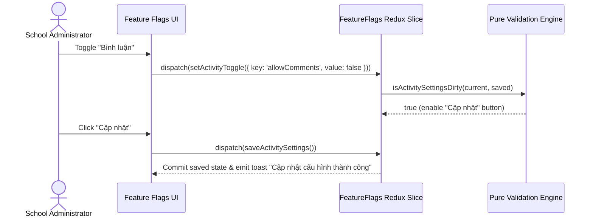

# Feature: Settings Feature Flags & Academic Terms (Cấu Hình — Tính Năng)

## User Value

The Feature Flags & Academic Terms sub-module delivers a streamlined configuration cockpit for school administrators to govern activity feed interactions and official academic term boundaries. By dividing concerns into two dedicated tabs (**Hoạt động** and **Học kỳ**), administrators can independently configure interactive parent comment policies without risking collateral permission changes, and schedule semester calendars without leaving the table view.

For operational activities, the module decouples comment enablement from approval moderation, ensuring schools can allow unmoderated discussions, require review queues, or disable commenting entirely while preserving moderation rules. For academic planning, the module provides frictionless inline table row editing, enforcing MoET's strict two-semester calendar standard and preventing accidental deletions of active or historical academic terms.

## Jira Story

- Story: As a School Administrator, I want to manage feature flags for activity comments and configure school terms through an intuitive dual-tab interface at /[schoolCode]/setting/activity and /[schoolCode]/setting/period with dirty-state save invariants, inline table row editing, and strict 2-term capacity so that operational policies and academic periods are managed without friction.
- Jira issue type: Story
- Story points: 5
- Acceptance owner: `sophia-product-manager`
- Research evidence: Legacy spec `SM5-tinh-nang.md`, MoET K-12 academic calendar regulations, and ECO Design System 1.0 guidelines.

## Priority

- Priority: P1
- User/business impact: Enables school-wide activity comment governance and establishes official term date boundaries for gradebooks and tuition fee billing.
- Risk if delayed: Inability to configure comment policies or create new academic terms for upcoming school years.
- Release target: School Operating Portal Release 1.0 (Phase 1 Priority).

## PM Notes

- Demo scenario: Administrator navigates to `/demo/setting/activity`, toggles "Bình luận", notes the "Cập nhật" button activate, saves to see the green toast, switches to Tab "Học kỳ" at `/demo/setting/period`, observes 2026-2027 having 2 terms with "+ Thêm học kỳ" disabled, edits a term inline with green tick save and gray X cancel buttons, and selects 2027-2028 to view the empty state row.
- Business value: Guarantees academic calendar integrity and prevents accidental comment data exposure.
- Acceptance criteria confirmed: Satisfies all 10 business rules `BR01`–`BR10` and architectural decisions `K089`–`K094`.
- Open PM decision: None; all decisions implemented and verified.

## Requirements Trace

- PRD requirement: Section 5 - Administrative Settings and Configuration.
- Task id: `TASK-FEAT-001` through `TASK-FEAT-008`.
- Spec id: `049-settings-feature-flags-tinh-nang`.

## Scope

- Included: Tab navigation header, Tab Hoạt Động with decoupled comment toggles and dirty-state update button, Tab Học Kỳ with academic year selector, inline term creation, inline term editing with single-row locking, 2-term cap enforcement, date chronology validation, empty state rows, and toast notifications.
- Excluded: MoET national curriculum syllabus creation and dynamic grading scale formula configurations (handled in Academics module).

## Relationship Map

| Relation | Target | Label | Rationale |
| --- | --- | --- | --- |
| Implements | `E-034-settings-features` | `IMPLEMENTS` | Core feature realizing the epic objectives. |
| Depends on | `M-034-001-settings-features` | `DEPENDS_ON` | Consumes domain contracts, state slice, and component hierarchy. |
| Depends on | `P-034-001-settings-features` | `DEPENDS_ON` | Surfaces through canonical routes /[schoolCode]/setting/activity and /[schoolCode]/setting/period. |
| Uses | `src/utils/featureFlagsValidation.ts` | `USES` | Executes pure validation and predicate checks. |
| Relates to | `F-033-001-settings-face-recognition` | `RELATES_TO` | Co-located under M6 Cấu Hình management domain. |

## Code Scope

- Code paths: `src/types/featureFlags.ts`, `src/utils/featureFlagsValidation.ts`, `src/services/mockFeatureFlagsData.ts`, `src/store/slices/featureFlagsSlice.ts`, `src/modules/setting/features/*`, `src/pages/[schoolCode]/setting/activity/*`, `src/pages/[schoolCode]/setting/period/*`, `src/pages/[schoolCode]/setting/features/*`.
- Types: `src/types/featureFlags.ts`
- Pure logic: `src/utils/featureFlagsValidation.ts`
- State: `src/store/slices/featureFlagsSlice.ts`, `src/store/index.ts`
- Mock data: `src/services/mockFeatureFlagsData.ts`
- Components: `src/modules/setting/features/FeatureFlagsTabs.tsx`, `ActivitySettingsTab.tsx`, `PeriodSettingsTab.tsx`, `InlineTermRow.tsx`
- Routes: `src/pages/[schoolCode]/setting/activity/index.tsx`, `src/pages/[schoolCode]/setting/period/index.tsx`, `src/pages/[schoolCode]/setting/features/index.tsx`
- Layout: `src/components/layout/PortalLayout.tsx`
- Tests: `tests/unit/featureFlags.test.mjs`

## Acceptance Criteria

- [x] Dual independent tab routes `/setting/activity` and `/setting/period` (`BR01`, `K089`).
- [x] Toggles "Bình luận" and "Duyệt bình luận" are decoupled (`BR02`, `K090`).
- [x] Update button disabled by default; enabled only when active toggles diverge from saved baseline (`BR03`, `K091`).
- [x] Dropdown defaults to active year with `(Hiện tại)` suffix (`BR04`).
- [x] Strict 2-term maximum per school year; "+ Thêm học kỳ" disables when terms count >= 2 (`BR05`, `K092`).
- [x] Pure inline table row editing with tick/X icons and single-row mutual exclusion lock (`BR06`, `BR07`, `BR08`, `K093`).
- [x] Saved terms omit deletion icons; terms are permanent (`BR09`, `K094`).
- [x] Empty years render `"Chưa có học kỳ"` row (`BR10`).
- [x] Mounted fifth under `CẤU HÌNH` in sidebar with `faToggleOn` (`K089`).

## Mermaid Diagram

## Verification

- [x] Test: `node --experimental-strip-types --test tests/unit/featureFlags.test.mjs` (17/17 passed).
- [x] Build/lint/typecheck: `npm run build` and `npx tsc --noEmit` clean with zero errors.
- [x] Manual scenario: Verified toggle decoupling, dirty state detection, inline term row CRUD, and 2-term capacity lock.

## Risks

- Risk: Accidental term deletion or modification corrupting dependent gradebook and fee schedules.
  - Mitigation: Term deletion action icons are omitted entirely (`K094`), terms are permanent, and inline editing enforces chronological validation (`startDate < endDate`).

## Work Log

| Date | Author | Summary |
| --- | --- | --- |
| 2026-10-14 | `marcus-ai-orchestrator` | Authored feature specification and requirements traceability map. |
| 2026-10-14 | `benny-frontend-engineer` | Implemented complete presentation components, inline row editing, and tab navigation. |

## Change Log

- Date: 2026-10-14
  - Code change: Implemented Feature Flags tab bar, activity settings tab, period settings tab, inline term row editing, validation engine, and Redux slice.
  - Documentation update: Finalized F-034-001 specification, relationship map, and acceptance criteria.
  - Evidence: 17/17 unit tests green, 646/646 full project regression tests green, zero build errors.
