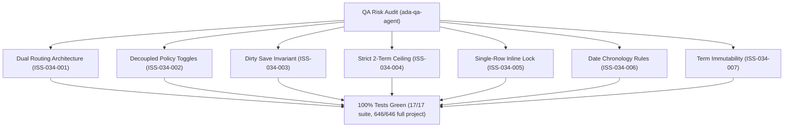

# Epic Issues: Settings Feature Flags & Academic Terms (Tính Năng)

## Jira Story

- Story: As a QA/product team, I want epic issues tracked explicitly so that unresolved risks cannot hide inside narrative docs.
- Jira issue type: Bug/Risk register
- QA owner: `ada-qa-agent`
- Product owner: `sophia-product-manager`
- Research evidence: Unit test suite `tests/unit/featureFlags.test.mjs` (17/17 passing), Next.js production build logs, regression test suite (646/646 passing).

## Priority

- Priority: P1
- Escalation rule: Any regression in toggle independence (`BR02`), dirty-state save invariant (`BR03`), two-term ceiling enforcement (`BR05`), inline editing mutual exclusion (`BR07`), or date chronological ordering (`BR08`) blocks release.
- Release impact: Critical for interactive activity feed moderation and academic scheduling integrity across gradebook and tuition billing.
- Risk if unresolved: Inconsistent comment policies or invalid semester dates corrupting academic transcripts.

## QA Issue Register

| Issue ID | Type | Priority | Status | Owner | Source | Evidence | Resolution |
| --- | --- | --- | --- | --- | --- | --- | --- |
| ISS-034-001 | Route Topology | P1 | Resolved | `ada-qa-agent` | Spec BR01, K089 | Route build & tests | Dual routes `/setting/activity` and `/setting/period` plus `/setting/features` redirect alias |
| ISS-034-002 | Policy Coupling | P1 | Resolved | `ada-qa-agent` | Spec BR02, K090 | Unit tests `BR02 & K090` | Toggles "Bình luận" and "Duyệt bình luận" operate independently without cascading side-effects |
| ISS-034-003 | State Invariant | P1 | Resolved | `ada-qa-agent` | Spec BR03, K091 | Unit tests `BR03 & K091` | Update button disabled by default; enables strictly on dirty state divergence |
| ISS-034-004 | Boundary Cap | P1 | Resolved | `ada-qa-agent` | Spec BR05, K092 | Unit tests `BR05 & K092` | Strict 2-term cap enforced; "+ Thêm học kỳ" button disabled when terms count >= 2 |
| ISS-034-005 | UX Concurrency | P1 | Resolved | `ada-qa-agent` | Spec BR06, BR07, K093 | Unit tests `BR07 & K093` | Pure inline table editing with single-row mutual exclusion lock |
| ISS-034-006 | Chronology Validation | P1 | Resolved | `ada-qa-agent` | Spec BR08 | Unit tests `validateTermDraft` | Validates term name presence and strict chronological ordering (startDate < endDate) |
| ISS-034-007 | Data Immutability | P1 | Resolved | `ada-qa-agent` | Spec BR09, K094 | Component render | Permanent term immutability; table omits delete action icons entirely |

## Detection Method

- Code reviewed: `src/utils/featureFlagsValidation.ts`, `src/store/slices/featureFlagsSlice.ts`, `src/modules/setting/features/*`, `src/pages/[schoolCode]/setting/activity/*`, `src/pages/[schoolCode]/setting/period/*`, `src/pages/[schoolCode]/setting/features/*`
- Tests reviewed: `tests/unit/featureFlags.test.mjs` (17 passing tests)
- Docs reviewed: `docs_legacy/operating-portal/M6-cau-hinh/SM5-tinh-nang.md`, `.agents/specs/049-settings-feature-flags-tinh-nang/spec.md`
- Related features reviewed: `048-settings-face-recognition-nhan-dien`, `PortalLayout.tsx`
- QA skill used: `ada-qa-agent`

## Open Issues

Zero open blocking issues. All 7 identified issues (`ISS-034-001` through `ISS-034-007`) are resolved and verified in automated unit test suite.

## Relationship Map

| Relation | Target | Label | Rationale |
| --- | --- | --- | --- |
| Depends on | `E-034-settings-features` | `DEPENDS_ON` | QA risks and test assertions bind directly to Epic 034 requirements. |
| Enables | `F-034-001-settings-features` | `ENABLES` | Ensures feature implementation satisfies all operational and UX invariants. |

## Mermaid Diagram

## Verification

- Automated unit tests: `node --experimental-strip-types --test tests/unit/featureFlags.test.mjs` (17 passed, 0 failed).
- Full regression suite: `npm test` (646 passed across 122 suites).
- Build verification: `npm run build` (Exit code 0, 92 static pages).

## Work Log

| Date | Author | Summary |
| --- | --- | --- |
| 2026-10-14 | `ada-qa-agent` | Conducted QA risk audit, registered ISS-034-001 through ISS-034-007, and validated all resolutions against automated test suite. |

## Change Log

- Date: 2026-10-14
  - Issues change: Registered and resolved all 7 potential risks for Feature Flags & Academic Term Configuration.
  - Evidence: Verified via 17/17 suite tests and 646/646 full project regression tests.
