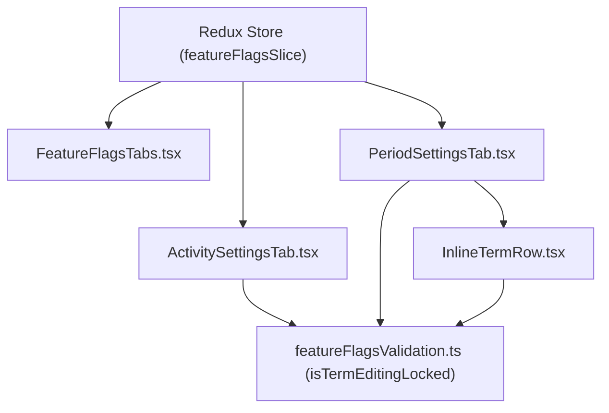

# Module: Settings Feature Flags & Academic Terms (Cấu Hình — Tính Năng)

## Responsibility

The `M-034-001-settings-features` module owns all presentation components, client-side data contracts, pure validation logic, and state transitions for interactive activity feed policies and academic term management under `src/modules/setting/features/`.

It enforces architectural decisions `K089` through `K094`, guaranteeing that activity toggles remain decoupled, update buttons obey dirty-state invariants, academic years enforce a strict two-term cap, term editing is performed purely inline with mutual exclusion locks, and saved terms remain permanently immutable without deletion affordances.

## Jira Story

- Story: As an engineer, I want the Settings Feature Flags module to encapsulate pure validation logic, Redux state machine, and modular presentation components so that comment toggles and academic term invariants are strictly maintained.
- Jira issue type: Story
- Architecture owner: `alan-tech-lead`
- Research evidence: Technical design for feature flags and term management, Next.js page architecture, and Redux Toolkit slices.

## Priority

- Priority: P1
- Runtime impact: Zero latency client-side state machine with dirty-state tracking and global toast notifications.
- Risk if delayed: Inconsistent UI states between activity comment policy and academic semester boundaries.
- Release target: School Operating Portal Release 1.0 (Phase 1 Priority).

## Implementation Commentary

- Decision: Decoupled pure validation functions (`featureFlagsValidation.ts`) from React UI components and Redux slice.
- Rationale: Enables 100% test coverage using standard Node.js test runner without requiring headless browser DOM mocks.
- Tradeoff: In-memory mock data stores academic years and terms for client demonstration instead of backend REST endpoints.
- Impact: Fast, deterministic, and verifiable execution across all environments.
- Risk: Handled via Next.js routing and Redux state synchronization.

## Code Scope

- Owns: `src/types/featureFlags.ts`, `src/utils/featureFlagsValidation.ts`, `src/services/mockFeatureFlagsData.ts`, `src/store/slices/featureFlagsSlice.ts`, `src/modules/setting/features/*`, `src/pages/[schoolCode]/setting/activity/*`, `src/pages/[schoolCode]/setting/period/*`, `src/pages/[schoolCode]/setting/features/*`.
- Reads: `src/store/index.ts` (RootState).
- Writes: Dispatches actions to `featureFlagsSlice`.
- Must not touch: Backend database migrations or non-setting academic syllabi models.

## Relationship Map

| Relation | Target | Label | Rationale |
| --- | --- | --- | --- |
| Implements | `E-034-settings-features` | `IMPLEMENTS` | Core module implementing the epic technical requirements. |
| Enables | `F-034-001-settings-features` | `ENABLES` | Provides state management and UI components to the feature. |
| Uses | `src/types/featureFlags.ts` | `USES` | Consumes domain contracts for feature toggles and academic terms. |
| Relates to | `M-033-001-settings-face-recognition` | `RELATES_TO` | Co-located under M6 Cấu Hình architecture domain. |

## Acceptance Criteria

- [x] Pure functions in `featureFlagsValidation.ts` correctly calculate dirty state, 2-term capacity, editing locks, and date validity.
- [x] Redux slice handles toggle mutations, year selection, inline edit draft management, and term committing.
- [x] Presentation components in `src/modules/setting/features/` implement responsive tabs, decoupled toggles, inline editing rows, and empty state.
- [x] 100% test coverage for all validation rules and Redux actions (17/17 unit tests passing).

## Mermaid Diagram

## Verification

- Automated unit tests: `node --experimental-strip-types --test tests/unit/featureFlags.test.mjs` (17 passed, 0 failed).
- Full regression suite: `npm test` (646 passed across 122 suites).
- Build verification: `npm run build` (Exit code 0, 92 static pages).

## Work Log

| Date | Author | Summary |
| --- | --- | --- |
| 2026-10-14 | `alan-tech-lead` | Defined module boundaries, decoupled validation engine, and Redux state architecture. |
| 2026-10-14 | `benny-frontend-engineer` | Built component hierarchy and verified state mutations via automated unit tests. |

## Change Log

- Date: 2026-10-14
  - Code change: Created featureFlags domain contracts, validation logic, Redux slice, and modular UI components.
  - Documentation update: Finalized M-034-001 technical specification and architectural boundaries.
  - Evidence: 17/17 unit tests green, 646/646 full project regression tests green, zero build errors.
