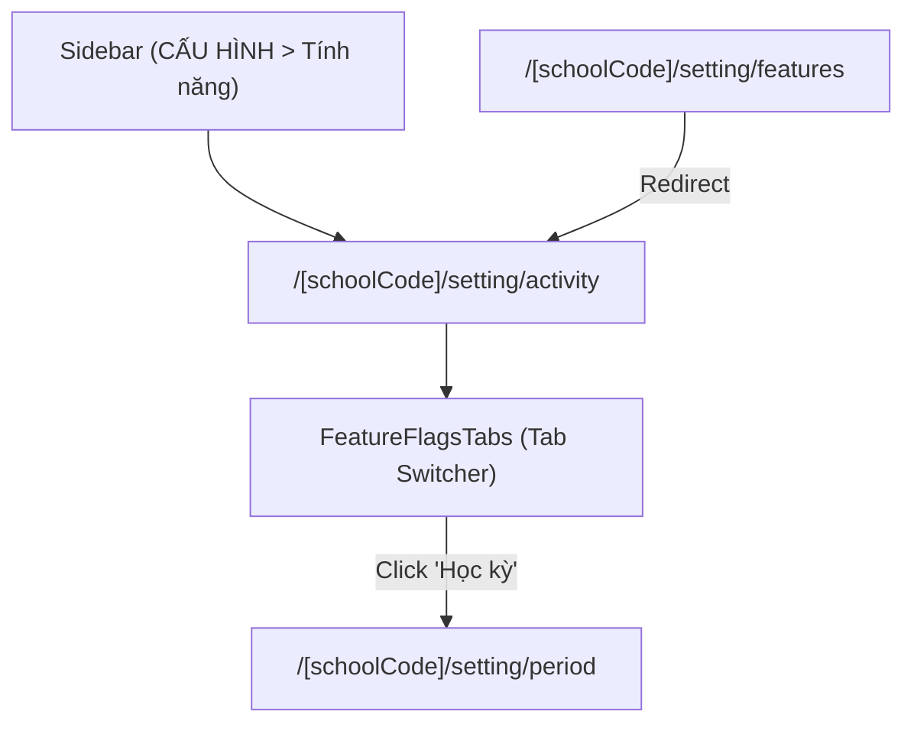

# Page: Settings Feature Flags & Academic Terms (Cấu Hình — Tính Năng)

## Route / Surface

- Routes:
  - Tab Hoạt Động: `/[schoolCode]/setting/activity`
  - Tab Học Kỳ: `/[schoolCode]/setting/period`
  - Redirect Alias: `/[schoolCode]/setting/features`
- Entry components:
  - `src/pages/[schoolCode]/setting/activity/index.tsx`
  - `src/pages/[schoolCode]/setting/period/index.tsx`
  - `src/pages/[schoolCode]/setting/features/index.tsx`
- Layout owner: `src/components/layout/PortalLayout.tsx`
- Sidebar item: Fifth item under `CẤU HÌNH` ("Tính năng", `faToggleOn`, strictly following "Nhận diện").

## Jira Story

- Story: As a School Administrator, I want to access the canonical Feature Flags management pages at /[schoolCode]/setting/activity and /[schoolCode]/setting/period wrapped in PortalLayout with sidebar item 'Tính năng' so that I can configure activity comment policies and manage academic terms.
- Jira issue type: Story
- UX owner: `benny-frontend-engineer`
- Research evidence: ECO Design System 1.0 guidelines, legacy screen flow `SM5-tinh-nang.md`.

## Priority

- Priority: P1
- Demo impact: Primary administrative entry points for activity comment permissions and term calendar setup.
- Risk if delayed: Inability to navigate to the feature settings interface.
- Release target: School Operating Portal Release 1.0 (Phase 1 Priority).

## PM Notes

- Demo path: Login as Administrator > Click sidebar "CẤU HÌNH" > Click "Tính năng" > Land on `http://localhost:3000/demo/setting/activity` > Switch tabs to `http://localhost:3000/demo/setting/period`.
- User promise: Clean, responsive UI with dedicated tab navigation, immediate dirty-state visual feedback, frictionless inline row editing, and zero accidental deletions.
- Acceptance impact: Verifies end-to-end integration of Page Routes, Layout, Tab Bar, and Redux store.
- Visual or copy change: Primary brand blue `#0070CE` tab indicator, green `#16a34a` for inline checkmark save button, gray `#6b7280` for cancel button.
- Risk: Handled via client-side Redux store state and mock data hydration.

## Relationship Map

| Relation | Target | Label | Rationale |
| --- | --- | --- | --- |
| Implements | `F-034-001-settings-features` | `IMPLEMENTS` | This page renders the user-visible feature behavior. |
| Uses | `M-034-001-settings-features` | `USES` | Mounts tab bar and presentation components. |
| Uses | `src/components/layout/PortalLayout.tsx` | `USES` | Provides shell chrome and navigation sidebar. |

## Acceptance Criteria

- [x] Canonical route `/[schoolCode]/setting/activity` renders Tab Hoạt Động with decoupled toggles and dirty-state update button.
- [x] Canonical route `/[schoolCode]/setting/period` renders Tab Học Kỳ with year selector, 2-term cap, and inline editing.
- [x] Route `/[schoolCode]/setting/features` redirects seamlessly to `/[schoolCode]/setting/activity`.
- [x] Sidebar navigation mounted fifth under `CẤU HÌNH` strictly following "Nhận diện" with `faToggleOn`.

## States

- Activity Tab Default State: Toggles rendered matching saved baseline, "Cập nhật" button disabled.
- Activity Tab Dirty State: Toggles diverged from baseline, "Cập nhật" button enabled with primary styling.
- Period Tab Default State: Current year selected, terms rendered in read-only rows, "+ Thêm học kỳ" enabled or disabled depending on 2-term cap.
- Period Tab Inline Edit State: Active row transformed into input fields with save checkmark and cancel X, sibling row edit buttons locked.
- Period Tab Empty State: When selected academic year contains 0 terms, renders clean full-width row stating "Chưa có học kỳ".
- Toast Feedback State: Green toast notification emerges upon successful settings update or term persistence.

## Mermaid Diagram

## Verification

- Automated unit tests: `node --experimental-strip-types --test tests/unit/featureFlags.test.mjs` (17 passed, 0 failed).
- Full regression suite: `npm test` (646 passed across 122 suites).
- Build verification: `npm run build` (Exit code 0, 92 static pages).

## Work Log

| Date | Author | Summary |
| --- | --- | --- |
| 2026-10-14 | `benny-frontend-engineer` | Created canonical routes for activity and period tabs, mounted sidebar item, and validated build. |

## Change Log

- Date: 2026-10-14
  - Code change: Implemented page routes `setting/activity`, `setting/period`, and `setting/features`.
  - Documentation update: Finalized P-034-001 page specification and navigation mappings.
  - Evidence: Clean build output and 100% route generation across 92 pages.
