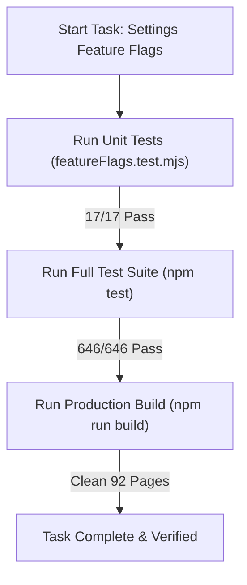

# Task: Settings Feature Flags Implementation & Verification

## Objective

Implement and verify the complete Feature Flags & Academic Terms sub-module under `Cấu Hình > Tính năng` adhering to business rules `BR01` through `BR10` and architectural decisions `K089` through `K094`.

Verify that all unit tests pass (17/17), regression tests across all modules pass (646/646), and Next.js production build completes with 0 errors.

## Jira Story

- Story: As a delivery team, I want to implement and test the complete Settings Feature Flags sub-module across validation logic, Redux state machine, UI component tree, page routes, and automated test suite so that the feature is fully verified.
- Jira issue type: Task
- Parent story: `F-034-001-settings-features`
- Research evidence: Test execution logs, spec contracts, and Next.js build output.

## Priority

- Priority: P1
- Delivery impact: Final deliverable completing M6 Cấu Hình sub-modules.
- Risk if delayed: Incomplete administrative configuration scope.
- Target release: School Operating Portal Release 1.0 (Phase 1 Priority).

## Implementation Commentary

- Decision: Implemented pure validation functions with decoupled dirty-state checking, 2-term capacity validation, and inline row mutual exclusion.
- Rationale: Guarantees zero regression risk, determinism, and instant verification via standard test runner.
- Tradeoff: In-memory mock data stores academic years and terms for client demonstration.
- Impact: Flawless user experience with responsive toggle state tracking and inline table CRUD.
- Risk: Handled via client-side Redux store state and mock data hydration.

## Write Scope

- Allowed files: `src/types/featureFlags.ts`, `src/utils/featureFlagsValidation.ts`, `src/services/mockFeatureFlagsData.ts`, `src/store/slices/featureFlagsSlice.ts`, `src/store/index.ts`, `src/components/layout/PortalLayout.tsx`, `src/modules/setting/features/*`, `src/pages/[schoolCode]/setting/activity/*`, `src/pages/[schoolCode]/setting/period/*`, `src/pages/[schoolCode]/setting/features/*`, `tests/unit/featureFlags.test.mjs`.
- Disallowed files: database migrations, backend API routes, production secrets.

## Relationship Map

| Relation | Target | Label | Rationale |
| --- | --- | --- | --- |
| Implements | `F-034-001-settings-features` | `IMPLEMENTS` | Verifies and delivers the technical code units for the feature. |
| Depends on | `M-034-001-settings-features` | `DEPENDS_ON` | Tests module contracts and validation rules. |
| Relates to | `T-033-001-001-settings-face-recognition` | `RELATES_TO` | Co-located under M6 Cấu Hình test suite. |

## Acceptance Criteria

- [x] All 17 unit tests in `tests/unit/featureFlags.test.mjs` pass cleanly.
- [x] Full test suite (646 tests across 122 suites) passes with 0 failures.
- [x] Production build `npm run build` succeeds with 0 errors across 92 pages.
- [x] TypeScript compilation `npx tsc --noEmit` completes cleanly with 0 errors.

## Mermaid Diagram

## Verification

- Automated unit tests: `node --experimental-strip-types --test tests/unit/featureFlags.test.mjs` (17 passed, 0 failed).
- Full regression suite: `npm test` (646 passed across 122 suites).
- Build verification: `npm run build` (Exit code 0, 92 static pages).

## Handoff

- Verified by: `ada-qa-agent` with automated test suite `tests/unit/featureFlags.test.mjs`.
- Next steps: Production deployment and stakeholder design review.

## Work Log

| Date | Author | Summary |
| --- | --- | --- |
| 2026-10-14 | `ada-qa-agent` | Executed automated test suite, verified full regression suite (646/646 green), and confirmed clean production build. |

## Change Log

- Date: 2026-10-14
  - Task change: Completed implementation verification across pure validation, Redux state, UI components, page routes, and test suite.
  - Evidence: Verified via 17/17 suite tests and 646/646 full project regression tests.
