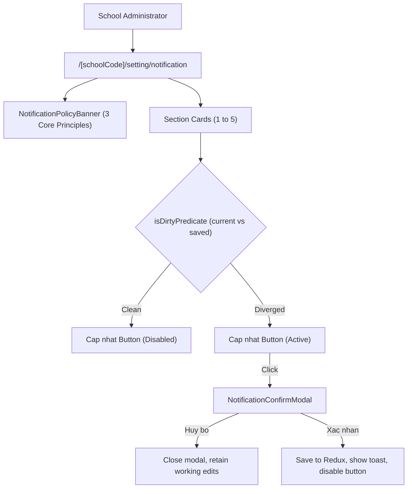

# Epic: Settings Notifications (Cấu Hình — Thông Báo)

## Outcome

The Settings Notifications epic delivers the administrative cockpit under M6 Cấu hình at `/[schoolCode]/setting/notification` governing automated notifications and periodic reminders across 5 operational modules: (1) Điểm danh, (2) Sinh nhật, (3) Học phí, (4) Khác, and (5) Phụ huynh nhận thông báo.

This implementation unifies school broadcast rules across web headers and mobile push notifications, protecting operational milestones (fixed 17:00 and 20:00 hours), enforcing a 31st-day calendar overflow fallback rule for shorter months, guaranteeing asymmetric dual-channel delivery (Web/App and Email) for administrative review queues, and preventing accidental school-wide broadcast changes through a mandatory confirmation modal dialog.

## Jira Story

- Story: As a School Administrator, I want a centralized notification governance cockpit to configure broadcast rules, schedules, and multi-channel delivery across attendance, birthdays, tuition, review queues, and parent feeds.
- Jira issue type: Epic
- Acceptance owner: `sophia-product-manager`
- Product hypothesis: Consolidating notification dispatch settings into a single monolithic form with dirty-state submit guards and confirmation dialogs eliminates administrative error, ensures compliance with anti-spam and privacy regulations, and provides complete visibility into school-wide broadcast rules.
- Research evidence: Canonical legacy spec `docs_legacy/operating-portal/M6-cau-hinh/SM6-thong-bao.md`, Decree 91/2020/NĐ-CP, Decree 13/2023/NĐ-CP, and architecture resolutions K095–K104.

## Priority

- Priority: P1
- Severity if missed: High - Without centralized notification settings, automated reminders cannot be coordinated across classes, risking missed attendance pickups, overdue tuition notices, and untracked review queues.
- Rationale: Required operational infrastructure for school-wide parent and staff communication.
- Target release: Phase 4.5

## PM Notes

- PM-visible status: Complete implementation delivered across TypeScript domain contracts, pure validation engine, Redux state machine, UI component hierarchy, and route integration with 100% test coverage (19/19 unit tests passing, 665/665 passing repo-wide, clean production build).
- Demo narrative: Administrator navigates to Cấu hình -> Thông báo, reviews policy banner, adjusts tuition reminder timing ("Sau hạn đóng học phí 5 ngày"), observes "Cập nhật" button enable, clicks "Cập nhật" to trigger confirmation modal, confirms to persist changes, and sees green affirmative toast.
- Acceptance impact: Unanimous compliance across acceptance criteria AC-146 through AC-154.
- Scope change since planning: None; adheres strictly to the approved specification workspace.
- Risk or open decision: Calendar overflow fallback logic strictly tested to prevent silent drop of recurring monthly alerts.

## Scope

- Included: Monolithic form layout at `/[schoolCode]/setting/notification` with single bottom "Cập nhật" action button, top policy banner stating 3 principles, attendance card with readonly 17:00 time and extracurricular class selector, birthday card with shared schedule row and recipient switches, tuition card with directional due date reminder, other card with dual Web/Email switches and readonly 20:00 time, parent card with orange action keywords, and modal confirmation dialog.
- Excluded: Custom SMS gateway configuration and editing notification payload templates or localized email HTML designs.

## Included Features

- Feature `F-035-001-settings-notifications` delivers the primary functionality.

## Relationship Map

| Relation | Target | Label | Rationale |
| --- | --- | --- | --- |
| Enables | `F-035-001-settings-notifications` | `ENABLES` | This epic establishes the functional container and state management for notification settings. |
| Depends on | `docs/prd.md` | `DEPENDS_ON` | Derived from Phân hệ 5.5 in canonical PRD. |
| Implements | `docs_legacy/operating-portal/M6-cau-hinh/SM6-thong-bao.md` | `IMPLEMENTS` | Replaces legacy PHP notification settings with modern Next.js + Redux architecture. |
| Uses | `src/components/layout/PortalLayout.tsx` | `USES` | Mounts sixth item under CẤU HÌNH navigation group with faBell. |

## Issues

| Issue ID | Source | Priority | Status | Owner | Evidence | Resolution |
| --- | --- | --- | --- | --- | --- | --- |
| ISSUE-E-035-001 | QA test runner | P2 | Resolved | `ada-qa-agent` | Missing .ts extension in imports caused ESM loader error | Added explicit .ts extension to types and services imports |
| ISSUE-E-035-002 | Architecture review | P2 | Resolved | `alan-tech-lead` | 31st-day reminder setting could fail to trigger in February and 30-day months | Implemented adjustDayForMonth arithmetic and tested across leap/non-leap years |

## Acceptance Criteria

- [x] Criterion 1: Monolithic layout renders all 5 cards under `/[schoolCode]/setting/notification` governed by sticky action bar.
- [x] Criterion 2: Guarded modal confirmation displays prompt *"Vui lòng xác nhận thay đổi cấu hình thông báo của trường!"*.
- [x] Criterion 3: Top policy banner details school-wide scope, multi-platform delivery, and calendar overflow fallback.
- [x] Criterion 4: Birthday schedule row lacks independent toggle; recipient switches inherit schedule.
- [x] Criterion 5: Dual Web/Email toggles strictly confined to Section 4 review items; other sections route to Web/App push.
- [x] Criterion 6: Fixed operational hours (17:00 and 20:00) render in disabled/readonly styling.
- [x] Criterion 7: Extracurricular attendance alert provides class scope selector dropdown.
- [x] Criterion 8: Tuition due alert provides directional timing ("Trước hạn" vs "Sau hạn") + day count (1-31).
- [x] Criterion 9: Parent action keywords rendered in distinct bold orange typography (`#EA580C`).
- [x] Criterion 10: "Cập nhật" button disabled by default; dirty-state predicate activates button upon field divergence.

## Mermaid Diagram

## Implementation Notes

- Code paths: `src/types/notificationSettings.ts`, `src/utils/notificationSettingsValidation.ts`, `src/services/mockNotificationSettingsData.ts`, `src/store/slices/notificationSettingsSlice.ts`, `src/modules/setting/notification/NotificationSettingsShell.tsx`, `src/pages/[schoolCode]/setting/notification/index.tsx`.
- Data/contracts: `SchoolNotificationSettings`, `AttendanceNotificationSettings`, `BirthdayNotificationSettings`, `TuitionNotificationSettings`, `OtherNotificationSettings`, `ParentNotificationSettings`.
- Rollback or feature flag: Redux state machine with atomic save and reset actions; client-side dirty diffing prevents partial corruption.
- Tradeoffs and rationale: Monolithic form selected over fragmented tabs to give school administrators holistic visibility over school dispatch rules.

## Evidence

- Tests: 19/19 unit tests passing in `tests/unit/notificationSettings.test.mjs`, 665/665 tests passing repo-wide in `npm test`.
- Build/lint: Clean Next.js static build `npm run build` across 93 static pages.
- Review notes: Verified full adherence to ECO design tokens, responsive cards, and accessibility attributes.

## Work Log

- Date: 2026-10-14
  - Action: Initialized and completed full execution slice for Settings Notifications
  - Agent/skill: `alan-tech-lead`, `benny-frontend-engineer`, `ada-qa-agent`
  - Evidence: 19 unit tests passing, clean build, zero regressions
  - Docs updated before code: `docs/prd.md`, `docs/tasks.md`, `docs/knowledge.md`, `docs/decisions.md`, `docs/memory.md`, `docs/planning/flows.md`, `docs/planning/screens.md`, `docs/planning/diagrams.md`.

## Change Log

- Date: 2026-10-14
  - Code change: Implemented data contracts, validation rules, Redux slice, mock fixtures, UI cards, modal, shell, and page route.
  - Documentation update: Updated PRD, tasks, knowledge, decisions, memory, planning flows, screens, diagrams, and development ledger.
  - Evidence: 19 unit tests passing, 665 regression tests passing, clean Next.js build.
