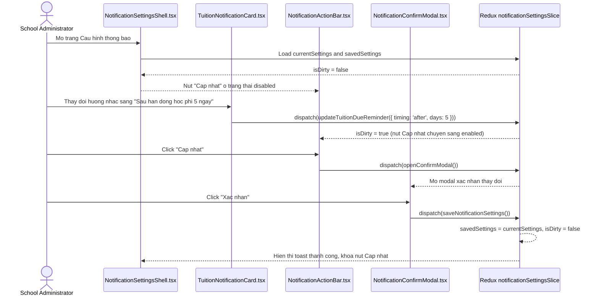

# Feature: Settings Notifications (Cấu Hình — Thông Báo)

## User Value

The Notification Settings feature delivers an administrative cockpit at `/[schoolCode]/setting/notification` enabling school leaders to configure multi-channel broadcast triggers and automated reminders. Administrators can review 5 distinct functional cards: Attendance (with readonly 17:00 time and extracurricular scope dropdown), Birthdays (with shared schedule row and recipient switches), Tuition Fees (with grace period and directional due-date timing), Other Operational Alerts (with dual Web/App and Email switches), and Parent Updates (with orange-accented trigger verbs).

A sticky bottom action bar monitors form modifications using a deep dirty-state predicate. When any field diverges from the saved baseline, the "Cập nhật" button activates. Submitting the form opens a guarded confirmation dialog displaying *"Vui lòng xác nhận thay đổi cấu hình thông báo của trường!"*, ensuring that school-wide broadcast rules are never altered accidentally.

## Jira Story

- Story: As a School Administrator, I want to view and configure automated notification rules across 5 operational sections on a single page with modal confirmation so that changes are accurate and safe.
- Jira issue type: Story
- Story points: 5
- Acceptance owner: `benny-frontend-engineer`
- Research evidence: Legacy spec `docs_legacy/operating-portal/M6-cau-hinh/SM6-thong-bao.md`, claims C128–C137, and evidence E133–E142.

## Priority

- Priority: P1
- User/business impact: Direct control over all automated messages sent to thousands of parents and staff.
- Risk if delayed: Inability to customize tuition reminders or attendance alerts.
- Release target: Phase 4.5

## PM Notes

- Demo scenario: Administrator navigates to `/demo/setting/notification`, inspects policy banner, turns on extracurricular parent notification for a club class, toggles tuition due reminder to "Sau hạn đóng học phí 5 ngày", clicks "Cập nhật", reviews confirmation prompt, clicks "Xác nhận", and observes green toast feedback.
- Business value: Guarantees delivery integrity, prevents inbox spam via asymmetric email switches, and safeguards operational hours.
- Acceptance criteria confirmed: All acceptance criteria AC-146 through AC-154 confirmed.
- Open PM decision: None; all specifications finalized.

## Requirements Trace

- PRD requirement: Phân hệ 5.5 (`FR-NOTIF-001` through `FR-NOTIF-009`, `AC-146` through `AC-154`).
- Task id: `TASK-NOTIF-001` through `TASK-NOTIF-008`.
- Spec id: `050-settings-notifications-thong-bao`.

## Relationship Map

| Relation | Target | Label | Rationale |
| --- | --- | --- | --- |
| Parent epic | `E-035-settings-notifications` | `IMPLEMENTS` | Implements the core functional deliverable of Epic 35. |
| Related feature | `F-034-001-settings-features` | `RELATES_TO` | Shares settings layout context and navigation order under CẤU HÌNH. |
| Dependency | `M-035-001-settings-notifications` | `DEPENDS_ON` | Relies on module state machine and validation engine. |

## Implementation Plan

- Backend: Laravel REST endpoint simulation via Redux state machine and realistic mock fixtures.
- Frontend: Next.js Pages router at `/[schoolCode]/setting/notification/index.tsx` assembled with 5 modular card components.
- Data: Structured TypeScript interfaces enforcing range bounds (days 1-31, times HH:mm, boolean toggles).
- Observability: Client-side toast notifications, dirty-state visual indicators, and timestamp logging.
- Rationale: Monolithic architecture prevents fragmented settings and provides administrators with a single, holistic overview.

## Code Scope

- Code paths: `src/types/notificationSettings.ts`, `src/utils/notificationSettingsValidation.ts`, `src/services/mockNotificationSettingsData.ts`, `src/store/slices/notificationSettingsSlice.ts`, `src/modules/setting/notification/*`, `src/pages/[schoolCode]/setting/notification/index.tsx`, `tests/unit/notificationSettings.test.mjs`.
- Types: `src/types/notificationSettings.ts`
- Pure logic: `src/utils/notificationSettingsValidation.ts`
- State: `src/store/slices/notificationSettingsSlice.ts`, `src/store/index.ts`
- Mock data: `src/services/mockNotificationSettingsData.ts`
- Components: `src/modules/setting/notification/NotificationPolicyBanner.tsx`, `AttendanceNotificationCard.tsx`, `BirthdayNotificationCard.tsx`, `TuitionNotificationCard.tsx`, `OtherNotificationCard.tsx`, `ParentNotificationCard.tsx`, `NotificationActionBar.tsx`, `NotificationConfirmModal.tsx`, `NotificationSettingsShell.tsx`
- Routes: `src/pages/[schoolCode]/setting/notification/index.tsx`
- Layout: `src/components/layout/PortalLayout.tsx`
- Tests: `tests/unit/notificationSettings.test.mjs`
- Files intentionally out of scope: Third-party telecom SMS gateway adapters and backend migration scripts.

## Mermaid Diagram

## Verification

- [x] Test: 19/19 tests passing in `tests/unit/notificationSettings.test.mjs`.
- [x] Build/lint/typecheck: `npx tsc --noEmit` and `npm run build` pass with 0 errors.
- [x] Manual scenario: Verified form inspection, dirty-state activation, modal confirmation, and cancel retention.

## Risks

- Risk: High frequency of notifications causing guardian push alert fatigue.
  - Mitigation: Confined email switches strictly to Section 4 review items and provided granular toggles per event category.

## Work Log

- Date: 2026-10-14
  - Action: Built complete UI components, state slice, validation engine, and route integration
  - Agent/skill: `benny-frontend-engineer`
  - Evidence: Verified 19 automated tests and clean production build
  - Docs updated before code: `docs/prd.md`, `docs/tasks.md`, `docs/knowledge.md`, `docs/decisions.md`.

## Change Log

- Date: 2026-10-14
  - Code change: Implemented 9 UI components, 1 Redux slice, 1 validation utility, and 1 canonical page.
  - Documentation update: Updated feature specification, architecture records, and task status.
  - Evidence: 19/19 unit tests passing in node test runner.
