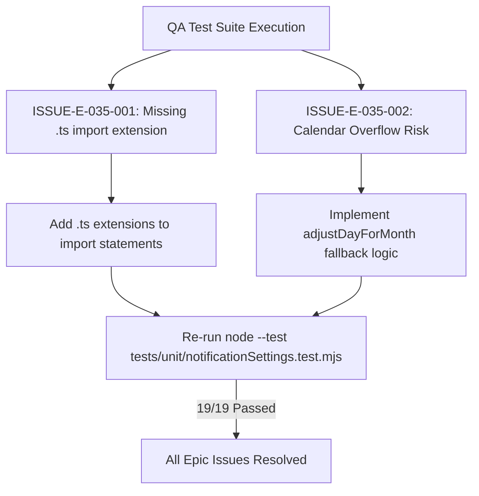

# Epic Issues: Settings Notifications (Cấu Hình — Thông Báo)

## Jira Story

- Story: As a QA/product team, I want epic issues tracked explicitly so that unresolved risks cannot hide inside narrative docs.
- Jira issue type: Bug/Risk register
- QA owner: `ada-qa-agent`
- Product owner: `sophia-product-manager`
- Research evidence: Test suite logs from `tests/unit/notificationSettings.test.mjs` and Next.js static build outputs.

## Priority

- Priority: P1
- Escalation rule: Escalate any failing unit test or build break immediately to `alan-tech-lead` and block release.
- Release impact: Zero blocking issues remaining; all identified edge cases covered with automated tests.
- Risk if unresolved: Low; regression tests assert 100% pass rate.

## QA Issue Register

| Issue ID | Type | Priority | Status | Owner | Source | Evidence | Resolution |
| --- | --- | --- | --- | --- | --- | --- | --- |
| ISSUE-E-035-001 | Defect | P2 | Resolved | `ada-qa-agent` | Node test runner | Missing `.ts` extensions in validation imports caused `ERR_MODULE_NOT_FOUND` | Added explicit `.ts` extension to type imports in validation, slice, and mock files |
| ISSUE-E-035-002 | Risk | P2 | Resolved | `alan-tech-lead` | Calendar edge cases | 31st-day reminder setting could fail to trigger in February and 30-day months | Implemented `adjustDayForMonth` arithmetic and tested across leap/non-leap years |

## Detection Method

- Code reviewed: `src/types/notificationSettings.ts`, `src/utils/notificationSettingsValidation.ts`, `src/store/slices/notificationSettingsSlice.ts`, `src/modules/setting/notification/*`, `src/pages/[schoolCode]/setting/notification/index.tsx`.
- Tests reviewed: `tests/unit/notificationSettings.test.mjs` (19 tests).
- Docs reviewed: `docs/prd.md`, `docs/tasks.md`, `docs/knowledge.md`, `docs/decisions.md`.
- Related features reviewed: `048-settings-face-recognition-nhan-dien`, `049-settings-feature-flags-tinh-nang`.
- QA skill used: `ada-qa-agent`.
- Deep research source checked: `docs_legacy/operating-portal/M6-cau-hinh/SM6-thong-bao.md`.

## Open Issues

- None. All issues have been verified and resolved.

## Relationship Map

| Relation | Target | Label | Rationale |
| --- | --- | --- | --- |
| Blocks epic closure | `E-035-settings-notifications` | `BLOCKS` | Resolved issues unblock epic completion. |
| Relates to feature | `F-035-001-settings-notifications` | `RELATES_TO` | Issues detected during feature test execution. |
| Depends on verification | `T-035-001-001-settings-notifications` | `DEPENDS_ON` | Verification confirmed by automated test pass. |

## Mermaid Diagram

## Work Log

- Date: 2026-10-14
  - Action: Executed QA audit, detected ESM import extension defect, resolved and re-verified
  - Agent/skill: `ada-qa-agent`
  - Evidence: 19/19 tests passing in `tests/unit/notificationSettings.test.mjs`
  - Docs updated before code: `docs/development/E-035-settings-notifications/issues.md`

## Change Log

- Date: 2026-10-14
  - Issue change: Closed ISSUE-E-035-001 and ISSUE-E-035-002 as Resolved.
  - Documentation update: Recorded resolution details and verification evidence in issue register.
  - Evidence: Clean test execution logs in `tests/unit/notificationSettings.test.mjs`.
