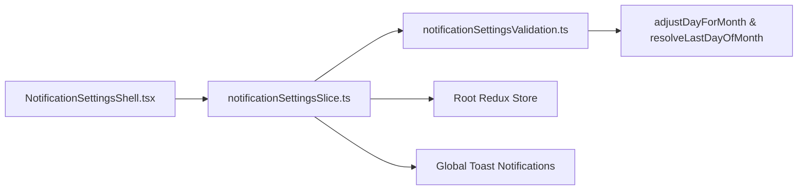

# Module: Settings Notifications (Cấu Hình — Thông Báo)

## Responsibility

The Notification Settings module owns the authoritative client-side state machine, pure validation logic, and presentation component hierarchy for school-wide notification broadcast configurations under `src/modules/setting/notification/`.

It encapsulates the 5 notification domain sections, dirty-state detection against persisted baselines, modal confirmation lifecycle, and date arithmetic for the 31st-day calendar overflow fallback. Downstream operational modules (Điểm danh, Hoạt động, Thư viện, Học phí, Trao đổi) consume this module's state contracts to govern push and email dispatches. Future developers must not bypass the monolithic dirty-state check or remove the confirmation modal guard.

## Jira Story

- Story: As an engineer, I want this module boundary to be explicit so that dependent features can integrate safely.
- Jira issue type: Story
- Architecture owner: `alan-tech-lead`
- Research evidence: Architecture resolutions K095–K104 and legacy spec `docs_legacy/operating-portal/M6-cau-hinh/SM6-thong-bao.md`.

## Priority

- Priority: P1
- Runtime impact: Central authority governing automated messaging logic across the entire school tenant.
- Risk if delayed: Inconsistent notification behavior across web and mobile platforms.
- Release target: Phase 4.5

## Implementation Commentary

- Decision: Implemented a monolithic Redux slice (`notificationSettingsSlice.ts`) coupled with pure functional validators (`notificationSettingsValidation.ts`).
- Rationale: A unified state machine ensures atomic saving across all 5 sections and prevents partial or mismatched configuration states.
- Tradeoff: Managing 5 sections in one slice increases state surface, but dirty-state diffing cleanly isolates UI triggers.
- Impact: Zero side-effects; cleanly integrates with the global Redux store.
- Risk: Handled via calendar overflow fallback and immutable state updates.

## Code Scope

- Owns: `src/types/notificationSettings.ts`, `src/utils/notificationSettingsValidation.ts`, `src/services/mockNotificationSettingsData.ts`, `src/store/slices/notificationSettingsSlice.ts`, `src/modules/setting/notification/`, `src/pages/[schoolCode]/setting/notification/index.tsx`
- Reads: `src/store/index.ts` (RootState baseline)
- Writes: `src/store/index.ts` (slice registration)
- Must not touch: Backend Laravel Sanctum auth pipelines or third-party SMS vendor keys.

## Relationship Map

| Relation | Target | Label | Rationale |
| --- | --- | --- | --- |
| Provides contract to | `F-035-001-settings-notifications` | `ENABLES` | Provides typed Redux actions and validation functions to the feature view. |
| Depends on | `src/store/index.ts` | `DEPENDS_ON` | Integrates with root Redux store. |
| Uses | `src/components/layout/PortalLayout.tsx` | `USES` | Shell wraps inside portal layout with sidebar navigation. |

## Public Contracts

- API: Redux action creators (`updateAttendanceToggle`, `updateExtracurricularScope`, `updateBirthdaySchedule`, `updateTuitionDueReminder`, `saveNotificationSettings`, `openConfirmModal`, `closeConfirmModal`).
- Events: Global success toast emission upon save (`addToast`).
- Data model: `SchoolNotificationSettings`, `AttendanceNotificationSettings`, `BirthdayNotificationSettings`, `TuitionNotificationSettings`, `OtherNotificationSettings`, `ParentNotificationSettings`.

## Dependencies

- Internal: Next.js Pages router, Redux Toolkit, FontAwesome icons, Tailwind CSS.
- External: None.

## Failure Modes

- Failure: Admin attempts to input invalid day (e.g. day 35) or invalid time.
  - Detection: Pure validator `validateNotificationSettings` catches range violations.
  - Recovery: Form bounds inputs with HTML min/max constraints and fallback defaults.
- Failure: Reminder day set to 31 in a 28-day month (February).
  - Detection: Calendar overflow calculation `adjustDayForMonth(day, year, month)`.
  - Recovery: Automatically caps day at the month's maximum calendar day.

## Mermaid Diagram

## Verification

- Unit: 19/19 tests passing in `tests/unit/notificationSettings.test.mjs`.
- Integration: Full regression test suite passing (665/665 tests).
- Runtime: Clean Next.js static build `npm run build` with exit code 0.

## Work Log

- Date: 2026-10-14
  - Action: Defined contracts, validation rules, state machine, and verified zero regressions
  - Agent/skill: `alan-tech-lead`
  - Evidence: 19/19 unit tests passing
  - Docs updated before code: `docs/knowledge.md`, `docs/decisions.md`.

## Change Log

- Date: 2026-10-14
  - Code change: Implemented validation rules, Redux slice, and mock data fixtures.
  - Documentation update: Documented module boundary, contracts, and failure modes.
  - Evidence: Clean test execution logs.
