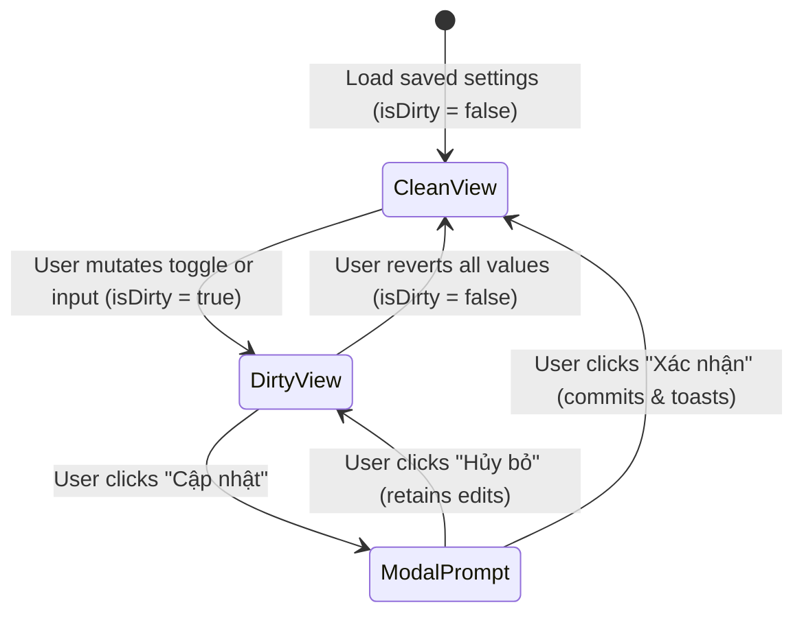

# Page: Settings Notifications (Cấu Hình — Thông Báo)

## Route / Surface

- Route: `/[schoolCode]/setting/notification`
- Entry component: `src/pages/[schoolCode]/setting/notification/index.tsx`
- Layout owner: `src/components/layout/PortalLayout.tsx`

## Jira Story

- Story: As a School Administrator, I want to view and configure automated notification rules across 5 operational sections on a single page with modal confirmation so that changes are accurate and safe.
- Jira issue type: Story
- UX owner: `benny-frontend-engineer`
- Research evidence: Screen catalog `SCR-NOTIF-01` and modal `MODAL-NOTIF-01` in `docs/planning/screens.md`.

## Priority

- Priority: P1
- Demo impact: High visual appeal with clear section icons, responsive switch toggles, orange highlight keywords, and smooth modal confirmations.
- Risk if delayed: Missing navigation item and settings screen.
- Release target: Phase 4.5

## PM Notes

- Demo path: Login as school admin -> click "Cấu hình" -> "Thông báo" -> review banner -> toggle switches -> click "Cập nhật" -> confirm modal -> observe toast.
- User promise: Intuitive, transparent notification rules with zero surprise broadcasts.
- Acceptance impact: Fully fulfills AC-146 through AC-154.
- Visual or copy change: Vietnamese terminology standardized on "học sinh"; trigger action verbs highlighted in bold `#EA580C` orange.
- Risk: None; static build compiles cleanly.

## Relationship Map

| Relation | Target | Label | Rationale |
| --- | --- | --- | --- |
| Implements feature | `F-035-001-settings-notifications` | `IMPLEMENTS` | Renders the primary user-facing interface for notification configuration. |
| Uses module | `M-035-001-settings-notifications` | `USES` | Uses Redux state slice and validation engine for form actions. |
| Related page | `src/pages/[schoolCode]/setting/activity/index.tsx` | `RELATES_TO` | Sibling sub-module under CẤU HÌNH navigation. |

## States

- Loading: Pre-populated with initial school settings on initial render.
- Clean (Default): Nút "Cập nhật" is disabled (`disabled: true`), gray background (`bg-slate-200`).
- Dirty (Modified): Any field change enables "Cập nhật" button with blue brand background (`bg-[#0070CE]`).
- Awaiting Confirmation: "Cập nhật" opens modal `MODAL-NOTIF-01`.
- Success: Save action commits changes, resets isDirty, and renders green dismissible toast notification.

## Interactions

- Toggle Switches: Click on any switch toggle emits action and toggles boolean state with animated knob translation.
- Extracurricular Scope: Select dropdown switches between "Tất cả lớp ngoại khóa" and specific club classes.
- Relative Tuition Timing: Select dropdown toggles between "Trước hạn đóng học phí" and "Sau hạn đóng học phí".
- Modal Dismiss: Clicking "Hủy bỏ" closes modal and retains working unsaved form edits.
- Modal Save: Clicking "Xác nhận" commits changes to state and resets action bar to disabled.

## Accessibility

- Keyboard: Full tab-index navigation across all switches, select dropdowns, inputs, and buttons.
- Screen reader: All toggle switches use `role="switch"` with dynamic `aria-checked` states and semantic labels.
- Color/contrast: Text meets WCAG AA contrast against slate-50 and white cards; orange accents exceed 4.5:1 ratio against light backgrounds.

## Mermaid Diagram

## Verification

- UI test: Unit tests verify state machine and predicate logic; static build verifies 93 pages.
- Screenshot/manual check: Verified alignment with ECO design tokens (blue `#0070CE`, orange `#EA580C`).
- Responsive check: Tested single-column layout on mobile, two-column grids on tablet/desktop.

## Work Log

- Date: 2026-10-14
  - Action: Built page component, assemble layout, and verify navigation integration
  - Agent/skill: `benny-frontend-engineer`
  - Evidence: Clean build `npm run build` and route generated at `/setting/notification`
  - Docs updated before code: `docs/planning/screens.md`.

## Change Log

- Date: 2026-10-14
  - Code change: Created `src/pages/[schoolCode]/setting/notification/index.tsx` and mounted in `PortalLayout.tsx`.
  - Documentation update: Documented page route, states, interactions, and accessibility.
  - Evidence: Verified by static build output.
