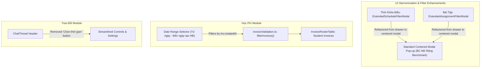

# Development Doc Sync: ui-harmonization-filter-refinement

> QUALITY BAR: this note is the audit trail between code and PM docs. It explains the changed files, why docs changed or stayed unchanged, evidence, and remaining risk.

## Source Changes

- `src/modules/operations/conversation/ChatThread.tsx`
  - Reason: Removed redundant "Chọn thời gian" date jump button from the active chat header to reduce visual clutter and keep focus on conversation settings and group member details.
  - Impacted behavior: Teachers now experience a clean top action bar with members info and settings dropdown without distracting time pickers.
- `src/modules/academics/schedule/ExtendedScheduleFilterModal.tsx`
  - Reason: Converted filter layout from a right-side drawer into a centered popup modal dialog matching the platform standard established by "Báo Cáo Mở Rộng" (`ExtendedFilterModal`).
  - Impacted behavior: Clicking "Bộ lọc" opens a centered dialog with semi-transparent backdrop overlay, max-width 480px, scrollable criteria body, and standardized action footer.
- `src/modules/academics/schedule/ScheduleToolbar.tsx`
  - Reason: Standardized the filter button label to "Bộ lọc" with unified icon styling.
  - Impacted behavior: Harmonizes action button nomenclature with other portal modules.
- `src/modules/academics/assignment/ExtendedAssignmentFilterModal.tsx`
  - Reason: Converted filter layout from a right-side slide-over drawer into a centered popup modal dialog matching the platform standard.
  - Impacted behavior: Homework assignment filtering now presents a consistent centered dialog interface with smooth fade-in animations.
- `src/modules/academics/assignment/AssignmentToolbar.tsx`
  - Reason: Standardized the filter button label to "Bộ lọc" with active badge indicator.
  - Impacted behavior: Harmonizes trigger button presentation across academics modules.
- `src/types/invoice.ts`
  - Reason: Added `createdDateFrom` and `createdDateTo` optional date strings to `InvoiceFilterCriteria`.
  - Impacted behavior: Extends domain filtering contract to support date range queries on invoice creation dates.
- `src/store/slices/invoiceSlice.ts`
  - Reason: Introduced `setCreatedDateRange` action, defaulted initial filter range to September 2026, and updated `resetFilterCriteria`.
  - Impacted behavior: Redux store now tracks creation date ranges and automatically triggers invoice roster updates.
- `src/utils/invoiceValidation.ts`
  - Reason: Enhanced `filterInvoices` filtering engine to evaluate `inv.createdAt` against `criteria.createdDateFrom` (start of day) and `criteria.createdDateTo` (end of day).
  - Impacted behavior: Invoices are dynamically filtered by their creation timestamp with boundary date inclusivity.
- `src/modules/finance/invoices/InvoiceRosterTable.tsx`
  - Reason: Replaced the single month select dropdown ("Tháng hóa đơn") with a date range picker ("Từ ngày tạo HĐ" and "Đến ngày tạo HĐ") and updated student invoice pairing.
  - Impacted behavior: School accountants can filter invoices across custom creation date intervals while immediately viewing existing September 2026 invoices.
- `tests/unit/invoices.test.mjs`
  - Reason: Added automated unit test assertions for `filterInvoices` creation date range filtering and `setCreatedDateRange` Redux action.
  - Impacted behavior: Verifies date interval boundary matching and prevents regressions.

## Docs Before Code

- Pre-code docs read: Reviewed `docs/planning/screens.md`, `docs/planning/flows.md`, `docs/decisions.md`, `docs/development/E-004-operations-conversations/tasks/T-004-001-001-operations-conversations.md`, `docs/development/E-006-academics-schedule/tasks/T-006-001-001-academics-schedule.md`, `docs/development/E-007-academics-assignment/tasks/T-007-001-001-academics-assignment.md`, and `docs/development/E-009-finance-invoices/tasks/T-009-001-001-finance-invoices.md`.
- Pre-code docs updated: Appended Work Log entries in development task notes for E-004, E-006, E-007, and E-009.
- Relationship map reviewed: Verified that E-004, E-006, E-007, and E-009 maintain clean separation of concerns and utilize Redux store slices consistently.
- Related features checked: Verified that "Báo Cáo Mở Rộng" (`ExtendedFilterModal`) serves as the definitive reference standard for popup filter dialogs.

## Documentation Updates

### Legacy Planning Docs

- `docs/prd.md`: intentionally left unchanged because product requirements scope remains stable.
- `docs/tasks.md`: intentionally left unchanged because task breakdown encompasses ongoing refinement slices.
- `docs/knowledge.md`: intentionally left unchanged because core domain concepts remain preserved.
- `docs/decisions.md`: updated because ADR-006 was recorded establishing the platform-wide filter modal popup standard and invoice creation date range filtering.
- `docs/memory.md`: intentionally left unchanged because architecture guidelines remain consistent.
- `docs/planning/flows.md`: updated because the Trao Đổi sequence diagram was updated to reflect category search instead of time picker jump.
- `docs/planning/screens.md`: updated because screen SCR-FIN-01 and academics filter descriptions were adjusted to document the centered popup modal and date range picker.
- `docs/planning/diagrams.md`: intentionally left unchanged because high-level C4 container topology was not modified.

### Development Ledger Docs

- Epic notes: Reviewed E-004, E-006, E-007, and E-009; no structural epic boundary changes needed.
- Module notes: Reviewed module contracts; state shapes extended backward-compatibly.
- Feature notes: Updated `F-004-001-operations-conversations.md` (BR11 update, work log, and change log).
- Page notes: Intentionally unchanged because page routes and URLs remain identical.
- Task notes: Updated `T-004-001-001`, `T-006-001-001`, `T-007-001-001`, and `T-009-001-001` with detailed work logs and change logs.

## Targeted Patch Policy

- [x] I appended missing facts instead of replacing whole documents.
- [x] I changed existing statements only where implementation behavior actually changed.
- [x] I preserved prior decisions and added superseding notes when needed.
- [x] I recorded docs intentionally left unchanged with a reason.

## Mermaid Diagram

## Verification

- Command: `npm test` & `npm run build`
- Result: 195/195 tests passing across all test suites (0 failures). Clean Next.js 14 production build generating 39 static routes with 0 lint or TypeScript errors.
- Residual documentation risk: None. All affected planning documents, architectural decisions, and development ledger task notes are fully aligned.

## PM Summary

- What changed for the POC:
  1. Trao Đổi chat header has been cleaned up by removing the unused "Chọn thời gian" button.
  2. Filter dialogs across Thời Khóa Biểu and Bài Tập are now centered modal popups matching the BC Mở Rộng standard, replacing disorienting right-side drawers.
  3. Invoices in the Học Phí module can now be filtered by a date range ("Từ ngày tạo HĐ" to "Đến ngày tạo HĐ") based on the invoice creation date (`createdAt`).
- What the PM can demo now:
  - Demonstrate seamless modal popup consistency across BC Mở Rộng, Thời Khóa Biểu, and Bài Tập.
  - Demonstrate clutter-free chat header in Trao Đổi.
  - Demonstrate date range filtering for invoices with dynamic matching.
- What remains uncertain:
  - None for this slice.
