# Tên: Tổng Quan

## Mục lục
- [1. Thông tin tổng quan](#1-thông-tin-tổng-quan)
  - [1.1 Giới thiệu chung](#11-giới-thiệu-chung)
  - [1.2 Mục tiêu](#12-mục-tiêu)
  - [1.3 Phạm vi](#13-phạm-vi)
  - [1.4 Tài liệu tham khảo](#14-tài-liệu-tham-khảo)
- [2. Tổng quan nghiệp vụ](#2-tổng-quan-nghiệp-vụ)
  - [2.1 Đối tượng](#21-đối-tượng)
  - [2.2 Luồng nghiệp vụ](#22-luồng-nghiệp-vụ)
  - [2.3 Nguyên tắc nghiệp vụ](#23-nguyên-tắc-nghiệp-vụ)
- [3. Đặc tả tính năng](#3-đặc-tả-tính-năng)
  - [3.1 Phân rã chức năng](#31-phân-rã-chức-năng)
  - [3.2 Acceptance Criteria](#32-acceptance-criteria)
  - [3.3 Use case](#33-use-case)
  - [3.4 Edge Cases & Error Handling](#34-edge-cases--error-handling)
  - [3.5 Non-functional Requirements](#35-non-functional-requirements)
  - [3.6 Quy ước UI chung](#36-quy-ước-ui-chung)

## 1. Thông tin tổng quan

### 1.1 Giới thiệu chung
"Tổng Quan" (tiêu đề trang: "Bảng tin") là trang landing mặc định sau khi đăng nhập, tại URL gốc `/demo/overview/`. Đây là module cấp cao nhất riêng biệt (không có sub-module con), tổng hợp toàn bộ chỉ số quan trọng của trường trong một dashboard duy nhất: số liệu học sinh/lớp/nhân sự, tài chính, hoạt động trong ngày, dung lượng lưu trữ, kiểm duyệt nội dung, bảng thông tin, và các danh sách nhanh (sinh nhật, học sinh vắng nhiều, góp ý).

### 1.2 Mục tiêu
- Cho Admin trường thấy ngay các chỉ số quan trọng nhất của trường mà không cần vào từng module riêng.
- Cảnh báo nhanh các việc cần xử lý trong ngày: lớp chưa điểm danh, hoạt động chờ duyệt, báo vắng/báo đón chưa xử lý.
- Cung cấp shortcut điều hướng nhanh sang các trang chi tiết hoặc màn hình tác vụ liên quan (điểm danh, báo cáo, danh sách học sinh...).
- Cho phép xem nhanh chi tiết một số chỉ số (suất ăn theo lớp, danh sách lớp chưa điểm danh) ngay trên dashboard qua modal, không cần rời trang.

### 1.3 Phạm vi
| In scope | Out of scope |
|---|---|
| Xem các chỉ số tổng quan trường, tài chính, hoạt động trong ngày, lưu trữ, kiểm duyệt, bảng thông tin, góp ý, sinh nhật | Chỉnh sửa/cấu hình bất kỳ ngưỡng, chỉ số hay nội dung nào — trang này chỉ để xem |
| Điều hướng shortcut sang các trang chi tiết/báo cáo liên quan | Nội dung chi tiết của các trang đích (đã/sẽ được mô tả ở tài liệu module tương ứng) |
| Mở modal xem nhanh "Suất ăn theo lớp" và "Danh sách chưa điểm danh", và shortcut điểm danh nhanh theo lớp từ modal | Thực hiện điểm danh thật (chỉ dừng ở bước điều hướng sang trang điểm danh của lớp) |

### 1.4 Tài liệu tham khảo
- Module Vận Hành (M2) — Điểm danh, Báo vắng/Báo đón, Hoạt động, Trao đổi: xem chi tiết nghiệp vụ đầy đủ tại `M2-van-hanh/`.
- Module Tài Chính (M4) — Học phí, Khoản chi: xem chi tiết tại `M4-tai-chinh/`.
- Module Nhà Trường (M5) — Học Sinh, Lớp Học, Góp Ý: xem chi tiết tại `M5-nha-truong/`.
- [M6-cau-hinh/SM1-truong.md](../M6-cau-hinh/SM1-truong.md), [M6-cau-hinh/SM6-thong-bao.md](../M6-cau-hinh/SM6-thong-bao.md) — cùng ghi nhận hiện tượng nội dung mô tả đổi qua lại giữa "học sinh" và "trẻ" không nhất quán giữa các lần tải trang; hiện tượng này cũng xuất hiện trên trang Tổng Quan.

## 2. Tổng quan nghiệp vụ

### 2.1 Đối tượng
| Actor | Vai trò | Trách nhiệm chính |
|---|---|---|
| Admin trường | Người xem | Xem tổng quan trường, phát hiện việc cần xử lý, điều hướng sang trang liên quan |
| Hệ thống | Xử lý nghiệp vụ | Tổng hợp số liệu real-time từ các module khác để hiển thị trên dashboard |

### 2.2 Luồng nghiệp vụ

#### 2.2.1 Mô hình hóa nghiệp vụ
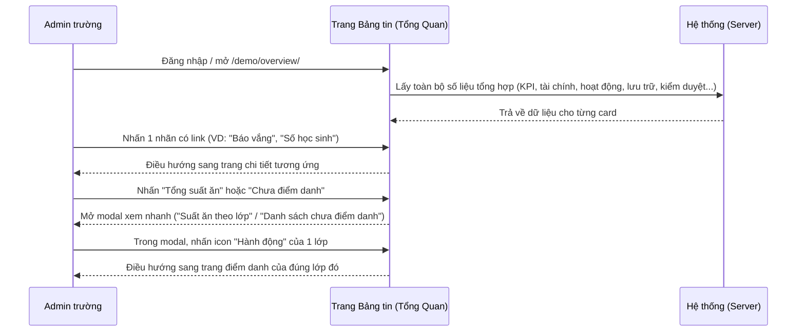

#### 2.2.2 Mô tả các bước nghiệp vụ
| Bước | Người thực hiện | Mô tả | Kết quả |
|---|---|---|---|
| 1 | Admin trường | Đăng nhập hoặc chọn "Tổng Quan" trên sidebar | Hiển thị dashboard với đầy đủ các card số liệu |
| 2 | Admin trường | Nhấn vào 1 nhãn/số liệu có gạch chân (link) | Điều hướng sang trang module tương ứng |
| 3 | Admin trường | Nhấn "Tổng suất ăn" hoặc "Chưa điểm danh" trong card Điểm danh | Mở modal xem nhanh, không rời trang |
| 4 | Admin trường | Trong modal "Danh sách chưa điểm danh", nhấn icon cửa ở 1 dòng lớp | Điều hướng thẳng sang trang điểm danh của lớp đó |

### 2.3 Nguyên tắc nghiệp vụ
| ID | Nguyên tắc nghiệp vụ |
|---|---|
| BR01 | Trang Tổng Quan là URL gốc (`/demo/overview/`), tự động hiển thị sau khi đăng nhập |
| BR02 | Hầu hết các card đều thuần xem (view-only); nhiều card có icon refresh (⟳) riêng để tải lại dữ liệu của card đó mà không cần tải lại cả trang |
| BR03 | "Tổng quan tài chính" có 2 chế độ xem dạng tab: "Tổng quan" (mặc định — biểu đồ Thu chi + funnel trạng thái Học phí + Khoản chi) và "Chi tiết" (4 thẻ số liệu tổng hợp + bảng "Chi tiết học phí theo lớp" kèm nút "Xuất báo cáo") |
| BR04 | Nhiều nhãn/số liệu là link điều hướng sang trang chi tiết tương ứng (VD: Số học sinh, Số lớp học, Báo vắng, Báo đón trẻ, Dặn thuốc, Học phí, Khoản chi, Điểm danh trong ngày, Xem báo cáo điểm danh); một số khác (Trao đổi, Hoạt động mới, Hình ảnh/video mới, Số giáo viên/nhân viên, Số phụ huynh kích hoạt) chỉ hiển thị số liệu, không phải link [Cần xác nhận với "Số giáo viên/nhân viên"/"Số phụ huynh kích hoạt" — không thấy link nhưng có thể là do quyền hạn tài khoản test] |
| BR05 | Nhãn "Tổng suất ăn" và "Chưa điểm danh" (trong card "Điểm danh trong ngày"/"Thông tin trong ngày") không điều hướng trang mà mở modal xem nhanh ngay trên dashboard: "Suất ăn theo lớp" (bảng chi tiết theo lớp, có cảnh báo ⚠ cho lớp chưa điểm danh đủ) và "Danh sách chưa điểm danh" (danh sách lớp chưa điểm danh kèm shortcut) |
| BR06 | Trong modal "Danh sách chưa điểm danh", mỗi dòng lớp có icon "cửa" ở cột "Hành động" dẫn thẳng tới trang điểm danh của đúng lớp đó (`/demo/class/{id}/attendance/`); dòng "Khác" (học sinh không thuộc lớp cụ thể) không có icon hành động |
| BR07 | "Sinh nhật trong tháng" lọc được theo tháng và theo lớp học qua 2 dropdown riêng; có link "Chi tiết" dẫn sang trang xem đầy đủ |
| BR08 | "Hộp thư góp ý" và "Top giáo viên nhận tim tháng" mỗi card có ô chọn tháng riêng, độc lập với ô chọn tháng của "Tổng quan tài chính" |
| BR09 | Toàn bộ số liệu "0" quan sát được trong tài liệu này phản ánh trạng thái tenant demo tại thời điểm khảo sát (chưa phát sinh hoạt động thật trong ngày/tháng đang xem), không phải giá trị cố định hay giới hạn của tính năng |

## 3. Đặc tả tính năng

### 3.1 Phân rã chức năng
| Feature | Platform | Priority | User Story |
|---|---|---|---|
| Xem chỉ số tổng quan trường & tài chính | Web Admin | Cao | Là Admin trường, tôi muốn thấy ngay số học sinh/lớp/nhân sự và tình hình tài chính khi vào hệ thống |
| Xem thông tin hoạt động trong ngày & điểm danh | Web Admin | Cao | Là Admin trường, tôi muốn biết ngay hôm nay có gì cần xử lý (báo vắng, báo đón, điểm danh...) |
| Xem dung lượng lưu trữ, kiểm duyệt & hoạt động trong tuần | Web Admin | Trung bình | Là Admin trường, tôi muốn theo dõi dung lượng ảnh/video và hoạt động chờ duyệt |
| Xem bảng thông tin, top giáo viên & học sinh vắng nhiều | Web Admin | Thấp | Là Admin trường, tôi muốn nắm nhanh thông báo gần đây và các trường hợp cần chú ý |
| Xem hộp thư góp ý & sinh nhật trong tháng | Web Admin | Thấp | Là Admin trường, tôi muốn theo dõi góp ý mới và sinh nhật học sinh trong tháng |
| Xem nhanh suất ăn & điểm danh nhanh theo lớp | Web Admin | Cao | Là Admin trường, tôi muốn xem nhanh lớp nào chưa điểm danh và bấm vào điểm danh ngay |

### 3.2 Acceptance Criteria
| User Story | Chức năng | Acceptance Criteria |
|---|---|---|
| Xem tổng quan & tài chính | Chuyển tab Tổng quan/Chi tiết | Nội dung bảng/biểu đồ đổi đúng theo tab đang chọn; đổi tháng cập nhật lại số liệu |
| Xem hoạt động trong ngày | Nhấn nhãn có link | Điều hướng đúng trang chi tiết tương ứng |
| Xem nhanh suất ăn/điểm danh | Nhấn "Tổng suất ăn"/"Chưa điểm danh" | Mở đúng modal tương ứng, không rời trang; nhấn icon hành động trong modal điều hướng đúng lớp |

### 3.3 Use case
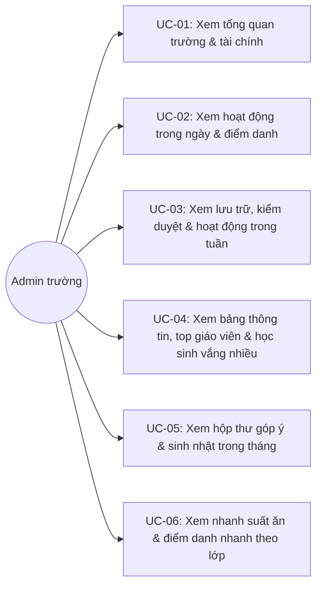

---

| Trường | Nội dung |
|---|---|
| Use case ID | UC-01 |
| Use case name | Xem tổng quan trường & tài chính |
| Use case description | Admin trường xem số liệu KPI trường và tình hình tài chính tháng hiện tại |
| Actor | Admin trường |
| Happy path | 1. Mở trang Tổng Quan, xem 4 chỉ số: Số học sinh, Số lớp học, Số giáo viên/nhân viên, Số phụ huynh kích hoạt:  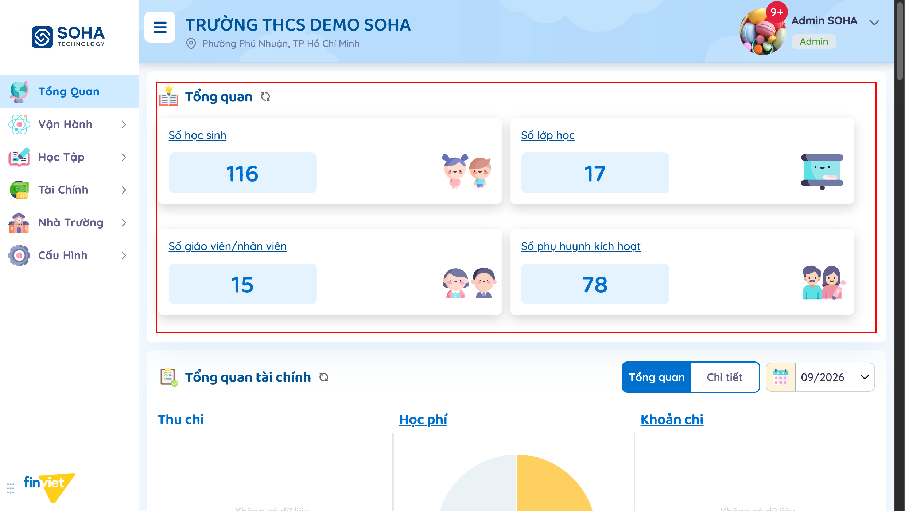 2. Xem "Tổng quan tài chính" ở tab "Tổng quan" (mặc định): biểu đồ Thu chi, funnel trạng thái Học phí, Khoản chi. 3. Chọn tháng khác nếu cần. 4. Chuyển sang tab "Chi tiết" để xem 4 thẻ tổng hợp (Tổng hóa đơn/Đã thu/Cần thu/Tỉ lệ hoàn thành) và bảng "Chi tiết học phí theo lớp":  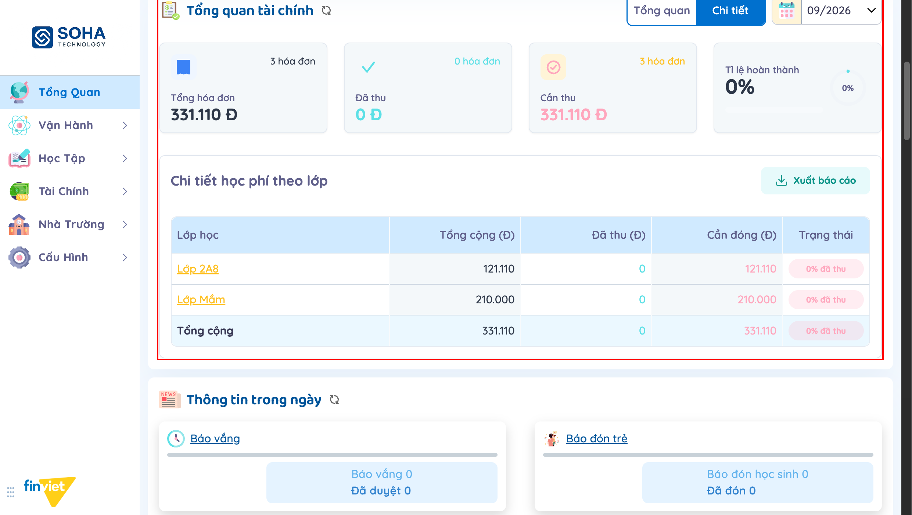 |
| Exception | Tháng chưa có dữ liệu → các mục hiển thị "Không có dữ liệu" hoặc số 0 |
| Trigger | Admin trường cần nắm nhanh quy mô trường và tình hình thu học phí |
| Pre-condition | Đã đăng nhập với quyền Admin trường |
| Post-condition | Không thay đổi dữ liệu — chỉ xem |
| Business Rules | BR02, BR03, BR04 |

---

| Trường | Nội dung |
|---|---|
| Use case ID | UC-02 |
| Use case name | Xem hoạt động trong ngày & điểm danh trong ngày |
| Use case description | Admin trường xem các chỉ số phát sinh trong ngày hiện tại (báo vắng, báo đón, trao đổi, dặn thuốc...) và tình trạng điểm danh |
| Actor | Admin trường |
| Happy path | 1. Xem card "Thông tin trong ngày" gồm 7 mục: Báo vắng, Báo đón trẻ, Trao đổi, Hoạt động mới, Dặn thuốc, Hình ảnh/video mới, Tổng suất ăn:  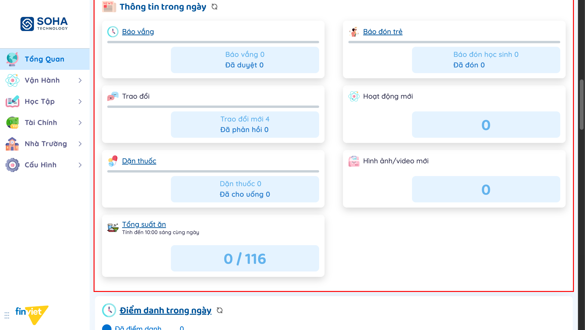 2. Xem card "Điểm danh trong ngày": biểu đồ donut theo 4 trạng thái (Đã điểm danh/Đã trả/Vắng/Chưa điểm danh) và link "Xem báo cáo điểm danh":  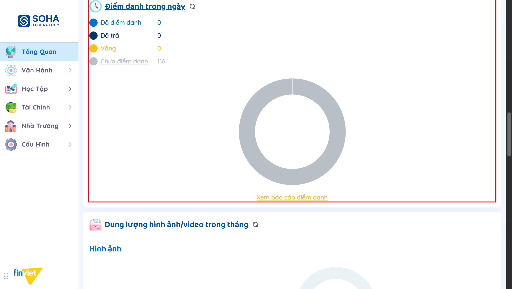 |
| Exception | Chưa phát sinh hoạt động trong ngày → toàn bộ số liệu hiển thị 0 |
| Trigger | Admin trường cần theo dõi hoạt động vận hành trong ngày |
| Pre-condition | Đã đăng nhập với quyền Admin trường |
| Post-condition | Không thay đổi dữ liệu — chỉ xem |
| Business Rules | BR04 |

---

| Trường | Nội dung |
|---|---|
| Use case ID | UC-03 |
| Use case name | Xem dung lượng lưu trữ, trung tâm kiểm duyệt & hoạt động trong tuần |
| Use case description | Admin trường theo dõi dung lượng ảnh/video đã dùng, số hoạt động chờ duyệt theo lớp, và biểu đồ hoạt động 6 ngày gần nhất |
| Actor | Admin trường |
| Happy path | 1. Xem "Dung lượng hình ảnh/video trong tháng": số hình/phút video đã đăng so với giới hạn, dạng donut riêng cho Hình ảnh và Video:  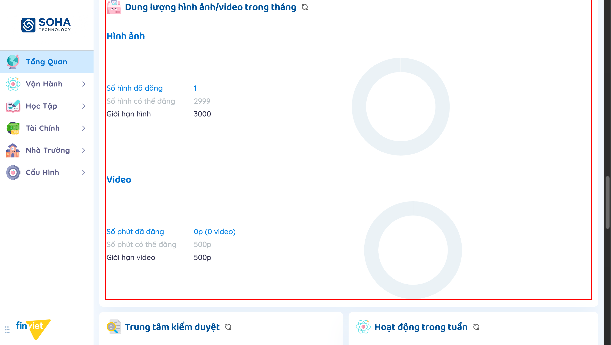 2. Xem "Trung tâm kiểm duyệt": bảng số hoạt động chờ duyệt theo từng lớp + Tổng. 3. Xem "Hoạt động trong tuần": biểu đồ cột số hoạt động/số album/lượt tim theo 6 ngày gần nhất:  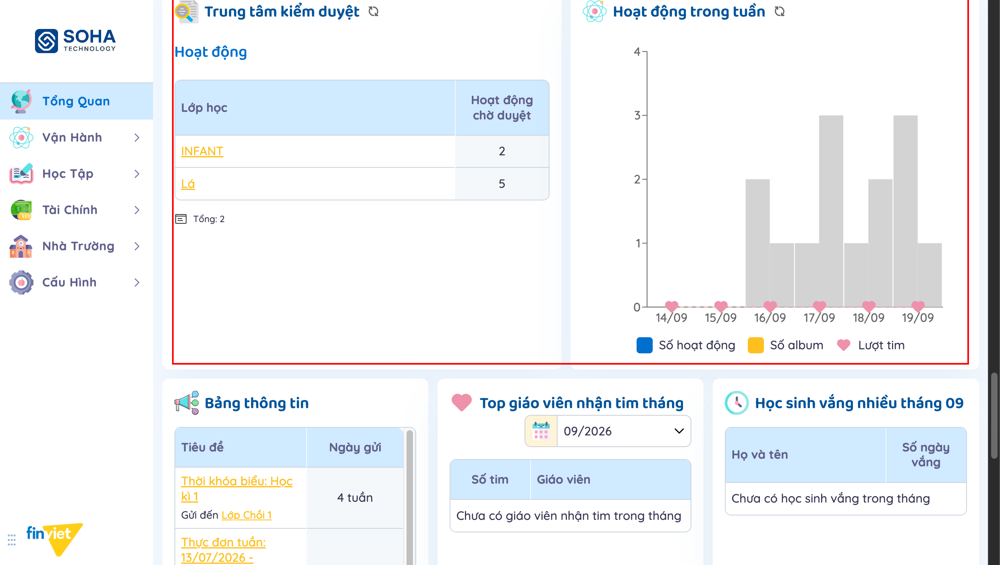 |
| Exception | Lớp không có hoạt động chờ duyệt → không xuất hiện trong bảng Trung tâm kiểm duyệt |
| Trigger | Admin trường cần theo dõi dung lượng lưu trữ và tiến độ kiểm duyệt nội dung |
| Pre-condition | Đã đăng nhập với quyền Admin trường |
| Post-condition | Không thay đổi dữ liệu — chỉ xem |
| Business Rules | BR02 |

---

| Trường | Nội dung |
|---|---|
| Use case ID | UC-04 |
| Use case name | Xem bảng thông tin, top giáo viên nhận tim & học sinh vắng nhiều |
| Use case description | Admin trường xem danh sách thông báo gần đây, xếp hạng giáo viên được yêu thích, và học sinh vắng nhiều trong tháng |
| Actor | Admin trường |
| Happy path | 1. Xem "Bảng thông tin": danh sách thông báo gần đây (Tiêu đề, Ngày gửi, Gửi đến), cuộn được, có link "Xem thêm...". 2. Xem "Top giáo viên nhận tim tháng": chọn tháng, bảng xếp hạng Số tim/Giáo viên. 3. Xem "Học sinh vắng nhiều tháng X": bảng Họ và tên/Số ngày vắng:  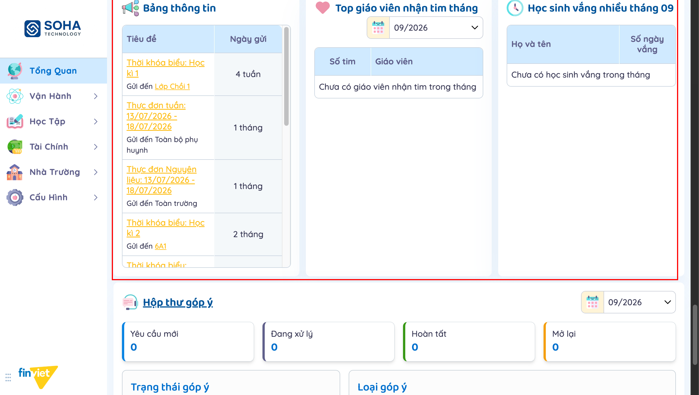 |
| Exception | Chưa có giáo viên nhận tim/học sinh vắng trong tháng → hiển thị thông báo trống tương ứng |
| Trigger | Admin trường cần điểm qua thông báo gần đây hoặc rà soát học sinh vắng nhiều/giáo viên nổi bật |
| Pre-condition | Đã đăng nhập với quyền Admin trường |
| Post-condition | Không thay đổi dữ liệu — chỉ xem |
| Business Rules | BR08 |

---

| Trường | Nội dung |
|---|---|
| Use case ID | UC-05 |
| Use case name | Xem hộp thư góp ý & sinh nhật trong tháng |
| Use case description | Admin trường theo dõi số lượng góp ý theo trạng thái/loại, và danh sách sinh nhật học sinh/nhân viên trong tháng |
| Actor | Admin trường |
| Happy path | 1. Xem "Hộp thư góp ý": chọn tháng, 4 thẻ số liệu (Yêu cầu mới/Đang xử lý/Hoàn tất/Mở lại), biểu đồ Trạng thái góp ý và Loại góp ý. 2. Xem "Sinh nhật trong tháng": chọn tháng và/hoặc lớp học để lọc, bảng Ngày/Học sinh/Nhân viên, link "Chi tiết":  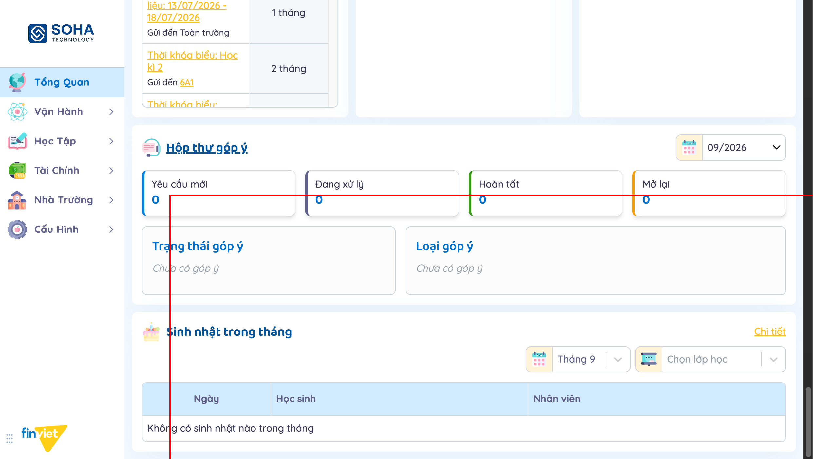 |
| Exception | Chưa có góp ý/sinh nhật trong tháng đang chọn → hiển thị thông báo trống tương ứng |
| Trigger | Admin trường cần theo dõi góp ý phụ huynh hoặc chuẩn bị chúc mừng sinh nhật |
| Pre-condition | Đã đăng nhập với quyền Admin trường |
| Post-condition | Không thay đổi dữ liệu — chỉ xem |
| Business Rules | BR07, BR08 |

---

| Trường | Nội dung |
|---|---|
| Use case ID | UC-06 |
| Use case name | Xem nhanh suất ăn theo lớp & điểm danh nhanh theo lớp |
| Use case description | Admin trường mở modal xem nhanh chi tiết suất ăn/điểm danh theo lớp và điều hướng thẳng tới trang điểm danh của 1 lớp cụ thể |
| Actor | Admin trường |
| Happy path | 1. Trong card "Thông tin trong ngày", nhấn nhãn "Tổng suất ăn" → mở modal "Suất ăn theo lớp": bảng Lớp/Thông tin điểm danh/Số suất ăn/Học sinh vắng, cảnh báo ⚠ cho lớp chưa điểm danh đủ:  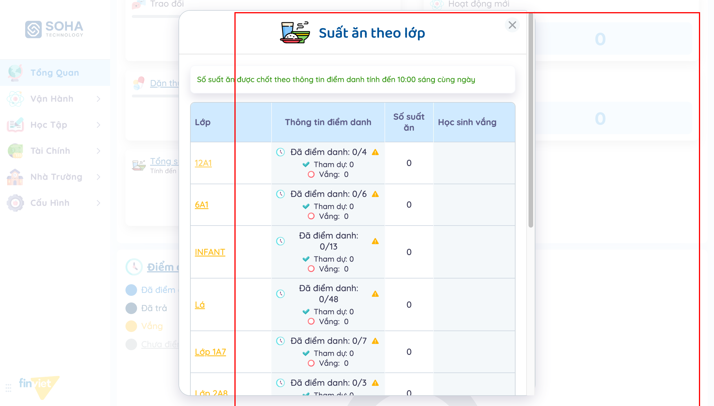 2. Đóng modal, nhấn nhãn "Chưa điểm danh" trong card "Điểm danh trong ngày" → mở modal "Danh sách chưa điểm danh": bảng Lớp/Số học sinh/Hành động:  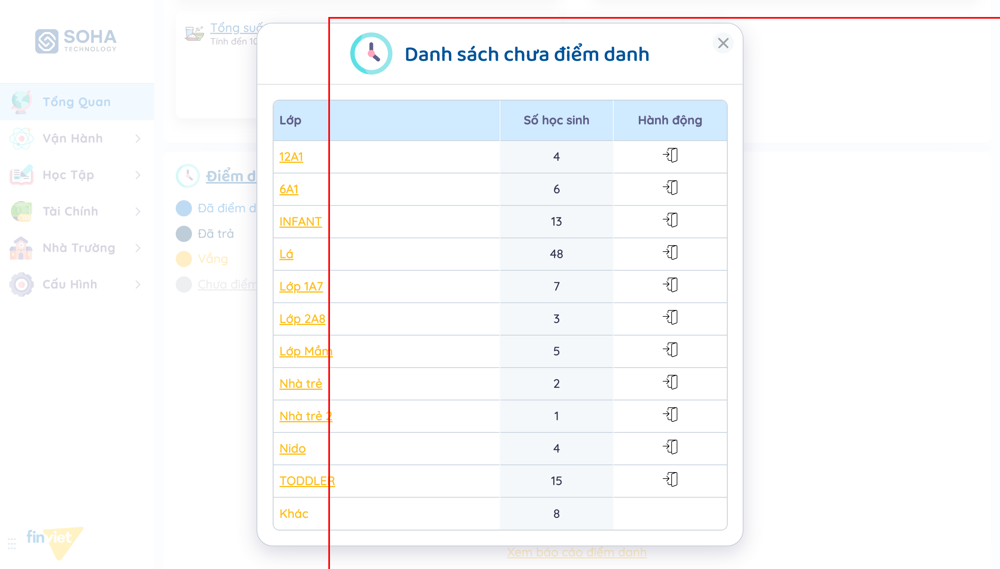 3. Nhấn icon cửa (Hành động) ở 1 dòng lớp → điều hướng thẳng sang trang điểm danh của đúng lớp đó. |
| Exception | Dòng "Khác" (học sinh không thuộc lớp cụ thể) không có icon Hành động — không thể điểm danh nhanh cho nhóm này |
| Trigger | Admin trường cần xử lý nhanh các lớp chưa điểm danh mà không cần tìm lớp từ menu Học Sinh/Lớp Học |
| Pre-condition | Đã đăng nhập với quyền Admin trường |
| Post-condition | Điều hướng sang trang điểm danh của lớp; không có thay đổi dữ liệu nào xảy ra trên trang Tổng Quan |
| Business Rules | BR05, BR06 |

### 3.4 Edge Cases & Error Handling

#### 3.4.1 Tổng quan
| Nhóm | Tình huống | Xử lý mong đợi |
|---|---|---|
| Modal xem nhanh | "Suất ăn theo lớp"/"Danh sách chưa điểm danh" không có trigger hiển thị rõ ràng trên UI (không phải nút bấm thông thường) | Phải nhấn đúng vào nhãn text "Tổng suất ăn"/"Chưa điểm danh" — đây là hành vi click ẩn, không có chỉ dẫn trực quan (VD: không đổi cursor, không có icon "mở rộng") [Cần xác nhận UX] |
| Điểm danh nhanh | Nhấn icon Hành động cho lớp có 0 học sinh hoặc dòng "Khác" | Dòng "Khác" không có icon — không thao tác được; các lớp khác đều điều hướng được dù số học sinh khác nhau |
| Tài chính | Chuyển tab Tổng quan ↔ Chi tiết khi đang xem tháng không phải tháng hiện tại | [Cần xác nhận] — chưa kiểm thử việc tab có giữ nguyên tháng đã chọn khi chuyển qua lại |

#### 3.4.2 Danh sách Thông báo (lỗi/thành công)
| Message ID | Trường hợp lỗi | Rule kiểm tra | Message đề xuất | Hình thức báo | Hành vi hệ thống |
|---|---|---|---|---|---|
| — | Không có message lỗi — toàn bộ trang chỉ đọc, không có hành động submit nào | | | | — |

### 3.5 Non-functional Requirements
| ID | Nhóm | Yêu cầu |
|---|---|---|
| NFR01 | Hiệu năng | Mỗi card tải/refresh độc lập (icon ⟳ riêng), tránh phải tải lại toàn trang khi chỉ cần cập nhật 1 chỉ số |
| NFR02 | UX | Modal xem nhanh (Suất ăn theo lớp, Danh sách chưa điểm danh) cho phép xử lý tình huống thường gặp (lớp chưa điểm danh) ngay từ dashboard, giảm số bước điều hướng |

### 3.6 Quy ước UI chung
- Mỗi khối chức năng là 1 card riêng, tiêu đề có icon minh họa; nhiều card có icon refresh (⟳) cạnh tiêu đề để tải lại riêng.
- Nhãn có gạch chân (underline) là link điều hướng; nhãn không gạch chân chỉ hiển thị thông tin, không tương tác được — cần quan sát kỹ vì hai kiểu này dễ nhầm lẫn khi nhìn nhanh.
- Một số nhãn tưởng chừng chỉ hiển thị số liệu (VD: "Tổng suất ăn", "Chưa điểm danh") thực chất mở modal xem nhanh khi nhấn vào — hành vi này không được gợi ý trực quan trên UI (không đổi con trỏ, không có icon riêng).
- Modal xem nhanh dùng chung kiểu overlay trắng, có icon minh họa + tiêu đề + nút đóng (X) ở góc phải, nội dung cuộn được nếu bảng dài.
- Các bộ lọc theo tháng (Tổng quan tài chính, Hộp thư góp ý, Top giáo viên nhận tim, Sinh nhật trong tháng) độc lập với nhau — đổi tháng ở 1 card không ảnh hưởng các card khác.
