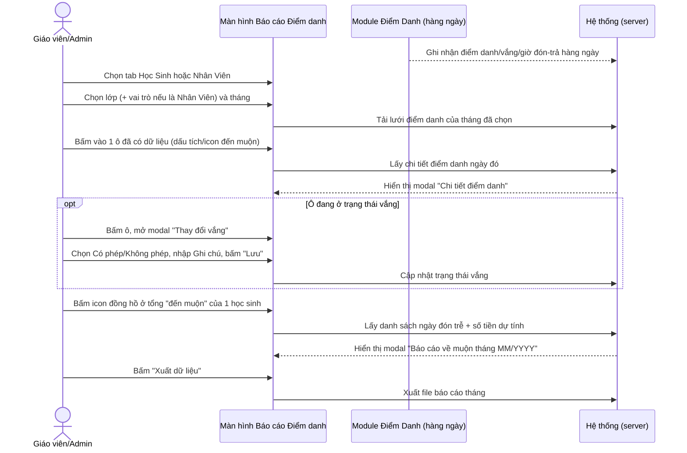
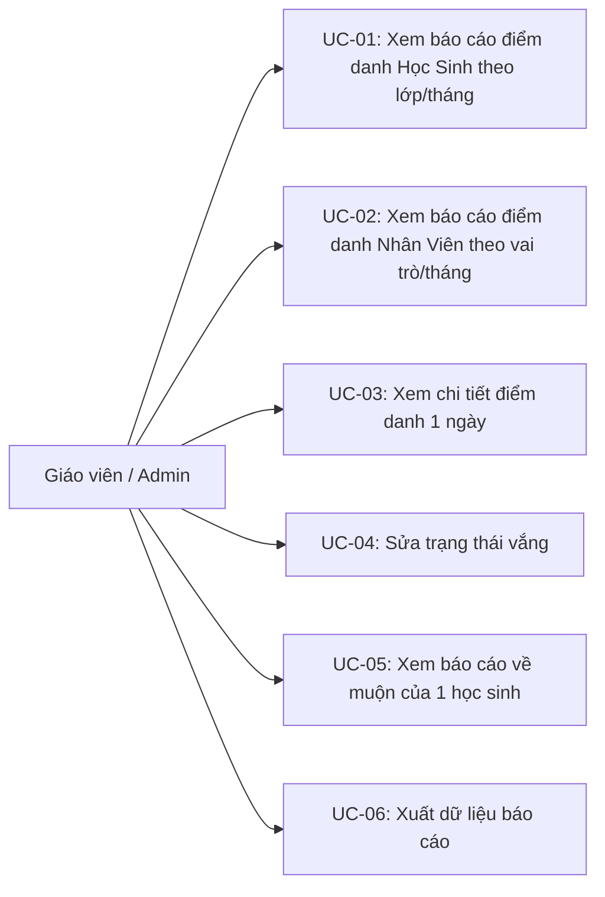
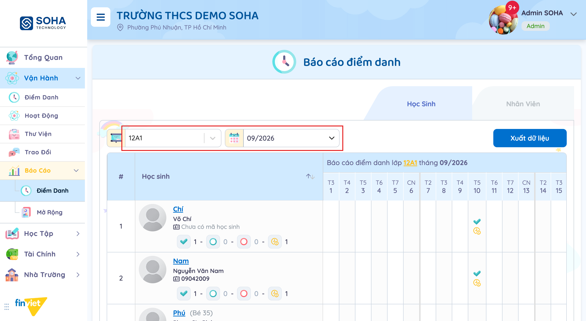
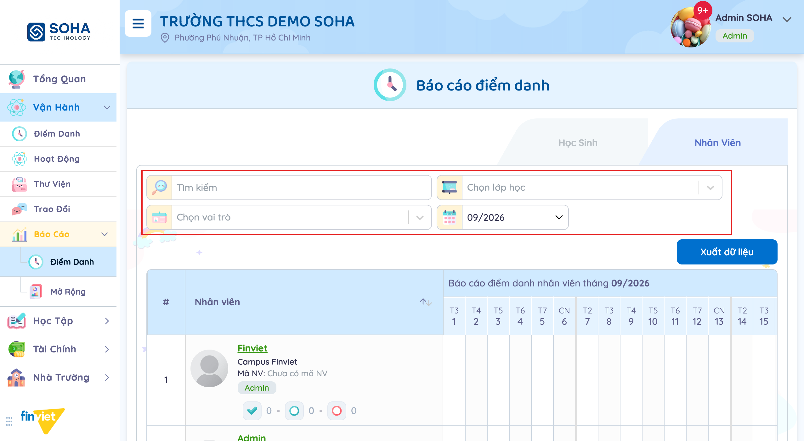
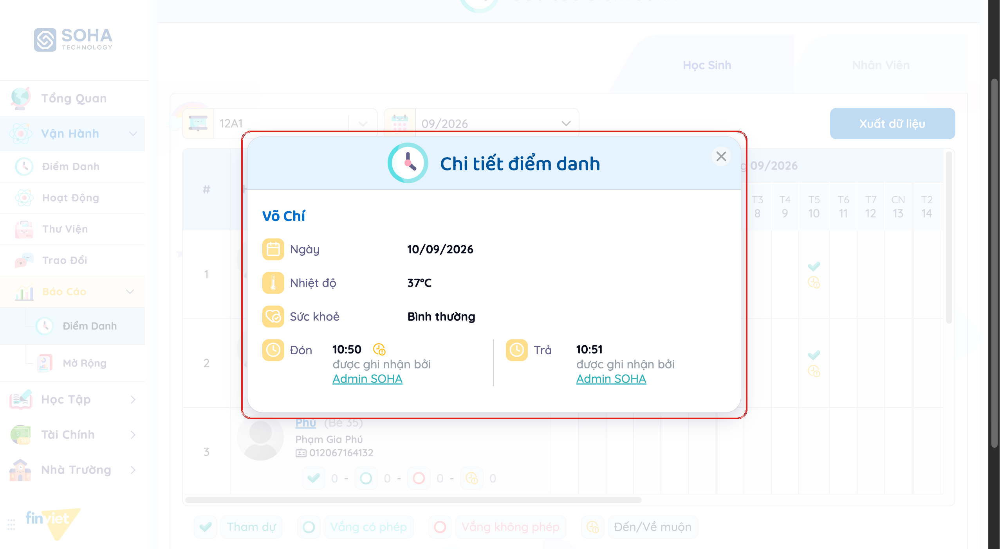
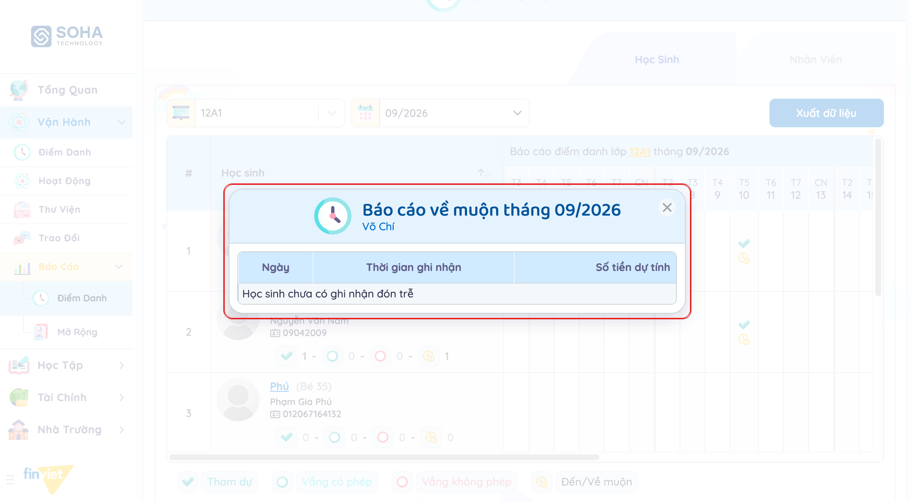

# Tên: Báo cáo Điểm danh (Vận hành)

## Mục lục
- [1. Thông tin tổng quan](#1-thông-tin-tổng-quan)
  - [1.1 Giới thiệu chung](#11-giới-thiệu-chung)
  - [1.2 Mục tiêu](#12-mục-tiêu)
  - [1.3 Phạm vi](#13-phạm-vi)
  - [1.4 Tài liệu tham khảo](#14-tài-liệu-tham-khảo)
- [2. Tổng quan nghiệp vụ](#2-tổng-quan-nghiệp-vụ)
  - [2.1 Đối tượng](#21-đối-tượng)
  - [2.2 Luồng nghiệp vụ](#22-luồng-nghiệp-vụ)
  - [2.3 Nguyên tắc nghiệp vụ](#23-nguyên-tắc-nghiệp-vụ)
- [3. Đặc tả tính năng](#3-đặc-tả-tính-năng)
  - [3.1 Phân rã chức năng](#31-phân-rã-chức-năng)
  - [3.2 Acceptance Criteria](#32-acceptance-criteria)
  - [3.3 Use case](#33-use-case)
  - [3.4 Edge Cases & Error Handling](#34-edge-cases--error-handling)
  - [3.5 Non-functional Requirements](#35-non-functional-requirements)
  - [3.6 Quy ước UI chung](#36-quy-ước-ui-chung)

## 1. Thông tin tổng quan

### 1.1 Giới thiệu chung
Báo cáo Điểm danh tổng hợp dữ liệu điểm danh theo dạng lịch tháng, tách 2 tab riêng cho Học Sinh và Nhân Viên. Từ lưới tháng, Admin có thể mở chi tiết 1 ngày điểm danh, sửa trạng thái vắng, và xem báo cáo đón trễ kèm số tiền phí dự tính theo từng học sinh.

### 1.2 Mục tiêu
- Xem nhanh tình trạng điểm danh cả tháng của 1 lớp (hoặc toàn trường theo vai trò, với Nhân viên) dưới dạng lưới ngày, không phải mở từng ngày trong Điểm Danh hàng ngày.
- Xem lại chi tiết điểm danh 1 ngày cụ thể: nhiệt độ, tình trạng sức khỏe, giờ đón/trả và người ghi nhận.
- Sửa trạng thái vắng (có phép/không phép) kèm ghi chú ngay từ ô lịch tháng.
- Theo dõi số lần và số phút đến muộn/về muộn, cùng số tiền phí đón trễ dự tính theo từng học sinh.
- Xuất dữ liệu báo cáo tháng ra file.

### 1.3 Phạm vi
| In scope | Out of scope |
|---|---|
| Xem lưới điểm danh tháng cho Học Sinh (lọc lớp + tháng) và Nhân Viên (lọc tìm kiếm + lớp + vai trò + tháng), 2 tab riêng | Thực hiện sửa vắng thật (bấm "Lưu" trên modal "Thay đổi vắng") — không có ô "vắng" nào trong dữ liệu mẫu ở bất kỳ lớp/tháng nào đã thử để kích hoạt đúng modal này |
| Mở modal "Chi tiết điểm danh" của 1 ngày đã có dữ liệu (nhiệt độ/sức khỏe/giờ đón-trả/người ghi nhận cho Học Sinh; Check-In/Check-Out cho Nhân Viên) | Xem báo cáo cho ngày/học sinh không có dữ liệu — ô đó không phản hồi khi bấm (không phải lỗi, là do không có gì để hiển thị) |
| Mở modal "Báo cáo về muộn tháng MM/YYYY" theo từng học sinh (ngày, thời gian ghi nhận, số tiền dự tính) | Xuất dữ liệu ra file thật — không bấm "Xuất dữ liệu" để tránh tải file trong phiên khảo sát |
| Đọc cấu trúc modal "Thay đổi vắng" (Có phép/Không phép + Ghi chú) qua DOM dù không kích hoạt được bằng dữ liệu mẫu hiện có | Hành vi backend sau khi Lưu thay đổi vắng — [Cần xác nhận] |

### 1.4 Tài liệu tham khảo
- [docs/operating-portal/00-inventory.md](../00-inventory.md) — kiểm kê toàn bộ module Phase 1.
- [docs/operating-portal/van-hanh/diem-danh.md](diem-danh.md) — modal "Chi tiết điểm danh" ở đây hiển thị lại đúng bộ dữ liệu (nhiệt độ, sức khỏe, giờ đón/trả, người ghi nhận) đã nhập từ màn Điểm Danh hàng ngày; đồng thời tài liệu đó cũng ghi nhận không có dữ liệu mẫu cho luồng "đánh dấu vắng" (BR06, UC-06 ở diem-danh.md) — báo cáo tháng ở đây gặp đúng khoảng trống dữ liệu tương tự nên không kiểm chứng được modal "Thay đổi vắng" bằng thao tác thật.
- [docs/operating-portal/van-hanh/trao-doi.md](trao-doi.md) — module Trao đổi có luồng "Báo vắng" do phụ huynh gửi trước với đầy đủ dữ liệu mẫu (đã xác nhận/đã hủy/đang chờ), nhưng không có báo vắng nào trong số đó xuất hiện lại ở báo cáo tháng của lớp tương ứng (đã thử lớp INFANT tháng 09/2026, nơi có báo vắng ngày 04/09 và 20/09 theo Trao đổi) — cho thấy "báo vắng" phụ huynh gửi qua Trao đổi và trạng thái "vắng" chính thức trên báo cáo Điểm danh có thể là 2 luồng dữ liệu độc lập, giáo viên phải chủ động đánh dấu vắng trong Điểm Danh hàng ngày thì mới phản ánh vào báo cáo này. [Cần xác nhận]

## 2. Tổng quan nghiệp vụ

### 2.1 Đối tượng
| Actor | Vai trò | Trách nhiệm chính |
|---|---|---|
| Giáo viên / Admin trường | Người xem báo cáo chính | Chọn lớp/vai trò + tháng, xem chi tiết từng ngày, sửa vắng, xem báo cáo đón trễ, xuất dữ liệu |
| Học sinh | Đối tượng của báo cáo (tab Học Sinh) | Dữ liệu điểm danh/vắng/đón trễ của từng em được tổng hợp theo tháng |
| Nhân viên | Đối tượng của báo cáo (tab Nhân Viên) | Dữ liệu Check-In/Check-Out được tổng hợp theo tháng, lọc theo vai trò |
| Module Điểm Danh (hàng ngày) | Nguồn dữ liệu | Mọi số liệu hiển thị ở đây (giờ đón/trả, nhiệt độ, sức khỏe, vắng) đều bắt nguồn từ thao tác điểm danh hàng ngày tại module đó |

### 2.2 Luồng nghiệp vụ

#### 2.2.1 Mô hình hóa nghiệp vụ

#### 2.2.2 Mô tả các bước nghiệp vụ
| Bước | Người thực hiện | Mô tả | Kết quả |
|---|---|---|---|
| 1 | Hệ thống | Ghi nhận dữ liệu điểm danh hàng ngày tại module Điểm Danh | Dữ liệu sẵn sàng để tổng hợp theo tháng |
| 2 | Giáo viên/Admin | Chọn tab Học Sinh/Nhân Viên, chọn lớp (+vai trò) và tháng | Lưới điểm danh tháng hiển thị đúng phạm vi đã lọc |
| 3 | Giáo viên/Admin | Bấm vào 1 ô ngày đã có dữ liệu | Modal "Chi tiết điểm danh" mở ra với đầy đủ thông tin ngày đó |
| 4 | Giáo viên/Admin | (Khi có ô vắng) Bấm ô, chọn Có phép/Không phép, ghi chú, Lưu | Trạng thái vắng của ngày đó được cập nhật — [Cần xác nhận] chưa thực hiện được do thiếu dữ liệu mẫu |
| 5 | Giáo viên/Admin | Bấm icon đồng hồ cạnh tổng đến muộn của 1 học sinh | Modal "Báo cáo về muộn tháng MM/YYYY" hiện danh sách ngày đón trễ + phí dự tính (hoặc rỗng) |
| 6 | Giáo viên/Admin | Bấm "Xuất dữ liệu" | Tải file báo cáo tháng — [Cần xác nhận] định dạng, chưa thực hiện trong phiên khảo sát |

### 2.3 Nguyên tắc nghiệp vụ
| ID | Nguyên tắc nghiệp vụ |
|---|---|
| BR01 | Trang có 2 tab tách biệt hoàn toàn: **Học Sinh** (lọc Lớp học + Tháng) và **Nhân Viên** (lọc Tìm kiếm + Lớp học + Vai trò + Tháng); mỗi tab có nút "Xuất dữ liệu" riêng. |
| BR02 | Lưới hiển thị mỗi ngày trong tháng là 1 cột (kèm thứ trong tuần T2–CN), mỗi học sinh/nhân viên là 1 hàng, kết thúc bằng các hàng tổng kết: Tổng tham dự / Tổng vắng không phép / Tổng vắng có phép / Tổng đến muộn / Tổng phút đến muộn / Tổng về muộn / Tổng phút về muộn. Tab Nhân Viên trong dữ liệu mẫu chỉ thấy 3 hàng tổng đầu (không có 4 hàng liên quan tới muộn) — [Cần xác nhận] có phải Nhân viên không theo dõi trễ hay chỉ do dữ liệu mẫu toàn 0. |
| BR03 | Chỉ ô ngày **đã có dữ liệu điểm danh** mới bấm được (class `is-absented-or-not cursor-pointer`, hiện dấu tích xanh, kèm icon đồng hồ hồng nếu có ghi nhận muộn); ô trống (chưa điểm danh ngày đó) không có hành vi khi bấm. Toàn bộ lớp/tháng đã thử chỉ tồn tại 2 loại ô: trống, hoặc "tham dự (+ muộn)" — không có ô "vắng" nào để đối chiếu cách hiển thị/thao tác riêng cho vắng. |
| BR04 | Modal "Chi tiết điểm danh" của Học Sinh hiển thị: Ngày, Nhiệt độ, Sức khoẻ, Đón (giờ + "được ghi nhận bởi {tên}"), Trả (giờ + người ghi nhận) — cùng cấu trúc dữ liệu với Điểm Danh hàng ngày (xem 1.4). Bản Nhân Viên rút gọn còn Ngày, Check-In, Check-Out (nhãn tiếng Anh, không dùng "Đón"/"Trả" như Học Sinh). |
| BR05 | Tồn tại sẵn (ẩn trong DOM) 1 modal "Thay đổi vắng": chọn radio "Có phép"/"Không phép", nhập "Ghi chú", nút Hủy/Lưu. Không xác định được ô lưới nào thực sự mở modal này trong phiên khảo sát vì không có ô "vắng" nào trong dữ liệu mẫu — suy luận nó dùng để sửa nhanh 1 ngày đã đánh dấu vắng ngay từ báo cáo tháng, tương tự luồng "Đánh dấu vắng hàng loạt" ở Điểm Danh hàng ngày nhưng thao tác cho từng ngày/từng học sinh riêng lẻ. [Cần xác nhận] |
| BR06 | Icon đồng hồ nhỏ cạnh số liệu "đến muộn" của 1 học sinh mở modal **"Báo cáo về muộn tháng MM/YYYY"** — modal này chỉ theo dõi **"về muộn"** (đón trễ buổi chiều, có tính phí dự kiến), khác với **"đến muộn"** (tới lớp trễ buổi sáng, không thấy có phí) dù trên lưới cả 2 loại đều dùng chung 1 icon đồng hồ hiển thị trên ô ngày. Modal liệt kê cột Ngày / Thời gian ghi nhận / Số tiền dự tính, trạng thái rỗng hiện "Học sinh chưa có ghi nhận đón trễ". |
| BR07 | Nút "Xuất dữ liệu" có ở cả 2 tab, đặt cùng hàng với bộ lọc — không thử bấm trong phiên khảo sát để tránh tải file thật; [Cần xác nhận] định dạng file và nội dung cột xuất ra. |

## 3. Đặc tả tính năng

### 3.1 Phân rã chức năng
| Feature | Platform | Priority | User Story |
|---|---|---|---|
| Xem lưới điểm danh tháng — Học Sinh | Web | Must | Là giáo viên, tôi muốn xem nhanh tình trạng điểm danh cả tháng của lớp mình |
| Xem lưới điểm danh tháng — Nhân Viên | Web | Should | Là Admin, tôi muốn theo dõi chuyên cần của nhân viên theo tháng, lọc theo vai trò |
| Xem chi tiết điểm danh 1 ngày | Web | Must | Là giáo viên, tôi muốn xem lại nhiệt độ/sức khỏe/giờ đón trả của 1 ngày cụ thể mà không cần vào Điểm Danh hàng ngày |
| Sửa trạng thái vắng | Web | Should | Là giáo viên, tôi muốn sửa nhanh 1 ngày đã đánh dấu sai phép/không phép ngay từ báo cáo tháng |
| Xem báo cáo đón trễ + phí dự tính | Web | Should | Là Admin, tôi muốn biết học sinh nào đón trễ bao nhiêu lần và số tiền phí dự kiến để đối chiếu thu phí |
| Xuất dữ liệu báo cáo | Web | Could | Là Admin, tôi muốn xuất báo cáo tháng ra file để lưu trữ hoặc gửi lên cấp trên |

### 3.2 Acceptance Criteria
| User Story | Chức năng | Acceptance Criteria |
|---|---|---|
| Xem lưới Học Sinh | Chọn lớp + tháng | Lưới hiển thị đúng số ngày trong tháng, đúng danh sách học sinh của lớp, hàng tổng kết khớp tổng từng cột |
| Xem lưới Nhân Viên | Chọn lớp/vai trò/tháng + tìm kiếm | Danh sách nhân viên lọc đúng theo vai trò đã chọn (Admin/Giáo Viên/Quản Lý/Nhân Viên) |
| Xem chi tiết 1 ngày | Bấm ô đã có dữ liệu | Modal hiện đúng ngày, đúng học sinh/nhân viên, đủ trường theo BR04 |
| Sửa vắng | Modal Thay đổi vắng | Bắt buộc chọn Có phép/Không phép trước khi bấm Lưu — [Cần xác nhận, chưa kiểm chứng bằng dữ liệu thật] |
| Xem báo cáo đón trễ | Modal Báo cáo về muộn | Rỗng hiện đúng thông báo "Học sinh chưa có ghi nhận đón trễ"; có dữ liệu thì hiện đủ Ngày/Thời gian ghi nhận/Số tiền dự tính |

### 3.3 Use case

**UC-01**
| Trường | Nội dung |
|---|---|
| Use case ID | UC-01 |
| Use case name | Xem báo cáo điểm danh Học Sinh theo lớp/tháng |
| Use case description | Giáo viên/Admin xem lưới điểm danh tháng của 1 lớp |
| Actor | Giáo viên / Admin |
| Happy path | 1. Vào Báo Cáo → Điểm Danh, tab "Học Sinh" (mặc định). 2. Chọn Lớp học và Tháng ở 2 dropdown đầu trang.  3. Đọc lưới: mỗi ô ngày hiện dấu tích (tham dự) và/hoặc icon đồng hồ (có ghi nhận muộn); cột tổng bên trái mỗi học sinh hiện 4 số Tham dự - Vắng có phép - Vắng không phép - Muộn. |
| Exception | Không quan sát được |
| Trigger | Chọn Lớp học và Tháng |
| Pre-condition | Không có |
| Post-condition | Lưới hiển thị đúng lớp/tháng đã chọn |
| Business Rules | BR01, BR02, BR03 |

**UC-02**
| Trường | Nội dung |
|---|---|
| Use case ID | UC-02 |
| Use case name | Xem báo cáo điểm danh Nhân Viên theo vai trò/tháng |
| Use case description | Admin xem lưới chuyên cần của nhân viên toàn trường, lọc theo vai trò |
| Actor | Admin |
| Happy path | 1. Bấm tab "Nhân Viên". 2. (Tuỳ chọn) Gõ từ khoá tìm kiếm, chọn Lớp học hoặc Vai trò (Admin/Giáo Viên/Quản Lý/Nhân Viên), chọn Tháng.  3. Đọc lưới: cấu trúc giống tab Học Sinh nhưng cột tổng chỉ có 3 số (Tham dự/Vắng có phép/Vắng không phép), không thấy số muộn trong dữ liệu mẫu. |
| Exception | Toàn bộ nhân viên trong dữ liệu mẫu đều có chỉ số "0" — không quan sát được ô có dữ liệu thật để so sánh với tab Học Sinh |
| Trigger | Bấm tab "Nhân Viên" |
| Pre-condition | Không có |
| Post-condition | Lưới hiển thị đúng bộ lọc đã chọn |
| Business Rules | BR01, BR02 |

**UC-03**
| Trường | Nội dung |
|---|---|
| Use case ID | UC-03 |
| Use case name | Xem chi tiết điểm danh 1 ngày |
| Use case description | Giáo viên/Admin xem lại đầy đủ thông tin điểm danh của 1 học sinh trong 1 ngày cụ thể |
| Actor | Giáo viên / Admin |
| Happy path | 1. Trong lưới, bấm vào 1 ô ngày đã có dấu tích/icon. 2. Modal "Chi tiết điểm danh" mở ra: Ngày, Nhiệt độ, Sức khoẻ, giờ Đón + người ghi nhận, giờ Trả + người ghi nhận.  |
| Exception | Bấm vào ô trống (chưa điểm danh) không có phản hồi |
| Trigger | Bấm vào 1 ô ngày đã có dữ liệu |
| Pre-condition | Ngày đó đã có dữ liệu điểm danh |
| Post-condition | Chỉ xem, không đổi dữ liệu |
| Business Rules | BR03, BR04 |

**UC-04**
| Trường | Nội dung |
|---|---|
| Use case ID | UC-04 |
| Use case name | Sửa trạng thái vắng |
| Use case description | Giáo viên/Admin sửa nhanh 1 ngày đã đánh dấu vắng thành có phép/không phép kèm ghi chú |
| Actor | Giáo viên / Admin |
| Happy path | [Cần xác nhận] — xác nhận được cấu trúc modal "Thay đổi vắng" (radio Có phép/Không phép, Ghi chú, Hủy/Lưu) tồn tại qua DOM, nhưng không tìm được ô lưới nào trong dữ liệu mẫu (đã thử nhiều lớp/tháng) ở trạng thái "vắng" để kích hoạt đúng modal này bằng thao tác thật. |
| Exception | Không áp dụng |
| Trigger | [Cần xác nhận] — suy đoán là bấm vào 1 ô đang ở trạng thái vắng |
| Pre-condition | Ô ngày đó đang ở trạng thái vắng |
| Post-condition | [Cần xác nhận] |
| Business Rules | BR05 |

**UC-05**
| Trường | Nội dung |
|---|---|
| Use case ID | UC-05 |
| Use case name | Xem báo cáo về muộn của 1 học sinh |
| Use case description | Giáo viên/Admin xem danh sách ngày đón trễ và số tiền phí dự tính của 1 học sinh trong tháng |
| Actor | Giáo viên / Admin |
| Happy path | 1. Trong lưới, bấm icon đồng hồ nhỏ cạnh số liệu "đến muộn" ở cột tổng của 1 học sinh. 2. Modal "Báo cáo về muộn tháng MM/YYYY" mở ra, hiện tên học sinh + bảng Ngày/Thời gian ghi nhận/Số tiền dự tính.  |
| Exception | Học sinh chưa có ghi nhận đón trễ → hiện dòng "Học sinh chưa có ghi nhận đón trễ" thay vì bảng dữ liệu |
| Trigger | Bấm icon đồng hồ ở cột tổng của 1 học sinh |
| Pre-condition | Không có |
| Post-condition | Chỉ xem, không đổi dữ liệu |
| Business Rules | BR06 |

**UC-06**
| Trường | Nội dung |
|---|---|
| Use case ID | UC-06 |
| Use case name | Xuất dữ liệu báo cáo |
| Use case description | Giáo viên/Admin xuất báo cáo điểm danh tháng ra file |
| Actor | Giáo viên / Admin |
| Happy path | [Cần xác nhận] — không bấm "Xuất dữ liệu" trong phiên khảo sát để tránh tải file thật; chưa xác nhận được định dạng file (Excel/PDF/CSV) hay nội dung cột xuất ra. |
| Exception | Không áp dụng |
| Trigger | Bấm nút "Xuất dữ liệu" |
| Pre-condition | Không có |
| Post-condition | [Cần xác nhận] |
| Business Rules | BR07 |

### 3.4 Edge Cases & Error Handling

#### 3.4.1 Tổng quan
| Nhóm | Tình huống | Xử lý mong đợi |
|---|---|---|
| Không có dữ liệu vắng mẫu | Toàn bộ lớp/tháng đã thử (kể cả đối chiếu ngược từ Trao đổi) | Không có ô nào ở trạng thái "vắng" trên lưới — modal "Thay đổi vắng" không thể kích hoạt bằng thao tác thật trong phạm vi dữ liệu demo hiện có |
| Ô trống không phản hồi | Bấm vào ngày chưa điểm danh | Không mở modal, không có thông báo lỗi — hành vi im lặng |
| "Báo vắng" phụ huynh không đồng bộ vào báo cáo | Đối chiếu báo vắng đã xác nhận/hủy trong Trao đổi (lớp INFANT) với báo cáo tháng cùng lớp/tháng | Không thấy phản ánh — [Cần xác nhận] đây là 2 luồng dữ liệu tách biệt hay do dữ liệu demo chưa đồng bộ |
| Nhân viên không có số liệu muộn | Toàn bộ nhân viên trong tab Nhân Viên | Tất cả hiển thị "0" — không rõ do nhân viên không bị theo dõi trễ hay do dữ liệu mẫu trống |

#### 3.4.2 Danh sách Thông báo (lỗi/thành công)
| Message ID | Trường hợp lỗi | Rule kiểm tra | Message đề xuất | Hình thức báo | Hành vi hệ thống |
|---|---|---|---|---|---|
| — | Không có | Không có | Không quan sát được thông báo lỗi/thành công nào (không submit modal Thay đổi vắng, không bấm Xuất dữ liệu) | — | — |

### 3.5 Non-functional Requirements
| ID | Nhóm | Yêu cầu |
|---|---|---|
| NFR01 | Hiệu năng | Đổi lớp/tháng/vai trò cập nhật lưới ngay không cần tải lại trang |
| NFR02 | Ngôn ngữ | Giao diện tiếng Việt hoàn toàn, riêng modal chi tiết điểm danh Nhân Viên dùng nhãn tiếng Anh "Check-In"/"Check-Out" — không nhất quán với "Đón"/"Trả" của Học Sinh |
| NFR03 | Nhất quán | Modal "Chi tiết điểm danh" dùng lại đúng cấu trúc dữ liệu của màn Điểm Danh hàng ngày, giúp người dùng không phải học lại cách đọc |

### 3.6 Quy ước UI chung
- Bộ lọc luôn ở dạng dropdown/textbox ngay dưới tiêu đề trang, nút hành động chính ("Xuất dữ liệu") đặt lệch phải cùng hàng.
- Lưới tháng dùng chung 1 khuôn mẫu cho cả Học Sinh và Nhân Viên: cột đầu cố định (sticky) chứa tên + ảnh đại diện + cột tổng nhanh, các cột ngày cuộn ngang, hàng tổng kết luôn ở cuối bảng.
- Legend màu/icon (Tham dự/Vắng có phép/Vắng không phép/Đến-Về muộn) đặt cố định cuối trang, dùng chung màu sắc với Điểm Danh hàng ngày.
- Modal dùng chung bố cục toàn hệ thống: nút hành động chính bên phải, "Hủy" xám bên trái.
