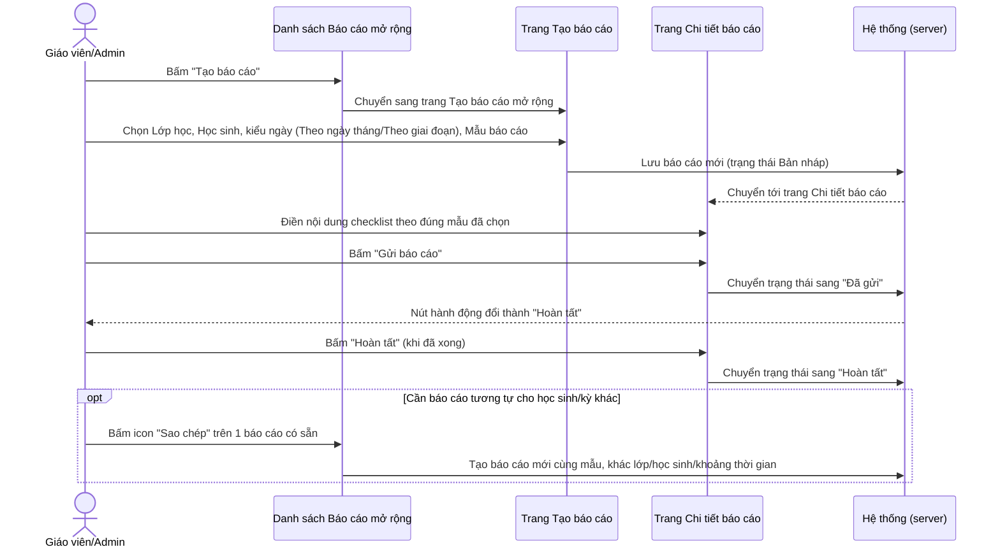
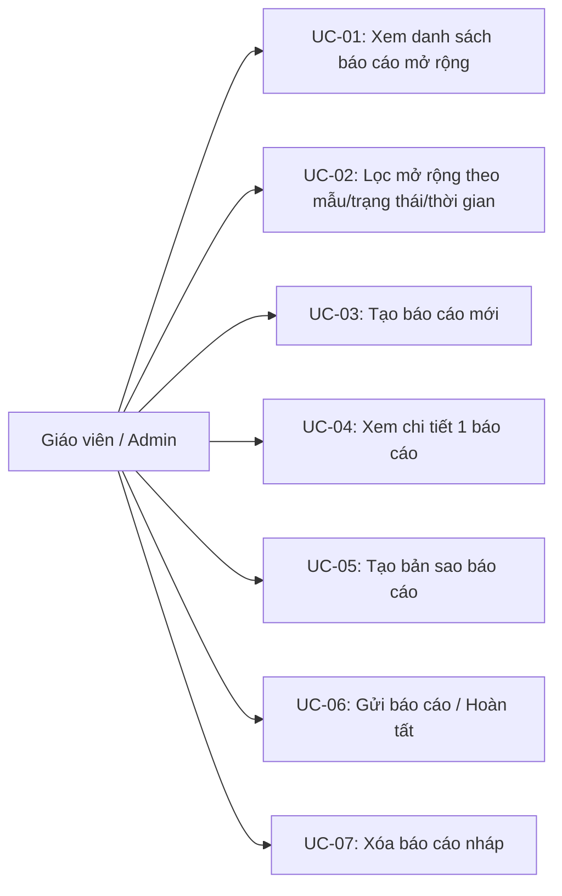
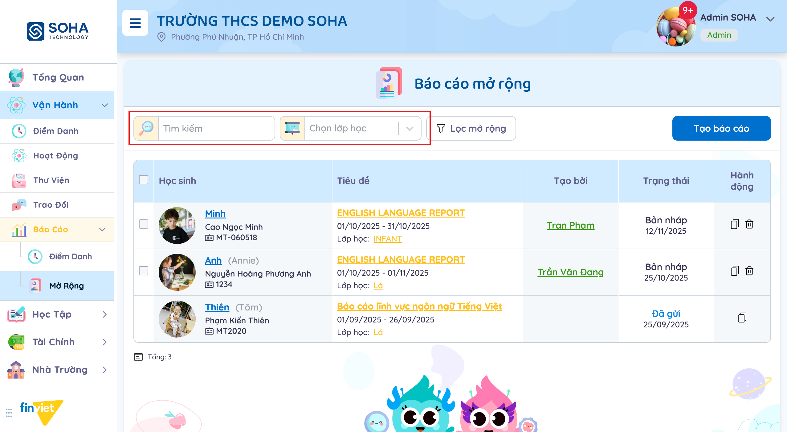
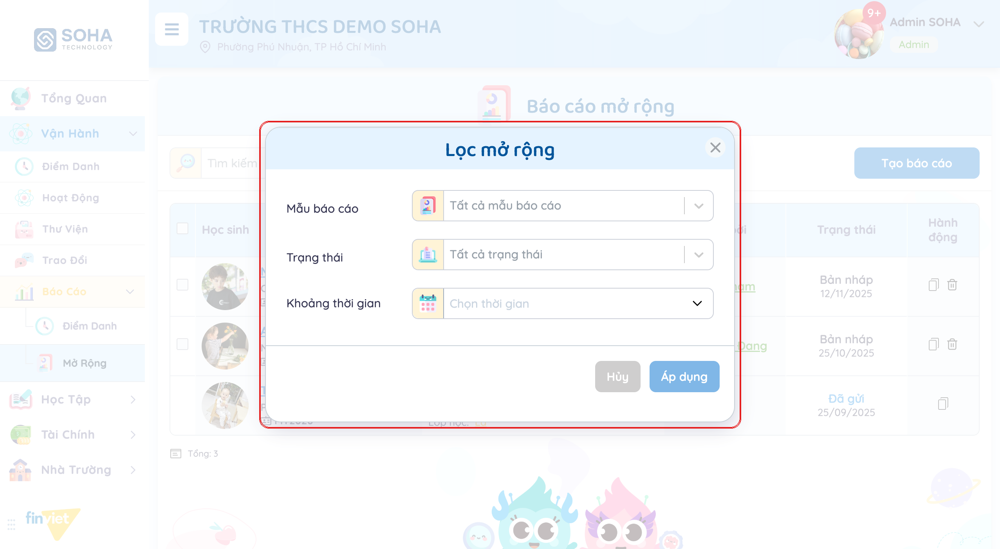
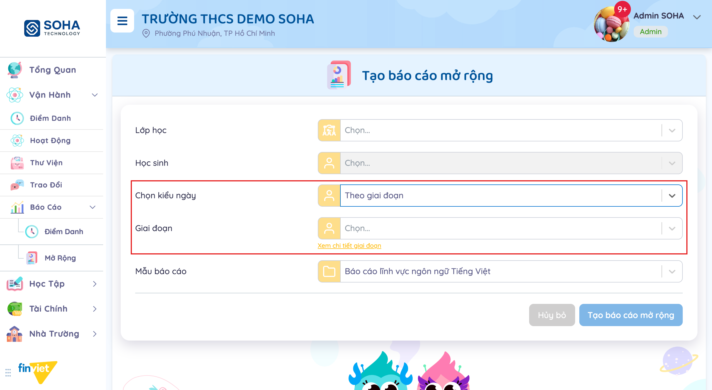
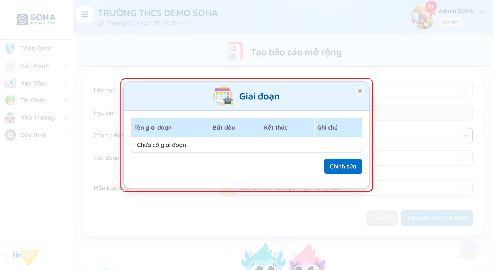
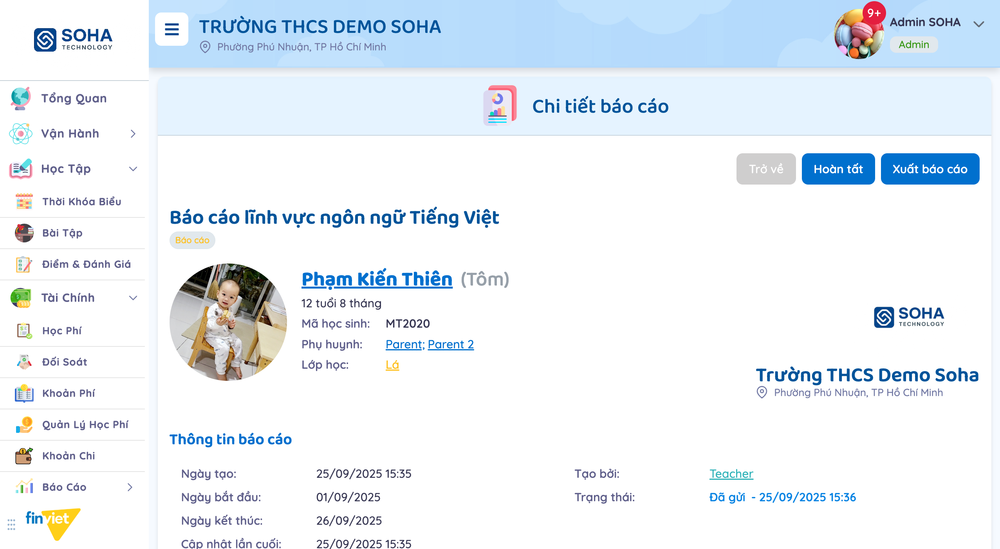
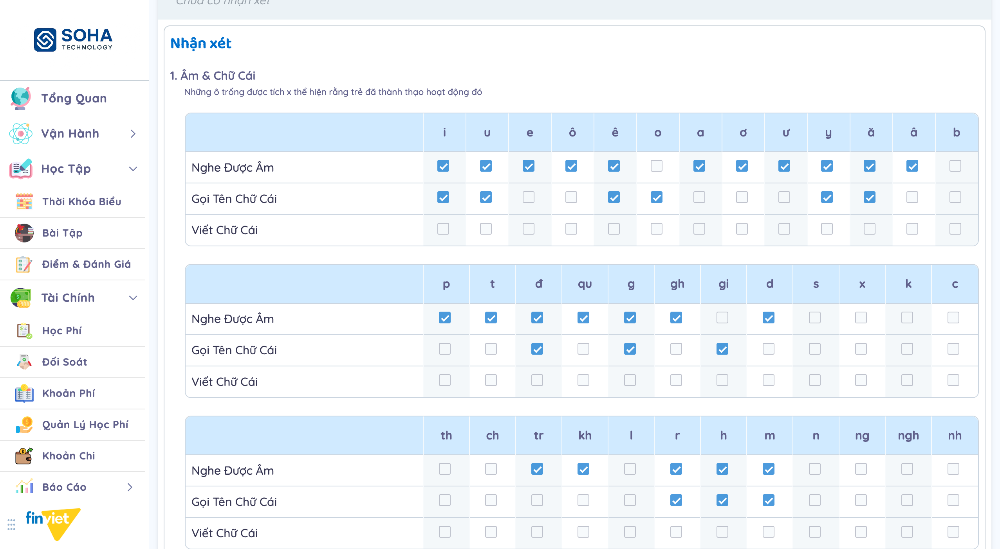
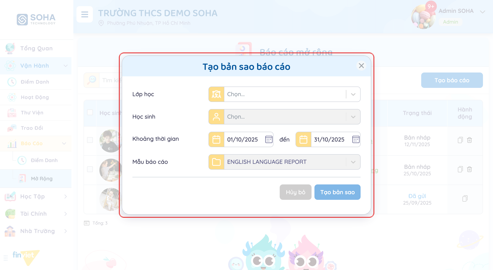

# Tên: Báo cáo Mở rộng (Vận hành)

## Mục lục
- [1. Thông tin tổng quan](#1-thông-tin-tổng-quan)
  - [1.1 Giới thiệu chung](#11-giới-thiệu-chung)
  - [1.2 Mục tiêu](#12-mục-tiêu)
  - [1.3 Phạm vi](#13-phạm-vi)
  - [1.4 Tài liệu tham khảo](#14-tài-liệu-tham-khảo)
- [2. Tổng quan nghiệp vụ](#2-tổng-quan-nghiệp-vụ)
  - [2.1 Đối tượng](#21-đối-tượng)
  - [2.2 Luồng nghiệp vụ](#22-luồng-nghiệp-vụ)
  - [2.3 Nguyên tắc nghiệp vụ](#23-nguyên-tắc-nghiệp-vụ)
- [3. Đặc tả tính năng](#3-đặc-tả-tính-năng)
  - [3.1 Phân rã chức năng](#31-phân-rã-chức-năng)
  - [3.2 Acceptance Criteria](#32-acceptance-criteria)
  - [3.3 Use case](#33-use-case)
  - [3.4 Edge Cases & Error Handling](#34-edge-cases--error-handling)
  - [3.5 Non-functional Requirements](#35-non-functional-requirements)
  - [3.6 Quy ước UI chung](#36-quy-ước-ui-chung)

## 1. Thông tin tổng quan

### 1.1 Giới thiệu chung
Báo cáo Mở rộng tạo các báo cáo đánh giá/nhận xét cho từng học sinh dựa trên mẫu (template) có sẵn — mỗi mẫu định nghĩa 1 bộ tiêu chí riêng theo lĩnh vực (ngôn ngữ, toán, tiếng Anh...). Mỗi báo cáo đi qua 3 trạng thái Bản nháp → Đã gửi → Hoàn tất, và có thể tạo bản sao nhanh từ 1 báo cáo có sẵn cho học sinh hoặc khoảng thời gian khác.

### 1.2 Mục tiêu
- Tạo báo cáo nhận xét cho 1 học sinh dựa trên mẫu có sẵn, theo khoảng ngày cụ thể hoặc theo 1 "giai đoạn" (kỳ) đặt tên riêng.
- Theo dõi trạng thái từng báo cáo (nháp/đã gửi/hoàn tất), ai tạo và tạo khi nào.
- Tạo bản sao nhanh từ 1 báo cáo có sẵn để dùng lại cùng mẫu cho học sinh/khoảng thời gian khác, không phải nhập lại từ đầu.
- Lọc danh sách báo cáo theo lớp, từ khoá, mẫu báo cáo, trạng thái, khoảng thời gian.

### 1.3 Phạm vi
| In scope | Out of scope |
|---|---|
| Xem danh sách báo cáo mở rộng: lọc theo lớp/tìm kiếm, "Lọc mở rộng" theo mẫu báo cáo/trạng thái/khoảng thời gian | Cấu hình/tạo mới "Mẫu báo cáo" — không tìm thấy nơi quản lý mẫu trong phạm vi module Báo Cáo; [Cần xác nhận] có thể nằm ở Cấu hình |
| Tạo báo cáo mới: chọn Lớp học, Học sinh, kiểu ngày (Theo ngày tháng / Theo giai đoạn), Mẫu báo cáo | Tạo/sửa "Giai đoạn" — chỉ xem được modal rỗng "Chưa có giai đoạn", nút "Chỉnh sửa" không thử bấm trong phiên khảo sát |
| Tạo bản sao từ 1 báo cáo có sẵn (giữ nguyên mẫu, đổi lớp/học sinh/khoảng thời gian) | Thực hiện Gửi báo cáo / Hoàn tất / Xuất báo cáo thật — không bấm để tránh thay đổi trạng thái dữ liệu mẫu |
| Xem trang "Chi tiết báo cáo": thông tin metadata (ngày tạo/bắt đầu/kết thúc/cập nhật/tạo bởi/trạng thái) và nội dung checklist theo đúng mẫu (đã xem đầy đủ mẫu "Báo cáo lĩnh vực ngôn ngữ Tiếng Việt" ở trạng thái Đã gửi) | Nội dung đầy đủ của các mẫu khác ("ENGLISH LANGUAGE REPORT", "Báo cáo lĩnh vực Toán", "Thư tuần") — chỉ xác nhận được tên mẫu qua dropdown, chưa mở xem cấu trúc checklist thật của từng mẫu này |
| Nhận biết 3 trạng thái nháp/đã gửi/hoàn tất qua nút hành động khác nhau ở trang chi tiết | Vai trò Phụ huynh xem báo cáo đã gửi — không quan sát được từ tài khoản Admin |

### 1.4 Tài liệu tham khảo
- [docs/operating-portal/00-inventory.md](../00-inventory.md) — kiểm kê toàn bộ module Phase 1; mô tả ban đầu "report templates được tham chiếu nhưng chưa rõ nơi quản lý" — tài liệu này xác nhận đúng: mẫu chỉ chọn được từ dropdown có sẵn, không tìm thấy màn hình tạo/sửa mẫu trong phạm vi Báo Cáo.
- Tên lớp xuất hiện trong dữ liệu mẫu (INFANT, Lá) và thuật ngữ "lĩnh vực"/"giai đoạn" cho thấy module này phục vụ chương trình đánh giá phát triển bậc mầm non — không có tài liệu van-hanh khác đề cập trực tiếp; liên quan gián tiếp tới [docs/operating-portal/van-hanh/trao-doi.md](trao-doi.md) và [docs/operating-portal/van-hanh/thu-vien.md](thu-vien.md) chỉ ở điểm chung là cùng nhắm tới đối tượng Học sinh/Phụ huynh của 1 lớp.

## 2. Tổng quan nghiệp vụ

### 2.1 Đối tượng
| Actor | Vai trò | Trách nhiệm chính |
|---|---|---|
| Giáo viên / Admin trường | Người tạo và quản lý báo cáo | Tạo báo cáo, điền nội dung theo mẫu, Gửi, Hoàn tất, tạo bản sao |
| Học sinh | Đối tượng của báo cáo | Mỗi báo cáo gắn với đúng 1 học sinh, hiển thị kèm tuổi/mã học sinh/phụ huynh/lớp học |
| Phụ huynh | Actor gián tiếp (ngoài phạm vi portal này) | Được liên kết trên trang chi tiết báo cáo (link "Phụ huynh") — suy đoán là người nhận báo cáo sau khi Gửi, chưa quan sát trực tiếp |
| Hệ thống (server) | Lưu trữ + quản lý trạng thái | Chuyển trạng thái Bản nháp → Đã gửi → Hoàn tất, ghi nhận thời điểm mỗi lần đổi trạng thái |

### 2.2 Luồng nghiệp vụ

#### 2.2.1 Mô hình hóa nghiệp vụ

#### 2.2.2 Mô tả các bước nghiệp vụ
| Bước | Người thực hiện | Mô tả | Kết quả |
|---|---|---|---|
| 1 | Giáo viên/Admin | Bấm "Tạo báo cáo" từ danh sách | Chuyển sang trang riêng "Tạo báo cáo mở rộng" |
| 2 | Giáo viên/Admin | Chọn Lớp học, Học sinh, kiểu ngày và Mẫu báo cáo | Nút "Tạo báo cáo mở rộng" được bật khi đủ dữ liệu bắt buộc |
| 3 | Hệ thống | Lưu báo cáo mới | Báo cáo ở trạng thái "Bản nháp", chuyển tới trang Chi tiết báo cáo |
| 4 | Giáo viên/Admin | Điền nội dung checklist theo mẫu (vd. bảng Âm & Chữ Cái) | Nội dung được lưu vào báo cáo — [Cần xác nhận] cơ chế lưu tự động hay phải bấm nút riêng |
| 5 | Giáo viên/Admin | Bấm "Gửi báo cáo" | Trạng thái chuyển "Đã gửi", nút hành động đổi thành "Hoàn tất" |
| 6 | Giáo viên/Admin | Bấm "Hoàn tất" | Trạng thái chuyển "Hoàn tất" — [Cần xác nhận] hành vi khoá sửa sau đó |
| 7 | Giáo viên/Admin | (Tuỳ chọn) Bấm "Sao chép" trên 1 báo cáo có sẵn, đổi Lớp học/Học sinh/Khoảng thời gian | Tạo báo cáo mới cùng Mẫu báo cáo nguồn (không đổi được) |

### 2.3 Nguyên tắc nghiệp vụ
| ID | Nguyên tắc nghiệp vụ |
|---|---|
| BR01 | Mỗi báo cáo gắn với đúng **1 học sinh** (khác trao đổi nhóm ở module Trao Đổi có thể gắn nhiều học sinh); danh sách và trang chi tiết đều hiển thị kèm avatar, tên, tuổi tính sẵn (vd. "12 tuổi 8 tháng"), mã học sinh, phụ huynh (dạng link), lớp học. |
| BR02 | Trạng thái báo cáo có 3 mức tăng dần, không quay lui: **Bản nháp → Đã gửi → Hoàn tất**. Thể hiện qua nút hành động chính đổi tương ứng ở trang Chi tiết báo cáo: Bản nháp có nút "Gửi báo cáo" + icon bút sửa cạnh tiêu đề; Đã gửi có nút "Hoàn tất" thay cho "Gửi báo cáo". Nút "Trở về" và "Xuất báo cáo" luôn có mặt ở mọi trạng thái. |
| BR03 | Danh sách chính có tối đa 3 hành động theo dòng: mở báo cáo (bấm tiêu đề), "Sao chép" (luôn có), "Xóa" (thùng rác). Nút **Xóa chỉ xuất hiện ở báo cáo "Bản nháp"** — đã kiểm chứng trực tiếp: 2 dòng "Bản nháp" có đủ 2 icon, dòng "Đã gửi" chỉ còn icon Sao chép. |
| BR04 | "Tạo báo cáo" mở 1 **trang riêng** (route `/demo/reports/create/create-extended/`), không phải modal, gồm 5 trường: Lớp học*, Học sinh*, Chọn kiểu ngày (mặc định "Theo ngày tháng"), trường ngày tương ứng, Mẫu báo cáo*. |
| BR05 | Khi đổi "Chọn kiểu ngày" sang **"Theo giai đoạn"**, trường "Khoảng thời gian" (từ-đến) được thay bằng trường "Giai đoạn" (chọn 1 giai đoạn đã đặt tên) kèm link "Xem chi tiết giai đoạn" mở modal quản lý danh sách giai đoạn của trường (cột Tên giai đoạn/Bắt đầu/Kết thúc/Ghi chú). Trường demo chưa cấu hình giai đoạn nào ("Chưa có giai đoạn"), nên kiểu ngày này chưa dùng được ngay — phải bấm "Chỉnh sửa" để khai báo trước. [Cần xác nhận hành vi nút Chỉnh sửa] |
| BR06 | Tối thiểu 4 "Mẫu báo cáo" tồn tại: **Báo cáo lĩnh vực ngôn ngữ Tiếng Việt, Báo cáo lĩnh vực Toán, ENGLISH LANGUAGE REPORT, Thư tuần**. Mỗi mẫu định nghĩa 1 bộ nội dung/checklist riêng cho phần "Nhận xét" — đã xem trực tiếp mẫu ngôn ngữ Tiếng Việt: chia theo từng nhóm kỹ năng (vd. "1. Âm & Chữ Cái"), mỗi nhóm là 1 bảng liệt kê từng chữ cái × 3 mức độ thành thạo ("Nghe Được Âm", "Gọi Tên Chữ Cái", "Viết Chữ Cái") dạng checkbox — chú thích rõ "Những ô trống được tích x thể hiện rằng trẻ đã thành thạo hoạt động đó". |
| BR07 | Trang "Chi tiết báo cáo" trình bày theo khuôn "letterhead" sẵn sàng in ấn: logo + tên trường + địa chỉ ở góc phải, tiêu đề báo cáo + thẻ "Báo cáo" bên trái, khối "Thông tin báo cáo" liệt kê Ngày tạo, Ngày bắt đầu, Ngày kết thúc, Cập nhật lần cuối, Tạo bởi (link), Trạng thái (kèm ngày giờ nếu đã gửi). |
| BR08 | "Sao chép" 1 báo cáo mở modal "Tạo bản sao báo cáo" với Lớp học và Học sinh để trống (bắt buộc chọn lại), Khoảng thời gian **được điền sẵn từ báo cáo nguồn** (có thể sửa), và Mẫu báo cáo **giữ cố định, không sửa được** (hiển thị dạng disabled) — đảm bảo bản sao luôn cùng loại mẫu với báo cáo gốc. |
| BR09 | "Lọc mở rộng" (modal riêng, tách khỏi ô "Tìm kiếm"/"Chọn lớp học" ở đầu trang) gồm 3 trường: Mẫu báo cáo ("Tất cả mẫu báo cáo" + 4 mẫu ở BR06), Trạng thái ("Tất cả trạng thái"/"Bản nháp"/"Đã gửi"/"Hoàn tất"), Khoảng thời gian. |

## 3. Đặc tả tính năng

### 3.1 Phân rã chức năng
| Feature | Platform | Priority | User Story |
|---|---|---|---|
| Xem danh sách báo cáo, lọc lớp/tìm kiếm | Web | Must | Là giáo viên, tôi muốn xem tất cả báo cáo đã tạo cho lớp mình |
| Lọc mở rộng theo mẫu/trạng thái/thời gian | Web | Should | Là Admin, tôi muốn lọc nhanh các báo cáo còn ở dạng nháp để hoàn thiện |
| Tạo báo cáo mới | Web | Must | Là giáo viên, tôi muốn tạo báo cáo nhận xét định kỳ cho 1 học sinh theo mẫu có sẵn |
| Tạo bản sao báo cáo | Web | Should | Là giáo viên, tôi muốn tái sử dụng cấu trúc 1 báo cáo cho học sinh/kỳ khác thay vì tạo lại từ đầu |
| Xem/điền chi tiết báo cáo | Web | Must | Là giáo viên, tôi muốn điền nhận xét theo đúng checklist của mẫu đã chọn |
| Gửi báo cáo / Hoàn tất | Web | Must | Là giáo viên, tôi muốn gửi báo cáo cho phụ huynh và khoá lại khi đã hoàn thiện |
| Xóa báo cáo nháp | Web | Should | Là giáo viên, tôi muốn xoá báo cáo nháp tạo nhầm trước khi gửi |
| Định nghĩa Giai đoạn | Web | Could | Là Admin, tôi muốn đặt tên sẵn các kỳ báo cáo để không phải chọn ngày tháng thủ công mỗi lần |

### 3.2 Acceptance Criteria
| User Story | Chức năng | Acceptance Criteria |
|---|---|---|
| Tạo báo cáo | Trang Tạo báo cáo mở rộng | Chọn đủ Lớp học/Học sinh/Mẫu báo cáo (+ ngày hoặc giai đoạn) → nút "Tạo báo cáo mở rộng" được bật |
| Tạo bản sao | Modal Tạo bản sao báo cáo | Mẫu báo cáo giữ nguyên không sửa được; chọn Lớp học + Học sinh mới → nút "Tạo bản sao" được bật |
| Xóa báo cáo | Danh sách | Icon Xóa chỉ hiển thị khi Trạng thái = "Bản nháp" |
| Gửi/Hoàn tất | Trang Chi tiết báo cáo | Nút hành động chính đổi nhãn đúng theo trạng thái hiện tại (Gửi báo cáo ↔ Hoàn tất) |
| Lọc mở rộng | Modal Lọc mở rộng | Chọn Mẫu báo cáo/Trạng thái/Khoảng thời gian rồi bấm "Áp dụng" → danh sách lọc lại đúng tiêu chí |

### 3.3 Use case

**UC-01**
| Trường | Nội dung |
|---|---|
| Use case ID | UC-01 |
| Use case name | Xem danh sách báo cáo mở rộng |
| Use case description | Giáo viên/Admin xem toàn bộ báo cáo đã tạo, lọc theo lớp hoặc từ khoá |
| Actor | Giáo viên / Admin |
| Happy path | 1. Vào Báo Cáo → Mở Rộng. 2. (Tuỳ chọn) Gõ từ khoá vào "Tìm kiếm" hoặc chọn lớp ở "Chọn lớp học".  3. Đọc từng dòng: avatar + tên học sinh, tiêu đề báo cáo (link) + khoảng thời gian + lớp học, người tạo, trạng thái + ngày, hành động (Sao chép/Xóa tuỳ trạng thái). |
| Exception | Không quan sát được |
| Trigger | Vào trang Báo Cáo → Mở Rộng |
| Pre-condition | Không có |
| Post-condition | Danh sách hiển thị đúng bộ lọc |
| Business Rules | BR01, BR03 |

**UC-02**
| Trường | Nội dung |
|---|---|
| Use case ID | UC-02 |
| Use case name | Lọc mở rộng theo mẫu/trạng thái/thời gian |
| Use case description | Thu hẹp danh sách báo cáo theo tiêu chí chi tiết hơn bộ lọc chính |
| Actor | Giáo viên / Admin |
| Happy path | 1. Bấm nút "Lọc mở rộng". 2. Chọn Mẫu báo cáo và/hoặc Trạng thái, chọn Khoảng thời gian.  3. Bấm "Áp dụng". |
| Exception | Không quan sát được |
| Trigger | Bấm nút "Lọc mở rộng" |
| Pre-condition | Không có |
| Post-condition | [Cần xác nhận] — chưa bấm Áp dụng để xác nhận kết quả lọc |
| Business Rules | BR09 |

**UC-03**
| Trường | Nội dung |
|---|---|
| Use case ID | UC-03 |
| Use case name | Tạo báo cáo mới |
| Use case description | Giáo viên/Admin tạo 1 báo cáo nhận xét mới cho 1 học sinh |
| Actor | Giáo viên / Admin |
| Happy path | 1. Bấm "Tạo báo cáo" — chuyển sang trang riêng. 2. Chọn Lớp học, Học sinh. 3. Chọn kiểu ngày: "Theo ngày tháng" (nhập Khoảng thời gian) hoặc "Theo giai đoạn" (chọn Giai đoạn có sẵn, hoặc bấm "Xem chi tiết giai đoạn" để xem/khai báo trước).   4. Chọn Mẫu báo cáo, bấm "Tạo báo cáo mở rộng" (không thực hiện trong phiên khảo sát để tránh tạo dữ liệu rác). |
| Exception | Trường "Giai đoạn" không chọn được gì nếu trường chưa khai báo giai đoạn nào |
| Trigger | Bấm nút "Tạo báo cáo" |
| Pre-condition | Không có |
| Post-condition | [Cần xác nhận] — chưa submit để xác nhận |
| Business Rules | BR04, BR05, BR06 |

**UC-04**
| Trường | Nội dung |
|---|---|
| Use case ID | UC-04 |
| Use case name | Xem chi tiết 1 báo cáo |
| Use case description | Giáo viên/Admin mở 1 báo cáo để xem thông tin và nội dung nhận xét |
| Actor | Giáo viên / Admin |
| Happy path | 1. Bấm vào tiêu đề 1 báo cáo trong danh sách. 2. Trang "Chi tiết báo cáo" hiện thông tin học sinh + metadata báo cáo.  3. Cuộn xuống xem phần "Nhận xét": nội dung checklist theo đúng cấu trúc của Mẫu báo cáo đã chọn khi tạo.  |
| Exception | Không quan sát được |
| Trigger | Bấm vào tiêu đề báo cáo |
| Pre-condition | Không có |
| Post-condition | Chỉ xem, trừ khi bấm sửa qua icon bút (báo cáo Bản nháp) |
| Business Rules | BR01, BR06, BR07 |

**UC-05**
| Trường | Nội dung |
|---|---|
| Use case ID | UC-05 |
| Use case name | Tạo bản sao báo cáo |
| Use case description | Giáo viên/Admin tái sử dụng 1 báo cáo có sẵn cho học sinh/khoảng thời gian khác, cùng mẫu |
| Actor | Giáo viên / Admin |
| Happy path | 1. Bấm icon "Sao chép" trên 1 dòng báo cáo trong danh sách. 2. Modal "Tạo bản sao báo cáo" mở ra, Mẫu báo cáo giữ nguyên (không sửa được), Khoảng thời gian điền sẵn từ báo cáo gốc.  3. Chọn Lớp học + Học sinh mới, sửa Khoảng thời gian nếu cần, bấm "Tạo bản sao" (không thực hiện trong phiên khảo sát). |
| Exception | Không quan sát được |
| Trigger | Bấm icon "Sao chép" |
| Pre-condition | Không có |
| Post-condition | [Cần xác nhận] — chưa submit để xác nhận |
| Business Rules | BR08 |

**UC-06**
| Trường | Nội dung |
|---|---|
| Use case ID | UC-06 |
| Use case name | Gửi báo cáo / Hoàn tất |
| Use case description | Giáo viên/Admin chuyển trạng thái báo cáo từ Bản nháp sang Đã gửi, rồi sang Hoàn tất |
| Actor | Giáo viên / Admin |
| Happy path | [Cần xác nhận] — xác nhận được nút "Gửi báo cáo" chỉ xuất hiện ở báo cáo Bản nháp và nút "Hoàn tất" chỉ xuất hiện ở báo cáo Đã gửi (đối chiếu trực tiếp 2 báo cáo mẫu khác trạng thái), nhưng không bấm để tránh thay đổi trạng thái dữ liệu mẫu. |
| Exception | Không áp dụng |
| Trigger | Bấm "Gửi báo cáo" hoặc "Hoàn tất" trên trang Chi tiết báo cáo |
| Pre-condition | Đang xem 1 báo cáo ở đúng trạng thái tương ứng |
| Post-condition | [Cần xác nhận] |
| Business Rules | BR02 |

**UC-07**
| Trường | Nội dung |
|---|---|
| Use case ID | UC-07 |
| Use case name | Xóa báo cáo nháp |
| Use case description | Giáo viên/Admin xoá 1 báo cáo còn ở dạng nháp |
| Actor | Giáo viên / Admin |
| Happy path | [Cần xác nhận] — xác nhận được icon Xóa chỉ hiển thị ở dòng "Bản nháp" trong danh sách, không bấm để tránh xoá dữ liệu mẫu. |
| Exception | Không áp dụng |
| Trigger | Bấm icon thùng rác trên 1 dòng "Bản nháp" |
| Pre-condition | Báo cáo đang ở trạng thái "Bản nháp" |
| Post-condition | [Cần xác nhận] |
| Business Rules | BR03 |

### 3.4 Edge Cases & Error Handling

#### 3.4.1 Tổng quan
| Nhóm | Tình huống | Xử lý mong đợi |
|---|---|---|
| Không có giai đoạn nào | Chọn kiểu ngày "Theo giai đoạn" khi trường chưa khai báo giai đoạn | Dropdown "Giai đoạn" không có lựa chọn nào — phải bấm "Xem chi tiết giai đoạn" → "Chỉnh sửa" để khai báo trước [Cần xác nhận bước Chỉnh sửa] |
| Báo cáo Đã gửi không xoá được | Dòng "Đã gửi" trong danh sách | Không có icon Xóa, chỉ có icon Sao chép — ngăn xoá nhầm báo cáo đã gửi cho phụ huynh |
| Mẫu báo cáo cố định khi sao chép | Modal Tạo bản sao báo cáo | Trường Mẫu báo cáo hiển thị dạng disabled, không cho đổi sang mẫu khác |
| Báo vắng/dữ liệu khác lớp không liên quan | Không áp dụng cho module này | — |

#### 3.4.2 Danh sách Thông báo (lỗi/thành công)
| Message ID | Trường hợp lỗi | Rule kiểm tra | Message đề xuất | Hình thức báo | Hành vi hệ thống |
|---|---|---|---|---|---|
| — | Không có | Không có | Không quan sát được thông báo lỗi/thành công nào (không submit tạo báo cáo, sao chép, gửi, hoàn tất, hoặc xoá trong phiên khảo sát) | — | — |

### 3.5 Non-functional Requirements
| ID | Nhóm | Yêu cầu |
|---|---|---|
| NFR01 | Trình bày | Trang Chi tiết báo cáo dùng khuôn "letterhead" (logo + tên trường + địa chỉ), phù hợp in/xuất PDF trực tiếp |
| NFR02 | Ngôn ngữ | Giao diện tiếng Việt hoàn toàn, riêng tên mẫu "ENGLISH LANGUAGE REPORT" giữ nguyên tiếng Anh vì đó là tên mẫu do trường tự đặt |
| NFR03 | Nhất quán | "Tạo báo cáo" và "Tạo bản sao báo cáo" dùng chung tập trường (Lớp học/Học sinh/Khoảng thời gian/Mẫu báo cáo), giúp người dùng không phải học lại luồng nhập liệu |

### 3.6 Quy ước UI chung
- "Tạo báo cáo" mở 1 trang riêng (không phải modal) — khác với phần lớn thao tác "Tạo mới" ở các module Vận hành khác (Trao Đổi, Thư Viện) đều dùng modal; "Tạo bản sao báo cáo" ngược lại vẫn dùng modal.
- Nút hành động trên trang Chi tiết báo cáo đặt cố định góc phải header phụ (Trở về / Gửi báo cáo hoặc Hoàn tất / Xuất báo cáo), không cuộn theo nội dung.
- Danh sách dùng chung mẫu hành động dạng icon (Sao chép/Xóa) thay vì nút chữ, và ẩn/hiện icon theo trạng thái dòng dữ liệu thay vì disable — nhất quán với cách Trao Đổi ẩn nút xoá cho người nhận suy ra tự động.
- Modal dùng chung bố cục toàn hệ thống: nút hành động chính bên phải, "Hủy"/"Hủy bỏ" xám bên trái, disabled tới khi đủ dữ liệu bắt buộc.
