# Tên: Điểm danh (Vận hành)

## Mục lục
- [1. Thông tin tổng quan](#1-thông-tin-tổng-quan)
  - [1.1 Giới thiệu chung](#11-giới-thiệu-chung)
  - [1.2 Mục tiêu](#12-mục-tiêu)
  - [1.3 Phạm vi](#13-phạm-vi)
  - [1.4 Tài liệu tham khảo](#14-tài-liệu-tham-khảo)
- [2. Tổng quan nghiệp vụ](#2-tổng-quan-nghiệp-vụ)
  - [2.1 Đối tượng](#21-đối-tượng)
  - [2.2 Luồng nghiệp vụ](#22-luồng-nghiệp-vụ)
  - [2.3 Nguyên tắc nghiệp vụ](#23-nguyên-tắc-nghiệp-vụ)
- [3. Đặc tả tính năng](#3-đặc-tả-tính-năng)
  - [3.1 Phân rã chức năng](#31-phân-rã-chức-năng)
  - [3.2 Acceptance Criteria](#32-acceptance-criteria)
  - [3.3 Use case](#33-use-case)
  - [3.4 Edge Cases & Error Handling](#34-edge-cases--error-handling)
  - [3.5 Non-functional Requirements](#35-non-functional-requirements)
  - [3.6 Quy ước UI chung](#36-quy-ước-ui-chung)

## 1. Thông tin tổng quan

### 1.1 Giới thiệu chung
Điểm danh là màn hình điểm danh hằng ngày cho một lớp học cụ thể: ghi nhận giờ đến (Đón) / giờ về (Trả) của từng học sinh, nhiệt độ, tình trạng sức khỏe, ghi chú, và trạng thái vắng mặt. Đây là công cụ tác nghiệp hằng ngày dành cho giáo viên chủ nhiệm / nhân viên trực lớp (đăng nhập bằng tài khoản Admin trong bản demo, nhưng theo cách phân nhóm menu — nằm trong "Vận hành", gắn với một lớp cụ thể — đây rõ ràng là công cụ dành cho giáo viên đứng lớp).

### 1.2 Mục tiêu
- Ghi nhận nhanh việc học sinh có mặt/vắng mặt tại lớp mỗi ngày.
- Ghi nhận giờ đến/giờ về thực tế của từng học sinh (phục vụ tính phí đón trễ, cảnh báo đến muộn).
- Theo dõi thân nhiệt và tình trạng sức khỏe (nghi ngờ bệnh truyền nhiễm) theo từng học sinh mỗi ngày.
- Tiếp nhận và đối chiếu các báo vắng do phụ huynh gửi trước (module "Báo vắng").
- Đối chiếu với dữ liệu điểm danh tự động bằng nhận diện khuôn mặt (module "Lịch sử nhận diện").

### 1.3 Phạm vi
| In scope | Out of scope |
|---|---|
| Xem danh sách học sinh của 1 lớp theo ngày, lọc theo tên | Chỉnh sửa danh sách học sinh của lớp (thuộc module "Học sinh"/"Lớp học") |
| Đánh dấu Đón (giờ đến) / Trả (giờ về) cho từng học sinh, có thể sửa lại giờ sau khi đã chọn | Cấu hình giờ hoạt động của trường / ngưỡng "đến muộn" (thuộc "Cấu hình → Trường") |
| Ghi nhiệt độ, chọn tình trạng sức khỏe (danh mục cố định), ghi chú tự do | Gửi thông báo chủ động cho phụ huynh (không quan sát thấy nút gửi riêng trên màn hình này) |
| Xem tổng hợp nhanh: số Tham dự / Vắng (có phép, không phép) / Chưa điểm danh | Duyệt/từ chối báo vắng của phụ huynh — màn hình "Báo vắng" mở được từ đây nhưng không có dữ liệu mẫu để quan sát hành vi duyệt |
| Xem lịch sử ảnh nhận diện khuôn mặt lúc đón/trả (mở từ nút "Lịch sử nhận diện") | Cấu hình/đăng ký ảnh nhận diện khuôn mặt (thuộc "Cấu hình → Nhận diện") |
| Đánh dấu vắng hàng loạt qua nút "Vắng" trên thanh công cụ (khi chọn checkbox học sinh), khai báo có phép/không phép và có hoàn tiền hay không | Quy trình phê duyệt hoàn tiền sau khi đánh dấu vắng (thuộc nghiệp vụ Tài chính — "Khoản chi"/"Học phí") |

### 1.4 Tài liệu tham khảo
- [docs/operating-portal/00-inventory.md](../00-inventory.md) — kiểm kê toàn bộ module Phase 1.
- Liên quan trực tiếp: Vận hành → Báo cáo → Điểm danh (báo cáo điểm danh tháng, chỉnh sửa vắng có phép/không phép — chưa viết tài liệu riêng).
- Liên quan: Cấu hình → Nhận diện (đăng ký ảnh khuôn mặt học sinh dùng cho "Lịch sử nhận diện" ở màn hình này).
- Liên quan: Cấu hình → Trường (giờ hoạt động — nghi ngờ là nguồn cấu hình cho nhãn "Đến muộn", [Cần xác nhận]).
- Tổng quan (dashboard) có widget "Điểm danh trong ngày" tổng hợp số liệu điểm danh toàn trường, dẫn link sang `/demo/attendance/` (điểm danh toàn trường, khác với URL theo lớp `/demo/class/{id}/attendance/` — [Cần xác nhận] về sự khác biệt giữa 2 màn hình này).

## 2. Tổng quan nghiệp vụ

### 2.1 Đối tượng
| Actor | Vai trò | Trách nhiệm chính |
|---|---|---|
| Giáo viên / Admin trường | Người dùng chính của màn hình này | Chọn lớp + ngày, đánh dấu Đón/Trả, nhập nhiệt độ/sức khỏe/ghi chú, đánh dấu vắng |
| Phụ huynh | Actor gián tiếp (không thao tác trên portal này) | Gửi báo vắng trước cho con (xuất hiện ở màn "Báo vắng"); là người nhận thông báo khi trạng thái điểm danh thay đổi [Cần xác nhận — không quan sát được thông báo thực tế được gửi] |
| Hệ thống nhận diện khuôn mặt (camera tại trường) | Hệ thống ngoài, tự động ghi nhận | Tự động chụp ảnh và ghi log lúc học sinh đến/về, hiển thị tại "Lịch sử nhận diện"; [Cần xác nhận] liệu có tự động điền Đón/Trả hay chỉ lưu ảnh đối chiếu |
| Portal Managing (portal quản lý cấp Sở/hệ thống) | Hệ thống khác có thể tiêu thụ dữ liệu điểm danh | [Cần xác nhận] — chưa quan sát được, sẽ kiểm chứng ở Phase 4 (Cross-portal connections) |

### 2.2 Luồng nghiệp vụ

#### 2.2.1 Mô hình hóa nghiệp vụ
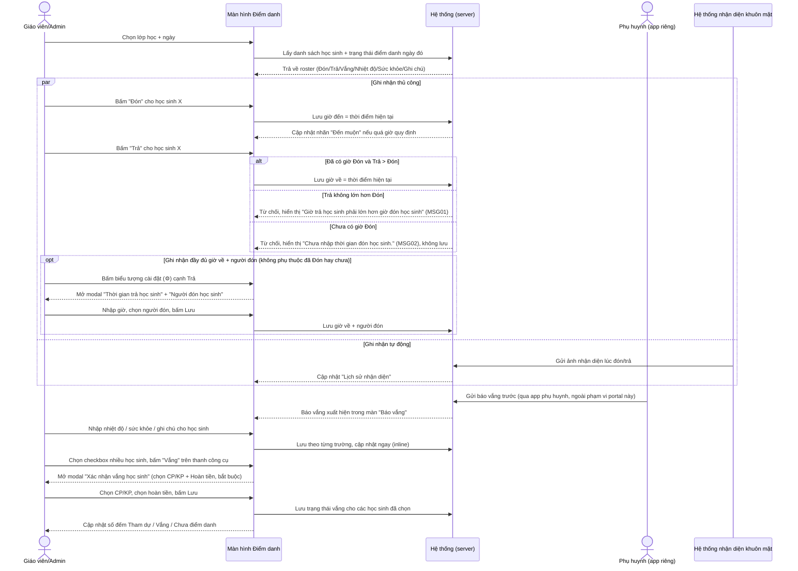

#### 2.2.2 Mô tả các bước nghiệp vụ
| Bước | Người thực hiện | Mô tả | Kết quả |
|---|---|---|---|
| 1 | Giáo viên/Admin | Chọn lớp học và ngày cần điểm danh (mặc định là lớp/ngày hiện tại) | Danh sách học sinh của lớp, đúng ngày, được tải lên |
| 2 | Giáo viên/Admin | Bấm "Đón" tại dòng học sinh khi học sinh đến lớp | Giờ đến được ghi nhận = giờ hiện tại; nếu trễ so với giờ quy định, hệ thống tự gắn nhãn "Đến muộn" |
| 3 | Giáo viên/Admin | Bấm "Trả" khi học sinh được đón về | Giờ về được ghi nhận = giờ hiện tại |
| 4 | Giáo viên/Admin | (Tuỳ chọn) Bấm vào giờ Đón/Trả đã ghi để sửa lại | Ô giờ chuyển thành textbox có thể nhập lại |
| 5 | Giáo viên/Admin | Nhập nhiệt độ, chọn tình trạng sức khỏe, nhập ghi chú tự do | Dữ liệu được lưu theo từng học sinh/ngày |
| 6 | Giáo viên/Admin | Với học sinh vắng: chọn checkbox (một hoặc nhiều học sinh) rồi bấm nút "Vắng" trên thanh công cụ | Mở modal "Xác nhận vắng học sinh": chọn Có phép/Không phép (bắt buộc) và Được hoàn tiền/Không hoàn tiền, có thể ghi chú nội bộ, rồi Lưu |
| 7 | Giáo viên/Admin | Bấm "Báo vắng" để xem danh sách báo vắng phụ huynh gửi trước | Chuyển sang màn hình riêng, lọc theo lớp / hôm nay / tất cả |
| 8 | Giáo viên/Admin | Bấm "Lịch sử nhận diện" để đối chiếu ảnh chụp tự động lúc đón/trả | Chuyển sang màn hình riêng, 2 tab "Đón học sinh"/"Trả học sinh", lọc theo ngày |
| 9 | Hệ thống | Sau mỗi thao tác điểm danh, cập nhật lại 3 số đếm ở đầu trang: Tham dự / Vắng (CP/KP) / Chưa điểm danh | Số liệu tổng hợp luôn phản ánh đúng theo thời gian thực |

### 2.3 Nguyên tắc nghiệp vụ
| ID | Nguyên tắc nghiệp vụ |
|---|---|
| BR01 | Khi bấm "Đón", hệ thống tự lấy thời điểm hiện tại làm giờ đến; nếu thời điểm này muộn hơn một mốc giờ quy định của trường, hệ thống hiển thị thêm nhãn "Đến muộn" ngay dưới giờ (quan sát trực tiếp: học sinh "Chí" được Đón lúc 10:50 → hiển thị "Đến muộn"). Mốc giờ dùng để so sánh nhiều khả năng lấy từ Cấu hình → Trường → "Giờ hoạt động" [Cần xác nhận]. |
| BR02 | Giờ Đón và giờ Trả là 2 trường độc lập, có thể ghi nhận lệch nhau và **có thể sửa lại sau khi đã ghi nhận** (bấm vào giá trị giờ để chuyển thành ô nhập liệu). **Ràng buộc xác nhận trực tiếp:** hệ thống từ chối lưu nếu giờ Trả không lớn hơn giờ Đón, hiển thị thông báo "Giờ trả học sinh phải lớn hơn giờ đón học sinh" (quan sát trực tiếp khi Đón/Trả cùng rơi vào một phút) — xem 3.4.2/MSG01. |
| BR02b | Nếu bấm "Trả" cho một học sinh **chưa từng được Đón** trong ngày, hệ thống **không** mở modal — chỉ hiển thị một banner cảnh báo nhỏ "Chưa nhập thời gian đón học sinh." ngay cạnh nút, và không lưu gì cả (xem 3.4.2/MSG02). *(Sửa lại so với bản trước: quan sát ban đầu nhầm hành vi này với modal của BR09 — đã kiểm chứng lại bằng cách bấm "Trả" một mình, tách biệt khỏi biểu tượng cài đặt, và tái hiện được 2 lần liên tiếp.)* |
| BR03 | 3 số đếm tổng hợp (Tham dự / Vắng CP+KP / Chưa điểm danh) được tính lại ngay lập tức (không cần tải lại trang) sau mỗi thao tác Đón/Trả. |
| BR04 | Vắng được chia 2 loại bắt buộc chọn một: "Có phép" (CP) và "Không phép" (KP) — xác nhận qua modal khi đánh dấu vắng. Modal này xuất hiện giống hệt nhau dù đánh dấu **1 học sinh** (gạt toggle "Vắng" ở cuối dòng — modal tiêu đề là tên học sinh) hay **nhiều học sinh** (chọn checkbox + nút "Vắng" trên thanh công cụ — modal tiêu đề "Xác nhận vắng học sinh", có danh sách chip từng học sinh) — đã kiểm chứng cả 2 đường dẫn đều mở đúng modal Vắng*/Hoàn tiền (xem BR08). |
| BR04b | Khi đánh dấu vắng, hệ thống còn yêu cầu khai báo **hoàn tiền**: "Được hoàn tiền" hoặc "Không hoàn tiền", kèm ô "Ghi chú hoàn tiền" ghi rõ là nội bộ ("*Nội bộ"). Điều này cho thấy đánh dấu vắng có liên kết trực tiếp tới nghiệp vụ tài chính (hoàn phí ăn/phí ngày nghỉ) — chi tiết luồng hoàn tiền thực tế thuộc phạm vi module Tài chính, [Cần xác nhận] nơi phản ánh khoản hoàn tiền này (Khoản chi? Học phí?). |
| BR05 | Tình trạng sức khỏe là danh mục đóng, gồm: Bình thường, Cảm sốt, Sốt cao, Đỏ mắt, Mụn rộp, Đau bụng, Thủy đậu, Sốt xuất huyết, Tay chân miệng — đây đều là các bệnh truyền nhiễm phổ biến ở trẻ nhỏ, cho thấy mục tiêu theo dõi dịch bệnh trong lớp/trường chứ không chỉ ghi chú sức khỏe đơn thuần [Cần xác nhận việc dữ liệu này có được tổng hợp thành báo cáo dịch bệnh ở nơi khác không]. |
| BR06 | "Báo vắng" (mở từ nút trên thanh công cụ) là một hàng đợi/toàn cảnh riêng theo trường (không chỉ theo lớp đang chọn), có bộ lọc theo lớp, và bộ lọc thời gian "Hôm nay"/"Tất cả" — là nơi tiếp nhận các khai báo vắng được gửi từ phía phụ huynh [Cần xác nhận nguồn gửi chính xác là app phụ huynh hay do giáo viên tạo hộ]. |
| BR07 | "Lịch sử nhận diện" tách riêng theo 2 chiều Đón/Trả, lọc theo ngày và "Phân loại hình ảnh" — cho thấy có một luồng ghi nhận điểm danh song song bằng camera nhận diện khuôn mặt, độc lập với thao tác tay của giáo viên trên bảng chính [Cần xác nhận cách 2 nguồn dữ liệu (thủ công vs camera) được đối chiếu/hợp nhất]. Màn hình này còn có form "Nhận diện bằng tay" với trường "Nhận diện cho" cho phép chọn đối tượng là **Học sinh** (chọn lớp + chọn học sinh) hoặc **Nhân viên** (chọn nhân viên) rồi bấm "Gửi" — nghĩa là tính năng nhận diện thủ công dùng chung cho cả điểm danh học sinh lẫn điểm danh nhân viên (Điểm Danh NV), không riêng module này [Cần xác nhận cơ chế chọn Học sinh/Nhân viên — form hiển thị mặc định khác nhau giữa các lần quan sát]. |
| BR08 | Đánh dấu Đón hoặc Trả **hàng loạt** (chọn checkbox nhiều học sinh rồi bấm nút "Đón"/"Trả" trên thanh công cụ, thay vì bấm từng dòng) mở modal xác nhận riêng ("Xác nhận đón học sinh") hiển thị tổng số học sinh được chọn, cho phép nhập chung một giờ Đón và một ghi chú áp dụng cho tất cả, thay vì áp giờ hiện tại tức thời như thao tác từng dòng. |
| BR09 | Mỗi ô Trả có thêm một biểu tượng cài đặt (⚙, class nội bộ `pickup-button`) tách biệt hoàn toàn với nút "Trả" — bấm vào đây mở modal riêng "Thời gian trả học sinh" + chọn bắt buộc "Người đón học sinh" (một trong các phụ huynh/người giám hộ đã khai báo cho trẻ). Modal này dùng được cho **bất kỳ học sinh nào, kể cả chưa từng được Đón** (đã kiểm chứng trên học sinh chưa Đón, modal vẫn mở bình thường không báo lỗi) — đây là con đường "đầy đủ" để ghi nhận giờ về kèm người đón, khác với nút "Trả" nhanh (chỉ lưu giờ, không hỏi người đón). |

## 3. Đặc tả tính năng

### 3.1 Phân rã chức năng
| Feature | Platform | Priority | User Story |
|---|---|---|---|
| Chọn lớp + ngày để điểm danh | Web | Must | Là giáo viên, tôi muốn chọn đúng lớp và ngày để xem/điểm danh đúng học sinh cần quản lý |
| Đánh dấu Đón (giờ đến) | Web | Must | Là giáo viên, tôi muốn ghi nhận giờ học sinh đến lớp chỉ với 1 lần bấm |
| Đánh dấu Trả (giờ về) | Web | Must | Là giáo viên, tôi muốn ghi nhận giờ học sinh được đón về chỉ với 1 lần bấm |
| Sửa giờ Đón/Trả đã ghi | Web | Should | Là giáo viên, tôi muốn sửa lại giờ nếu bấm nhầm hoặc ghi nhận trễ |
| Ghi nhiệt độ / sức khỏe / ghi chú | Web | Must | Là giáo viên, tôi muốn ghi lại tình trạng sức khỏe học sinh ngay trong lúc điểm danh |
| Đánh dấu vắng hàng loạt (chọn phép/không phép, hoàn tiền) | Web | Must | Là giáo viên, tôi muốn đánh dấu nhanh nhiều học sinh vắng mặt cùng lúc và khai báo lý do + hoàn tiền |
| Đánh dấu Đón/Trả hàng loạt | Web | Should | Là giáo viên, tôi muốn áp một giờ đến/về chung cho nhiều học sinh đến/về cùng lúc (vd. cả xe buýt) |
| Ghi nhận giờ trả + người đón (icon cài đặt) | Web | Should | Là giáo viên, tôi muốn ghi rõ ai đã đón học sinh về, kể cả khi chưa kịp bấm Đón trước đó |
| Xem báo vắng từ phụ huynh | Web | Should | Là giáo viên, tôi muốn biết trước học sinh nào được phụ huynh báo nghỉ để đối chiếu khi điểm danh |
| Xem lịch sử ảnh nhận diện khuôn mặt | Web | Could | Là giáo viên/Admin, tôi muốn đối chiếu ảnh chụp tự động lúc đón/trả để xác minh giờ ghi nhận |
| Tìm kiếm học sinh trong lớp | Web | Should | Là giáo viên, tôi muốn tìm nhanh 1 học sinh trong danh sách dài |

### 3.2 Acceptance Criteria
| User Story | Chức năng | Acceptance Criteria |
|---|---|---|
| Đánh dấu Đón | Đón | Khi bấm "Đón": giờ hiện tại được ghi vào cột Đón; số đếm "Tham dự" +1; nếu giờ ghi nhận sau mốc quy định, hiển thị nhãn "Đến muộn" |
| Đánh dấu Trả | Trả | Khi bấm "Trả": giờ hiện tại được ghi vào cột Trả, độc lập với cột Đón |
| Sửa giờ | Đón/Trả | Khi bấm vào giá trị giờ đã ghi, ô chuyển thành textbox cho phép nhập giờ mới |
| Ghi nhiệt độ | Nhiệt độ | Giá trị hiển thị dạng nút bấm (vd. "37ºC"); bấm vào cho phép chỉnh sửa |
| Ghi sức khỏe | Sức khỏe | Dropdown với danh mục cố định 9 lựa chọn, mặc định "Bình thường" |
| Ghi chú | Ghi chú | Bấm icon bút chì hiện ra textbox nhập tự do cho đúng học sinh, đúng ngày |
| Xem báo vắng | Báo vắng | Bấm nút "Báo vắng" điều hướng sang màn hình liệt kê báo vắng, có bộ lọc lớp + "Hôm nay"/"Tất cả" |
| Xem lịch sử nhận diện | Lịch sử nhận diện | Bấm nút điều hướng sang màn hình có 2 tab (Đón/Trả học sinh), lọc theo ngày |
| Đánh dấu vắng hàng loạt | Vắng | Chọn ≥1 checkbox rồi bấm "Vắng": modal bắt buộc chọn Có phép/Không phép và Được hoàn tiền/Không hoàn tiền trước khi Lưu |
| Đánh dấu Đón/Trả hàng loạt | Đón/Trả (thanh công cụ) | Chọn ≥1 checkbox rồi bấm "Đón"/"Trả": modal cho nhập chung 1 giờ + ghi chú, áp dụng cho tất cả học sinh đã chọn |
| Ghi nhận giờ trả + người đón | Icon cài đặt (⚙) cạnh Trả | Bấm icon mở modal "Thời gian trả học sinh" + bắt buộc chọn "Người đón học sinh"; hoạt động cả khi học sinh chưa có giờ Đón |
| Tìm kiếm | Tìm kiếm | Gõ tên vào ô "Tìm kiếm" lọc danh sách học sinh theo lớp đang chọn |

### 3.3 Use case
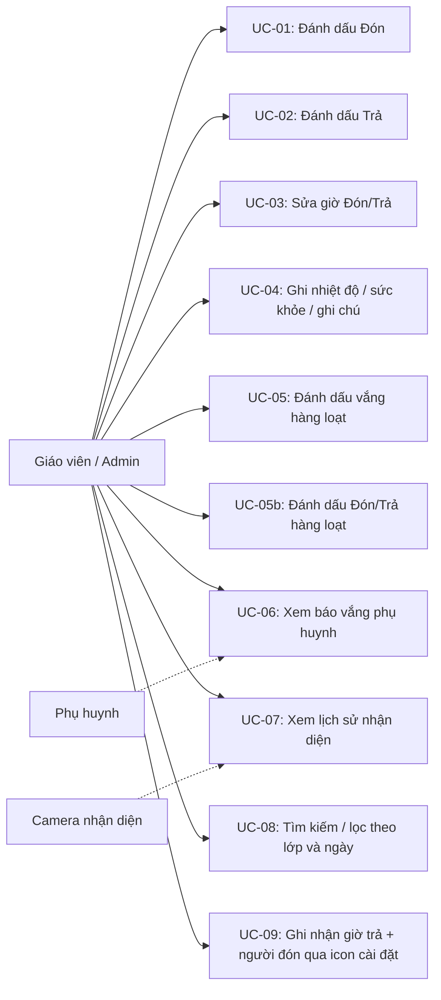

**UC-01**
| Trường | Nội dung |
|---|---|
| Use case ID | UC-01 |
| Use case name | Đánh dấu Đón (giờ đến lớp) |
| Use case description | Giáo viên ghi nhận thời điểm học sinh đến lớp bằng một lần bấm |
| Actor | Giáo viên / Admin |
| Happy path | 1. Vào Điểm danh, chọn lớp và ngày (mặc định hôm nay). 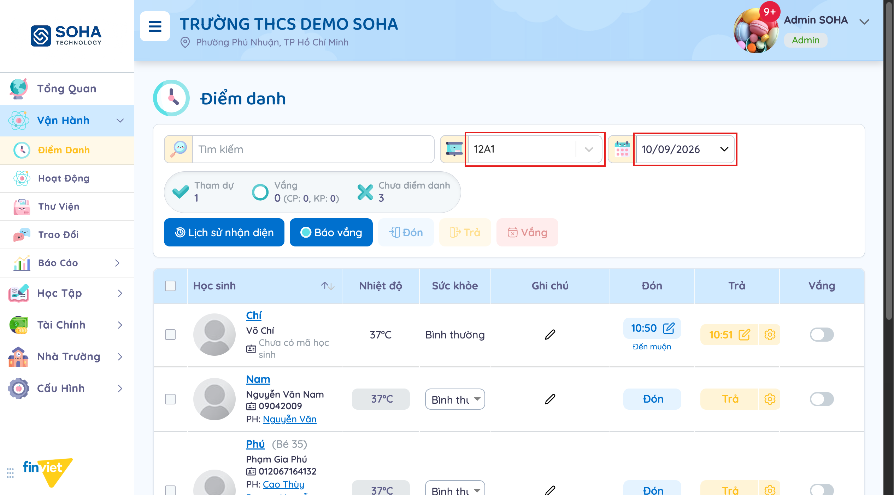 2. Tại dòng học sinh cần điểm danh, bấm nút "Đón". 3. Hệ thống ghi giờ hiện tại vào cột Đón; nếu trễ giờ quy định, hiển thị thêm nhãn "Đến muộn". 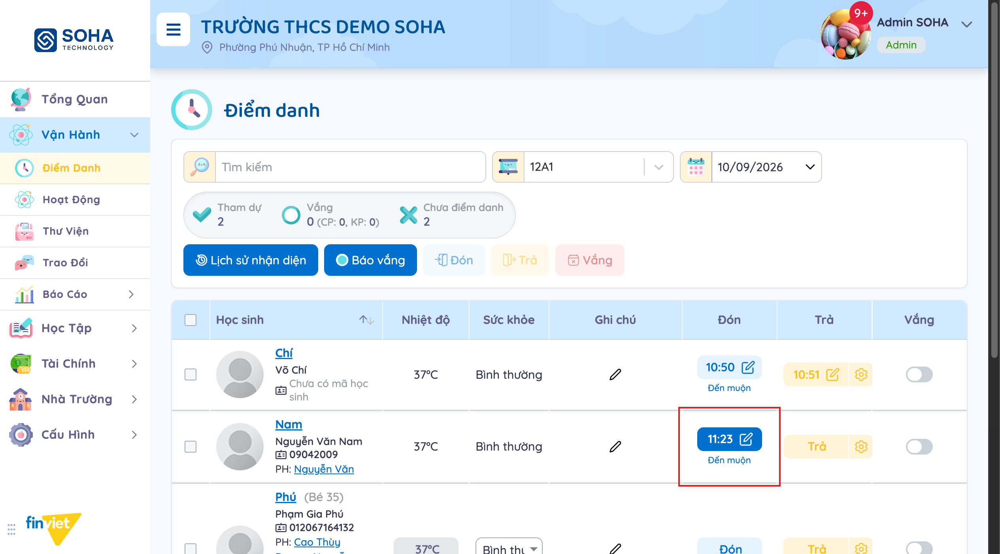 4. Số đếm "Tham dự" ở đầu trang tăng thêm 1. |
| Exception | Không quan sát được — không có thao tác nào trong UI dẫn đến lỗi rõ ràng khi bấm Đón |
| Trigger | Giáo viên bấm nút "Đón" tại dòng học sinh |
| Pre-condition | Đã chọn đúng lớp và ngày; học sinh chưa được đánh dấu Đón cho ngày đó |
| Post-condition | Cột Đón của học sinh có giá trị giờ; số đếm Tham dự cập nhật |
| Business Rules | BR01, BR03 |

**UC-02**
| Trường | Nội dung |
|---|---|
| Use case ID | UC-02 |
| Use case name | Đánh dấu Trả (giờ về) |
| Use case description | Giáo viên ghi nhận thời điểm học sinh được đón về. Hành vi rẽ nhánh tùy học sinh đã được Đón hay chưa (xem BR02b). |
| Actor | Giáo viên / Admin |
| Happy path | 1. Tại dòng học sinh **đã có giờ Đón**, bấm nút "Trả". 2. Hệ thống ghi giờ hiện tại vào cột Trả ngay lập tức, không cần xác nhận thêm. 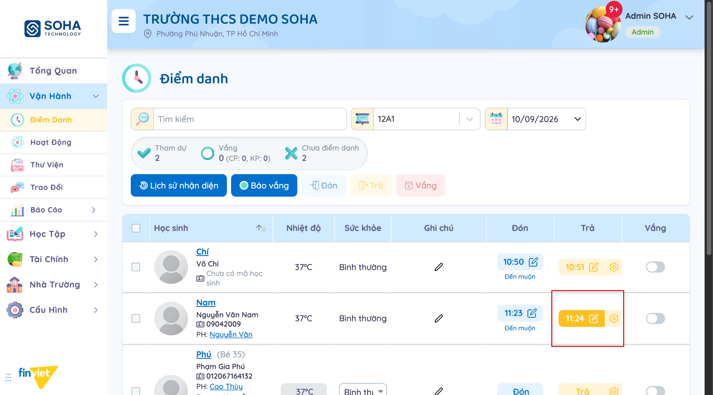 |
| Exception | **Giờ Trả không lớn hơn giờ Đón** (vd. Đón và Trả rơi cùng một phút): hệ thống từ chối lưu và hiển thị banner đỏ "Giờ trả học sinh phải lớn hơn giờ đón học sinh" (MSG01) ở góc trên bên phải. 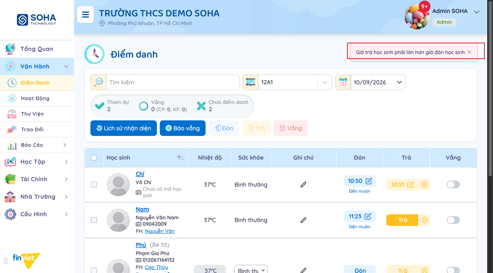 **Học sinh chưa được Đón**: bấm "Trả" không mở modal — chỉ hiển thị banner nhỏ "Chưa nhập thời gian đón học sinh." (MSG02) cạnh nút, và không lưu gì. Đã kiểm chứng lại 2 lần độc lập, tái hiện ổn định. 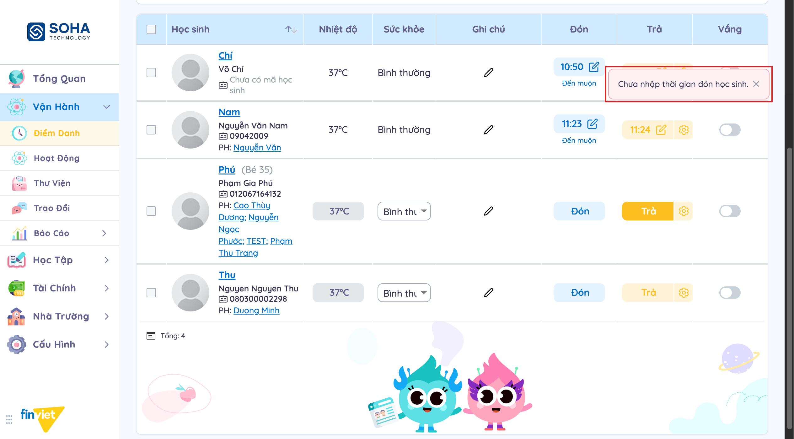 |
| Trigger | Giáo viên bấm nút "Trả" |
| Pre-condition | Đã chọn đúng lớp/ngày |
| Post-condition | Thành công: cột Trả có giá trị giờ. Thất bại (MSG01/MSG02): không có gì thay đổi |
| Business Rules | BR02, BR02b, BR03 |

**UC-03**
| Trường | Nội dung |
|---|---|
| Use case ID | UC-03 |
| Use case name | Sửa giờ Đón/Trả đã ghi |
| Use case description | Giáo viên chỉnh lại giờ Đón hoặc Trả đã ghi nhận trước đó |
| Actor | Giáo viên / Admin |
| Happy path | 1. Bấm vào giá trị giờ đã hiển thị (vd. "10:50") ở cột Đón hoặc Trả. 2. Ô chuyển thành textbox chỉnh sửa được. 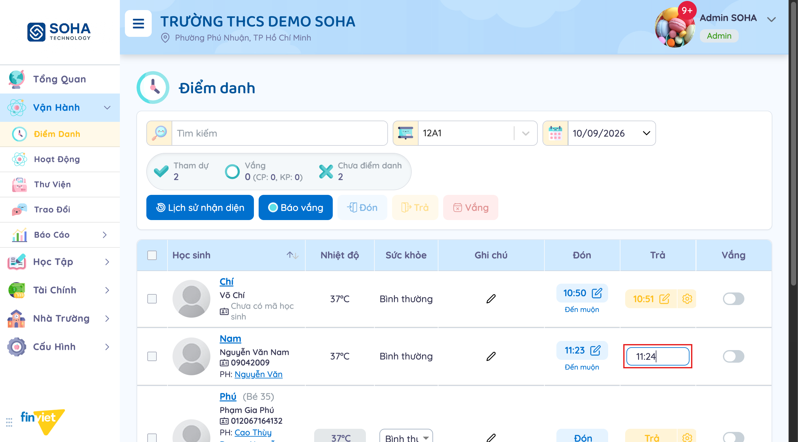 3. Nhập giờ mới (không thử submit để tránh làm sai lệch dữ liệu demo). |
| Exception | Chưa quan sát được (không submit giá trị không hợp lệ) |
| Trigger | Bấm vào giá trị giờ đã ghi |
| Pre-condition | Học sinh đã có giờ Đón hoặc Trả cho ngày đang chọn |
| Post-condition | [Cần xác nhận] — chưa xác nhận được hành vi lưu vì không submit |
| Business Rules | BR02 |

**UC-04**
| Trường | Nội dung |
|---|---|
| Use case ID | UC-04 |
| Use case name | Ghi nhiệt độ / tình trạng sức khỏe / ghi chú |
| Use case description | Giáo viên cập nhật thông tin sức khỏe hằng ngày cho từng học sinh |
| Actor | Giáo viên / Admin |
| Happy path | 1. Bấm vào giá trị nhiệt độ (vd. "37ºC") để sửa; hoặc chọn lại trong dropdown "Sức khỏe" (9 lựa chọn); hoặc bấm icon bút chì ở cột "Ghi chú". 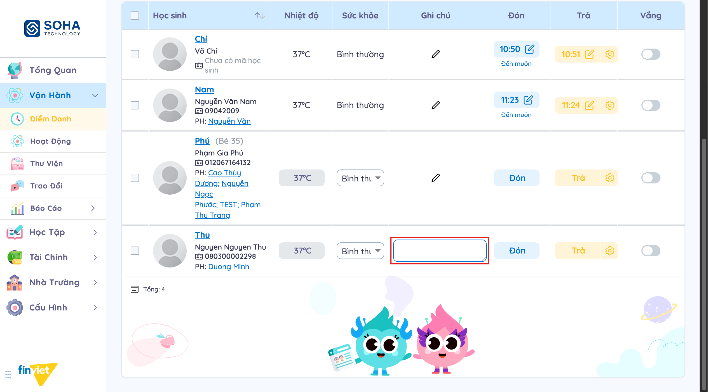 2. Nhập/chọn giá trị mới. |
| Exception | Chưa quan sát được |
| Trigger | Bấm vào ô Nhiệt độ / Sức khỏe / Ghi chú |
| Pre-condition | Đã chọn đúng lớp/ngày |
| Post-condition | [Cần xác nhận] hành vi lưu (không submit để tránh thay đổi dữ liệu demo ngoài phạm vi cần thiết) |
| Business Rules | BR05 |

**UC-05**
| Trường | Nội dung |
|---|---|
| Use case ID | UC-05 |
| Use case name | Đánh dấu vắng (hàng loạt) |
| Use case description | Giáo viên đánh dấu một hoặc nhiều học sinh vắng mặt trong ngày, khai báo lý do và việc hoàn tiền |
| Actor | Giáo viên / Admin |
| Happy path | 1. Chọn checkbox ở đầu dòng của một hoặc nhiều học sinh (nút "Vắng" trên thanh công cụ chuyển từ mờ sang màu đỏ, đã bật). 2. Bấm nút "Vắng" trên thanh công cụ. 3. Modal "Xác nhận vắng học sinh" mở ra: hiển thị danh sách học sinh đã chọn (dạng chip, có thể bỏ bớt), tổng số học sinh, chọn bắt buộc "Có phép"/"Không phép", chọn "Được hoàn tiền"/"Không hoàn tiền", có thể ghi "Ghi chú hoàn tiền" (nội bộ). 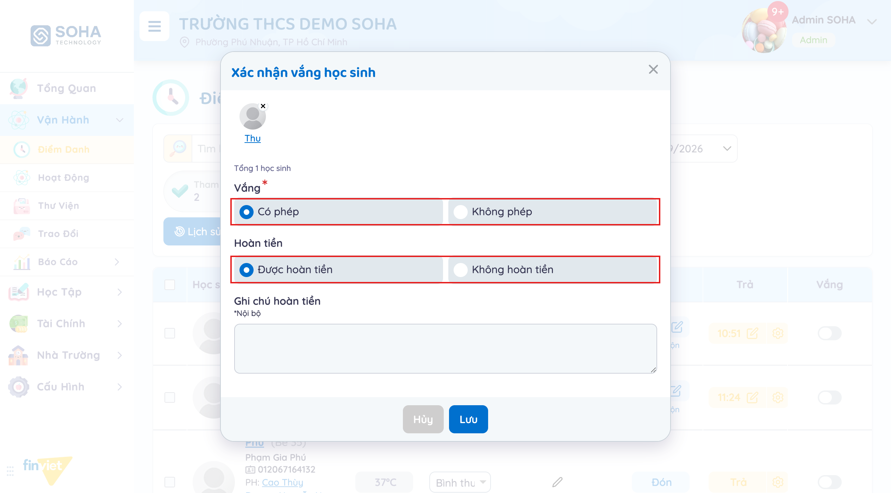 4. Bấm "Lưu" để xác nhận (không thực hiện trong phiên khảo sát để tránh làm sai lệch dữ liệu demo — hành vi sau khi Lưu ghi nhận là [Cần xác nhận]). |
| Exception | Chưa quan sát được thông báo lỗi cụ thể (vd. chọn "Có phép" nhưng bỏ trống trường bắt buộc khác) vì không submit modal |
| Trigger | Chọn ít nhất 1 checkbox học sinh rồi bấm nút "Vắng" trên thanh công cụ; **hoặc** gạt toggle "Vắng" ở cuối dòng của 1 học sinh trực tiếp (không cần chọn checkbox trước) — cả 2 cách đều mở cùng một modal, chỉ khác tiêu đề (tên học sinh thay vì "Xác nhận vắng học sinh") và việc có/không có danh sách chip nhiều học sinh. Đã kiểm chứng trực tiếp cả 2 đường trên học sinh "Phú"/"Thu". |
| Pre-condition | Đã chọn checkbox ít nhất 1 học sinh trong danh sách |
| Post-condition | [Cần xác nhận] — chưa bấm Lưu để xác nhận cột Vắng và số đếm tổng hợp có cập nhật hay không, nhưng theo cấu trúc modal thì chắc chắn ghi nhận Có phép/Không phép và trạng thái hoàn tiền |
| Business Rules | BR04, BR04b |

**UC-05b**
| Trường | Nội dung |
|---|---|
| Use case ID | UC-05b |
| Use case name | Đánh dấu Đón/Trả hàng loạt |
| Use case description | Giáo viên áp một giờ Đón (hoặc Trả) chung cho nhiều học sinh cùng lúc, thay vì bấm từng dòng |
| Actor | Giáo viên / Admin |
| Happy path | 1. Chọn checkbox nhiều học sinh. 2. Bấm nút "Đón" (hoặc "Trả") trên thanh công cụ. 3. Modal "Xác nhận đón học sinh" mở ra: hiển thị tổng số học sinh đã chọn, ô "Giờ đón" (mặc định giờ hiện tại, có thể sửa), ô "Ghi chú" tự do. 4. Bấm "Xác nhận" để áp dụng cho tất cả học sinh đã chọn. |
| Exception | Chưa quan sát được (không submit trong phiên khảo sát) |
| Trigger | Chọn ≥1 checkbox rồi bấm nút "Đón"/"Trả" trên thanh công cụ |
| Pre-condition | Đã chọn checkbox ít nhất 1 học sinh |
| Post-condition | [Cần xác nhận] |
| Business Rules | BR08 |

**UC-06**
| Trường | Nội dung |
|---|---|
| Use case ID | UC-06 |
| Use case name | Xem danh sách báo vắng từ phụ huynh |
| Use case description | Giáo viên/Admin xem các báo vắng được gửi trước, đối chiếu khi điểm danh |
| Actor | Giáo viên / Admin; Phụ huynh (nguồn dữ liệu gián tiếp) |
| Happy path | 1. Từ màn Điểm danh, bấm nút "Báo vắng". 2. Hệ thống chuyển sang màn hình riêng, liệt kê: Học sinh, Lớp, Thời gian nghỉ, Tạo bởi, Trạng thái, Hành động — lọc theo lớp và theo "Hôm nay"/"Tất cả". 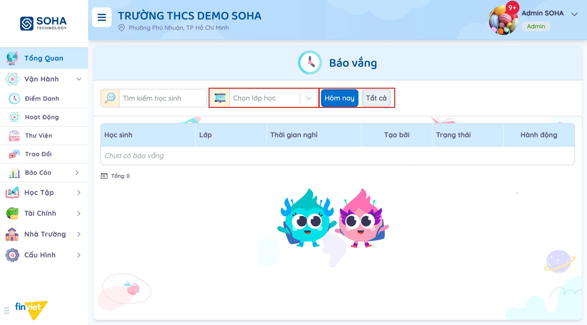 |
| Exception | Không có dữ liệu mẫu ("Chưa có báo vắng") nên không quan sát được hành vi khi có báo vắng thật (duyệt/từ chối, trạng thái cụ thể) |
| Trigger | Bấm nút "Báo vắng" |
| Pre-condition | Không có |
| Post-condition | Không thay đổi dữ liệu, chỉ xem |
| Business Rules | BR06 |

**UC-07**
| Trường | Nội dung |
|---|---|
| Use case ID | UC-07 |
| Use case name | Xem lịch sử nhận diện khuôn mặt |
| Use case description | Giáo viên/Admin đối chiếu ảnh chụp tự động lúc học sinh đến/về qua camera nhận diện |
| Actor | Giáo viên / Admin; Hệ thống nhận diện khuôn mặt |
| Happy path | 1. Từ màn Điểm danh, bấm nút "Lịch sử nhận diện" (điều hướng tới `/demo/attendance/face-recognition/` — dùng chung toàn trường, không giữ theo lớp đang chọn). 2. Hệ thống chuyển sang màn hình riêng với 2 tab "Đón học sinh"/"Trả học sinh", lọc theo ngày và "Phân loại hình ảnh". 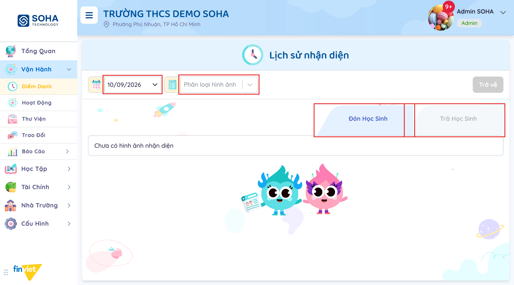 3. (Tuỳ chọn) Cuộn xuống khối "Nhận diện bằng tay" (không hiện sẵn trong khung nhìn đầu tiên): chọn "Nhận diện cho" là Học sinh hoặc Nhân viên, chọn đối tượng cụ thể, bấm "Gửi" để nhận diện thủ công khi camera không tự nhận ra. |
| Exception | Không có ảnh mẫu cho ngày đang chọn ("Chưa có hình ảnh nhận diện") |
| Trigger | Bấm nút "Lịch sử nhận diện" |
| Pre-condition | Không có |
| Post-condition | Không thay đổi dữ liệu, chỉ xem (trừ khi dùng "Nhận diện bằng tay" để gửi yêu cầu nhận diện thủ công) |
| Business Rules | BR07 |

**UC-08**
| Trường | Nội dung |
|---|---|
| Use case ID | UC-08 |
| Use case name | Tìm kiếm / lọc theo lớp và ngày |
| Use case description | Giáo viên thu hẹp danh sách học sinh cần xem theo lớp, ngày, hoặc tên |
| Actor | Giáo viên / Admin |
| Happy path | 1. Chọn lớp trong dropdown lớp học. 2. Chọn ngày trong bộ chọn ngày. 3. Gõ từ khóa vào ô "Tìm kiếm" để lọc theo tên học sinh trong lớp đang chọn. |
| Exception | Không quan sát được |
| Trigger | Thay đổi giá trị lớp/ngày/từ khóa tìm kiếm |
| Pre-condition | Không có |
| Post-condition | Danh sách học sinh hiển thị được lọc lại tương ứng |
| Business Rules | Không có |

**UC-09**
| Trường | Nội dung |
|---|---|
| Use case ID | UC-09 |
| Use case name | Ghi nhận giờ trả + người đón qua biểu tượng cài đặt (⚙) |
| Use case description | Giáo viên ghi nhận đầy đủ giờ về và người đến đón, dùng được cho bất kỳ học sinh nào bất kể đã Đón hay chưa — khác với nút "Trả" nhanh vốn chỉ lưu giờ |
| Actor | Giáo viên / Admin |
| Happy path | 1. Tại ô Trả của học sinh, bấm biểu tượng cài đặt (⚙) nằm ngay cạnh nút "Trả" (không phải bấm vào "Trả"). 2. Modal mở ra, tiêu đề là tên học sinh, gồm ô "Thời gian trả học sinh" (mặc định giờ hiện tại) và ô bắt buộc "Người đón học sinh" (dropdown chọn 1 trong các phụ huynh/người giám hộ đã khai báo). 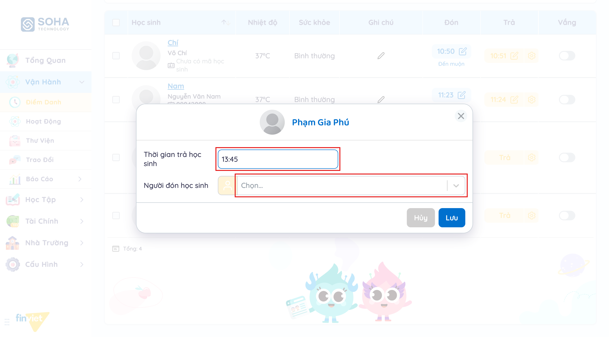 3. Chọn người đón, chỉnh giờ nếu cần, bấm "Lưu". |
| Exception | Chưa quan sát được thông báo lỗi (không submit khi bỏ trống "Người đón học sinh" để tránh làm sai lệch dữ liệu demo) |
| Trigger | Bấm biểu tượng cài đặt (⚙) ở ô Trả |
| Pre-condition | Không có — hoạt động được kể cả khi học sinh chưa có giờ Đón (đã kiểm chứng trực tiếp) |
| Post-condition | [Cần xác nhận] — chưa bấm Lưu để xác nhận cột Trả có được ghi cùng lúc với tên người đón hay chỉ lưu riêng người đón |
| Business Rules | BR09 |

### 3.4 Edge Cases & Error Handling

#### 3.4.1 Tổng quan
| Nhóm | Tình huống | Xử lý mong đợi |
|---|---|---|
| Trả trước/trùng giờ Đón | Bấm "Trả" khi giờ hiện tại không lớn hơn giờ Đón đã ghi (quan sát trực tiếp khi cả hai cùng rơi vào một phút) | Từ chối lưu, hiển thị banner đỏ MSG01 (xem 3.4.2), không thay đổi cột Trả |
| Trả khi chưa Đón | Bấm nút "Trả" (không phải icon ⚙) cho học sinh chưa có giờ Đón trong ngày | Không lưu — chỉ hiện banner nhỏ MSG02 "Chưa nhập thời gian đón học sinh." (BR02b). Muốn ghi giờ về cho học sinh này phải dùng icon ⚙ cạnh Trả (UC-09/BR09), không dùng nút Trả nhanh |
| Đánh dấu vắng | Chọn checkbox + bấm nút "Vắng" trên thanh công cụ | Mở modal bắt buộc chọn Có phép/Không phép và Được hoàn tiền/Không hoàn tiền trước khi lưu (BR04, BR04b) — không cho lưu vắng "trần" không phân loại |
| Báo vắng trùng lịch điểm danh thủ công | Học sinh vừa được phụ huynh báo vắng trước, vừa được giáo viên bấm "Đón" | Chưa quan sát được — không có dữ liệu mẫu nào ở trạng thái này để kiểm chứng |
| Đối chiếu 2 nguồn dữ liệu (thủ công vs camera nhận diện) | Camera ghi nhận giờ khác với giờ giáo viên bấm tay | Chưa quan sát được — không có ảnh mẫu trong ngày đang khảo sát |

#### 3.4.2 Danh sách Thông báo (lỗi/thành công)
| Message ID | Trường hợp lỗi | Rule kiểm tra | Message đề xuất | Hình thức báo | Hành vi hệ thống |
|---|---|---|---|---|---|
| MSG01 | Bấm "Trả" khi giờ Trả tính được không lớn hơn giờ Đón đã ghi | Giờ Trả > Giờ Đón (quan sát trực tiếp: Đón 11:23, bấm Trả cùng phút 11:23 → bị chặn; đợi sang phút 11:24 thì Trả thành công) | "Giờ trả học sinh phải lớn hơn giờ đón học sinh" (nguyên văn quan sát được) | Banner đỏ, góc trên bên phải, có nút đóng (x) | Không lưu giờ Trả; cột Trả giữ nguyên trạng thái trước đó |
| MSG02 | Bấm nút "Trả" (không phải icon ⚙) cho học sinh chưa có giờ Đón trong ngày | Học sinh phải có giờ Đón trước khi nút Trả nhanh có thể lưu (quan sát trực tiếp, tái hiện ổn định 2 lần độc lập trên cùng học sinh) | "Chưa nhập thời gian đón học sinh." (nguyên văn quan sát được) | Banner nhỏ màu đỏ nhạt, nổi ngay cạnh vị trí nút vừa bấm, có nút đóng (x), tự ẩn sau vài giây | Không lưu gì; cột Trả giữ nguyên là nút "Trả" |

Nhãn khác quan sát được mang tính "thông báo trạng thái" (không phải lỗi): **"Đến muộn"** — xuất hiện tự động dưới giờ Đón khi giờ ghi nhận trễ hơn mốc quy định (xem BR01).

### 3.5 Non-functional Requirements
| ID | Nhóm | Yêu cầu |
|---|---|---|
| NFR01 | Hiệu năng | Các thao tác Đón/Trả/ghi chú cập nhật ngay trên giao diện mà không cần tải lại trang (inline update) |
| NFR02 | Khả dụng | Toàn bộ thao tác điểm danh phải thực hiện được nhanh trong lúc học sinh lần lượt đến lớp — mỗi thao tác chỉ 1 lần bấm |
| NFR03 | Ngôn ngữ | Giao diện tiếng Việt hoàn toàn, kể cả danh mục sức khỏe |

### 3.6 Quy ước UI chung
- Bộ lọc lớp học luôn ở dạng dropdown gần đầu trang, đi kèm bộ chọn ngày dạng `dd/mm/yyyy`.
- Trạng thái "đã ghi nhận" dùng màu để phân biệt: Đón = xanh dương, Trả = cam/vàng, chưa ghi nhận = nhạt/mờ (disabled).
- Giá trị đã ghi (giờ, nhiệt độ) hiển thị dạng nút bấm — bấm vào để chuyển sang chế độ chỉnh sửa inline, không có màn hình/modal riêng cho việc sửa các trường đơn giản này.
- Các hành động phụ trợ liên quan (Báo vắng, Lịch sử nhận diện) được đặt thành nút riêng trên cùng thanh công cụ của trang chính, điều hướng sang trang con thay vì mở modal.
- Số liệu tổng hợp (Tham dự/Vắng/Chưa điểm danh) luôn đặt ngay dưới thanh tiêu đề, cập nhật theo thời gian thực.
- Nút chính (Đón/Trả) trên mỗi dòng thực hiện tức thời, không cần xác nhận, miễn là dữ kiện đầu vào hợp lệ; nếu thiếu dữ kiện tham chiếu (vd. Trả khi chưa Đón) thì bị chặn bằng banner nhỏ ngay cạnh nút, không mở modal. Modal xác nhận chỉ xuất hiện cho: (a) thao tác hàng loạt qua thanh công cụ, (b) toggle Vắng từng dòng, và (c) các icon cài đặt (⚙) riêng dùng để ghi nhận chi tiết hơn (vd. người đón).
- Thông báo lỗi validation hiển thị dạng banner đỏ có nút đóng (x); vị trí không cố định — quan sát được cả ở góc trên bên phải màn hình (MSG01) lẫn ngay cạnh nút vừa bấm (MSG02, tự ẩn sau vài giây nếu không đóng tay).
