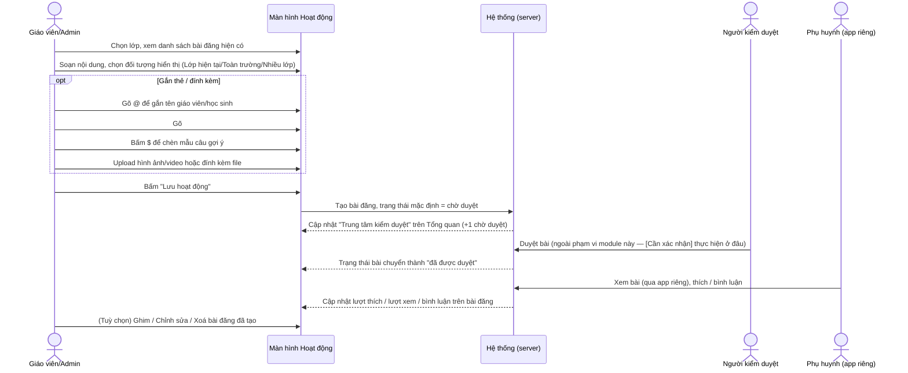
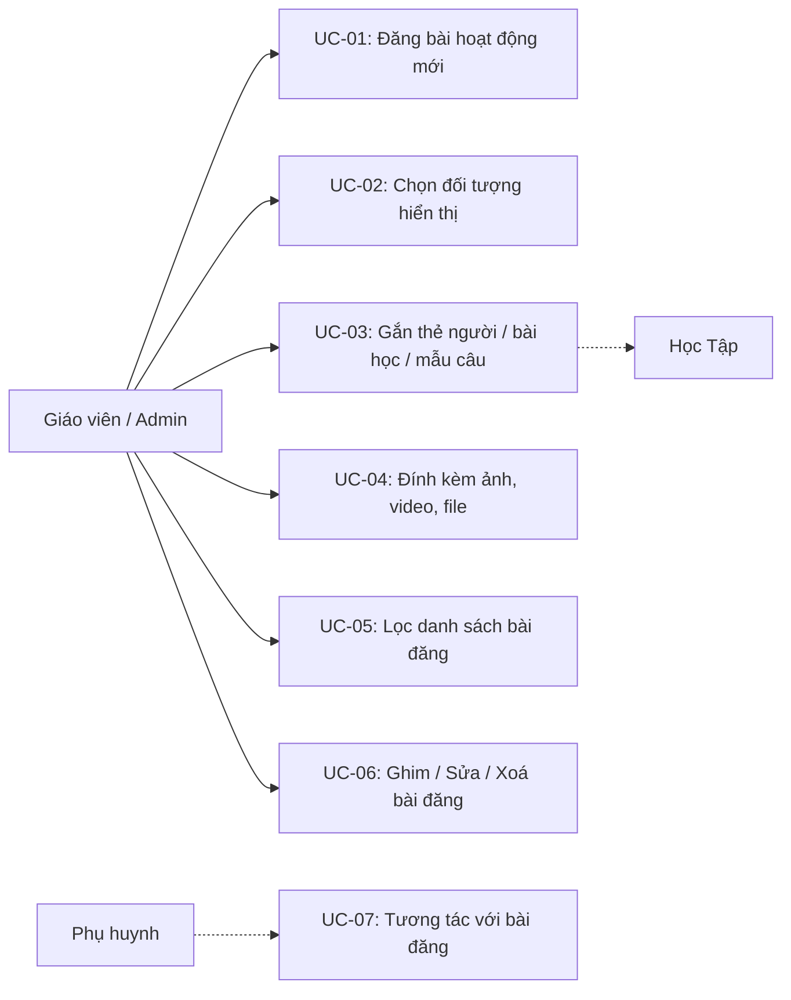
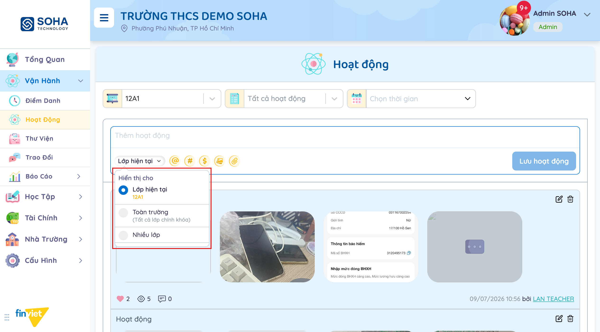
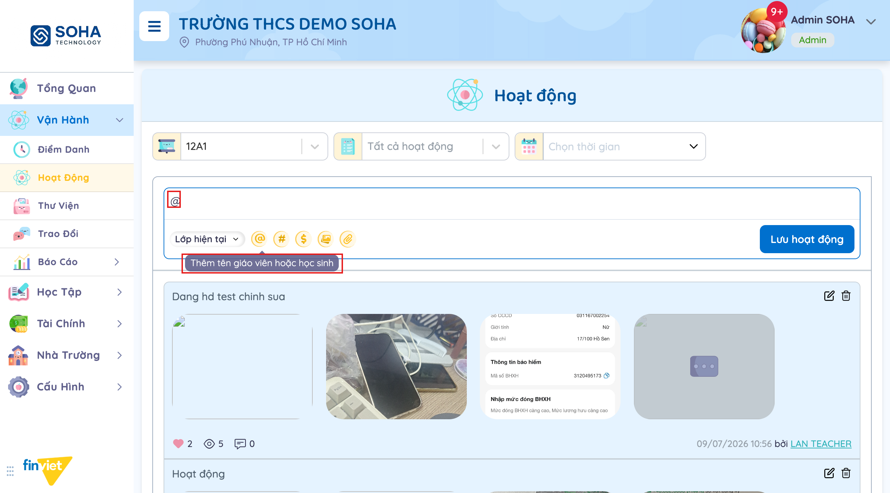
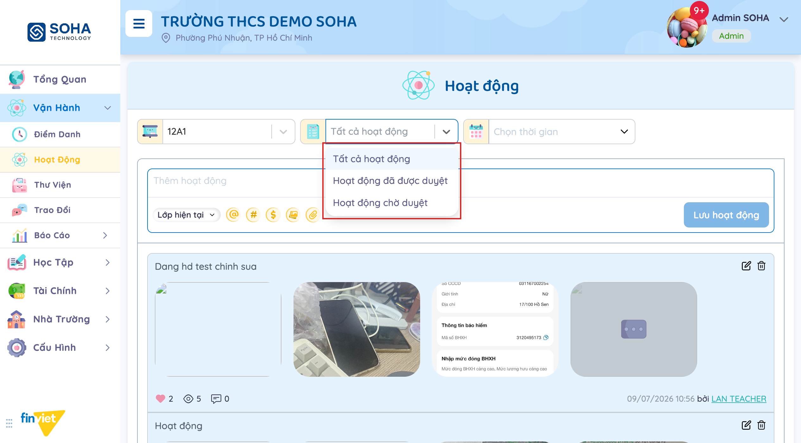
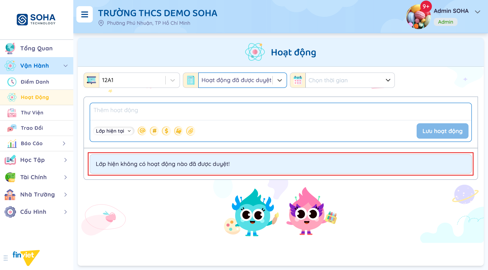

# Tên: Hoạt động (Vận hành)

## Mục lục
- [1. Thông tin tổng quan](#1-thông-tin-tổng-quan)
  - [1.1 Giới thiệu chung](#11-giới-thiệu-chung)
  - [1.2 Mục tiêu](#12-mục-tiêu)
  - [1.3 Phạm vi](#13-phạm-vi)
  - [1.4 Tài liệu tham khảo](#14-tài-liệu-tham-khảo)
- [2. Tổng quan nghiệp vụ](#2-tổng-quan-nghiệp-vụ)
  - [2.1 Đối tượng](#21-đối-tượng)
  - [2.2 Luồng nghiệp vụ](#22-luồng-nghiệp-vụ)
  - [2.3 Nguyên tắc nghiệp vụ](#23-nguyên-tắc-nghiệp-vụ)
- [3. Đặc tả tính năng](#3-đặc-tả-tính-năng)
  - [3.1 Phân rã chức năng](#31-phân-rã-chức-năng)
  - [3.2 Acceptance Criteria](#32-acceptance-criteria)
  - [3.3 Use case](#33-use-case)
  - [3.4 Edge Cases & Error Handling](#34-edge-cases--error-handling)
  - [3.5 Non-functional Requirements](#35-non-functional-requirements)
  - [3.6 Quy ước UI chung](#36-quy-ước-ui-chung)

## 1. Thông tin tổng quan

### 1.1 Giới thiệu chung
Hoạt động là một bảng tin dạng mạng xã hội cho từng lớp học: giáo viên/Admin đăng bài (chữ, ảnh, video, file) kể lại hoạt động trong ngày, phụ huynh xem và tương tác (thích/xem/bình luận) qua app riêng. Mỗi bài đăng có thể gắn tên giáo viên/học sinh, gắn tên bài học (liên kết sang Học Tập), và phải qua một vòng kiểm duyệt trước khi được xem là "đã duyệt".

### 1.2 Mục tiêu
- Cho giáo viên một nơi đăng nhanh nhật ký hoạt động lớp học kèm hình ảnh/video mỗi ngày.
- Cho phép chọn phạm vi hiển thị bài đăng: chỉ lớp hiện tại, toàn trường, hoặc nhiều lớp cùng lúc.
- Gắn kết nội dung hoạt động với đối tượng cụ thể (giáo viên/học sinh) và với bài học trong chương trình học (Học Tập).
- Kiểm duyệt nội dung trước khi công khai (hàng đợi "chờ duyệt" / "đã được duyệt"), khớp với "Trung tâm kiểm duyệt" trên Tổng quan.
- Theo dõi mức độ tương tác của phụ huynh với từng bài đăng (lượt thích, lượt xem, bình luận).

### 1.3 Phạm vi
| In scope | Out of scope |
|---|---|
| Đăng bài hoạt động mới: nội dung chữ, chọn đối tượng hiển thị, gắn @ giáo viên/học sinh, gắn # bài học, chèn $ mẫu câu gợi ý, đính kèm ảnh/video/file | Nội dung chi tiết của "Thư viện" (album ảnh riêng, nhận diện khuôn mặt — xem module Thư Viện) |
| Xem danh sách bài đăng của 1 lớp, lọc theo trạng thái duyệt / lớp / khoảng thời gian | Thao tác duyệt (approve/reject) bài chờ duyệt — không tìm thấy nút duyệt trong màn hình này, nghi ngờ nằm ở "Trung tâm kiểm duyệt" trên Tổng quan [Cần xác nhận ở Phase 4] |
| Xem 3 chỉ số tương tác trên mỗi bài: lượt thích / lượt xem / bình luận | Xem chi tiết ai đã thích, hoặc đọc/trả lời bình luận — không quan sát được UI mở rộng khi bấm vào các số này |
| Ghim / Chỉnh sửa / Xoá bài đăng đã có (icon hiện khi hover) | Nội dung modal Chỉnh sửa/Xoá thực tế — bấm thử không quan sát được thay đổi giao diện rõ ràng, [Cần xác nhận] |
| Panel "Thông tin Bài học" hiển thị cạnh danh sách bài đăng | Nội dung/hành vi panel khi có bài học thật được gắn — dữ liệu demo trống ("Không tìm thấy dữ liệu") |

### 1.4 Tài liệu tham khảo
- [docs/operating-portal/00-inventory.md](../00-inventory.md) — kiểm kê toàn bộ module Phase 1.
- [docs/operating-portal/van-hanh/diem-danh.md](diem-danh.md) — module liền kề trong "Vận hành", cùng gắn với 1 lớp học đang chọn.
- Liên quan: Tổng quan → widget "Trung tâm kiểm duyệt" (đếm số "Hoạt động chờ duyệt" theo từng lớp) và widget "Hoạt động trong tuần" — cùng phản ánh dữ liệu từ module này.
- Liên quan: Học Tập (chưa viết tài liệu riêng) — nơi định nghĩa "bài học" mà tính năng gắn thẻ `#` trong module này tham chiếu tới.
- Liên quan: Thư Viện (chưa viết tài liệu riêng) — cũng cho đăng ảnh/video theo lớp nhưng là album riêng, có nhận diện khuôn mặt; khác với ảnh đính kèm trong 1 bài Hoạt động.

## 2. Tổng quan nghiệp vụ

### 2.1 Đối tượng
| Actor | Vai trò | Trách nhiệm chính |
|---|---|---|
| Giáo viên / Admin trường | Người đăng bài chính | Soạn bài hoạt động, chọn đối tượng hiển thị, gắn thẻ, đính kèm media, ghim/sửa/xoá bài |
| Phụ huynh | Actor gián tiếp (xem qua app riêng, ngoài phạm vi portal này) | Xem bài đăng theo đối tượng được chọn, thích/xem/bình luận — tạo ra 3 chỉ số tương tác hiển thị trên mỗi bài |
| Học sinh / Giáo viên khác | Đối tượng được gắn thẻ | Được nhắc tên qua `@` trong nội dung bài đăng |
| Người kiểm duyệt (Ban giám hiệu/Admin?) | Duyệt nội dung trước khi công khai | [Cần xác nhận] — không xác định được vai trò cụ thể vì không tìm thấy thao tác duyệt trong module này |
| Học Tập (module khác) | Nguồn dữ liệu "bài học" | Cung cấp danh sách bài học để gắn thẻ `#`, hiển thị lại ở panel "Thông tin Bài học" |

### 2.2 Luồng nghiệp vụ

#### 2.2.1 Mô hình hóa nghiệp vụ

#### 2.2.2 Mô tả các bước nghiệp vụ
| Bước | Người thực hiện | Mô tả | Kết quả |
|---|---|---|---|
| 1 | Giáo viên/Admin | Chọn lớp học ở bộ lọc đầu trang | Danh sách bài đăng của lớp được tải, mới nhất trước |
| 2 | Giáo viên/Admin | Gõ nội dung vào ô "Thêm hoạt động" | Nút "Lưu hoạt động" chuyển từ mờ (disabled) sang có thể bấm |
| 3 | Giáo viên/Admin | Chọn đối tượng hiển thị ở dropdown "Lớp hiện tại" | Bài đăng sẽ hiển thị cho Lớp hiện tại / Toàn trường (tất cả lớp chính khóa) / Nhiều lớp |
| 4 | Giáo viên/Admin | (Tuỳ chọn) Gõ `@`, `#`, hoặc bấm `$`, upload ảnh/video, đính kèm file | Gắn thẻ người/bài học, chèn mẫu câu, hoặc đính kèm media vào bài đăng |
| 5 | Giáo viên/Admin | Bấm "Lưu hoạt động" | Bài đăng mới xuất hiện đầu danh sách, trạng thái chờ duyệt |
| 6 | Hệ thống | Đếm bài chờ duyệt theo lớp | Số liệu phản ánh tại widget "Trung tâm kiểm duyệt" trên Tổng quan |
| 7 | Giáo viên/Admin | Lọc lại danh sách theo trạng thái duyệt / lớp / khoảng thời gian | Danh sách bài đăng được thu hẹp tương ứng |
| 8 | Giáo viên/Admin | Hover vào 1 bài đăng, bấm Ghim / Chỉnh sửa / Xoá | [Cần xác nhận] hành vi cụ thể sau khi bấm |

### 2.3 Nguyên tắc nghiệp vụ
| ID | Nguyên tắc nghiệp vụ |
|---|---|
| BR01 | Đối tượng hiển thị bài đăng có 3 lựa chọn: "Lớp hiện tại" (mặc định, chỉ lớp đang chọn), "Toàn trường" (tất cả lớp chính khóa), "Nhiều lớp" (chọn thủ công nhiều lớp — chưa quan sát được UI chọn cụ thể). Một bài đăng cũ quan sát được có nhãn "Hiển thị cho: Toàn trường" xác nhận trường dữ liệu này được lưu và hiển thị lại trên mỗi bài. |
| BR02 | Nút "Lưu hoạt động" bị vô hiệu hoá (disabled) khi ô nội dung trống; chỉ cần gõ ký tự đầu tiên là nút được bật — [Cần xác nhận] liệu chỉ đính kèm ảnh mà không gõ chữ có đủ điều kiện lưu hay không. |
| BR03 | Composer có 3 "ký tự kích hoạt" chèn trực tiếp vào nội dung: `@` (Thêm tên giáo viên hoặc học sinh — gắn thẻ người), `#` (Thêm tên bài học — liên kết sang dữ liệu bài học của module Học Tập), `$` (Gợi ý mẫu câu — chèn mẫu câu dựng sẵn). Cả 3 đều chỉ chèn ký tự kích hoạt vào ô nhập khi bấm icon; danh sách gợi ý cụ thể xuất hiện khi gõ tiếp theo sau ký tự đó [Cần xác nhận nội dung gợi ý vì không có dữ liệu bài học/mẫu câu trong bản demo]. |
| BR04 | Mỗi bài đăng hiển thị đúng 3 chỉ số cố định theo thứ tự: lượt thích (❤), lượt xem (👁), số bình luận (💬), cùng ngày giờ đăng và tên người đăng (dạng link). |
| BR05 | Mỗi bài đăng có thể có nhiều media đính kèm hiển thị dạng dải ảnh ngang trong bài (quan sát được bài có 4 ảnh đính kèm cùng lúc). |
| BR06 | **Quy trình kiểm duyệt:** bài đăng mới mặc định ở trạng thái "chờ duyệt". Đã kiểm chứng trực tiếp: lọc "Hoạt động đã được duyệt" trên lớp 12A1 trả về "Lớp hiện không có hoạt động nào đã được duyệt!" dù danh sách mặc định ("Tất cả hoạt động") đang hiển thị 9 bài — nghĩa là toàn bộ 9 bài này đều đang ở trạng thái chờ duyệt. Không tìm thấy nút Duyệt/Từ chối trong module Hoạt động — khớp với widget "Trung tâm kiểm duyệt" trên Tổng quan (đếm "Hoạt động chờ duyệt" theo từng lớp), nghi ngờ thao tác duyệt thực hiện tại đó [Cần xác nhận ở Phase 4]. |
| BR07 | Mỗi bài đăng có 3 hành động khi hover (icon chỉ hiện khi rê chuột qua, class nội bộ gợi ý `lg:group-hover:flex`): "Ghim hoạt động", "Chỉnh sửa", "Xoá". Bấm thử "Chỉnh sửa"/"Xoá" trong phiên khảo sát không quan sát được modal hay thay đổi giao diện rõ ràng — [Cần xác nhận], có thể do thao tác click lập trình không kích hoạt đúng trạng thái hover cần thiết. |
| BR08 | Panel "Thông tin Bài học" nằm cạnh danh sách bài đăng, dùng để hiển thị chi tiết bài học khi một hoạt động được gắn thẻ `#` — hiện trống ("Không tìm thấy dữ liệu") vì không có bài học nào được gắn trong dữ liệu demo. |
| BR09 | Bộ lọc trạng thái duyệt có 3 giá trị: "Tất cả hoạt động" (mặc định) / "Hoạt động đã được duyệt" / "Hoạt động chờ duyệt" — độc lập với bộ lọc lớp và bộ lọc khoảng thời gian, cả 3 bộ lọc cùng áp dụng đồng thời (AND). |

## 3. Đặc tả tính năng

### 3.1 Phân rã chức năng
| Feature | Platform | Priority | User Story |
|---|---|---|---|
| Đăng bài hoạt động mới | Web | Must | Là giáo viên, tôi muốn đăng nhanh một bài kể lại hoạt động trong ngày kèm ảnh cho phụ huynh xem |
| Chọn đối tượng hiển thị | Web | Must | Là giáo viên, tôi muốn chọn bài đăng chỉ hiển thị cho lớp mình hoặc cho toàn trường |
| Gắn thẻ giáo viên/học sinh (@) | Web | Should | Là giáo viên, tôi muốn nhắc tên học sinh cụ thể trong bài đăng |
| Gắn tên bài học (#) | Web | Could | Là giáo viên, tôi muốn liên kết bài đăng với một bài học cụ thể trong chương trình |
| Chèn mẫu câu gợi ý ($) | Web | Could | Là giáo viên, tôi muốn dùng mẫu câu có sẵn để viết bài nhanh hơn |
| Đính kèm ảnh/video/file | Web | Must | Là giáo viên, tôi muốn minh hoạ bài đăng bằng hình ảnh hoặc video |
| Lọc danh sách bài đăng | Web | Should | Là giáo viên, tôi muốn lọc bài đăng theo lớp, trạng thái duyệt, hoặc khoảng thời gian |
| Ghim / Sửa / Xoá bài đăng | Web | Should | Là giáo viên, tôi muốn ghim bài quan trọng lên đầu, sửa lại hoặc xoá bài đăng nhầm |
| Xem chỉ số tương tác | Web | Could | Là giáo viên, tôi muốn biết bài đăng có bao nhiêu lượt thích/xem/bình luận từ phụ huynh |

### 3.2 Acceptance Criteria
| User Story | Chức năng | Acceptance Criteria |
|---|---|---|
| Đăng bài mới | Thêm hoạt động | Gõ nội dung → nút "Lưu hoạt động" được bật; bấm Lưu → bài mới xuất hiện đầu danh sách, trạng thái chờ duyệt |
| Chọn đối tượng | Hiển thị cho | Dropdown có 3 lựa chọn Lớp hiện tại/Toàn trường/Nhiều lớp; giá trị chọn được lưu và hiển thị lại trên bài đăng nếu khác mặc định |
| Gắn thẻ người | Icon @ | Bấm chèn `@` vào nội dung, gõ tiếp mở gợi ý tên giáo viên/học sinh |
| Gắn bài học | Icon # | Bấm chèn `#` vào nội dung, gõ tiếp mở gợi ý tên bài học |
| Mẫu câu | Icon $ | Bấm chèn `$` vào nội dung, gõ tiếp mở gợi ý mẫu câu dựng sẵn |
| Đính kèm media | Icon ảnh / icon ghim giấy | Mở hộp thoại chọn file tương ứng (ảnh/video hoặc file bất kỳ) |
| Lọc | 3 bộ lọc đầu trang | Chọn lớp / trạng thái duyệt / khoảng thời gian → danh sách cập nhật theo tổ hợp AND của cả 3 |
| Trạng thái duyệt | Bộ lọc trạng thái | "Hoạt động đã được duyệt" chỉ trả về bài đã qua kiểm duyệt; hiện tại trả về rỗng cho lớp 12A1 |

### 3.3 Use case

**UC-01**
| Trường | Nội dung |
|---|---|
| Use case ID | UC-01 |
| Use case name | Đăng bài hoạt động mới |
| Use case description | Giáo viên soạn và đăng một bài hoạt động mới cho lớp |
| Actor | Giáo viên / Admin |
| Happy path | 1. Vào Hoạt động, chọn đúng lớp ở bộ lọc đầu trang.  2. Gõ nội dung vào ô "Thêm hoạt động" — nút "Lưu hoạt động" chuyển sang trạng thái bật. 3. Bấm "Lưu hoạt động". |
| Exception | Chưa quan sát được (không submit để tránh tạo dữ liệu rác trong bản demo) |
| Trigger | Gõ nội dung vào ô soạn bài, bấm "Lưu hoạt động" |
| Pre-condition | Đã chọn đúng lớp cần đăng bài |
| Post-condition | [Cần xác nhận] — suy luận bài mới xuất hiện đầu danh sách với trạng thái chờ duyệt (BR06), chưa xác nhận bằng cách submit thật |
| Business Rules | BR02, BR06 |

**UC-02**
| Trường | Nội dung |
|---|---|
| Use case ID | UC-02 |
| Use case name | Chọn đối tượng hiển thị bài đăng |
| Use case description | Giáo viên chọn phạm vi người xem được bài đăng: lớp hiện tại, toàn trường, hoặc nhiều lớp |
| Actor | Giáo viên / Admin |
| Happy path | 1. Trong composer, bấm dropdown "Lớp hiện tại". 2. Chọn 1 trong 3 lựa chọn: "Lớp hiện tại" (mặc định), "Toàn trường (Tất cả lớp chính khóa)", hoặc "Nhiều lớp".  |
| Exception | Chưa quan sát được hành vi của lựa chọn "Nhiều lớp" (giao diện chọn nhiều lớp cụ thể chưa được mở thử) |
| Trigger | Bấm dropdown "Lớp hiện tại" trong composer |
| Pre-condition | Không có |
| Post-condition | Giá trị chọn được áp dụng cho bài đăng tiếp theo khi lưu; hiển thị lại dưới dạng nhãn "Hiển thị cho: ..." trên bài đăng nếu khác mặc định (quan sát được trên 1 bài cũ với nhãn "Toàn trường") |
| Business Rules | BR01 |

**UC-03**
| Trường | Nội dung |
|---|---|
| Use case ID | UC-03 |
| Use case name | Gắn thẻ người / bài học / mẫu câu khi soạn bài |
| Use case description | Giáo viên dùng 3 ký tự kích hoạt để gắn thẻ hoặc chèn nội dung dựng sẵn vào bài đăng |
| Actor | Giáo viên / Admin; Học Tập (nguồn dữ liệu bài học) |
| Happy path | 1. Trong ô soạn bài, bấm icon `@` để chèn ký tự gắn thẻ người (tooltip "Thêm tên giáo viên hoặc học sinh").  2. Hoặc bấm icon `#` để chèn ký tự gắn bài học (tooltip "Thêm tên bài học"). 3. Hoặc bấm icon `$` để chèn ký tự mở gợi ý mẫu câu (tooltip "Gợi ý mẫu câu"). 4. Gõ tiếp sau ký tự để lọc danh sách gợi ý tương ứng. |
| Exception | Không có dữ liệu bài học/mẫu câu mẫu trong bản demo nên không quan sát được nội dung danh sách gợi ý khi gõ tiếp |
| Trigger | Bấm icon `@`/`#`/`$` trong composer |
| Pre-condition | Không có |
| Post-condition | Ký tự kích hoạt được chèn vào vị trí con trỏ trong ô nội dung |
| Business Rules | BR03, BR08 |

**UC-04**
| Trường | Nội dung |
|---|---|
| Use case ID | UC-04 |
| Use case name | Đính kèm ảnh, video, file |
| Use case description | Giáo viên minh hoạ bài đăng bằng media hoặc tài liệu đính kèm |
| Actor | Giáo viên / Admin |
| Happy path | 1. Bấm icon hình ảnh (tooltip "Upload hình ảnh, video") để chọn ảnh/video từ máy. 2. Hoặc bấm icon ghim giấy (tooltip "File đính kèm") để đính kèm file bất kỳ. |
| Exception | Chưa quan sát được (không thử upload thật để tránh tạo dữ liệu rác) |
| Trigger | Bấm icon ảnh hoặc icon file đính kèm |
| Pre-condition | Không có |
| Post-condition | [Cần xác nhận] — suy luận media/file được thêm vào bài đăng khi lưu, dựa trên bài đăng mẫu có sẵn 4 ảnh đính kèm |
| Business Rules | BR05 |

**UC-05**
| Trường | Nội dung |
|---|---|
| Use case ID | UC-05 |
| Use case name | Lọc danh sách bài đăng |
| Use case description | Giáo viên/Admin thu hẹp danh sách bài đăng theo lớp, trạng thái duyệt, hoặc khoảng thời gian |
| Actor | Giáo viên / Admin |
| Happy path | 1. Chọn lớp ở dropdown đầu tiên. 2. Chọn trạng thái ở dropdown thứ hai: Tất cả hoạt động / Hoạt động đã được duyệt / Hoạt động chờ duyệt.  3. Chọn khoảng thời gian ở ô "Chọn thời gian". 4. Danh sách bài đăng cập nhật theo tổ hợp cả 3 bộ lọc.  |
| Exception | Không có (đã kiểm chứng: lọc "đã được duyệt" trả về thông báo rỗng hợp lệ, không phải lỗi) |
| Trigger | Thay đổi 1 trong 3 bộ lọc |
| Pre-condition | Không có |
| Post-condition | Danh sách bài đăng hiển thị đúng tập con thoả tất cả bộ lọc đang chọn |
| Business Rules | BR06, BR09 |

**UC-06**
| Trường | Nội dung |
|---|---|
| Use case ID | UC-06 |
| Use case name | Ghim / Chỉnh sửa / Xoá bài đăng |
| Use case description | Giáo viên quản lý lại bài đăng đã tạo |
| Actor | Giáo viên / Admin |
| Happy path | 1. Di chuột qua 1 bài đăng để hiện 3 icon hành động ở góc trên bên phải. 2. Bấm "Ghim hoạt động", "Chỉnh sửa", hoặc "Xoá". |
| Exception | Bấm thử "Chỉnh sửa" và "Xoá" (qua thao tác click lập trình) không quan sát được modal hay thay đổi giao diện — [Cần xác nhận], nhiều khả năng cần trạng thái hover thật từ chuột thay vì click lập trình |
| Trigger | Hover vào bài đăng, bấm 1 trong 3 icon |
| Pre-condition | Đang xem ít nhất 1 bài đăng |
| Post-condition | [Cần xác nhận] |
| Business Rules | BR07 |

**UC-07**
| Trường | Nội dung |
|---|---|
| Use case ID | UC-07 |
| Use case name | Tương tác với bài đăng (thích / xem / bình luận) |
| Use case description | Phụ huynh tương tác với bài đăng qua app riêng, số liệu phản ánh lại trên portal |
| Actor | Phụ huynh (gián tiếp); Giáo viên / Admin (người xem số liệu) |
| Happy path | 1. Phụ huynh xem/thích/bình luận bài đăng qua app phụ huynh (ngoài phạm vi portal này). 2. Giáo viên/Admin xem lại 3 chỉ số (❤ lượt thích, 👁 lượt xem, 💬 bình luận) ngay dưới mỗi bài đăng trên portal. |
| Exception | Không quan sát được UI xem chi tiết danh sách người thích/bình luận — bấm vào số liệu trong phiên khảo sát không có phản hồi rõ ràng |
| Trigger | Không có (giáo viên/Admin chỉ xem thụ động) |
| Pre-condition | Bài đăng đã được phụ huynh tương tác |
| Post-condition | Không thay đổi dữ liệu, chỉ xem |
| Business Rules | BR04 |

### 3.4 Edge Cases & Error Handling

#### 3.4.1 Tổng quan
| Nhóm | Tình huống | Xử lý mong đợi |
|---|---|---|
| Lọc rỗng | Lọc "Hoạt động đã được duyệt" cho lớp chưa có bài nào được duyệt | Hiển thị thông báo dạng câu đầy đủ "Lớp hiện không có hoạt động nào đã được duyệt!" thay vì bảng trống không giải thích |
| Đăng bài không nội dung | Chưa gõ gì vào ô soạn bài | Nút "Lưu hoạt động" ở trạng thái disabled, không thể bấm |
| Chỉnh sửa/Xoá | Bấm icon Chỉnh sửa/Xoá | Chưa quan sát được — [Cần xác nhận] |

#### 3.4.2 Danh sách Thông báo (lỗi/thành công)
| Message ID | Trường hợp lỗi | Rule kiểm tra | Message đề xuất | Hình thức báo | Hành vi hệ thống |
|---|---|---|---|---|---|
| — | Không có | Không có | Không quan sát được thông báo lỗi/thành công nào (không submit dữ liệu thật trong phiên khảo sát) | — | — |

Thông báo trạng thái (không phải lỗi) quan sát được: **"Lớp hiện không có hoạt động nào đã được duyệt!"** — hiển thị dạng khối văn bản thay cho danh sách khi bộ lọc trạng thái không khớp bài đăng nào (xem BR06).

### 3.5 Non-functional Requirements
| ID | Nhóm | Yêu cầu |
|---|---|---|
| NFR01 | Hiệu năng | Bộ lọc (lớp/trạng thái/thời gian) cập nhật danh sách ngay khi chọn, không cần bấm nút "Áp dụng" riêng |
| NFR02 | Ngôn ngữ | Giao diện tiếng Việt hoàn toàn, kể cả tooltip hướng dẫn từng icon |
| NFR03 | Khả dụng | Composer luôn cố định ở đầu danh sách bài đăng, không cần cuộn tìm |

### 3.6 Quy ước UI chung
- Bộ lọc luôn đặt thành hàng ngang đầu trang: lớp → trạng thái/loại → khoảng thời gian, giống bố cục đã thấy ở Điểm danh.
- Composer dùng chung một mẫu: ô nhập đa dòng ở trên, thanh công cụ icon + nút hành động chính ở dưới, nút hành động chính nằm bên phải và disabled cho tới khi có nội dung hợp lệ.
- Các icon chức năng trong composer đều có tooltip giải thích khi hover — không có nhãn chữ đi kèm icon.
- Hành động quản lý bài đăng đã tạo (Ghim/Sửa/Xoá) ẩn mặc định, chỉ hiện khi hover vào bài đăng — không chiếm diện tích giao diện khi không cần dùng tới.
- Trạng thái rỗng (không có dữ liệu khớp bộ lọc) hiển thị bằng câu văn đầy đủ có ngữ cảnh (vd. "Lớp hiện không có hoạt động nào đã được duyệt!") thay vì bảng trống hoặc từ chung chung "Không có dữ liệu".
