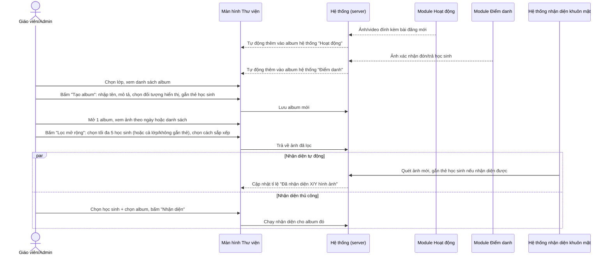
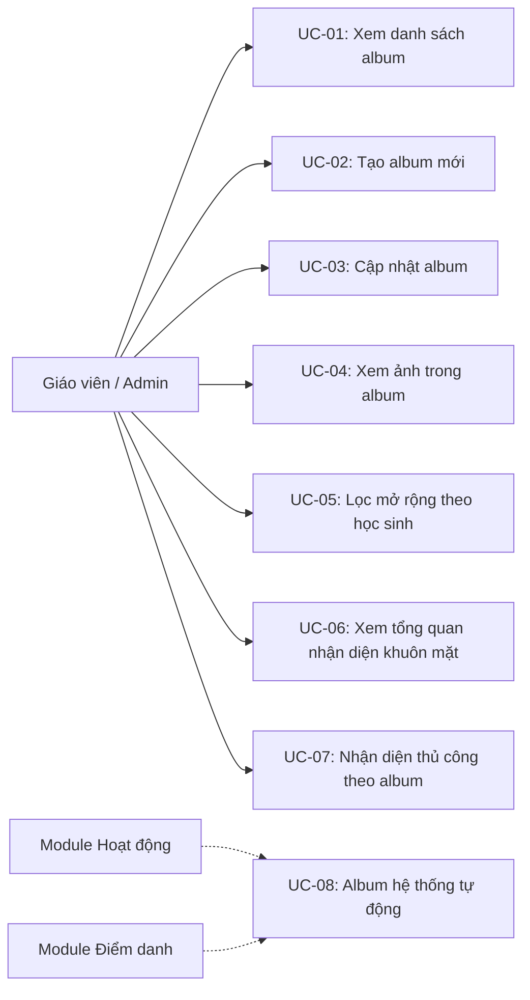
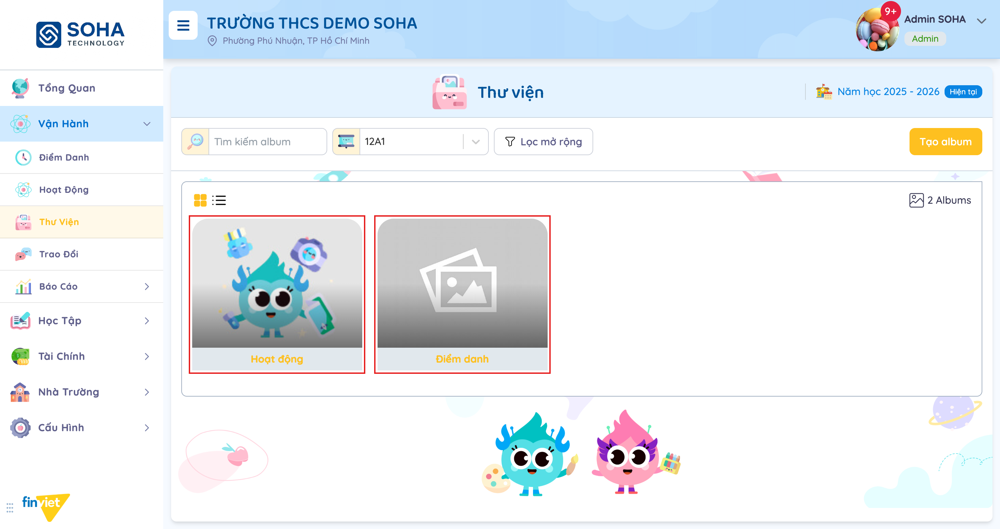
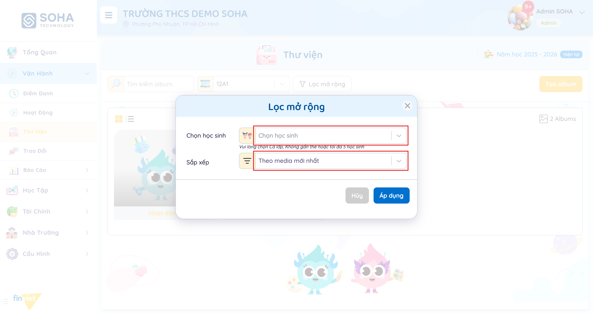

# Tên: Thư viện (Vận hành)

## Mục lục
- [1. Thông tin tổng quan](#1-thông-tin-tổng-quan)
  - [1.1 Giới thiệu chung](#11-giới-thiệu-chung)
  - [1.2 Mục tiêu](#12-mục-tiêu)
  - [1.3 Phạm vi](#13-phạm-vi)
  - [1.4 Tài liệu tham khảo](#14-tài-liệu-tham-khảo)
- [2. Tổng quan nghiệp vụ](#2-tổng-quan-nghiệp-vụ)
  - [2.1 Đối tượng](#21-đối-tượng)
  - [2.2 Luồng nghiệp vụ](#22-luồng-nghiệp-vụ)
  - [2.3 Nguyên tắc nghiệp vụ](#23-nguyên-tắc-nghiệp-vụ)
- [3. Đặc tả tính năng](#3-đặc-tả-tính-năng)
  - [3.1 Phân rã chức năng](#31-phân-rã-chức-năng)
  - [3.2 Acceptance Criteria](#32-acceptance-criteria)
  - [3.3 Use case](#33-use-case)
  - [3.4 Edge Cases & Error Handling](#34-edge-cases--error-handling)
  - [3.5 Non-functional Requirements](#35-non-functional-requirements)
  - [3.6 Quy ước UI chung](#36-quy-ước-ui-chung)

## 1. Thông tin tổng quan

### 1.1 Giới thiệu chung
Thư viện là kho album ảnh/video theo từng lớp học. Mỗi lớp luôn có sẵn 2 album hệ thống tự tạo ("Hoạt động" và "Điểm danh", gộp media từ 2 module cùng tên), và giáo viên/Admin có thể tạo thêm album tuỳ ý. Module này còn tích hợp tính năng nhận diện khuôn mặt để tự động (hoặc thủ công) gắn ảnh cho đúng học sinh.

### 1.2 Mục tiêu
- Lưu trữ và tổ chức ảnh/video của lớp theo album, có thể xem theo ngày hoặc dạng danh sách.
- Tự động gom ảnh từ 2 nguồn khác: bài đăng "Hoạt động" và ảnh xác nhận đón/trả của "Điểm danh" — không phải giáo viên tự tay sắp xếp.
- Cho phép tạo album riêng, chọn phạm vi hiển thị (lớp hiện tại/toàn trường/nhiều lớp) và gắn thẻ học sinh cho cả album.
- Lọc nhanh ảnh theo học sinh cụ thể (tối đa 5) hoặc ảnh chưa gắn thẻ ai.
- Theo dõi và hỗ trợ nhận diện khuôn mặt học sinh trong ảnh (tự động + thủ công).

### 1.3 Phạm vi
| In scope | Out of scope |
|---|---|
| Xem danh sách album của 1 lớp, tìm kiếm album, lọc mở rộng theo học sinh/sắp xếp | Xem album ở phạm vi "Toàn trường" từ màn hình khác (vd. trang tổng hợp toàn trường) — chưa quan sát |
| Tạo album mới: tên, mô tả, đối tượng hiển thị, gắn thẻ học sinh | Duyệt nội dung ảnh trước khi hiển thị (không quan sát thấy cơ chế duyệt như module Hoạt động) |
| Cập nhật (đổi tên/mô tả/đối tượng) album đã có | Xoá album — không tìm thấy nút xoá trong phiên khảo sát |
| Mở album, xem ảnh nhóm theo ngày đăng + người đăng, chọn (checkbox) từng ảnh | Xem ảnh phóng to/lightbox, tải ảnh xuống, xoá từng ảnh — không quan sát được hành vi khi bấm vào ảnh (chỉ thấy chọn/bỏ chọn) |
| Xem sự tồn tại của tính năng tổng quan nhận diện khuôn mặt và nhận diện thủ công theo album (nội dung xác nhận được qua cấu trúc trang) | Cách mở các màn hình đó từ giao diện — không xác định được nút/thao tác kích hoạt trong phiên khảo sát này [Cần xác nhận] |

### 1.4 Tài liệu tham khảo
- [docs/operating-portal/00-inventory.md](../00-inventory.md) — kiểm kê toàn bộ module Phase 1.
- [docs/operating-portal/van-hanh/diem-danh.md](diem-danh.md) — nguồn của album hệ thống "Điểm danh"; màn "Lịch sử nhận diện" ở đó có tính năng "Nhận diện bằng tay" tương tự modal "Nhận diện hình ảnh trẻ" ở đây, chỉ khác ngữ cảnh (theo ngày thay vì theo album).
- [docs/operating-portal/van-hanh/hoat-dong.md](hoat-dong.md) — nguồn của album hệ thống "Hoạt động"; đã đối chiếu trực tiếp: ảnh trong album "Hoạt động" ngày 21/05/2026 14:06 do "Tran Pham" đăng khớp chính xác với bài đăng "Các bé vui chơi thỏa thích sáng tạo" cùng thời điểm, cùng tác giả trong tài liệu Hoạt động.
- Liên quan: Cấu hình → Nhận diện (đăng ký ảnh khuôn mặt học sinh dùng làm dữ liệu gốc để nhận diện — chưa viết tài liệu riêng).

## 2. Tổng quan nghiệp vụ

### 2.1 Đối tượng
| Actor | Vai trò | Trách nhiệm chính |
|---|---|---|
| Giáo viên / Admin trường | Người quản lý chính | Tạo/sửa album, xem ảnh, lọc, dùng tính năng nhận diện khuôn mặt |
| Học sinh | Đối tượng được gắn thẻ | Được gắn thẻ vào album hoặc từng ảnh; là đối tượng của nhận diện khuôn mặt |
| Module Hoạt động | Nguồn dữ liệu tự động | Mọi ảnh/video đính kèm bài đăng Hoạt động tự động xuất hiện trong album hệ thống "Hoạt động" |
| Module Điểm danh | Nguồn dữ liệu tự động | Ảnh xác nhận đón/trả học sinh tự động xuất hiện trong album hệ thống "Điểm danh" |
| Hệ thống nhận diện khuôn mặt | Xử lý tự động + hỗ trợ thủ công | Tính tỉ lệ ảnh đã nhận diện theo từng học sinh; cho phép Admin nhận diện thủ công theo album |
| Phụ huynh | Actor gián tiếp (ngoài phạm vi portal) | Xem ảnh qua app riêng — không quan sát trực tiếp trong phiên khảo sát |

### 2.2 Luồng nghiệp vụ

#### 2.2.1 Mô hình hóa nghiệp vụ

#### 2.2.2 Mô tả các bước nghiệp vụ
| Bước | Người thực hiện | Mô tả | Kết quả |
|---|---|---|---|
| 1 | Hệ thống | Khi có bài đăng Hoạt động mới hoặc ảnh xác nhận đón/trả mới | Ảnh/video tự động thêm vào album hệ thống tương ứng, không cần thao tác thủ công |
| 2 | Giáo viên/Admin | Chọn lớp học ở bộ lọc đầu trang | Danh sách album của lớp được tải |
| 3 | Giáo viên/Admin | Bấm "Tạo album", điền tên/mô tả, chọn đối tượng hiển thị, gắn thẻ học sinh (tuỳ chọn) | Album mới xuất hiện trong danh sách |
| 4 | Giáo viên/Admin | Bấm vào 1 album để mở | Xem ảnh/video trong album, nhóm theo ngày đăng |
| 5 | Giáo viên/Admin | Bấm "Lọc mở rộng", chọn học sinh (tối đa 5, hoặc Cả lớp/Không gắn thẻ) và cách sắp xếp | Danh sách ảnh trong album được lọc lại |
| 6 | Giáo viên/Admin | (Tuỳ chọn) Bấm vào ảnh để chọn (checkbox) | Ảnh được đánh dấu chọn — [Cần xác nhận] hành động tiếp theo sau khi chọn |
| 7 | Hệ thống | Quét ảnh mới upload, đối chiếu với dữ liệu khuôn mặt đã đăng ký | Cập nhật tỉ lệ nhận diện và số ảnh theo từng học sinh |
| 8 | Giáo viên/Admin | (Khi cần) Yêu cầu nhận diện thủ công: chọn học sinh + chọn album | Hệ thống chạy nhận diện cho album đó — [Cần xác nhận] cách mở màn hình này |

### 2.3 Nguyên tắc nghiệp vụ
| ID | Nguyên tắc nghiệp vụ |
|---|---|
| BR01 | Mỗi lớp học luôn có sẵn (tối thiểu) 2 album hệ thống không cần tạo tay: **"Hoạt động"** (gộp mọi ảnh/video đính kèm bài đăng của module Hoạt động) và **"Điểm danh"** (gộp ảnh phát sinh từ xác nhận đón/trả của module Điểm danh). Đã đối chiếu trực tiếp và khớp chính xác thời gian + tác giả giữa 1 ảnh trong album "Hoạt động" và 1 bài đăng Hoạt động tương ứng (xem 1.4). |
| BR02 | Tạo album mới yêu cầu chọn đối tượng hiển thị theo đúng 3 lựa chọn dùng chung với module Hoạt động: "Lớp hiện tại", "Toàn trường (Tất cả lớp chính khóa)", "Nhiều lớp" — cho thấy đây là một cơ chế "Hiển thị cho" thống nhất toàn hệ thống, không riêng module nào. |
| BR03 | Album (khác với bài đăng Hoạt động) có thêm trường "Gắn thẻ học sinh" ngay khi tạo — gắn thẻ ở cấp album chứ không chỉ ở từng ảnh riêng lẻ. |
| BR04 | Bên trong 1 album, ảnh/video được nhóm theo ngày đăng, mỗi nhóm hiển thị tên người đăng (dạng link) và thời gian đăng — cùng khuôn mẫu hiển thị với bài đăng Hoạt động (tên + thời gian). |
| BR05 | Album hỗ trợ 2 chế độ xem xác nhận qua tooltip: "Album theo ngày" (mặc định, nhóm theo ngày) và "Album dạng danh sách" (danh sách phẳng). Album hệ thống "Điểm danh" chỉ hiển thị nút xem "dạng danh sách", không có nút "theo ngày" — [Cần xác nhận] có phải mặc định luôn là danh sách cho loại album này. |
| BR06 | "Lọc mở rộng" trong 1 album giới hạn chọn học sinh: **tối đa 5 học sinh cụ thể**, hoặc 2 lựa chọn đặc biệt "Cả lớp" / "Không gắn thẻ" (nguyên văn placeholder: "Vui lòng chọn Cả lớp, Không gắn thẻ hoặc tối đa 5 học sinh") — không cho chọn quá 5 học sinh cùng lúc. Kèm 1 lựa chọn sắp xếp, mặc định "Theo media mới nhất" [Cần xác nhận các lựa chọn sắp xếp khác]. |
| BR07 | Bấm vào ảnh trong album chỉ **chọn/bỏ chọn** ảnh đó (hiện icon dấu tích ở góc), không mở ảnh phóng to — khác với các gallery ảnh thông thường. [Cần xác nhận] hành động khả dụng sau khi chọn (không quan sát được thanh công cụ hàng loạt xuất hiện trong phiên khảo sát). |
| BR08 | Tồn tại một màn hình tổng quan nhận diện khuôn mặt (tiêu đề "Nhận diện hình ảnh") hiển thị tỉ lệ tổng "Đã có 70/100 hình ảnh được nhận diện" và bảng liệt kê từng học sinh trong lớp kèm số ảnh nhận diện được của em đó, với 2 hành động mỗi dòng: "Xem thêm" và "Di chuyển hình ảnh" (di chuyển ảnh gắn nhầm sang học sinh khác — suy luận từ tên hành động). Xác nhận được nội dung này tồn tại qua cấu trúc trang (DOM), nhưng **không xác định được nút/thao tác nào trên giao diện mở nó ra** trong phiên khảo sát — [Cần xác nhận]. |
| BR09 | Tồn tại một modal "Nhận diện hình ảnh trẻ" cho nhận diện thủ công: chọn 1 học sinh + chọn 1 album, bấm "Nhận diện" để chạy nhận diện khuôn mặt cho toàn bộ album đó. Cùng bản chất với "Nhận diện bằng tay" ở màn Điểm danh → Lịch sử nhận diện (xem tài liệu Điểm danh), nhưng ở đó chọn theo ngày/loại hình ảnh thay vì theo album, và có thêm lựa chọn nhận diện cho Nhân viên. **Không xác định được nút mở modal này** trong phiên khảo sát — [Cần xác nhận]. |

## 3. Đặc tả tính năng

### 3.1 Phân rã chức năng
| Feature | Platform | Priority | User Story |
|---|---|---|---|
| Xem danh sách album của lớp | Web | Must | Là giáo viên, tôi muốn xem tất cả album ảnh của lớp mình đang phụ trách |
| Tạo album mới | Web | Must | Là giáo viên, tôi muốn tạo album riêng để sắp xếp ảnh theo chủ đề |
| Cập nhật album | Web | Should | Là giáo viên, tôi muốn đổi tên/mô tả album nếu đặt sai |
| Xem ảnh trong album | Web | Must | Là giáo viên, tôi muốn xem lại ảnh đã đăng, nhóm theo ngày |
| Lọc ảnh theo học sinh | Web | Should | Là giáo viên, tôi muốn xem nhanh ảnh của 1 vài học sinh cụ thể |
| Xem tổng quan nhận diện khuôn mặt | Web | Could | Là Admin, tôi muốn biết bao nhiêu ảnh đã nhận diện được học sinh nào |
| Nhận diện thủ công theo album | Web | Could | Là Admin, tôi muốn yêu cầu hệ thống nhận diện lại 1 album cụ thể cho 1 học sinh |
| Album hệ thống tự động (Hoạt động, Điểm danh) | Web | Must | Là giáo viên, tôi không muốn phải tự tay gom ảnh đã đăng ở nơi khác vào Thư viện |

### 3.2 Acceptance Criteria
| User Story | Chức năng | Acceptance Criteria |
|---|---|---|
| Xem danh sách album | Trang Thư viện | Chọn lớp → hiển thị đúng số lượng album ("X Albums") của lớp đó, gồm cả 2 album hệ thống |
| Tạo album | Tạo album | Điền Tên album (bắt buộc) → nút "Tạo album" được bật; chọn đối tượng hiển thị và gắn thẻ học sinh là tuỳ chọn |
| Cập nhật album | Cập nhật album | Sửa Tên/Mô tả/đối tượng hiển thị → nút "Cập nhật" được bật |
| Xem ảnh | Mở album | Ảnh nhóm theo ngày, mỗi nhóm có tên người đăng + thời gian |
| Lọc theo học sinh | Lọc mở rộng | Không cho chọn quá 5 học sinh cùng lúc; chọn "Cả lớp" hoặc "Không gắn thẻ" loại trừ việc chọn học sinh cụ thể |
| Album hệ thống | Album "Hoạt động"/"Điểm danh" | Tự động xuất hiện, không có nút xoá, nội dung khớp với dữ liệu gốc ở module tương ứng |

### 3.3 Use case

**UC-01**
| Trường | Nội dung |
|---|---|
| Use case ID | UC-01 |
| Use case name | Xem danh sách album của lớp |
| Use case description | Giáo viên/Admin xem toàn bộ album ảnh của 1 lớp |
| Actor | Giáo viên / Admin |
| Happy path | 1. Vào Thư viện, chọn lớp ở bộ lọc.  2. Xem lưới album, mỗi thẻ hiển thị ảnh đại diện + tên album. 3. (Tuỳ chọn) Gõ từ khoá vào ô "Tìm kiếm album", hoặc chuyển chế độ xem lưới/danh sách. |
| Exception | Không quan sát được |
| Trigger | Chọn lớp học |
| Pre-condition | Không có |
| Post-condition | Danh sách album hiển thị đúng lớp đã chọn |
| Business Rules | BR01 |

**UC-02**
| Trường | Nội dung |
|---|---|
| Use case ID | UC-02 |
| Use case name | Tạo album mới |
| Use case description | Giáo viên/Admin tạo một album ảnh riêng cho lớp |
| Actor | Giáo viên / Admin |
| Happy path | 1. Bấm nút "Tạo album" ở góc phải. 2. Nhập Tên album, Mô tả (tuỳ chọn). 3. Chọn đối tượng hiển thị: Lớp hiện tại / Toàn trường / Nhiều lớp. 4. (Tuỳ chọn) Gắn thẻ học sinh cho cả album. 5. Bấm "Tạo album" (không thực hiện trong phiên khảo sát để tránh tạo dữ liệu rác). |
| Exception | Chưa quan sát được |
| Trigger | Bấm nút "Tạo album" |
| Pre-condition | Đã chọn lớp |
| Post-condition | [Cần xác nhận] — chưa submit để xác nhận |
| Business Rules | BR02, BR03 |

**UC-03**
| Trường | Nội dung |
|---|---|
| Use case ID | UC-03 |
| Use case name | Cập nhật album |
| Use case description | Giáo viên/Admin sửa lại thông tin album đã tạo |
| Actor | Giáo viên / Admin |
| Happy path | 1. Mở album cần sửa. 2. Bấm hành động "Cập nhật album" (chưa xác định rõ nút kích hoạt trên giao diện chính, xác nhận được qua cấu trúc modal). 3. Sửa Tên/Mô tả/đối tượng hiển thị, bấm "Cập nhật". |
| Exception | Chưa quan sát được |
| Trigger | [Cần xác nhận] |
| Pre-condition | Đang xem 1 album do người dùng tự tạo (không áp dụng cho 2 album hệ thống — không thấy nút sửa khi mở album "Hoạt động"/"Điểm danh") |
| Post-condition | [Cần xác nhận] |
| Business Rules | BR02 |

**UC-04**
| Trường | Nội dung |
|---|---|
| Use case ID | UC-04 |
| Use case name | Xem ảnh trong album |
| Use case description | Giáo viên/Admin mở 1 album để xem ảnh/video bên trong |
| Actor | Giáo viên / Admin |
| Happy path | 1. Bấm vào 1 album trong danh sách. 2. Hệ thống chuyển sang trang album, ảnh nhóm theo ngày đăng, kèm tên người đăng + thời gian. 3. Bấm vào 1 ảnh để chọn (hiện dấu tích ở góc). |
| Exception | Bấm vào ảnh chỉ chọn/bỏ chọn, không phóng to xem chi tiết — [Cần xác nhận] hành động khả dụng sau khi chọn |
| Trigger | Bấm vào 1 album |
| Pre-condition | Album có ít nhất 1 ảnh |
| Post-condition | Ảnh được đánh dấu chọn |
| Business Rules | BR04, BR07 |

**UC-05**
| Trường | Nội dung |
|---|---|
| Use case ID | UC-05 |
| Use case name | Lọc mở rộng theo học sinh |
| Use case description | Giáo viên/Admin thu hẹp ảnh trong album theo học sinh cụ thể hoặc sắp xếp lại |
| Actor | Giáo viên / Admin |
| Happy path | 1. Bấm nút "Lọc mở rộng". 2. Chọn học sinh (tối đa 5) hoặc "Cả lớp"/"Không gắn thẻ"; chọn cách sắp xếp.  3. Bấm "Áp dụng". |
| Exception | Không quan sát được thông báo lỗi khi chọn quá 5 học sinh (không thử vượt giới hạn) |
| Trigger | Bấm nút "Lọc mở rộng" |
| Pre-condition | Không có |
| Post-condition | [Cần xác nhận] — chưa bấm Áp dụng để xác nhận |
| Business Rules | BR06 |

**UC-06**
| Trường | Nội dung |
|---|---|
| Use case ID | UC-06 |
| Use case name | Xem tổng quan nhận diện khuôn mặt |
| Use case description | Admin xem tỉ lệ ảnh đã nhận diện và số ảnh theo từng học sinh trong lớp |
| Actor | Giáo viên / Admin |
| Happy path | [Cần xác nhận] — xác nhận được nội dung tồn tại (tỉ lệ "Đã có 70/100 hình ảnh được nhận diện", bảng học sinh + số ảnh + hành động "Xem thêm"/"Di chuyển hình ảnh") qua cấu trúc trang, nhưng không xác định được thao tác nào trên giao diện chính mở ra màn hình này trong phiên khảo sát. |
| Exception | Không áp dụng |
| Trigger | [Cần xác nhận] |
| Pre-condition | [Cần xác nhận] |
| Post-condition | Không thay đổi dữ liệu, chỉ xem |
| Business Rules | BR08 |

**UC-07**
| Trường | Nội dung |
|---|---|
| Use case ID | UC-07 |
| Use case name | Nhận diện thủ công theo album |
| Use case description | Admin yêu cầu hệ thống chạy nhận diện khuôn mặt cho 1 học sinh trong 1 album cụ thể |
| Actor | Giáo viên / Admin |
| Happy path | [Cần xác nhận] — xác nhận được nội dung modal tồn tại (chọn trẻ, chọn album, nút "Nhận diện") qua cấu trúc trang, nhưng không xác định được nút mở modal này trên giao diện chính trong phiên khảo sát. |
| Exception | Không áp dụng |
| Trigger | [Cần xác nhận] |
| Pre-condition | [Cần xác nhận] |
| Post-condition | [Cần xác nhận] |
| Business Rules | BR09 |

**UC-08**
| Trường | Nội dung |
|---|---|
| Use case ID | UC-08 |
| Use case name | Album hệ thống tự động (Hoạt động, Điểm danh) |
| Use case description | Hệ thống tự động gom ảnh/video từ 2 module khác vào album tương ứng, không cần thao tác thủ công |
| Actor | Module Hoạt động; Module Điểm danh (hệ thống) |
| Happy path | 1. Người dùng đăng bài Hoạt động kèm ảnh, hoặc hệ thống ghi nhận ảnh xác nhận đón/trả ở Điểm danh. 2. Ảnh tự động xuất hiện trong album "Hoạt động" hoặc "Điểm danh" tương ứng của đúng lớp, không cần Admin can thiệp. |
| Exception | Không quan sát được |
| Trigger | Hành động ở module nguồn (Hoạt động hoặc Điểm danh), không phải ở Thư viện |
| Pre-condition | Không có |
| Post-condition | Album hệ thống có thêm ảnh mới |
| Business Rules | BR01 |

### 3.4 Edge Cases & Error Handling

#### 3.4.1 Tổng quan
| Nhóm | Tình huống | Xử lý mong đợi |
|---|---|---|
| Album hệ thống không có nút sửa/xoá | Mở album "Hoạt động" hoặc "Điểm danh" | Không quan sát thấy hành động Cập nhật/Xoá — khác với album tự tạo |
| Lọc quá 5 học sinh | Chọn học sinh thứ 6 trong "Lọc mở rộng" | Chưa quan sát được (không thử vượt giới hạn) |
| Album "Điểm danh" hiển thị dạng danh sách | Mở album "Điểm danh" | Chỉ có nút xem "dạng danh sách", không có "theo ngày" như album khác — [Cần xác nhận] |

#### 3.4.2 Danh sách Thông báo (lỗi/thành công)
| Message ID | Trường hợp lỗi | Rule kiểm tra | Message đề xuất | Hình thức báo | Hành vi hệ thống |
|---|---|---|---|---|---|
| — | Không có | Không có | Không quan sát được thông báo lỗi/thành công nào (không submit dữ liệu thật trong phiên khảo sát) | — | — |

### 3.5 Non-functional Requirements
| ID | Nhóm | Yêu cầu |
|---|---|---|
| NFR01 | Hiệu năng | Chuyển đổi chế độ xem (lưới/danh sách, theo ngày/danh sách) không cần tải lại trang |
| NFR02 | Ngôn ngữ | Giao diện tiếng Việt hoàn toàn |
| NFR03 | Nhất quán | Cơ chế "Hiển thị cho" (Lớp hiện tại/Toàn trường/Nhiều lớp) dùng chung định dạng với module Hoạt động, giúp người dùng không phải học lại |

### 3.6 Quy ước UI chung
- Bộ lọc lớp luôn ở dạng dropdown gần đầu trang, đi kèm ô tìm kiếm và nút "Lọc mở rộng" mở modal riêng thay vì mở rộng inline.
- Modal tạo/sửa đều dùng chung bố cục: các trường nhập ở trên, "Hủy bỏ" (xám) bên trái và nút hành động chính (màu) bên phải ở cuối modal, nút hành động chính disabled cho tới khi đủ dữ liệu bắt buộc.
- Album/ảnh hiển thị 2 chế độ xem có thể chuyển đổi bằng 2 icon nhỏ cạnh nhau (lưới/danh sách ở cấp album, theo ngày/danh sách ở trong 1 album).
- Nhiều thành phần giao diện (bảng tổng quan nhận diện, modal nhận diện thủ công) được render sẵn trong DOM nhưng ẩn cho tới khi có một thao tác kích hoạt cụ thể — nhất quán với cách Điểm danh và Hoạt động dựng modal, nhưng ở Thư viện phiên khảo sát này chưa xác định được nút kích hoạt cho 2 modal liên quan đến nhận diện khuôn mặt.
