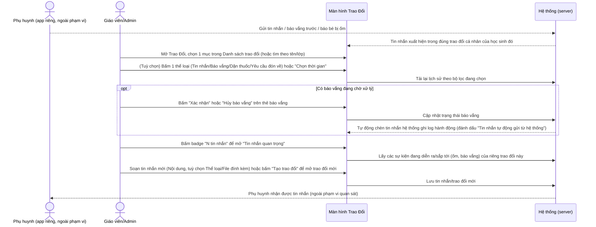
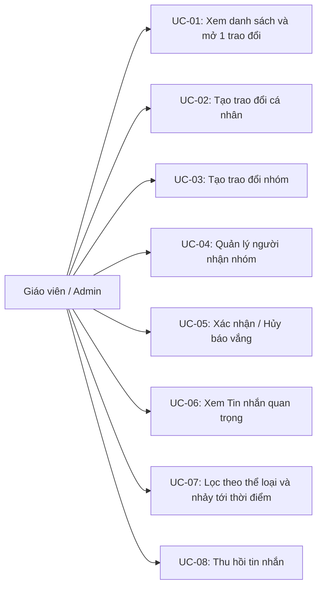
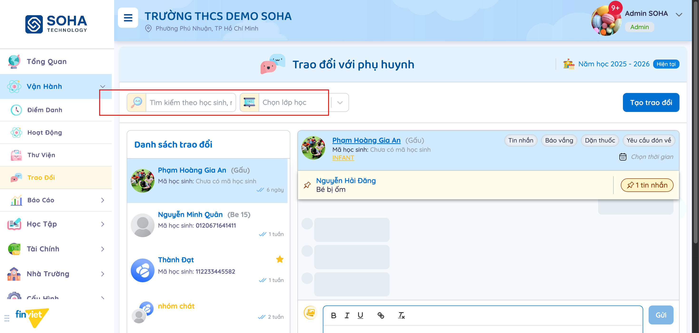
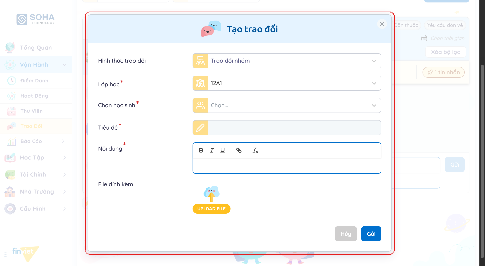
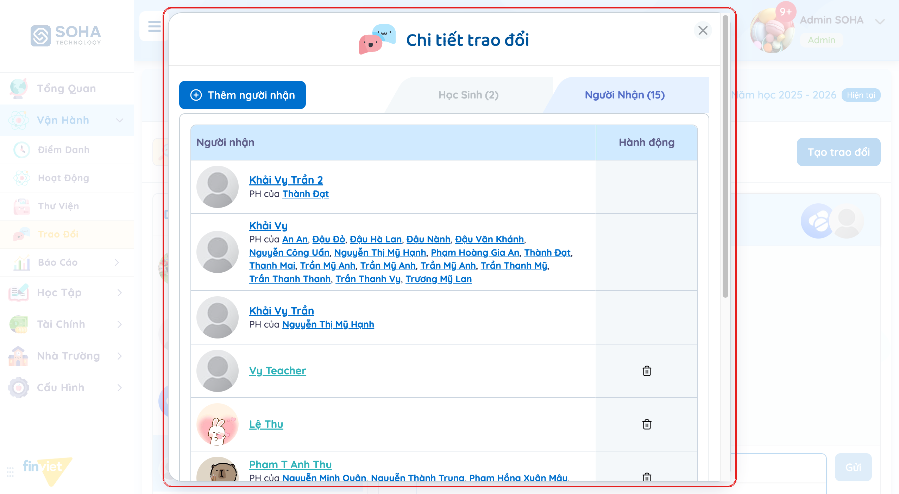
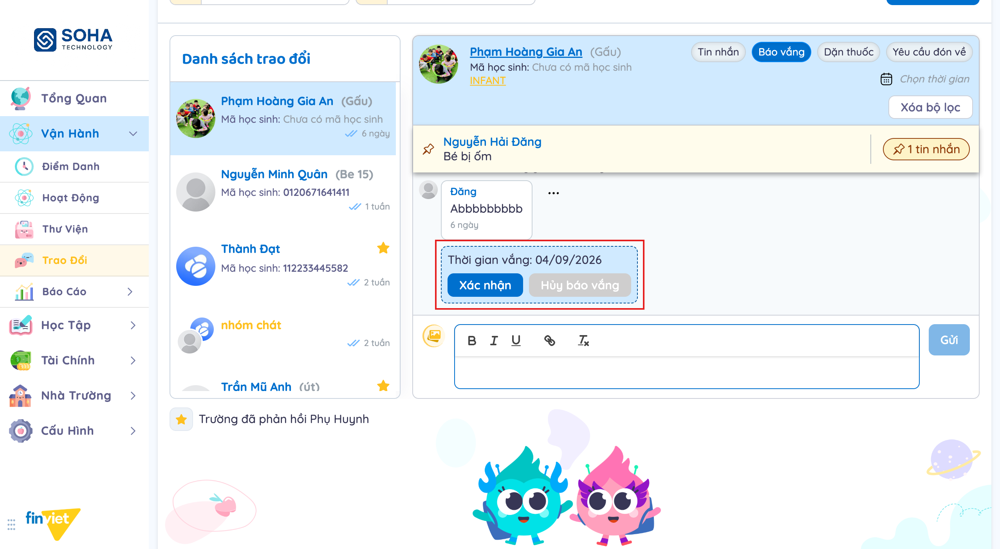
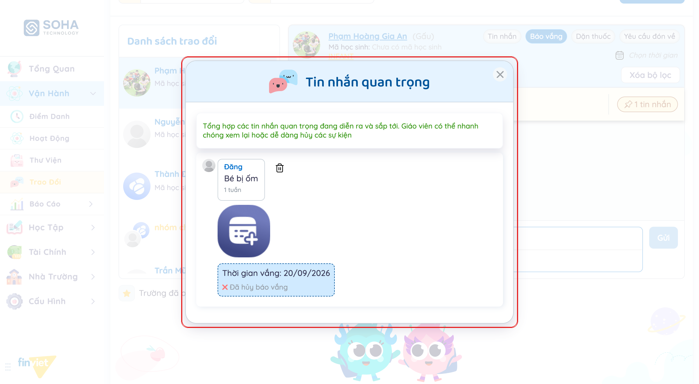

# Tên: Trao đổi (Vận hành)

## Mục lục
- [1. Thông tin tổng quan](#1-thông-tin-tổng-quan)
  - [1.1 Giới thiệu chung](#11-giới-thiệu-chung)
  - [1.2 Mục tiêu](#12-mục-tiêu)
  - [1.3 Phạm vi](#13-phạm-vi)
  - [1.4 Tài liệu tham khảo](#14-tài-liệu-tham-khảo)
- [2. Tổng quan nghiệp vụ](#2-tổng-quan-nghiệp-vụ)
  - [2.1 Đối tượng](#21-đối-tượng)
  - [2.2 Luồng nghiệp vụ](#22-luồng-nghiệp-vụ)
  - [2.3 Nguyên tắc nghiệp vụ](#23-nguyên-tắc-nghiệp-vụ)
- [3. Đặc tả tính năng](#3-đặc-tả-tính-năng)
  - [3.1 Phân rã chức năng](#31-phân-rã-chức-năng)
  - [3.2 Acceptance Criteria](#32-acceptance-criteria)
  - [3.3 Use case](#33-use-case)
  - [3.4 Edge Cases & Error Handling](#34-edge-cases--error-handling)
  - [3.5 Non-functional Requirements](#35-non-functional-requirements)
  - [3.6 Quy ước UI chung](#36-quy-ước-ui-chung)

## 1. Thông tin tổng quan

### 1.1 Giới thiệu chung
Trao đổi là kênh nhắn tin giữa nhà trường (giáo viên/Admin) và phụ huynh, tổ chức theo 2 hình thức: **trao đổi cá nhân** (1 học sinh — gắn với phụ huynh của em đó) và **trao đổi nhóm** (tự chọn nhiều phụ huynh/giáo viên vào 1 nhóm có tên riêng). Bên trong 1 trao đổi cá nhân, tin nhắn còn được phân theo thể loại (tin nhắn thường, báo vắng, dặn thuốc...), trong đó báo vắng có hẳn 1 quy trình xác nhận/hủy ngay trong khung chat.

### 1.2 Mục tiêu
- Cho giáo viên/Admin 1 nơi duy nhất để nhắn tin riêng với từng phụ huynh, hoặc tạo nhóm chat tuỳ ý (nhiều phụ huynh + có thể kèm giáo viên/quản lý khác).
- Xử lý báo vắng phụ huynh gửi trước ngay trong luồng chat: xem ngày nghỉ, bấm Xác nhận hoặc Hủy báo vắng, hệ thống tự ghi log ai đã xử lý.
- Tổng hợp nhanh các sự kiện "quan trọng" (bé bị ốm, báo vắng đang diễn ra/sắp tới) của 1 trao đổi vào 1 bảng tóm tắt, không phải cuộn lại lịch sử để tìm.
- Quản lý người tham gia của 1 nhóm chat: nhóm học sinh gốc (kéo theo phụ huynh tương ứng) tách biệt với người được thêm tay (phụ huynh khác hoặc giáo viên/quản lý).
- Tìm nhanh 1 trao đổi theo tên học sinh/nhóm hoặc theo lớp, và nhảy thẳng tới 1 mốc thời gian cụ thể trong lịch sử chat.

### 1.3 Phạm vi
| In scope | Out of scope |
|---|---|
| Xem danh sách trao đổi (cá nhân + nhóm), tìm kiếm, lọc theo lớp | Xem trao đổi từ phía phụ huynh (app riêng) — ngoài phạm vi portal này |
| Mở 1 trao đổi, lọc tin nhắn theo thể loại (Tin nhắn/Báo vắng/Dặn thuốc/Yêu cầu đón về), nhảy tới 1 ngày cụ thể | Duyệt/từ chối báo vắng từ màn hình hàng đợi riêng "Điểm danh → Báo vắng" — màn đó không có dữ liệu mẫu ở phiên khảo sát của tài liệu Điểm danh (xem 1.4); ở đây quan sát được đúng luồng xử lý này nhưng thực hiện ngay trong khung chat |
| Xác nhận / Hủy báo vắng ngay trong khung chat, xem log hệ thống tự động sau đó | Tạo tin nhắn thể loại "Yêu cầu đón về" — chỉ thấy được ở dạng bộ lọc xem, không có trong danh sách Thể loại khi soạn tin nhắn mới [Cần xác nhận nguồn tạo] |
| Tạo trao đổi cá nhân mới (chọn lớp, học sinh, thể loại, nội dung, file đính kèm) và trao đổi nhóm mới (chọn lớp, nhiều học sinh, tiêu đề, nội dung) — dừng lại trước khi bấm "Gửi" để tránh tạo dữ liệu rác | Xác nhận nội dung thực khi gửi thành công (message thành công, cách hiển thị tin nhắn vừa gửi) |
| Quản lý người nhận của 1 nhóm: xem/xoá học sinh gốc, thêm/xoá phụ huynh hoặc giáo viên/quản lý thủ công | Vai trò phụ huynh xem/trả lời tin nhắn — không quan sát được từ tài khoản Admin |
| Xem "Tin nhắn quan trọng", thu hồi tin nhắn (nút "Thu hồi") | Nội dung thực tế sau khi thu hồi (không thử thu hồi để tránh mất dữ liệu mẫu) |

### 1.4 Tài liệu tham khảo
- [docs/operating-portal/00-inventory.md](../00-inventory.md) — kiểm kê toàn bộ module Phase 1.
- [docs/operating-portal/van-hanh/diem-danh.md](diem-danh.md) — module Điểm danh có 1 màn hình riêng "Báo vắng" (hàng đợi báo vắng toàn trường, mở từ nút trên toolbar), nhưng tài liệu đó ghi nhận màn hình này **không có dữ liệu mẫu** ("Chưa có báo vắng") nên không quan sát được hành vi duyệt/từ chối thực tế (BR06, UC-06 trong diem-danh.md). Tài liệu này (Trao đổi) bổ khuyết đúng phần còn thiếu đó: cùng 1 báo vắng phụ huynh gửi trước xuất hiện **lồng trong khung chat** của trao đổi cá nhân tương ứng, có đủ dữ liệu mẫu ở cả 3 trạng thái (chờ xử lý / đã xác nhận / đã hủy) — xem BR03, UC-05.
- Liên quan: module Hoạt Động và Thư Viện dùng chung khái niệm "Lớp học" làm bộ lọc chính, nhưng không có phần nào của Trao đổi tự động lấy dữ liệu từ 2 module đó (khác với Thư Viện lấy ảnh tự động từ Hoạt Động/Điểm danh).

## 2. Tổng quan nghiệp vụ

### 2.1 Đối tượng
| Actor | Vai trò | Trách nhiệm chính |
|---|---|---|
| Giáo viên / Admin trường | Người quản lý chính | Đọc/gửi tin nhắn, xử lý báo vắng, tạo trao đổi mới, quản lý người nhận nhóm |
| Phụ huynh | Actor gián tiếp (ngoài phạm vi portal này) | Gửi tin nhắn/báo vắng qua app riêng; là 1 "người nhận" mặc định của trao đổi cá nhân gắn với con mình, hoặc được thêm thủ công vào nhóm |
| Học sinh | Đối tượng của trao đổi cá nhân | Mỗi trao đổi cá nhân gắn với đúng 1 học sinh; trong nhóm, học sinh là "nguồn" kéo theo phụ huynh tương ứng vào danh sách người nhận |
| Hệ thống (server) | Tự động hoá | Tự thêm tin nhắn log (vd. "Giáo viên X đã hủy báo vắng cho học sinh Y") khi có hành động Xác nhận/Hủy; tổng hợp "Tin nhắn quan trọng" |

### 2.2 Luồng nghiệp vụ

#### 2.2.1 Mô hình hóa nghiệp vụ

#### 2.2.2 Mô tả các bước nghiệp vụ
| Bước | Người thực hiện | Mô tả | Kết quả |
|---|---|---|---|
| 1 | Phụ huynh | Gửi tin nhắn/báo vắng/báo ốm qua app riêng | Tin nhắn xuất hiện trong trao đổi cá nhân của đúng học sinh, kèm badge số lượng "tin nhắn quan trọng" nếu là báo vắng/báo ốm |
| 2 | Giáo viên/Admin | Vào Trao Đổi, chọn lớp học và/hoặc gõ từ khoá tìm kiếm | Danh sách trao đổi bên trái được lọc lại; tìm kiếm khớp cả theo tên hiển thị lẫn tên thành viên bên trong (nhóm) |
| 3 | Giáo viên/Admin | Bấm vào 1 trao đổi trong danh sách | Mở khung chat bên phải, hiển thị header (tên học sinh/nhóm, lớp), lịch sử tin nhắn, ô soạn tin nhắn |
| 4 | Giáo viên/Admin | (Tuỳ chọn) Bấm 1 trong các chip thể loại phía trên khung chat | Khung chat lọc lại chỉ hiển thị tin nhắn thuộc thể loại đó, xuất hiện thêm nút "Xóa bộ lọc" |
| 5 | Giáo viên/Admin | Với thẻ báo vắng đang chờ xử lý, bấm "Xác nhận" hoặc "Hủy báo vắng" | Trạng thái thẻ đổi thành "Đã xác nhận"/"Đã hủy báo vắng"; hệ thống tự chèn 1 tin nhắn log bên dưới |
| 6 | Giáo viên/Admin | Bấm badge "N tin nhắn" ở banner ghim đầu khung chat | Mở modal "Tin nhắn quan trọng", liệt kê các sự kiện đang diễn ra/sắp tới, có thể xoá/hủy nhanh từng dòng |
| 7 | Giáo viên/Admin | Bấm "Tạo trao đổi", chọn Hình thức (cá nhân/nhóm), điền các trường bắt buộc | Trao đổi mới sẵn sàng gửi (không thực hiện Gửi thật trong phiên khảo sát) |
| 8 | Giáo viên/Admin | Với trao đổi nhóm đang mở, bấm vào cụm avatar người tham gia | Mở modal "Chi tiết trao đổi": tab Danh Sách Học Sinh và tab Danh Sách Người Nhận (có phân trang), có nút "Thêm người nhận" |

### 2.3 Nguyên tắc nghiệp vụ
| ID | Nguyên tắc nghiệp vụ |
|---|---|
| BR01 | Có đúng 2 hình thức trao đổi: **"Trao đổi cá nhân"** (bắt buộc chọn Lớp học + 1 học sinh, người nhận mặc định là phụ huynh của em đó) và **"Trao đổi nhóm"** (bắt buộc chọn Lớp học + 1 hoặc nhiều học sinh + Tiêu đề — tiêu đề chỉ bắt buộc ở nhóm, không có ở cá nhân). |
| BR02 | Khi soạn trao đổi cá nhân mới, trường "Thể loại" có 5 lựa chọn: **Tin nhắn, Báo vắng, Dặn thuốc, Góp ý, Khác**. Trong khi đó, các chip lọc hiển thị trên 1 trao đổi cá nhân đã mở lại chỉ có 4 loại: **Tin nhắn, Báo vắng, Dặn thuốc, Yêu cầu đón về** — 2 bộ nhãn không trùng nhau hoàn toàn (không có "Góp ý"/"Khác" ở bộ lọc xem, không có "Yêu cầu đón về" ở bộ tạo mới). [Cần xác nhận] "Yêu cầu đón về" được tạo ra từ đâu (nghi ngờ: từ app phụ huynh, hoặc từ 1 luồng khác trong Điểm danh). |
| BR03 | Tin nhắn thể loại Báo vắng hiển thị dưới dạng 1 thẻ riêng (khung viền, nền xanh nhạt khi đang chờ) ghi rõ "Thời gian vắng: dd/mm/yyyy" (hoặc khoảng ngày "dd/mm/yyyy - dd/mm/yyyy"), với 3 trạng thái quan sát được: (a) **đang chờ** — còn 2 nút "Xác nhận"/"Hủy báo vắng" hoạt động; (b) **"Đã xác nhận"**; (c) **"Đã hủy báo vắng"**. Đây là cùng loại dữ liệu với hàng đợi "Báo vắng" ở module Điểm danh, chỉ khác là hiển thị lồng trong khung chat thay vì 1 màn hình danh sách riêng (xem 1.4). |
| BR04 | Khi Giáo viên/Admin bấm Xác nhận hoặc Hủy báo vắng, hệ thống tự động chèn thêm 1 tin nhắn dạng "Giáo viên {tên} đã hủy báo vắng cho học sinh {tên}", đánh dấu bằng dòng chú thích "* Tin nhắn tự động gửi từ hệ thống" — đây là log audit hiển thị công khai trong chính khung chat đó (phụ huynh cũng nhìn thấy được, không phải log riêng cho nội bộ trường). |
| BR05 | Mỗi tin nhắn có 1 mục "Danh sách người đọc" (xác nhận qua cấu trúc trang — mặc định "Chưa có người đọc tin nhắn" với toàn bộ dữ liệu mẫu quan sát được), cho thấy hệ thống có theo dõi trạng thái đã đọc/chưa đọc theo từng người nhận, dù giao diện khảo sát không có ca nào đã có người đọc để đối chiếu hiển thị thực tế. [Cần xác nhận] |
| BR06 | "Tin nhắn quan trọng" là 1 bảng tổng hợp riêng theo từng trao đổi (không phải toàn trường), truy cập qua badge "N tin nhắn" ở banner ghim đầu khung chat. Nội dung gồm các báo ốm/báo vắng đang diễn ra hoặc sắp tới, mỗi dòng có icon thùng rác riêng để xoá/hủy nhanh mà không cần mở lại đúng tin nhắn gốc trong lịch sử. |
| BR07 | Trao đổi nhóm bắt buộc Tiêu đề, danh sách "Học sinh" (nguồn) và danh sách "Người nhận" (đích) là 2 khái niệm tách biệt, quản lý qua modal "Chi tiết trao đổi" với 2 tab riêng: **Danh Sách Học Sinh** (học sinh gốc của nhóm — xoá qua "Xóa trẻ", có chọn hàng loạt bằng checkbox) và **Danh Sách Người Nhận** (mọi người thực sự nhận được tin, có phân trang nhiều trang khi danh sách dài). |
| BR08 | Người nhận trong nhóm có 2 nguồn: (a) suy ra tự động từ danh sách Học sinh — hiển thị "PH của {tên con}", **không có nút xoá riêng** (muốn bỏ phải xoá học sinh nguồn ở tab kia); (b) thêm thủ công qua "Thêm người nhận" — chọn 1 trong 2 loại **"Phụ huynh của học sinh"** hoặc **"Giáo viên/Quản lý"**, các dòng này **có nút xoá riêng**. Một phụ huynh có thể là cha/mẹ chung của nhiều học sinh trong cùng nhóm (hiển thị "PH của A, B, C, ..." nối danh sách con), tương ứng nếu tài khoản đó có nhiều con học cùng lớp/trường. |
| BR09 | Danh sách trao đổi bên trái đánh dấu 1 icon ngôi sao cho các trao đổi có tooltip "Trao đổi đã có phản hồi từ nhà trường" — tức là trường (giáo viên/Admin) đã từng trả lời trong trao đổi đó, giúp phân biệt nhanh trao đổi nào còn "treo" (phụ huynh nhắn nhưng trường chưa phản hồi) so với trao đổi đã được xử lý. |
| BR10 | Ô tìm kiếm "Tìm kiếm theo học sinh, nhóm" khớp cả theo tên hiển thị của trao đổi lẫn theo tên từng thành viên bên trong nhóm (vd. tìm "Thành" trả về cả trao đổi cá nhân "Thành Đạt" lẫn nhóm "nhóm chát" vì nhóm đó có Thành Đạt là 1 trong các học sinh thành viên, dù chữ "Thành" không xuất hiện trong tên nhóm). Kết hợp được với bộ lọc "Chọn lớp học" cùng lúc. |
| BR11 | "Chọn thời gian" mở 1 lịch chọn tháng/năm độc lập với các chip thể loại, dùng để nhảy khung chat tới đúng 1 ngày trong lịch sử thay vì cuộn tay; có 2 nút "Áp dụng"/"Hủy bỏ". |
| BR12 | Mỗi tin nhắn (kể cả của phụ huynh) đều có menu "..." với hành động "Thu hồi" khả dụng cho Giáo viên/Admin — tức Admin có thể thu hồi bất kỳ tin nhắn nào trong trao đổi mình quản lý, không giới hạn ở tin nhắn do chính mình gửi. [Cần xác nhận nhãn chính xác cho tin nhắn của phụ huynh — chỉ xác nhận được qua cấu trúc DOM giống hệt tin nhắn của Admin, chưa mở menu để đọc tooltip trực tiếp]. |

## 3. Đặc tả tính năng

### 3.1 Phân rã chức năng
| Feature | Platform | Priority | User Story |
|---|---|---|---|
| Xem danh sách trao đổi, tìm kiếm, lọc theo lớp | Web | Must | Là giáo viên, tôi muốn tìm nhanh đúng trao đổi cần xem giữa hàng chục cuộc trò chuyện |
| Mở 1 trao đổi, lọc theo thể loại, nhảy tới ngày cụ thể | Web | Must | Là giáo viên, tôi muốn xem riêng các báo vắng hoặc dặn thuốc mà không lẫn với tin nhắn thường |
| Xác nhận/Hủy báo vắng ngay trong khung chat | Web | Must | Là giáo viên, tôi muốn xử lý báo vắng phụ huynh gửi trước mà không phải chuyển màn hình |
| Xem "Tin nhắn quan trọng" | Web | Should | Là giáo viên, tôi muốn thấy ngay các sự kiện sắp tới/đang diễn ra của 1 học sinh mà không cuộn lại lịch sử |
| Tạo trao đổi cá nhân | Web | Must | Là giáo viên, tôi muốn chủ động nhắn cho phụ huynh 1 học sinh cụ thể |
| Tạo trao đổi nhóm | Web | Should | Là giáo viên, tôi muốn tạo 1 nhóm chat cho nhiều phụ huynh cùng lúc (vd. cả lớp, hoặc 1 nhóm hoạt động ngoại khoá) |
| Quản lý người nhận của nhóm | Web | Should | Là giáo viên, tôi muốn thêm/bớt phụ huynh hoặc đồng nghiệp khỏi 1 nhóm chat đã tạo |
| Thu hồi tin nhắn | Web | Could | Là giáo viên, tôi muốn gỡ 1 tin nhắn gửi nhầm (của mình hoặc của phụ huynh) |

### 3.2 Acceptance Criteria
| User Story | Chức năng | Acceptance Criteria |
|---|---|---|
| Xem danh sách trao đổi | Trang Trao Đổi | Gõ từ khoá hoặc chọn lớp → danh sách bên trái cập nhật, khớp cả theo tên thành viên bên trong nhóm |
| Lọc theo thể loại | Chip Tin nhắn/Báo vắng/Dặn thuốc/Yêu cầu đón về | Bấm 1 chip → khung chat chỉ còn tin nhắn đúng loại, hiện nút "Xóa bộ lọc"; trao đổi nhóm không có các chip này |
| Xử lý báo vắng | Thẻ báo vắng trong khung chat | Bấm "Xác nhận"/"Hủy báo vắng" → trạng thái thẻ đổi ngay, tự sinh thêm 1 tin nhắn log hệ thống |
| Tạo trao đổi cá nhân | Modal Tạo trao đổi | Chọn Lớp học + Học sinh + Nội dung (bắt buộc) → nút "Gửi" được bật; Thể loại và File đính kèm là tuỳ chọn |
| Tạo trao đổi nhóm | Modal Tạo trao đổi | Chọn Lớp học + ít nhất 1 Học sinh + Tiêu đề + Nội dung (đều bắt buộc) → nút "Gửi" được bật |
| Thêm người nhận nhóm | Modal Thêm người nhận | Chọn loại (Phụ huynh của học sinh / Giáo viên-Quản lý) rồi chọn đối tượng → nút "Thêm" được bật |
| Xoá học sinh khỏi nhóm | Tab Danh Sách Học Sinh | Bấm icon thùng rác hoặc chọn checkbox nhiều dòng rồi bấm "Xóa trẻ" |

### 3.3 Use case

**UC-01**
| Trường | Nội dung |
|---|---|
| Use case ID | UC-01 |
| Use case name | Xem danh sách và mở 1 trao đổi |
| Use case description | Giáo viên/Admin tìm và mở 1 trao đổi cá nhân hoặc nhóm |
| Actor | Giáo viên / Admin |
| Happy path | 1. Vào Trao Đổi, (tuỳ chọn) gõ từ khoá vào ô tìm kiếm hoặc chọn lớp ở dropdown.  2. Bấm vào 1 mục trong "Danh sách trao đổi". 3. Khung chat bên phải hiển thị header (tên học sinh/nhóm), lịch sử tin nhắn, ô soạn tin nhắn. |
| Exception | Trường hợp quan sát được: trao đổi cá nhân mở lần đầu (chưa bấm chip thể loại nào) có thể bị kẹt ở trạng thái skeleton loading vĩnh viễn cho vài tin nhắn — xem BR trong 3.4 |
| Trigger | Bấm vào 1 mục trong Danh sách trao đổi |
| Pre-condition | Không có |
| Post-condition | Khung chat hiển thị đúng lịch sử của trao đổi đã chọn |
| Business Rules | BR09, BR10 |

**UC-02**
| Trường | Nội dung |
|---|---|
| Use case ID | UC-02 |
| Use case name | Tạo trao đổi cá nhân |
| Use case description | Giáo viên/Admin chủ động mở 1 trao đổi mới với phụ huynh của 1 học sinh |
| Actor | Giáo viên / Admin |
| Happy path | 1. Bấm "Tạo trao đổi". 2. Để "Hình thức trao đổi" mặc định = "Trao đổi cá nhân". 3. Chọn Lớp học → danh sách Học sinh lọc theo đúng lớp đó. 4. Chọn Học sinh, chọn Thể loại (mặc định "Tin nhắn"), nhập Nội dung, đính kèm file nếu cần. 5. Bấm "Gửi" (không thực hiện trong phiên khảo sát để tránh tạo dữ liệu rác). |
| Exception | Chưa quan sát được thông báo lỗi khi thiếu trường bắt buộc (nút "Gửi" chỉ ở trạng thái disabled) |
| Trigger | Bấm nút "Tạo trao đổi" |
| Pre-condition | Không có |
| Post-condition | [Cần xác nhận] — chưa submit để xác nhận |
| Business Rules | BR01, BR02 |

**UC-03**
| Trường | Nội dung |
|---|---|
| Use case ID | UC-03 |
| Use case name | Tạo trao đổi nhóm |
| Use case description | Giáo viên/Admin tạo 1 nhóm chat mới cho nhiều phụ huynh |
| Actor | Giáo viên / Admin |
| Happy path | 1. Bấm "Tạo trao đổi", đổi "Hình thức trao đổi" sang "Trao đổi nhóm" — biểu mẫu đổi ngay: xuất hiện thêm "Tiêu đề", không còn "Thể loại".  2. Chọn Lớp học. 3. Chọn 1 hoặc nhiều Học sinh trong dropdown checkbox (có tuỳ chọn "Cả lớp"). 4. Nhập Tiêu đề (bắt buộc) và Nội dung. 5. Bấm "Gửi" (không thực hiện trong phiên khảo sát). |
| Exception | Chưa quan sát được |
| Trigger | Bấm "Tạo trao đổi" rồi đổi Hình thức trao đổi sang "Trao đổi nhóm" |
| Pre-condition | Không có |
| Post-condition | [Cần xác nhận] — chưa submit để xác nhận |
| Business Rules | BR01 |

**UC-04**
| Trường | Nội dung |
|---|---|
| Use case ID | UC-04 |
| Use case name | Quản lý người nhận nhóm |
| Use case description | Giáo viên/Admin xem/thêm/xoá thành viên của 1 trao đổi nhóm đã tồn tại |
| Actor | Giáo viên / Admin |
| Happy path | 1. Mở 1 trao đổi nhóm, bấm vào cụm avatar người tham gia ở góc phải header. 2. Modal "Chi tiết trao đổi" mở ra, mặc định tab "Danh Sách Học Sinh". Bấm sang tab "Danh Sách Người Nhận" để xem toàn bộ người thực nhận tin (có phân trang).  3. Bấm "Thêm người nhận": chọn loại "Phụ huynh của học sinh" hoặc "Giáo viên/Quản lý", chọn đối tượng, bấm "Thêm". 4. Ở tab Danh Sách Học Sinh, bấm icon thùng rác từng dòng hoặc chọn nhiều checkbox rồi bấm "Xóa trẻ" để loại học sinh (và phụ huynh suy ra từ em đó) khỏi nhóm. |
| Exception | Các dòng người nhận suy ra tự động từ học sinh không có nút xoá riêng — phải xoá ở tab Học Sinh mới gỡ được |
| Trigger | Bấm vào cụm avatar người tham gia trên header trao đổi nhóm |
| Pre-condition | Đang mở 1 trao đổi nhóm |
| Post-condition | Danh sách người nhận/học sinh cập nhật theo thao tác thêm/xoá |
| Business Rules | BR07, BR08 |

**UC-05**
| Trường | Nội dung |
|---|---|
| Use case ID | UC-05 |
| Use case name | Xác nhận / Hủy báo vắng |
| Use case description | Giáo viên/Admin xử lý 1 báo vắng phụ huynh gửi trước, ngay trong khung chat |
| Actor | Giáo viên / Admin |
| Happy path | 1. Mở trao đổi cá nhân của học sinh, bấm chip "Báo vắng" để lọc riêng loại này. 2. Tìm thẻ báo vắng đang ở trạng thái chờ (còn 2 nút hoạt động), xem ngày/khoảng ngày nghỉ.  3. Bấm "Xác nhận" (đồng ý cho nghỉ) hoặc "Hủy báo vắng" (không chấp nhận/huỷ báo vắng đó). 4. Hệ thống tự chèn 1 tin nhắn log bên dưới, đánh dấu "Tin nhắn tự động gửi từ hệ thống". |
| Exception | Không quan sát được thông báo lỗi; không thử bấm thật để tránh thay đổi dữ liệu mẫu của các báo vắng đang ở trạng thái chờ |
| Trigger | Bấm "Xác nhận" hoặc "Hủy báo vắng" trên 1 thẻ báo vắng |
| Pre-condition | Thẻ báo vắng đang ở trạng thái chờ xử lý |
| Post-condition | Trạng thái thẻ đổi thành "Đã xác nhận" hoặc "Đã hủy báo vắng", không thể bấm lại |
| Business Rules | BR03, BR04 |

**UC-06**
| Trường | Nội dung |
|---|---|
| Use case ID | UC-06 |
| Use case name | Xem Tin nhắn quan trọng |
| Use case description | Giáo viên/Admin xem nhanh các sự kiện (ốm, báo vắng) đang diễn ra/sắp tới của 1 trao đổi |
| Actor | Giáo viên / Admin |
| Happy path | 1. Trong khung chat, bấm badge "N tin nhắn" ở banner ghim đầu trang. 2. Modal "Tin nhắn quan trọng" mở ra, liệt kê từng sự kiện kèm icon thùng rác/hủy riêng.  3. Bấm icon thùng rác trên 1 dòng để xoá/hủy nhanh (không thử để tránh mất dữ liệu mẫu). |
| Exception | Không quan sát được |
| Trigger | Bấm badge "N tin nhắn" |
| Pre-condition | Trao đổi có ít nhất 1 tin nhắn thuộc diện "quan trọng" (ốm/báo vắng) |
| Post-condition | Không đổi dữ liệu nếu chỉ xem |
| Business Rules | BR06 |

**UC-07**
| Trường | Nội dung |
|---|---|
| Use case ID | UC-07 |
| Use case name | Lọc theo thể loại và nhảy tới thời điểm |
| Use case description | Giáo viên/Admin thu hẹp khung chat theo loại tin nhắn hoặc theo ngày cụ thể |
| Actor | Giáo viên / Admin |
| Happy path | 1. Trong 1 trao đổi cá nhân, bấm 1 trong 4 chip: Tin nhắn/Báo vắng/Dặn thuốc/Yêu cầu đón về. 2. Khung chat lọc lại, hiện nút "Xóa bộ lọc" để quay về xem tất cả. 3. Hoặc bấm "Chọn thời gian", chọn tháng/năm/ngày trên lịch, bấm "Áp dụng" để nhảy tới đúng thời điểm đó. |
| Exception | Lọc "Yêu cầu đón về" trên trao đổi không có dữ liệu loại này trả về trạng thái rỗng "Chưa có tin nhắn" |
| Trigger | Bấm 1 chip thể loại hoặc "Chọn thời gian" |
| Pre-condition | Đang mở 1 trao đổi cá nhân (nhóm không có các chip này) |
| Post-condition | Khung chat hiển thị đúng tập tin nhắn theo bộ lọc |
| Business Rules | BR02, BR11 |

**UC-08**
| Trường | Nội dung |
|---|---|
| Use case ID | UC-08 |
| Use case name | Thu hồi tin nhắn |
| Use case description | Giáo viên/Admin gỡ bỏ 1 tin nhắn đã gửi trong trao đổi |
| Actor | Giáo viên / Admin |
| Happy path | 1. Trỏ chuột vào 1 tin nhắn bất kỳ trong khung chat, bấm icon "..." xuất hiện cạnh đó. 2. Chọn "Thu hồi" (không thực hiện trong phiên khảo sát để tránh mất dữ liệu mẫu). |
| Exception | [Cần xác nhận] hành vi sau khi thu hồi (xoá hẳn hay chỉ ẩn nội dung, có báo cho phụ huynh không) |
| Trigger | Bấm icon "..." trên 1 tin nhắn rồi chọn "Thu hồi" |
| Pre-condition | Trao đổi có ít nhất 1 tin nhắn |
| Post-condition | [Cần xác nhận] — chưa thực hiện để xác nhận |
| Business Rules | BR12 |

### 3.4 Edge Cases & Error Handling

#### 3.4.1 Tổng quan
| Nhóm | Tình huống | Xử lý mong đợi |
|---|---|---|
| Khung chat kẹt ở skeleton loading | Mở 1 trao đổi cá nhân lần đầu (kể cả sau khi tải lại toàn trang), không bấm chip thể loại nào | Một vài tin nhắn hiển thị vĩnh viễn dưới dạng khối xám nhấp nháy ("skeleton-item animate-pulse"), không tự chuyển thành nội dung thật dù đã cuộn hết khung chat. Bấm bất kỳ chip thể loại nào (vd. "Báo vắng") buộc tải lại và hiển thị đúng nội dung thật ngay lập tức — ghi nhận đây là hành vi bất thường quan sát được trong phiên khảo sát, không phải luồng mong đợi |
| Bộ nhãn Thể loại không đối xứng | So sánh Thể loại khi tạo mới (5 lựa chọn) với chip lọc khi xem (4 lựa chọn) | 2 danh sách lệch nhau ở "Góp ý"/"Khác" (chỉ tạo được, không lọc được) và "Yêu cầu đón về" (chỉ lọc được, không tạo được) — xem BR02 |
| Nội dung tin nhắn dài/nhiều ký tự đặc biệt | Quan sát 1 tin nhắn mẫu dài chứa nhiều ký tự Unicode đặc biệt (₫, €, ♤, ☆...) | Hiển thị đầy đủ, không bị cắt hay vỡ layout khung chat |
| Phụ huynh chung của nhiều học sinh | 1 tài khoản phụ huynh xuất hiện là "PH của" nhiều học sinh trong cùng 1 nhóm | Hệ thống gộp thành 1 dòng duy nhất, liệt kê tất cả tên con nối bằng dấu phẩy, thay vì lặp lại nhiều dòng cho cùng 1 phụ huynh |
| Người nhận suy ra không xoá được trực tiếp | Bấm icon xoá ở dòng người nhận dạng "PH của X" (tab Danh Sách Người Nhận) | Không có icon xoá cho các dòng này — phải sang tab Danh Sách Học Sinh xoá đúng học sinh nguồn |

#### 3.4.2 Danh sách Thông báo (lỗi/thành công)
| Message ID | Trường hợp lỗi | Rule kiểm tra | Message đề xuất | Hình thức báo | Hành vi hệ thống |
|---|---|---|---|---|---|
| — | Không quan sát được thông báo lỗi/thành công nào | Không có | Không submit dữ liệu thật trong phiên khảo sát (tạo trao đổi, xác nhận báo vắng, thu hồi tin nhắn đều dừng lại trước bước cuối) nên chưa thấy toast/thông báo tương ứng | — | — |
| — (đã quan sát gián tiếp) | Không có dữ liệu cho 1 bộ lọc thể loại | Chọn 1 chip thể loại không có tin nhắn tương ứng | "Chưa có tin nhắn" | Text tĩnh giữa khung chat | Không có hành vi phụ, chỉ hiển thị trạng thái rỗng |

### 3.5 Non-functional Requirements
| ID | Nhóm | Yêu cầu |
|---|---|---|
| NFR01 | Hiệu năng | Chuyển đổi giữa các trao đổi trong danh sách không tải lại toàn trang (SPA route) |
| NFR02 | Ngôn ngữ | Giao diện tiếng Việt hoàn toàn, kể cả tin nhắn log hệ thống tự sinh |
| NFR03 | Minh bạch | Hành động Xác nhận/Hủy báo vắng của trường được ghi lại công khai ngay trong khung chat (phụ huynh cũng thấy), không phải log ẩn nội bộ |
| NFR04 | Nhất quán | Composer (Bold/Italic/Underline/Link/xoá định dạng + upload ảnh/video) dùng chung kiểu với ô soạn bài của module Hoạt Động |

### 3.6 Quy ước UI chung
- Danh sách trao đổi luôn ở cột trái cố định, khung chat chiếm phần còn lại — không có chế độ toàn màn hình riêng cho khung chat.
- Trao đổi nhóm và trao đổi cá nhân dùng chung 1 khung chat, chỉ khác ở header: cá nhân có đủ bộ chip thể loại + "Chọn thời gian", nhóm chỉ có tên nhóm/lớp/người tạo và cụm avatar mở "Chi tiết trao đổi".
- Modal dùng chung bố cục: nút hành động chính (màu) nằm bên phải, "Hủy"/"Hủy bỏ" (xám) bên trái, nút chính disabled tới khi đủ dữ liệu bắt buộc — nhất quán với các module Vận hành khác.
- Icon ngôi sao dùng lặp lại 2 nơi với 2 ý nghĩa khác nhau trong cùng module: cạnh 1 trao đổi trong danh sách nghĩa là "đã có phản hồi từ nhà trường" (BR09); không nhầm với icon ngôi sao dùng làm bullet ở phần chú thích footer.
