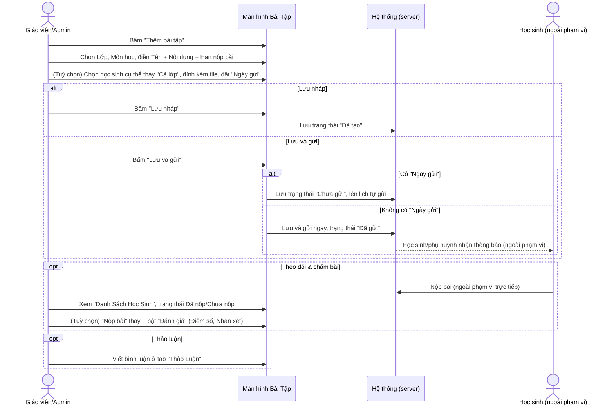
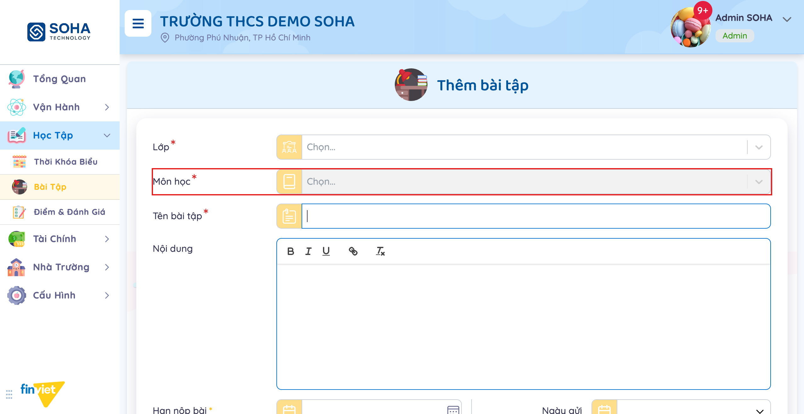
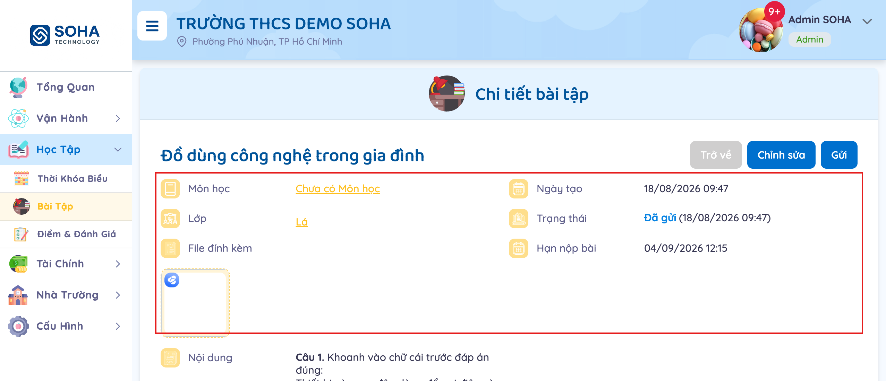
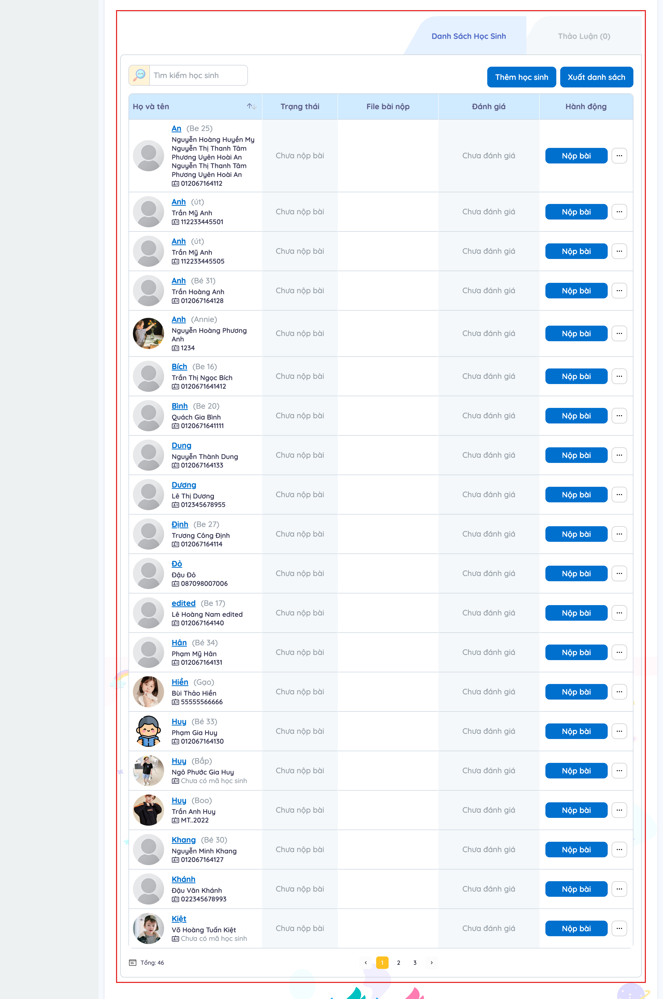
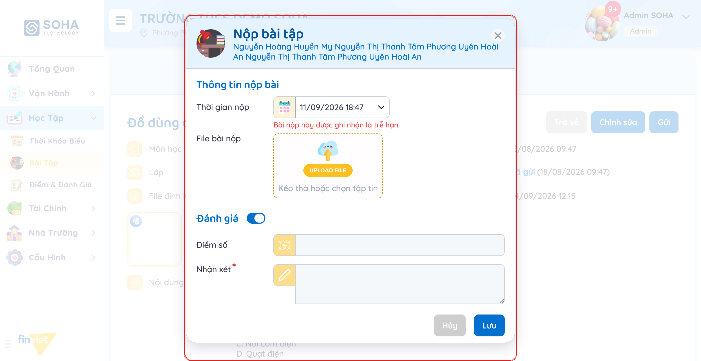
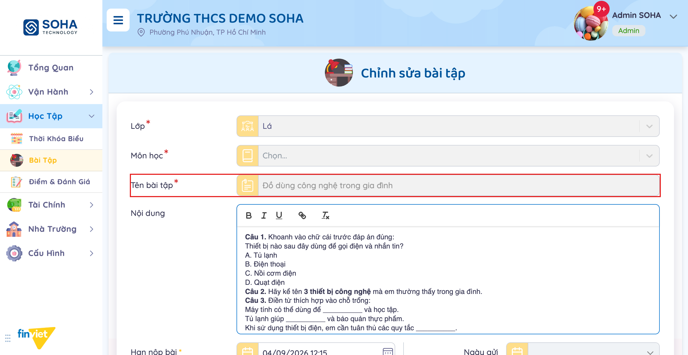
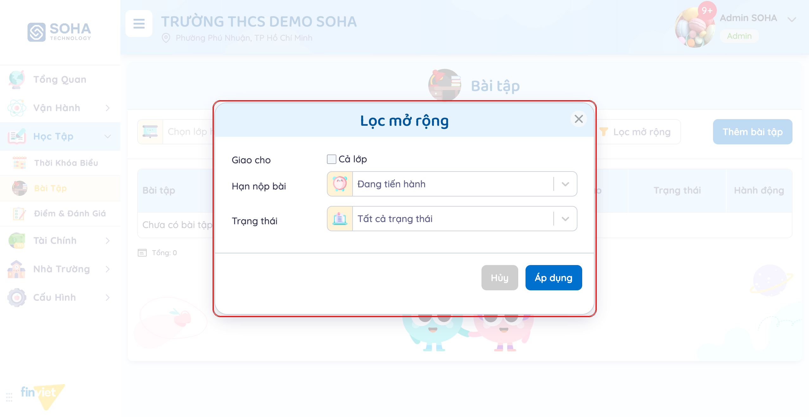
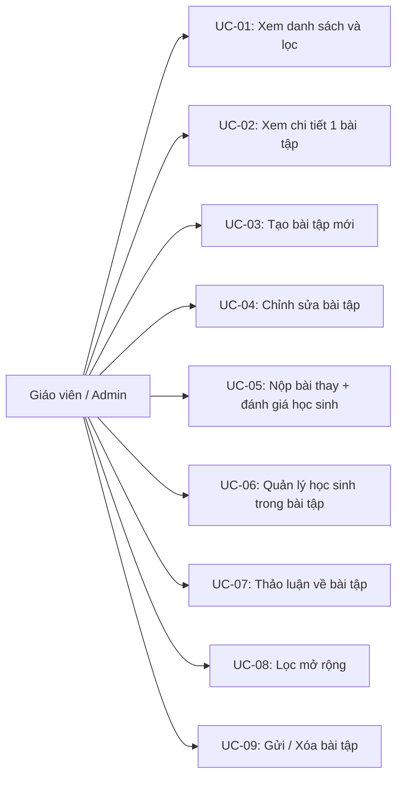
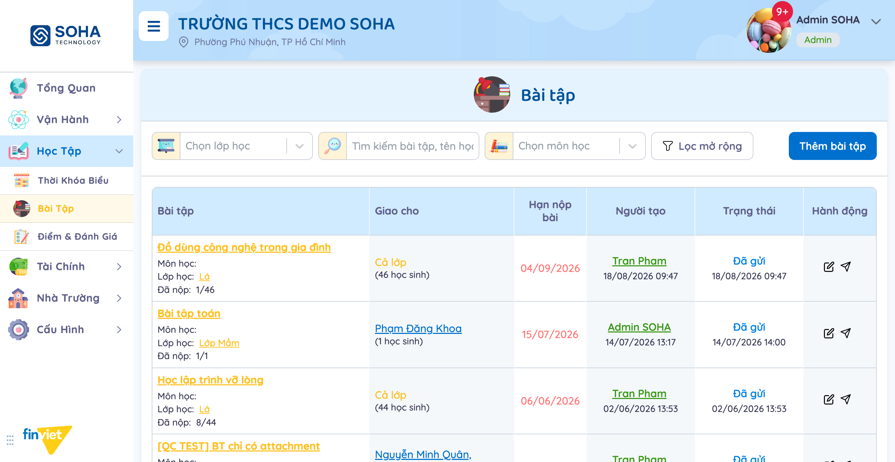
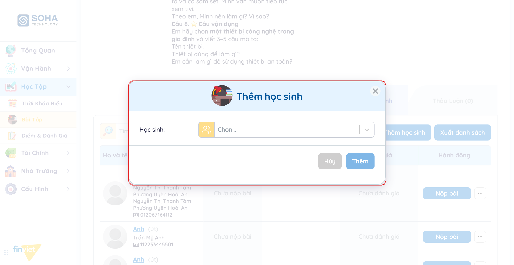

# Tên: Bài Tập (Học tập)

## Mục lục
- [1. Thông tin tổng quan](#1-thông-tin-tổng-quan)
  - [1.1 Giới thiệu chung](#11-giới-thiệu-chung)
  - [1.2 Mục tiêu](#12-mục-tiêu)
  - [1.3 Phạm vi](#13-phạm-vi)
  - [1.4 Tài liệu tham khảo](#14-tài-liệu-tham-khảo)
- [2. Tổng quan nghiệp vụ](#2-tổng-quan-nghiệp-vụ)
  - [2.1 Đối tượng](#21-đối-tượng)
  - [2.2 Luồng nghiệp vụ](#22-luồng-nghiệp-vụ)
  - [2.3 Nguyên tắc nghiệp vụ](#23-nguyên-tắc-nghiệp-vụ)
- [3. Đặc tả tính năng](#3-đặc-tả-tính-năng)
  - [3.1 Phân rã chức năng](#31-phân-rã-chức-năng)
  - [3.2 Acceptance Criteria](#32-acceptance-criteria)
  - [3.3 Use case](#33-use-case)
  - [3.4 Edge Cases & Error Handling](#34-edge-cases--error-handling)
  - [3.5 Non-functional Requirements](#35-non-functional-requirements)
  - [3.6 Quy ước UI chung](#36-quy-ước-ui-chung)

## 1. Thông tin tổng quan

### 1.1 Giới thiệu chung
Bài Tập quản lý bài tập về nhà giao cho học sinh theo lớp (cả lớp hoặc chọn riêng từng học sinh), theo dõi tình trạng nộp bài của từng em, cho phép giáo viên/admin nộp thay và đánh giá (điểm số + nhận xét), cùng 1 khung thảo luận riêng cho mỗi bài tập.

### 1.2 Mục tiêu
- Giao 1 bài tập cho cả lớp hoặc chỉ 1/nhiều học sinh cụ thể trong lớp, với nội dung soạn bằng rich text editor, hạn nộp bắt buộc và file đính kèm tuỳ chọn.
- Gửi thông báo bài tập ngay lập tức, hoặc lên lịch để hệ thống tự gửi vào 1 thời điểm sau ("Ngày gửi").
- Theo dõi trạng thái nộp bài của từng học sinh (Đã nộp bài/Chưa nộp bài), nộp bài thay học sinh kèm đánh giá (điểm số + nhận xét bắt buộc).
- Thảo luận (bình luận) riêng cho từng bài tập, tách biệt khỏi danh sách học sinh.
- Lọc nhanh theo lớp, môn học, tìm kiếm theo tên bài tập/học sinh, và "Lọc mở rộng" theo đối tượng giao/hạn nộp/trạng thái.

### 1.3 Phạm vi
| In scope | Out of scope |
|---|---|
| Xem danh sách bài tập (97 bản ghi mẫu), tìm kiếm, lọc theo lớp/môn học, "Lọc mở rộng" theo Giao cho + Hạn nộp bài + Trạng thái | Tạo mới thành công 1 bài tập thật — nút "Lưu và gửi" luôn bị khoá vì trường bắt buộc "Môn học" không có lựa chọn nào ("Chưa có môn học") ở toàn bộ dữ liệu demo, bất kể chọn lớp phổ thông (12A1, 6A1) hay lớp mầm non (Lá, Lớp Mầm...) |
| Xem chi tiết 1 bài tập: thông tin tổng quan + nội dung, và danh sách học sinh với trạng thái nộp bài | Xác nhận nguyên nhân "Môn học" luôn rỗng — nghi ngờ liên quan tới cấu hình môn học ở module khác (ngoài Bài Tập), ngoài phạm vi khảo sát ở đây |
| Mở form "Thêm bài tập" và trang "Chỉnh sửa bài tập" (đầy đủ trường, chưa submit) | Thực hiện "Gửi"/gửi lại 1 bài tập thật — bị chính hệ thống phân quyền của phiên làm việc chặn lại, giống các module thông báo khác trong portal |
| Mở modal "Nộp bài tập" (nộp thay 1 học sinh) kèm bật toggle "Đánh giá" để xem đầy đủ trường Điểm số/Nhận xét | Lưu 1 lượt "Nộp bài" hoặc "Đánh giá" thật — chỉ mở modal quan sát cấu trúc, không bấm "Lưu" để tránh đổi dữ liệu mẫu |
| Mở modal "Thêm học sinh" và menu "..." → "Xóa học sinh" trên 1 dòng học sinh | Thêm/xóa 1 học sinh thật khỏi bài tập, hoặc xóa 1 bài tập thật |
| Nhận biết bộ 2-3 hành động khác nhau ở danh sách theo Trạng thái (Đã tạo/Chưa gửi/Đã gửi) | Xác nhận đầy đủ quy luật khi nào "Xóa" xuất hiện thêm ở 1 bài tập "Đã gửi" — quan sát được ở một số dòng có 0 học sinh nộp bài nhưng không phải tất cả, chưa tìm ra quy luật chính xác |
| Xem tab "Thảo Luận" (khung bình luận rỗng) | Xuất danh sách học sinh thật (nút "Xuất danh sách" không được bấm để tránh tải file) |

### 1.4 Tài liệu tham khảo
- [docs/operating-portal/00-inventory.md](../00-inventory.md) — kiểm kê toàn bộ module Phase 1; mô tả ban đầu "Homework assignments by class/subject with due dates and submission status" — tài liệu này xác nhận đúng nhưng bổ sung thêm phần "theo môn học" trong demo hiện tại không thể sử dụng được (xem BR02).
- [docs/operating-portal/hoc-tap/thoi-khoa-bieu.md](thoi-khoa-bieu.md) — module liền kề cùng Học Tập; cùng gặp tình huống 1 trường bắt buộc (ở đó là Học kỳ) luôn khiến luồng tạo mới dạng đầy đủ bị chặn trong dữ liệu demo.

## 2. Tổng quan nghiệp vụ

### 2.1 Đối tượng
| Actor | Vai trò | Trách nhiệm chính |
|---|---|---|
| Giáo viên / Admin trường | Người tạo và quản lý bài tập | Tạo/chỉnh sửa bài tập, quản lý danh sách học sinh, nộp bài thay, đánh giá, thảo luận, gửi/xóa |
| Học sinh | Đối tượng được giao bài, người nộp bài | Nộp bài trước hạn (qua ứng dụng phía học sinh/phụ huynh, ngoài phạm vi portal này) |
| Phụ huynh | Người nhận thông báo (ngoài phạm vi portal này) | Nhận thông báo bài tập khi được gửi — không quan sát trực tiếp được từ tài khoản Admin |
| Hệ thống (server) | Validate + lưu trữ + gửi thông báo | Bắt buộc Lớp/Môn học/Tên bài tập/Hạn nộp bài; tự gửi đúng "Ngày gửi" đã lên lịch; ghi nhận "trễ hạn" khi nộp bài sau hạn |

### 2.2 Luồng nghiệp vụ

#### 2.2.1 Mô hình hóa nghiệp vụ

#### 2.2.2 Mô tả các bước nghiệp vụ
| Bước | Người thực hiện | Mô tả | Kết quả |
|---|---|---|---|
| 1 | Giáo viên/Admin | Bấm "Thêm bài tập", chọn Lớp và Môn học | Trường "Môn học" bắt buộc nhưng luôn rỗng trong dữ liệu demo (xem BR02) |
| 2 | Giáo viên/Admin | Điền Tên bài tập, Nội dung (rich text), Hạn nộp bài | Tên bài tập + Hạn nộp bài bắt buộc; Nội dung tuỳ chọn |
| 3 | Giáo viên/Admin | (Tuỳ chọn) Đổi "Học sinh" từ "Cả lớp" sang chọn riêng, đính kèm file, đặt "Ngày gửi" | "Giao cho" ở danh sách phản ánh đúng lựa chọn này |
| 4 | Giáo viên/Admin | Bấm "Lưu nháp" hoặc "Lưu và gửi" | Lưu nháp luôn khả dụng; "Lưu và gửi" chỉ bật khi đủ mọi trường bắt buộc kể cả Môn học |
| 5 | Hệ thống | Nếu có "Ngày gửi", chuyển trạng thái "Chưa gửi" và tự gửi đúng thời điểm; nếu không, gửi ngay | Trạng thái cập nhật thành "Chưa gửi" hoặc "Đã gửi" |
| 6 | Giáo viên/Admin | Mở chi tiết bài tập, xem tab "Danh Sách Học Sinh" | Thấy trạng thái nộp bài (Đã nộp bài/Chưa nộp bài) từng học sinh |
| 7 | Giáo viên/Admin | (Tuỳ chọn) Bấm "Nộp bài" trên 1 dòng học sinh, bật "Đánh giá" | Modal "Nộp bài tập" cho nhập Thời gian nộp, File bài nộp, Điểm số, Nhận xét (bắt buộc khi bật Đánh giá) |
| 8 | Giáo viên/Admin | (Tuỳ chọn) Chuyển tab "Thảo Luận", viết bình luận | Bình luận thêm vào khung thảo luận của riêng bài tập đó |

### 2.3 Nguyên tắc nghiệp vụ
| ID | Nguyên tắc nghiệp vụ |
|---|---|
| BR01 | Form "Thêm bài tập"/"Chỉnh sửa bài tập" có 4 trường bắt buộc (*): **Lớp**, **Môn học**, **Tên bài tập**, **Hạn nộp bài**. "Nội dung", "Ngày gửi", "Học sinh", "File đính kèm" đều tuỳ chọn. |
| BR02 | Trường "Môn học" luôn hiển thị **"Chưa có môn học"** khi mở dropdown, bất kể đã chọn Lớp nào — đã kiểm chứng với cả lớp phổ thông ("12A1", "6A1") và lớp mầm non ("Lá"). Vì "Môn học" là bắt buộc, nút **"Lưu và gửi" luôn bị khoá (disabled)** trong toàn bộ dữ liệu demo hiện có — chỉ "Lưu nháp" thực hiện được (không cần Môn học).  |
| BR03 | Trường "Học sinh" mặc định là **"Cả lớp"**; có thể đổi sang chọn 1 hoặc nhiều học sinh cụ thể trong đúng lớp đã chọn ở trên. Lựa chọn này phản ánh trực tiếp vào cột "Giao cho" ở danh sách — đã quan sát được bài tập giao riêng cho 1-2 học sinh cụ thể (ví dụ "[QC TEST] BT chỉ có attachment" giao cho "Nguyễn Minh Quân"). |
| BR04 | "Ngày gửi" để trống → bấm "Lưu và gửi" gửi thông báo ngay lập tức (trạng thái "Đã gửi"). Điền "Ngày gửi" → bài tập chuyển trạng thái **"Chưa gửi"** kèm dòng phụ "Đã lên lịch gửi vào - {ngày giờ}", hệ thống tự chuyển sang "Đã gửi" đúng thời điểm đó. |
| BR05 | 4 giá trị Trạng thái quan sát được qua bộ lọc "Trạng thái": **Đã tạo** (lưu nháp, chưa gửi và chưa lên lịch), **Chưa gửi** (đã lên lịch, chưa tới giờ gửi), **Đã gửi** (đã gửi/đã thông báo), **Đã thu hồi** [Cần xác nhận — chỉ thấy tên trong danh sách bộ lọc, không quan sát được bản ghi thật nào ở trạng thái này trong dữ liệu demo]. |
| BR06 | Cột "Hành động" ở danh sách: **Đã tạo** và **Chưa gửi** luôn có đủ 3 icon Chỉnh sửa/Gửi/Xóa; **Đã gửi** thường chỉ có Chỉnh sửa/Gửi (không Xóa) — nhưng 1 số dòng "Đã gửi" có 0 học sinh nộp bài lại có thêm icon Xóa, và 1 dòng không có "Giao cho" (không gán ai) chỉ có Chỉnh sửa/Xóa (không có Gửi, vì không có ai để gửi). [Cần xác nhận] quy luật đầy đủ khi nào "Xóa" xuất hiện thêm ở bài tập đã gửi — không tìm được điều kiện nhất quán trong dữ liệu mẫu hiện có. |
| BR07 | Trang chi tiết 1 bài tập gồm khối thông tin tổng quan (Môn học, Ngày tạo, Lớp, Trạng thái, File đính kèm, Hạn nộp bài) + khối "Nội dung", cùng 2 tab: **"Danh Sách Học Sinh"** (mặc định) và **"Thảo Luận (n)"** — n là số bình luận hiện có.  |
| BR08 | Tab "Danh Sách Học Sinh": mỗi dòng gồm Họ và tên (kèm mã học sinh/tên gọi ở nhà), Trạng thái nộp ("Đã nộp bài"/"Chưa nộp bài"), File bài nộp, Đánh giá ("Chưa đánh giá"/...), nút **"Nộp bài"** (nộp thay) và menu "..." → **"Xóa học sinh"** (chỉ bỏ học sinh này khỏi bài tập, không xóa cả bài tập). Có ô "Tìm kiếm học sinh", nút "Thêm học sinh" (mở modal chọn thêm 1 học sinh vào bài tập) và "Xuất danh sách".  |
| BR09 | Modal "Nộp bài tập" (nộp thay 1 học sinh): "Thời gian nộp" tự điền thời điểm hiện tại (sửa được); tự hiện cảnh báo đỏ **"Bài nộp này được ghi nhận là trễ hạn"** nếu thời gian nộp sau "Hạn nộp bài" của bài tập; "File bài nộp" (khu vực upload); toggle **"Đánh giá"** khi bật mở thêm 2 trường "Điểm số" và **"Nhận xét" (bắt buộc \*)**.  |
| BR10 | Tab "Thảo Luận" là 1 khung bình luận đơn giản: textarea "Thêm thảo luận" + nút "Gửi" (khoá cho tới khi có nội dung), hiển thị "Chưa có thảo luận" khi rỗng. Không phân biệt được vai trò người bình luận (Giáo viên/Phụ huynh) trong dữ liệu khảo sát vì chưa có bình luận mẫu nào. |
| BR11 | Trang "Chỉnh sửa bài tập" tái sử dụng nguyên form tạo mới, nhưng **khoá (disabled) trường "Tên bài tập"** sau khi bài tập đã tồn tại — không cho đổi tên sau khi tạo. 3 nút submit: "Hủy bỏ", **"Cập nhật"** (lưu, giữ nguyên trạng thái gửi hiện tại), **"Cập nhật và gửi"** (lưu và gửi lại ngay).  |
| BR12 | "Lọc mở rộng" gồm 3 trường: **"Giao cho"** (checkbox "Cả lớp"), **"Hạn nộp bài"** (Đang tiến hành/Hết hạn nộp/Tất cả bài tập), **"Trạng thái"** (Tất cả trạng thái/Đã tạo/Đã gửi/Chưa gửi/Đã thu hồi).  |
| BR13 | Vào trang lần đầu, bộ lọc "Hạn nộp bài" mặc định là **"Đang tiến hành"**. Vì mọi hạn nộp trong dữ liệu demo đều đã qua so với ngày truy cập, danh sách mặc định hiển thị rỗng ("Chưa có bài tập") cho tới khi bấm "Xóa bộ lọc" hoặc đổi sang "Hết hạn nộp"/"Tất cả bài tập". |

## 3. Đặc tả tính năng

### 3.1 Phân rã chức năng
| Feature | Platform | Priority | User Story |
|---|---|---|---|
| Xem danh sách, tìm kiếm, lọc theo lớp/môn học | Web | Must | Là giáo viên, tôi muốn tìm nhanh đúng bài tập cần xem giữa hàng chục bản ghi |
| Xem chi tiết 1 bài tập + danh sách học sinh | Web | Must | Là giáo viên, tôi muốn xem lại nội dung bài tập và ai đã nộp/chưa nộp |
| Tạo bài tập mới | Web | Must | Là giáo viên, tôi muốn giao bài tập mới cho cả lớp hoặc 1 vài học sinh cụ thể |
| Chỉnh sửa bài tập | Web | Must | Là giáo viên, tôi muốn sửa nội dung/hạn nộp khi cần |
| Nộp bài thay + đánh giá học sinh | Web | Must | Là giáo viên, tôi muốn nhập bài nộp giấy của học sinh vào hệ thống và chấm điểm |
| Quản lý học sinh trong bài tập | Web | Should | Là giáo viên, tôi muốn thêm/bớt học sinh cụ thể khỏi 1 bài tập đã giao riêng |
| Thảo luận về bài tập | Web | Could | Là giáo viên, tôi muốn trao đổi thêm quanh 1 bài tập cụ thể |
| Lọc mở rộng theo đối tượng/hạn/trạng thái | Web | Should | Là giáo viên, tôi muốn thu hẹp danh sách theo nhiều tiêu chí cùng lúc |
| Gửi / Xóa bài tập | Web | Must | Là giáo viên, tôi muốn gửi thông báo hoặc xóa bài tập nháp tạo nhầm |

### 3.2 Acceptance Criteria
| User Story | Chức năng | Acceptance Criteria |
|---|---|---|
| Tạo bài tập mới | Form Thêm bài tập | Chọn đủ Lớp + Môn học + Tên + Hạn nộp → nút "Lưu và gửi" mới bật; thiếu Môn học (như dữ liệu demo) → chỉ "Lưu nháp" khả dụng |
| Giao riêng học sinh | Trường "Học sinh" | Đổi từ "Cả lớp" sang chọn cụ thể → cột "Giao cho" ở danh sách hiển thị đúng danh sách đã chọn |
| Lên lịch gửi | Trường "Ngày gửi" | Điền ngày trong tương lai → trạng thái "Chưa gửi" kèm dòng "Đã lên lịch gửi vào..."; để trống → gửi ngay khi "Lưu và gửi" |
| Nộp bài thay | Modal Nộp bài tập | Nộp sau Hạn nộp bài → hiện cảnh báo "trễ hạn"; bật "Đánh giá" → "Nhận xét" trở thành bắt buộc |
| Hành động theo trạng thái | Cột Hành động | "Xóa" luôn có ở "Đã tạo"/"Chưa gửi"; "Gửi" ẩn khi bài tập không có ai được giao |
| Lọc mở rộng | Modal Lọc mở rộng | Chọn Giao cho/Hạn nộp bài/Trạng thái rồi bấm "Áp dụng" → danh sách lọc đúng theo tổ hợp tiêu chí |

### 3.3 Use case

**UC-01**
| Trường | Nội dung |
|---|---|
| Use case ID | UC-01 |
| Use case name | Xem danh sách và lọc |
| Use case description | Giáo viên/Admin xem toàn bộ bài tập, lọc theo lớp/môn học/từ khoá |
| Actor | Giáo viên / Admin |
| Happy path | 1. Vào Học Tập → Bài Tập — bộ lọc "Hạn nộp bài" mặc định "Đang tiến hành" nên danh sách có thể trống, bấm "Xóa bộ lọc" nếu cần. 2. (Tuỳ chọn) Chọn "Chọn lớp học"/"Chọn môn học" hoặc gõ từ khoá vào "Tìm kiếm bài tập, tên học sinh".  3. Đọc từng dòng: tiêu đề + môn học/lớp/số đã nộp, "Giao cho", "Hạn nộp bài", người tạo + thời gian, trạng thái, bộ icon hành động (thay đổi theo BR06). |
| Exception | Không quan sát được |
| Trigger | Vào trang Bài Tập |
| Pre-condition | Không có |
| Post-condition | Danh sách hiển thị đúng bộ lọc |
| Business Rules | BR05, BR06, BR13 |

**UC-02**
| Trường | Nội dung |
|---|---|
| Use case ID | UC-02 |
| Use case name | Xem chi tiết 1 bài tập |
| Use case description | Giáo viên/Admin mở 1 bài tập để xem đầy đủ nội dung và tình trạng nộp bài |
| Actor | Giáo viên / Admin |
| Happy path | 1. Bấm vào tiêu đề 1 bài tập trong danh sách. 2. Xem khối thông tin tổng quan (Môn học, Ngày tạo, Lớp, Trạng thái, File đính kèm, Hạn nộp bài) và nội dung chi tiết bài tập.  3. Ở tab "Danh Sách Học Sinh" (mặc định), xem trạng thái nộp bài của từng học sinh.  |
| Exception | Không quan sát được |
| Trigger | Bấm vào tiêu đề bài tập |
| Pre-condition | Không có |
| Post-condition | Chỉ xem, không đổi dữ liệu |
| Business Rules | BR07, BR08 |

**UC-03**
| Trường | Nội dung |
|---|---|
| Use case ID | UC-03 |
| Use case name | Tạo bài tập mới |
| Use case description | Giáo viên/Admin tạo mới 1 bài tập và giao cho cả lớp hoặc học sinh cụ thể |
| Actor | Giáo viên / Admin |
| Happy path | 1. Bấm "Thêm bài tập". 2. Chọn Lớp, chọn Môn học, điền Tên bài tập, Nội dung, Hạn nộp bài. 3. (Tuỳ chọn) Đổi "Học sinh" sang chọn riêng, đính kèm file, đặt "Ngày gửi". 4. Bấm "Lưu nháp" hoặc "Lưu và gửi" (không thực hiện lưu thật trong phiên khảo sát). |
| Exception | Dropdown "Môn học" luôn hiện "Chưa có môn học" — không có lựa chọn nào để chọn, khiến nút "Lưu và gửi" bị khoá vĩnh viễn trong dữ liệu demo bất kể lớp nào được chọn.  |
| Trigger | Bấm nút "Thêm bài tập" |
| Pre-condition | Không có |
| Post-condition | [Cần xác nhận] — chỉ "Lưu nháp" (không cần Môn học) có thể thực hiện được; "Lưu và gửi" không kiểm chứng được do thiếu dữ liệu Môn học |
| Business Rules | BR01, BR02, BR03, BR04 |

**UC-04**
| Trường | Nội dung |
|---|---|
| Use case ID | UC-04 |
| Use case name | Chỉnh sửa bài tập |
| Use case description | Giáo viên/Admin sửa lại nội dung/hạn nộp của 1 bài tập đã có |
| Actor | Giáo viên / Admin |
| Happy path | 1. Bấm icon "Chỉnh sửa" trên 1 dòng trong danh sách (hoặc nút "Chỉnh sửa" ở trang chi tiết). 2. Sửa Nội dung, Hạn nộp bài, Ngày gửi, Học sinh, File đính kèm — riêng "Tên bài tập" bị khoá, không sửa được.  3. Bấm "Cập nhật" (chỉ lưu) hoặc "Cập nhật và gửi" (lưu + gửi lại ngay) — không thực hiện trong phiên khảo sát. |
| Exception | Không quan sát được |
| Trigger | Bấm icon "Chỉnh sửa" |
| Pre-condition | Bài tập đã tồn tại (bất kỳ trạng thái) |
| Post-condition | [Cần xác nhận] — chưa submit để xác nhận |
| Business Rules | BR01, BR11 |

**UC-05**
| Trường | Nội dung |
|---|---|
| Use case ID | UC-05 |
| Use case name | Nộp bài thay + đánh giá học sinh |
| Use case description | Giáo viên/Admin nhập bài nộp của 1 học sinh vào hệ thống và chấm điểm |
| Actor | Giáo viên / Admin |
| Happy path | 1. Ở tab "Danh Sách Học Sinh", bấm "Nộp bài" trên dòng của 1 học sinh. 2. Sửa "Thời gian nộp" nếu cần, tải "File bài nộp". 3. Bật toggle "Đánh giá" để nhập "Điểm số" và "Nhận xét" (bắt buộc).  4. Bấm "Lưu" (không thực hiện trong phiên khảo sát để tránh đổi dữ liệu mẫu). |
| Exception | Nếu "Thời gian nộp" sau "Hạn nộp bài" của bài tập, hệ thống tự hiện cảnh báo đỏ "Bài nộp này được ghi nhận là trễ hạn" |
| Trigger | Bấm nút "Nộp bài" trên 1 dòng học sinh |
| Pre-condition | Học sinh đang ở trạng thái "Chưa nộp bài" (hoặc nộp lại) |
| Post-condition | [Cần xác nhận] — chưa bấm "Lưu" để xác nhận |
| Business Rules | BR08, BR09 |

**UC-06**
| Trường | Nội dung |
|---|---|
| Use case ID | UC-06 |
| Use case name | Quản lý học sinh trong bài tập |
| Use case description | Giáo viên/Admin thêm hoặc bỏ 1 học sinh khỏi bài tập đã giao riêng |
| Actor | Giáo viên / Admin |
| Happy path | 1. Ở tab "Danh Sách Học Sinh", bấm "Thêm học sinh". 2. Chọn 1 học sinh trong lớp từ dropdown "Học sinh:".  3. Bấm "Thêm" (không thực hiện trong phiên khảo sát) — hoặc để bỏ 1 học sinh, bấm menu "..." trên dòng của học sinh đó → "Xóa học sinh". |
| Exception | Không quan sát được |
| Trigger | Bấm "Thêm học sinh", hoặc menu "..." trên 1 dòng học sinh |
| Pre-condition | Không có |
| Post-condition | [Cần xác nhận] — chưa submit để xác nhận |
| Business Rules | BR08 |

**UC-07**
| Trường | Nội dung |
|---|---|
| Use case ID | UC-07 |
| Use case name | Thảo luận về bài tập |
| Use case description | Giáo viên/Admin viết bình luận riêng cho 1 bài tập |
| Actor | Giáo viên / Admin |
| Happy path | 1. Ở trang chi tiết bài tập, chuyển sang tab "Thảo Luận (n)". 2. Gõ nội dung vào ô "Thêm thảo luận". 3. Bấm "Gửi" (không thực hiện trong phiên khảo sát). |
| Exception | Hiện "Chưa có thảo luận" khi chưa có bình luận nào |
| Trigger | Chuyển tab "Thảo Luận" |
| Pre-condition | Không có |
| Post-condition | [Cần xác nhận] — chưa bấm Gửi để xác nhận |
| Business Rules | BR10 |

**UC-08**
| Trường | Nội dung |
|---|---|
| Use case ID | UC-08 |
| Use case name | Lọc mở rộng |
| Use case description | Thu hẹp danh sách theo đối tượng giao/hạn nộp/trạng thái cùng lúc |
| Actor | Giáo viên / Admin |
| Happy path | 1. Bấm nút "Lọc mở rộng". 2. Chọn "Giao cho" (Cả lớp), "Hạn nộp bài" và/hoặc "Trạng thái".  3. Bấm "Áp dụng". |
| Exception | Không quan sát được |
| Trigger | Bấm nút "Lọc mở rộng" |
| Pre-condition | Không có |
| Post-condition | [Cần xác nhận] — chưa bấm Áp dụng để xác nhận kết quả lọc |
| Business Rules | BR12, BR13 |

**UC-09**
| Trường | Nội dung |
|---|---|
| Use case ID | UC-09 |
| Use case name | Gửi / Xóa bài tập |
| Use case description | Giáo viên/Admin gửi thông báo 1 bài tập, hoặc xóa 1 bài tập nháp/chưa gửi |
| Actor | Giáo viên / Admin |
| Happy path | [Cần xác nhận] — xác nhận được vị trí và điều kiện hiện/ẩn của icon Gửi/Xóa qua BR06, nhưng không bấm thật để tránh gửi thông báo hoặc xóa dữ liệu mẫu. |
| Exception | Icon "Gửi" không xuất hiện ở bài tập không có "Giao cho" (không gán học sinh nào) |
| Trigger | Bấm icon Gửi (giấy bay) hoặc icon Xóa (thùng rác) trên 1 dòng trong danh sách |
| Pre-condition | Gửi: bài tập có ít nhất 1 học sinh/lớp được giao. Xóa: bài tập đang ở "Đã tạo"/"Chưa gửi", hoặc 1 số bài tập "Đã gửi" chưa xác định rõ điều kiện (BR06) |
| Post-condition | [Cần xác nhận] |
| Business Rules | BR06 |

### 3.4 Edge Cases & Error Handling

#### 3.4.1 Tổng quan
| Nhóm | Tình huống | Xử lý mong đợi |
|---|---|---|
| Không tạo được bài tập hoàn chỉnh | Mở form "Thêm bài tập" với bất kỳ lớp nào trong dữ liệu demo | "Môn học" luôn rỗng ("Chưa có môn học") — chặn hoàn toàn nút "Lưu và gửi"; chỉ "Lưu nháp" tạo được bản ghi ở trạng thái "Đã tạo" |
| Danh sách trống khi vào trang | Vào trang Bài Tập lần đầu (bộ lọc mặc định "Đang tiến hành") | Mọi hạn nộp trong dữ liệu demo đều đã qua → danh sách hiện "Chưa có bài tập" cho tới khi đổi bộ lọc |
| Nộp bài trễ hạn | Mở modal "Nộp bài tập" khi "Thời gian nộp" sau "Hạn nộp bài" | Hệ thống tự hiện cảnh báo đỏ "Bài nộp này được ghi nhận là trễ hạn", vẫn cho lưu |
| Hành động không đồng nhất ở "Đã gửi" | So sánh icon Hành động giữa các bài tập cùng trạng thái "Đã gửi" | Phần lớn chỉ có Chỉnh sửa/Gửi; một số dòng có 0 học sinh nộp bài lại có thêm Xóa — [Cần xác nhận] quy luật chính xác |
| Không có ai để gửi | Bài tập không có "Giao cho" (cột trống) | Icon "Gửi" không xuất hiện, chỉ còn Chỉnh sửa + Xóa |

#### 3.4.2 Danh sách Thông báo (lỗi/thành công)
| Message ID | Trường hợp lỗi | Rule kiểm tra | Message đề xuất | Hình thức báo | Hành vi hệ thống |
|---|---|---|---|---|---|
| — | Mở modal "Nộp bài tập" với Thời gian nộp sau Hạn nộp bài | So sánh Thời gian nộp với Hạn nộp bài của bài tập | "Bài nộp này được ghi nhận là trễ hạn" | Dòng chữ đỏ ngay dưới trường "Thời gian nộp" | Chỉ cảnh báo, không chặn lưu |

### 3.5 Non-functional Requirements
| ID | Nhóm | Yêu cầu |
|---|---|---|
| NFR01 | Hiệu năng | Đổi tab "Danh Sách Học Sinh"/"Thảo Luận" và mở modal cập nhật ngay, không cần tải lại trang |
| NFR02 | Ngôn ngữ | Giao diện tiếng Việt hoàn toàn |
| NFR03 | Toàn vẹn dữ liệu | "Tên bài tập" bị khoá sau khi tạo, tránh đổi tên gây nhầm lẫn với thông báo đã gửi trước đó |

### 3.6 Quy ước UI chung
- Cùng 1 form dùng chung cho "Thêm bài tập" và "Chỉnh sửa bài tập" — chỉ khác việc "Tên bài tập" bị khoá ở chế độ sửa, và tên nút submit đổi từ "Lưu nháp"/"Lưu và gửi" sang "Cập nhật"/"Cập nhật và gửi".
- Trường bắt buộc đánh dấu dấu `*` đỏ ngay sau label; nút submit "nặng" (Lưu và gửi/Cập nhật và gửi) chỉ bật khi mọi trường bắt buộc đã hợp lệ — nhất quán với cách Thời Khóa Biểu khoá nút submit tới khi đủ điều kiện.
- Toggle bật/tắt 1 khối trường phụ (ví dụ "Đánh giá" trong modal Nộp bài tập) thay vì luôn hiện đủ rồi disable — nhất quán với cách Thời Khóa Biểu dùng toggle "Sử dụng file" để đổi luồng form.
- Modal dùng chung bố cục toàn hệ thống: nút hành động chính bên phải, "Hủy"/"Hủy bỏ" xám bên trái.
