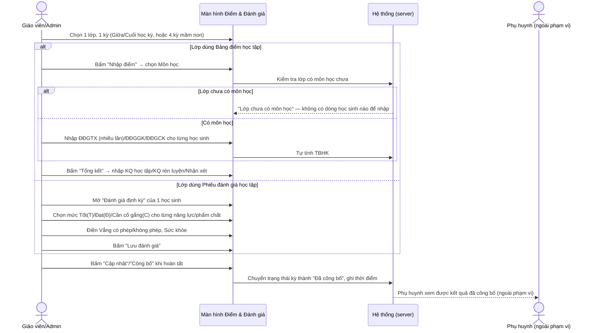
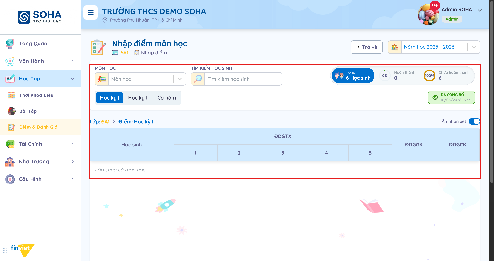
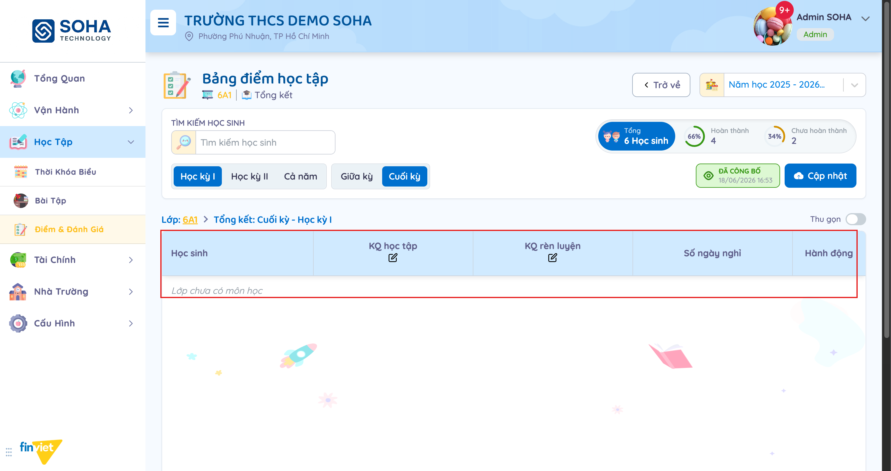
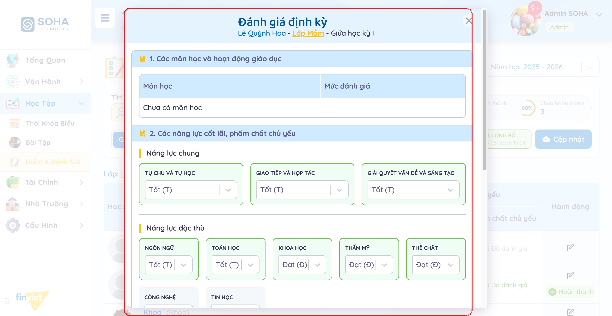
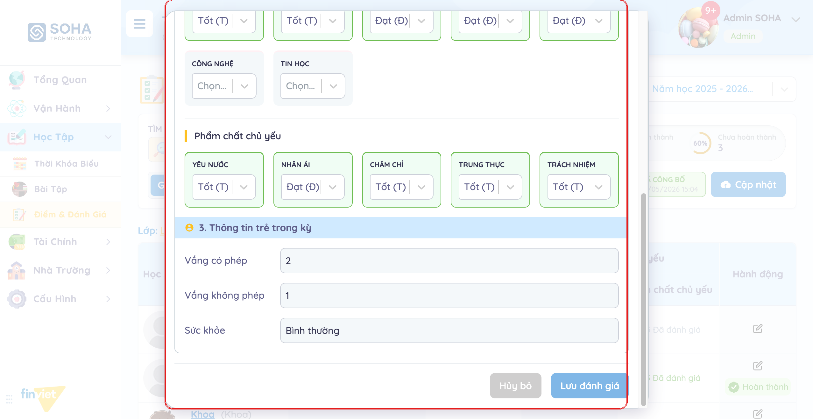
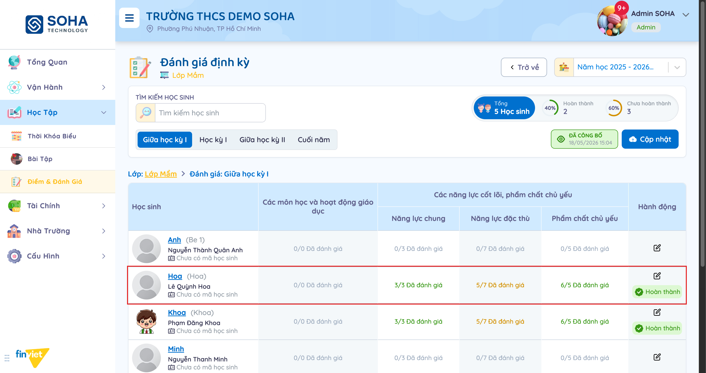
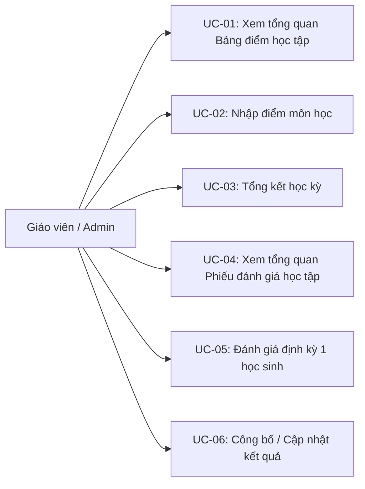
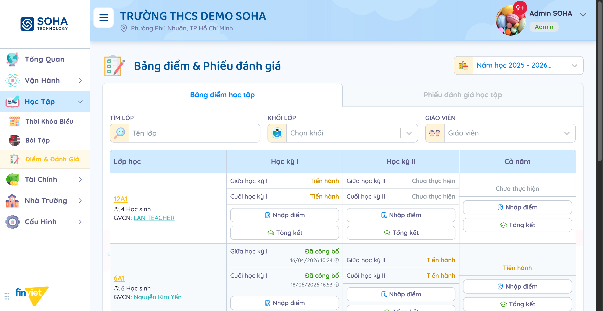
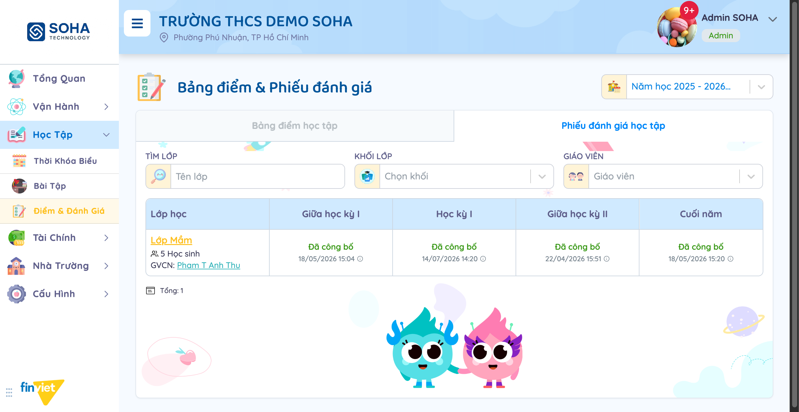

# Tên: Điểm & Đánh Giá (Học tập)

## Mục lục
- [1. Thông tin tổng quan](#1-thông-tin-tổng-quan)
  - [1.1 Giới thiệu chung](#11-giới-thiệu-chung)
  - [1.2 Mục tiêu](#12-mục-tiêu)
  - [1.3 Phạm vi](#13-phạm-vi)
  - [1.4 Tài liệu tham khảo](#14-tài-liệu-tham-khảo)
- [2. Tổng quan nghiệp vụ](#2-tổng-quan-nghiệp-vụ)
  - [2.1 Đối tượng](#21-đối-tượng)
  - [2.2 Luồng nghiệp vụ](#22-luồng-nghiệp-vụ)
  - [2.3 Nguyên tắc nghiệp vụ](#23-nguyên-tắc-nghiệp-vụ)
- [3. Đặc tả tính năng](#3-đặc-tả-tính-năng)
  - [3.1 Phân rã chức năng](#31-phân-rã-chức-năng)
  - [3.2 Acceptance Criteria](#32-acceptance-criteria)
  - [3.3 Use case](#33-use-case)
  - [3.4 Edge Cases & Error Handling](#34-edge-cases--error-handling)
  - [3.5 Non-functional Requirements](#35-non-functional-requirements)
  - [3.6 Quy ước UI chung](#36-quy-ước-ui-chung)

## 1. Thông tin tổng quan

### 1.1 Giới thiệu chung
Điểm & Đánh Giá quản lý kết quả học tập của học sinh theo từng lớp, theo 2 hình thức song song tuỳ loại lớp: **"Bảng điểm học tập"** (bảng điểm số truyền thống — dùng cho các lớp phổ thông và một phần lớp mầm non trong dữ liệu demo) và **"Phiếu đánh giá học tập"** (phiếu đánh giá theo mức Tốt/Đạt/Cần cố gắng — dùng cho lớp mầm non theo Thông tư 51). Mỗi lớp có 4 kỳ đánh giá trong năm, mỗi kỳ đi qua vòng đời Chưa thực hiện → Tiến hành → Đã công bố.

### 1.2 Mục tiêu
- Theo dõi tiến độ nhập điểm/đánh giá của cả trường theo lưới Lớp học × Học kỳ I/II/Cả năm (hoặc Lớp học × 4 kỳ đối với mầm non), với trạng thái Chưa thực hiện/Tiến hành/Đã công bố cho từng kỳ.
- Nhập điểm từng môn học cho từng học sinh (ĐĐGTX nhiều lần, ĐĐGGK, ĐĐGCK, tự tính TBHK) ở lớp phổ thông.
- Đánh giá định kỳ theo 3 nhóm tiêu chí (môn học, năng lực cốt lõi + phẩm chất, thông tin vắng/sức khỏe) theo thang Tốt (T)/Đạt (Đ)/Cần cố gắng (C) ở lớp mầm non.
- Tổng kết kết quả học tập + rèn luyện cuối mỗi học kỳ, kèm nhận xét, rồi công bố cho phụ huynh.
- Lọc nhanh theo tên lớp, khối lớp, giáo viên chủ nhiệm, và theo năm học.

### 1.3 Phạm vi
| In scope | Out of scope |
|---|---|
| Xem lưới tổng quan "Bảng điểm học tập" (4 lớp) và "Phiếu đánh giá học tập" (1 lớp — Lớp Mầm), lọc theo tên lớp/khối/giáo viên, đổi năm học | Nhập điểm/lưu đánh giá thật cho bất kỳ học sinh nào — mọi lớp phổ thông (12A1, 6A1, cả lớp "Lá" dù dùng bảng điểm số) đều hiển thị "Lớp chưa có môn học", chặn hoàn toàn việc nhập điểm theo môn |
| Mở trang "Nhập điểm môn học" và "Tổng kết" của 1 lớp phổ thông, quan sát cấu trúc bảng điểm (ĐĐGTX/ĐĐGGK/ĐĐGCK/TBHK) dù rỗng | Xác nhận nguyên nhân "Môn học" luôn rỗng — cùng hiện tượng đã ghi nhận ở [Bài Tập](bai-tap.md) và [Thời Khóa Biểu](thoi-khoa-bieu.md), nghi ngờ do cấu hình môn học ở phạm vi khác, ngoài tài liệu này |
| Mở modal "Đánh giá định kỳ" của 1 học sinh lớp mầm non (Lớp Mầm) với dữ liệu thật đã điền — đây là dữ liệu đầy đủ nhất quan sát được trong cả 3 module Học Tập | Sửa/lưu 1 đánh giá thật — chỉ mở modal quan sát, không bấm "Lưu đánh giá" để tránh đổi dữ liệu mẫu (nút cũng đang bị khoá vì chưa có thay đổi) |
| Nhận biết bộ trạng thái kỳ (Chưa thực hiện/Tiến hành/Đã công bố) và nút "Cập nhật" khi đã công bố | Xác nhận hành vi đầy đủ của nút "Cập nhật"/"Công bố" — không bấm để tránh đổi trạng thái công bố của dữ liệu mẫu |
| Ghi nhận tỉ lệ Hoàn thành/Chưa hoàn thành ở cả 2 hình thức, kể cả khi mẫu số liệu có nghi vấn (xem BR07) | Xác nhận vì sao lớp "Lá" và "Lớp 1A7" xuất hiện ở "Bảng điểm học tập" (số) trong khi "Lớp Mầm" lại xuất hiện ở "Phiếu đánh giá học tập" (mức) — cả 3 đều là lớp mầm non theo tên, có thể là lựa chọn cấu hình riêng từng lớp ngoài phạm vi tài liệu này |

### 1.4 Tài liệu tham khảo
- [docs/operating-portal/00-inventory.md](../00-inventory.md) — kiểm kê toàn bộ module Phase 1; mô tả ban đầu "Gradebook / evaluation sheets, browsable by grade level and class" — xác nhận đúng cả 2 hình thức bảng điểm số và phiếu đánh giá theo mức.
- [docs/operating-portal/hoc-tap/bai-tap.md](bai-tap.md), [docs/operating-portal/hoc-tap/thoi-khoa-bieu.md](thoi-khoa-bieu.md) — 2 module liền kề cùng Học Tập; cả 3 module đều gặp chung hiện tượng "Môn học" không có dữ liệu trong trường demo này, chặn phần thao tác cần chọn môn học cụ thể (đây là lần thứ 3 quan sát được cùng một khoảng trống dữ liệu xuyên suốt cả nhóm module Học Tập).

## 2. Tổng quan nghiệp vụ

### 2.1 Đối tượng
| Actor | Vai trò | Trách nhiệm chính |
|---|---|---|
| Giáo viên / Admin trường | Người nhập điểm/đánh giá | Nhập điểm theo môn hoặc đánh giá theo mức, viết nhận xét, tổng kết, công bố |
| Học sinh | Đối tượng được đánh giá | Không tương tác trực tiếp với module này |
| Phụ huynh | Người xem kết quả (ngoài phạm vi portal này) | Nhận thông báo/xem bảng điểm-phiếu đánh giá khi đã công bố — không quan sát trực tiếp được từ tài khoản Admin |
| Hệ thống (server) | Validate + tính toán + lưu trữ | Tự tính tỉ lệ Hoàn thành/Chưa hoàn thành theo kỳ; chặn nhập điểm theo môn khi lớp chưa có môn học; ghi thời điểm công bố |

### 2.2 Luồng nghiệp vụ

#### 2.2.1 Mô hình hóa nghiệp vụ

#### 2.2.2 Mô tả các bước nghiệp vụ
| Bước | Người thực hiện | Mô tả | Kết quả |
|---|---|---|---|
| 1 | Giáo viên/Admin | Vào Học Tập → Điểm & Đánh Giá, chọn tab "Bảng điểm học tập" hoặc "Phiếu đánh giá học tập" | Thấy lưới Lớp học × các kỳ, mỗi ô có trạng thái + nút hành động |
| 2 | Giáo viên/Admin | Bấm "Nhập điểm" (bảng điểm) hoặc mở "Đánh giá định kỳ" của 1 học sinh (phiếu đánh giá) | Mở trang/modal nhập chi tiết cho đúng lớp + đúng kỳ |
| 3a | Giáo viên/Admin | (Bảng điểm) Chọn Môn học, nhập ĐĐGTX/ĐĐGGK/ĐĐGCK | Nếu lớp chưa có môn học, không có dòng nào để nhập ("Lớp chưa có môn học") |
| 3b | Giáo viên/Admin | (Phiếu đánh giá) Chọn mức cho từng năng lực chung/đặc thù/phẩm chất, điền vắng/sức khỏe | Số "Đã đánh giá" trên danh sách tăng theo số mục đã chọn mức |
| 4 | Giáo viên/Admin | Bấm "Tổng kết" (bảng điểm): nhập KQ học tập/KQ rèn luyện + Nhận xét | Tính lại tỉ lệ Hoàn thành/Chưa hoàn thành của lớp |
| 5 | Giáo viên/Admin | Bấm "Công bố"/"Cập nhật" | Trạng thái kỳ chuyển "Đã công bố" kèm thời điểm; có thể "Cập nhật" lại sau khi đã công bố |

### 2.3 Nguyên tắc nghiệp vụ
| ID | Nguyên tắc nghiệp vụ |
|---|---|
| BR01 | Có 2 hình thức đánh giá độc lập, chọn qua 2 tab ở đầu trang: **"Bảng điểm học tập"** (bảng điểm số, cột Học kỳ I/Học kỳ II/Cả năm, mỗi cột lại tách Giữa học kỳ/Cuối học kỳ) và **"Phiếu đánh giá học tập"** (phiếu theo mức, cột Giữa học kỳ I/Học kỳ I/Giữa học kỳ II/Cuối năm). Trong dữ liệu demo, "Bảng điểm học tập" có 4 lớp (12A1, 6A1, Lá, Lớp 1A7); "Phiếu đánh giá học tập" chỉ có 1 lớp (Lớp Mầm) — dù "Lá" và "Lớp Mầm" đều là lớp mầm non theo tên, chúng lại thuộc 2 hình thức khác nhau. |
| BR02 | Mỗi kỳ có 3 trạng thái: **Chưa thực hiện**, **Tiến hành**, **Đã công bố** (kèm thời điểm công bố). Mỗi ô kỳ có 2 nút "Nhập điểm" và "Tổng kết" (bảng điểm) dẫn tới 2 trang riêng cùng 1 lớp/kỳ. |
| BR03 | Trang "Nhập điểm môn học" (bảng điểm) yêu cầu chọn "Môn học" trước khi hiện bảng nhập; bảng có các cột **ĐĐGTX** (nhiều lần, đánh số 1-5), **ĐĐGGK**, **ĐĐGCK**, **TBHK** (tự tính), cùng toggle "Ẩn nhận xét". Trong toàn bộ dữ liệu demo, dropdown "Môn học" của mọi lớp phổ thông đều rỗng và bảng hiện **"Lớp chưa có môn học"** — kể cả lớp 6A1 mà kỳ đó đã "ĐÃ CÔNG BỐ" (16/04/2026, 18/06/2026).  |
| BR04 | Trang "Tổng kết" (bảng điểm) có cột **KQ học tập**, **KQ rèn luyện** (mỗi cột có icon bút để bật chế độ sửa nhanh hàng loạt, hiện nút ✓/✗), **Số ngày nghỉ**, và khung "Nhận xét" riêng. Cùng bị chặn bởi "Lớp chưa có môn học" — không có dòng học sinh nào để tổng kết dù tỉ lệ Hoàn thành/Chưa hoàn thành ở trên vẫn hiển thị số liệu (xem BR07).  |
| BR05 | Modal/trang "Đánh giá định kỳ" (phiếu đánh giá — lớp mầm non) chia 3 phần: **(1) Các môn học và hoạt động giáo dục** (Môn học + Mức đánh giá — cũng luôn "Chưa có môn học" như bảng điểm); **(2) Các năng lực cốt lõi, phẩm chất chủ yếu** — 3 nhóm cố định: Năng lực chung (3 mục: Tự chủ và tự học, Giao tiếp và hợp tác, Giải quyết vấn đề và sáng tạo), Năng lực đặc thù (7 mục: Ngôn ngữ, Toán học, Khoa học, Thẩm mỹ, Thể chất, Công nghệ, Tin học), Phẩm chất chủ yếu (5 mục: Yêu nước, Nhân ái, Chăm chỉ, Trung thực, Trách nhiệm) — mỗi mục chọn 1 trong 3 mức; **(3) Thông tin trẻ trong kỳ** (Vắng có phép, Vắng không phép, Sức khỏe — nhập tay).   |
| BR06 | Thang đánh giá 3 mức cố định cho mọi năng lực/phẩm chất: **Tốt (T)**, **Đạt (Đ)**, **Cần cố gắng (C)**. |
| BR07 | Bộ đếm "Đã đánh giá" trên danh sách "Đánh giá định kỳ" hiển thị dạng x/y (y là tổng số mục cố định — 3 cho Năng lực chung, 7 cho Năng lực đặc thù, 5 cho Phẩm chất chủ yếu). Đã quan sát được lỗi đếm thật: 1 học sinh có đúng 5 mục Phẩm chất chủ yếu (Yêu nước/Nhân ái/Chăm chỉ/Trung thực/Trách nhiệm) đều đã chọn mức, nhưng bộ đếm hiển thị **"6/5 Đã đánh giá"** — vượt quá tổng số mục có thể có. Học sinh này vẫn được đánh dấu **"Hoàn thành"** ở cột Hành động dù Năng lực đặc thù mới đạt 5/7 (Công nghệ, Tin học còn "Chọn..." chưa chọn mức) — cho thấy "Hoàn thành" không yêu cầu 100% mọi mục đã chọn mức.  |
| BR08 | Khi 1 kỳ đã "Đã công bố", nút hành động đổi tên từ (ngụ ý) "Công bố" thành **"Cập nhật"** — vẫn cho sửa/lưu lại sau khi đã công bố, không khoá vĩnh viễn. |
| BR09 | "Lọc mở rộng" ở cả 2 tab dùng chung bộ 3 trường: "TÌM LỚP" (tên lớp), "KHỐI LỚP" (Chọn khối), "GIÁO VIÊN" (giáo viên chủ nhiệm) — không có trường lọc riêng theo trạng thái công bố. |
| BR10 | Trường "Năm học" ở góc phải trên cùng có 4 lựa chọn trong dữ liệu demo: "Năm học 2024 - 2025", "Năm học 2025 - 2026" (Hiện tại), "Kỳ 1 năm học 2026 - 2027", và 1 mục tên **"Test"** — mục "Test" là dữ liệu thử nghiệm còn sót lại trong môi trường demo, không phải năm học thật. |

## 3. Đặc tả tính năng

### 3.1 Phân rã chức năng
| Feature | Platform | Priority | User Story |
|---|---|---|---|
| Xem lưới tổng quan theo lớp × kỳ, lọc theo lớp/khối/giáo viên | Web | Must | Là giáo viên, tôi muốn biết ngay lớp nào đã nhập điểm, lớp nào chưa |
| Nhập điểm theo môn học (ĐĐGTX/ĐĐGGK/ĐĐGCK) | Web | Must | Là giáo viên, tôi muốn nhập điểm từng môn cho học sinh trong lớp |
| Tổng kết học kỳ (KQ học tập/rèn luyện + nhận xét) | Web | Must | Là giáo viên, tôi muốn tổng kết kết quả cuối kỳ trước khi công bố |
| Đánh giá định kỳ theo mức (năng lực/phẩm chất) — lớp mầm non | Web | Must | Là giáo viên mầm non, tôi muốn đánh giá trẻ theo các mức Tốt/Đạt/Cần cố gắng |
| Công bố / cập nhật kết quả đã công bố | Web | Must | Là giáo viên, tôi muốn công bố kết quả cho phụ huynh xem và có thể sửa lại sau đó |

### 3.2 Acceptance Criteria
| User Story | Chức năng | Acceptance Criteria |
|---|---|---|
| Nhập điểm theo môn học | Trang Nhập điểm | Lớp phải có ít nhất 1 môn học được cấu hình mới hiện được dòng học sinh để nhập điểm — dữ liệu demo hiện tại luôn thiếu nên bảng luôn rỗng |
| Đánh giá định kỳ | Modal Đánh giá định kỳ | Mỗi mục năng lực/phẩm chất chọn đúng 1 trong 3 mức Tốt/Đạt/Cần cố gắng; bộ đếm "Đã đánh giá" phải khớp đúng số mục đã chọn trên tổng số mục cố định (hiện đang lệch — xem BR07) |
| Công bố kết quả | Nút Cập nhật/Công bố | Bấm công bố → trạng thái kỳ chuyển "Đã công bố" kèm thời điểm; bấm lại sau đó ("Cập nhật") vẫn cho sửa |
| Lọc lớp | Bộ lọc TÌM LỚP/KHỐI LỚP/GIÁO VIÊN | Nhập bất kỳ tiêu chí nào → lưới chỉ còn hiện đúng lớp khớp |

### 3.3 Use case

**UC-01**
| Trường | Nội dung |
|---|---|
| Use case ID | UC-01 |
| Use case name | Xem tổng quan Bảng điểm học tập |
| Use case description | Giáo viên/Admin xem lưới Lớp học × Học kỳ I/II/Cả năm, biết lớp nào đã/chưa nhập điểm |
| Actor | Giáo viên / Admin |
| Happy path | 1. Vào Học Tập → Điểm & Đánh Giá — tab "Bảng điểm học tập" mặc định. 2. (Tuỳ chọn) Gõ "TÌM LỚP", chọn "KHỐI LỚP" hoặc "GIÁO VIÊN".  3. Đọc từng ô: trạng thái Giữa/Cuối học kỳ (Chưa thực hiện/Tiến hành/Đã công bố + thời điểm), 2 nút "Nhập điểm"/"Tổng kết". |
| Exception | Không quan sát được |
| Trigger | Vào trang Điểm & Đánh Giá |
| Pre-condition | Không có |
| Post-condition | Lưới hiển thị đúng năm học/bộ lọc đang chọn |
| Business Rules | BR01, BR02, BR09, BR10 |

**UC-02**
| Trường | Nội dung |
|---|---|
| Use case ID | UC-02 |
| Use case name | Nhập điểm môn học |
| Use case description | Giáo viên/Admin nhập điểm ĐĐGTX/ĐĐGGK/ĐĐGCK cho học sinh 1 lớp phổ thông |
| Actor | Giáo viên / Admin |
| Happy path | 1. Ở ô 1 kỳ của 1 lớp, bấm "Nhập điểm". 2. Chọn "Môn học" ở bộ lọc trên cùng. 3. Nhập điểm cho từng học sinh theo cột ĐĐGTX (1-5)/ĐĐGGK/ĐĐGCK — TBHK tự tính (không thực hiện được trong phiên khảo sát). |
| Exception | Dropdown "Môn học" không có lựa chọn nào — bảng luôn hiện "Lớp chưa có môn học", chặn hoàn toàn việc nhập điểm dù kỳ đó ở trạng thái nào.  |
| Trigger | Bấm nút "Nhập điểm" trên 1 ô kỳ |
| Pre-condition | Không có |
| Post-condition | [Cần xác nhận] — không nhập được do thiếu Môn học trong toàn bộ dữ liệu demo |
| Business Rules | BR03 |

**UC-03**
| Trường | Nội dung |
|---|---|
| Use case ID | UC-03 |
| Use case name | Tổng kết học kỳ |
| Use case description | Giáo viên/Admin tổng kết KQ học tập/rèn luyện và nhận xét cuối kỳ cho 1 lớp phổ thông |
| Actor | Giáo viên / Admin |
| Happy path | 1. Ở ô 1 kỳ của 1 lớp, bấm "Tổng kết". 2. Chọn tab "Giữa kỳ"/"Cuối kỳ". 3. Nhập/sửa "KQ học tập", "KQ rèn luyện" cho từng học sinh, viết "Nhận xét" — không thực hiện trong phiên khảo sát. |
| Exception | Bảng học sinh luôn hiện "Lớp chưa có môn học" — dù tỉ lệ "Hoàn thành/Chưa hoàn thành" ở đầu trang vẫn hiển thị số liệu tính sẵn (66%/34% với 6A1), tạo cảm giác mâu thuẫn giữa bảng rỗng và số liệu đã có.  |
| Trigger | Bấm nút "Tổng kết" trên 1 ô kỳ |
| Pre-condition | Không có |
| Post-condition | [Cần xác nhận] — không sửa được do bảng luôn trống |
| Business Rules | BR04, BR07 |

**UC-04**
| Trường | Nội dung |
|---|---|
| Use case ID | UC-04 |
| Use case name | Xem tổng quan Phiếu đánh giá học tập |
| Use case description | Giáo viên/Admin xem lưới lớp mầm non theo 4 kỳ (Giữa học kỳ I/Học kỳ I/Giữa học kỳ II/Cuối năm) |
| Actor | Giáo viên / Admin |
| Happy path | 1. Chuyển tab "Phiếu đánh giá học tập". 2. Đọc trạng thái từng kỳ của lớp (chỉ 1 lớp — Lớp Mầm — trong dữ liệu demo).  3. Bấm vào nút trạng thái 1 kỳ để mở danh sách học sinh của kỳ đó. |
| Exception | Không quan sát được |
| Trigger | Bấm tab "Phiếu đánh giá học tập" |
| Pre-condition | Không có |
| Post-condition | Lưới hiển thị đúng bộ lọc |
| Business Rules | BR01, BR02 |

**UC-05**
| Trường | Nội dung |
|---|---|
| Use case ID | UC-05 |
| Use case name | Đánh giá định kỳ 1 học sinh |
| Use case description | Giáo viên/Admin đánh giá 1 học sinh mầm non theo mức Tốt/Đạt/Cần cố gắng cho từng năng lực/phẩm chất |
| Actor | Giáo viên / Admin |
| Happy path | 1. Trong danh sách đánh giá của 1 kỳ, bấm icon sửa (hoặc tên) của 1 học sinh. 2. Xem/chọn mức cho từng mục Năng lực chung (3), Năng lực đặc thù (7), Phẩm chất chủ yếu (5).  3. Cuộn xuống điền "Vắng có phép"/"Vắng không phép"/"Sức khỏe".  4. Bấm "Lưu đánh giá" (không thực hiện trong phiên khảo sát; nút cũng đang khoá vì chưa sửa gì). |
| Exception | Mục "Các môn học và hoạt động giáo dục" luôn hiện "Chưa có môn học" — cùng hiện tượng thiếu Môn học như bảng điểm phổ thông |
| Trigger | Bấm vào 1 dòng học sinh trong danh sách đánh giá |
| Pre-condition | Không có |
| Post-condition | [Cần xác nhận] — chưa bấm Lưu để xác nhận |
| Business Rules | BR05, BR06, BR07 |

**UC-06**
| Trường | Nội dung |
|---|---|
| Use case ID | UC-06 |
| Use case name | Công bố / Cập nhật kết quả |
| Use case description | Giáo viên/Admin công bố kết quả 1 kỳ cho phụ huynh xem, hoặc cập nhật lại sau khi đã công bố |
| Actor | Giáo viên / Admin |
| Happy path | [Cần xác nhận] — xác nhận được nút đổi thành "Cập nhật" sau khi đã "Đã công bố" (BR08), nhưng không bấm thật để tránh đổi trạng thái công bố của dữ liệu mẫu. |
| Exception | Không quan sát được |
| Trigger | Bấm nút "Công bố"/"Cập nhật" ở trang Nhập điểm/Tổng kết/Đánh giá định kỳ |
| Pre-condition | Không có |
| Post-condition | [Cần xác nhận] |
| Business Rules | BR08 |

### 3.4 Edge Cases & Error Handling

#### 3.4.1 Tổng quan
| Nhóm | Tình huống | Xử lý mong đợi |
|---|---|---|
| Không nhập được điểm/đánh giá theo môn | Mở trang Nhập điểm/Tổng kết/phần 1 Đánh giá định kỳ của bất kỳ lớp nào | "Môn học" luôn rỗng ("Chưa có môn học") — chặn hoàn toàn phần liên quan tới môn học, kể cả ở lớp đã "Đã công bố" |
| Bộ đếm "Đã đánh giá" vượt tổng | Xem danh sách Đánh giá định kỳ của Lớp Mầm | Hiển thị "6/5 Đã đánh giá" cho 1 học sinh có đúng 5/5 mục đã chọn mức — lỗi đếm thật, [Cần xác nhận] nguyên nhân |
| "Hoàn thành" không đòi hỏi 100% | So sánh cột Hành động với các cột "Đã đánh giá" | 1 học sinh mới 5/7 Năng lực đặc thù vẫn được đánh dấu "Hoàn thành" — tiêu chí hoàn thành không yêu cầu mọi mục đều đã chọn mức |
| Số liệu tổng hợp không khớp bảng chi tiết | Trang Tổng kết của lớp phổ thông | Tỉ lệ Hoàn thành/Chưa hoàn thành ở đầu trang có số liệu cụ thể trong khi bảng chi tiết bên dưới hoàn toàn trống ("Lớp chưa có môn học") |
| Dữ liệu Năm học không hợp lệ | Mở dropdown "Năm học" | Xuất hiện 1 mục tên "Test" lẫn giữa các năm học thật — rác dữ liệu demo |

#### 3.4.2 Danh sách Thông báo (lỗi/thành công)
| Message ID | Trường hợp lỗi | Rule kiểm tra | Message đề xuất | Hình thức báo | Hành vi hệ thống |
|---|---|---|---|---|---|
| — | Lớp chưa được cấu hình môn học nhưng vào trang Nhập điểm/Tổng kết/Đánh giá định kỳ | Danh sách môn học của lớp trống | "Lớp chưa có môn học" | Chữ nghiêng xám thay cho toàn bộ dòng dữ liệu trong bảng | Ẩn hoàn toàn khu vực nhập liệu theo môn, không chặn phần khác của trang (vẫn xem được số liệu tổng hợp, nhận xét...) |

### 3.5 Non-functional Requirements
| ID | Nhóm | Yêu cầu |
|---|---|---|
| NFR01 | Hiệu năng | Đổi tab Bảng điểm/Phiếu đánh giá, đổi Giữa kỳ/Cuối kỳ cập nhật ngay không cần tải lại trang |
| NFR02 | Ngôn ngữ | Giao diện tiếng Việt hoàn toàn, dùng đúng thuật ngữ Thông tư (ĐĐGTX, ĐĐGGK, ĐĐGCK, TBHK, Tốt/Đạt/Cần cố gắng) |
| NFR03 | Minh bạch | Mỗi kỳ ghi rõ thời điểm công bố; vẫn cho "Cập nhật" sau khi công bố thay vì khoá vĩnh viễn |

### 3.6 Quy ước UI chung
- Cùng 1 khung "Năm học" + bộ lọc (TÌM LỚP/KHỐI LỚP/GIÁO VIÊN) dùng chung cho cả 2 tab "Bảng điểm học tập" và "Phiếu đánh giá học tập" — chỉ khác cấu trúc cột kỳ học và nút hành động bên trong lưới.
- Trạng thái kỳ dùng chung 3 màu xuyên suốt: xám (Chưa thực hiện), cam/vàng (Tiến hành), xanh lá kèm icon mắt (Đã công bố) — nhất quán với cách Thời Khóa Biểu và Bài Tập dùng màu trạng thái tương tự cho Bản nháp/Đang xử lý/Đã hoàn tất.
- Bảng dữ liệu trống hiển thị 1 dòng chữ nghiêng xám căn giữa ("Lớp chưa có môn học") thay vì để trắng hoàn toàn — nhất quán với "Chưa có bài tập"/"Chưa có thảo luận" ở module Bài Tập.
- Modal đánh giá dùng chung bố cục toàn hệ thống: nút hành động chính bên phải, "Hủy bỏ" xám bên trái, cuộn nội bộ khi nội dung dài hơn khung nhìn.
